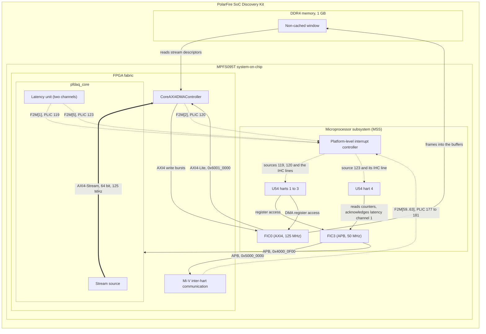

# pfdaq

**A measured, reproducible hardware/software system on the Microchip PolarFire SoC Discovery Kit: an FPGA data source, a DMA path into DDR, Linux on three RISC-V cores, and a real-time supervisor on the fourth.**

pfdaq generates framed test data in the FPGA fabric, moves it into memory with a DMA controller, verifies every frame under Linux, and has an independent program on a separate core watch that Linux keeps up. Every part can be made to fail on purpose, and every claim on this page points at a recorded result.

It is also a way to learn. Each technique the system uses is written up as a separate module that you can read, and usually run, without understanding the rest.

## Two ways in

| | |
|---|---|
| **Learn a concept** | Pick one topic, such as AXI4-Stream, DMA descriptors, clock-domain crossing or interrupt latency, and work through it on its own. Start with the [module catalog](docs/modules/README.md) or the [learning path](docs/learning-path.md). Many modules need only a simulator. |
| **Explore the system** | See the whole design and follow a burst, an interrupt or the boot sequence through it, component by component. Start with [the system page](docs/system/README.md). |

The two are the same material. Every module says where it sits in the system, and every component lists the modules that explain it.

## The system

<!-- arch:begin (generated by tools/gen_docs.py from docs/system/architecture.yaml; do not edit) -->

<!-- arch:end -->

| Core | Runs | Mode |
|---|---|---|
| E51 | Hart Software Services: boot monitor | machine |
| U54 1 to 3 | Linux 6.18 (Yocto), which configures the fabric, captures and verifies | supervisor |
| U54 4 | pfdaq supervisor on FreeRTOS, or the same source on bare metal | machine |

The fabric holds the vendor reference design plus about 1,200 lines of project RTL: a stream source with three payload types, fault injection and a real-time mode, and a two-channel timer that measures how long software takes to answer an interrupt.

## Verified results

All on one board, fabric v0.5.1 unless a row says otherwise. Each links to its record; [`evidence/`](evidence) holds the conditions for every entry.

| Result | Value | Kind | Record |
|---|---|---|---|
| Functional tests, from a freshly written SD card | 27 of 27 pass | board | [suite](evidence/v0.5.1/board/suite-fresh-card.md) |
| Same supervisor on bare metal instead of FreeRTOS | 8 of 8 pass | board | [suite](evidence/v0.5.1/board/suite-baremetal.md) |
| Warm reboots with both systems up and a supervised capture passing | 30 of 30 | board | [log](evidence/v0.5.1/board/reboot-30.csv) |
| Injected faults (CRC, sequence, payload) detected, three payload types | all, exactly | board | [suite](evidence/v0.5.1/board/suite-freertos.md) |
| Verified end-to-end throughput, 1 MiB bursts | 29.6 MB/s counter, 28.1 MB/s PRBS, 8.7 MB/s FIR | board | [raw](evidence/v0.5.1/board/suite-freertos.jsonl) |
| Fabric-side throughput into DDR | 931 to 947 MB/s (**fabric v0.3.0**) | board | [log](evidence/v0.3.0/board/suite-python-x3.txt) |
| Ten-minute supervised soak | 17.8 GB, 0 errors (**fabric v0.3.0**, counter payload) | board | [json](evidence/v0.3.0/board/soak-10min.json) |
| Timing closure and size | met in all corners; 24,334 logic elements, 26 % | build | [extract](evidence/v0.5.1/build/timing-and-utilisation.txt) |
| RTL simulation | 20 stream scenarios and 4 latency phases pass against independent models | simulation | [stream](evidence/v0.5.1/sim/stream.txt), [latency](evidence/v0.5.1/sim/latency.txt) |

Interrupt-to-acknowledge latency, 100,000 events each, board idle, measured by the fabric with 20 ns resolution:

| Who answers | Typical | Worst seen | Events missed |
|---|---|---|---|
| Bare-metal handler on hart 4 | 0.50 µs | 3.1 µs | 0 |
| FreeRTOS handler on hart 4 | 0.52 µs | 2.1 µs | 0 |
| FreeRTOS task on hart 4 | 2.0 µs | 11.7 µs | 0 |
| Linux kernel handler | 4.4 µs | 1.3 ms | 6 |
| Linux user space | 78 µs | 5.1 ms | 89 |

The gap between 940 MB/s in the fabric and 30 MB/s verified is one Linux core copying and checking every word. Where the time goes is the subject of a module of its own.

### Known issues

- **Odd frame lengths in multi-frame bursts corrupt data** at 2 KB boundaries. The stream is correct in simulation; the cause is not found. The capture tool refuses the case unless told otherwise.
- **Linux can stop the real-time core but not restart it.** The boot monitor rejects the request. Recovery is a reboot.
- One board, one unit: nothing here has been repeated on a second Discovery Kit.

## Try it in a minute

No board and no vendor tools needed:

```sh
sudo apt install iverilog python3 python3-yaml make
make -C hw sim
```

This runs both testbenches. A separate Python model recomputes every frame and decides whether the hardware was right. Then read [AXI4-Stream: the handshake, backpressure and TLAST](docs/modules/H02-axi4-stream.md) and break the handshake on purpose.

## Repository layout

| Directory | Content |
|---|---|
| [`hw/`](hw) | Project RTL, testbenches with their Python models, and the Libero overlay that adds them to the vendor reference design |
| [`firmware/`](firmware) | The hart 4 supervisor: one source for FreeRTOS and bare metal, applied on top of Microchip's examples |
| [`yocto/meta-pfdaq/`](yocto/meta-pfdaq) | Yocto layer: machine, boot payload, device tree, Linux tools (`pfdaq_cap`, `pfdaq_lat`) and the `pfdaq_uio` kernel driver |
| [`tests/`](tests) | Board test suites and the host scripts that drive and summarise them |
| [`experiments/`](experiments) | Small standalone programs that go with individual modules |
| [`evidence/`](evidence) | Recorded results, with a manifest stating command, conditions and kind for each |
| [`docs/`](docs) | Modules, concepts, case studies, the system description and reference material |
| [`tools/`](tools) | Documentation generator and consistency check |

Vendor code is fetched at build time, not copied: see [NOTICE.md](NOTICE.md).

## Building the real thing

You need the board, Libero SoC 2026.1 with a licence, and about 25 GB of disk for the Yocto build. Exact versions are in [VERSIONS.md](VERSIONS.md).

```sh
hw/libero/build.sh 6                  # fabric: reference design v2026.04 + overlay, about 40 minutes
hw/libero/program.sh build/libero/PFDAQ_dv6.job    # FABRIC and SNVM only; the boot flash is never written
# Linux image: add yocto/meta-pfdaq to a meta-mchp Scarthgap build, then
MACHINE=mpfs-disco-kit-amp bitbake mchp-base-image
```

Write the image to an SD card, boot, and run `tests/board/pfdaq_final_suite.sh` on the board.

## Documentation

- [Architecture as built](docs/architecture.md): register maps, frame format, DMA rules, RPMsg protocol, risks
- [Design decisions](docs/decisions.md): what was chosen, what was rejected and why
- [Validation plan and results](docs/validation-plan.md)
- [Versions and compatibility](VERSIONS.md), [changelog](CHANGELOG.md)
- [Writing guide](docs/writing-guide.md) and [contributing](CONTRIBUTING.md)

## Licence

Code and RTL: MIT. The kernel module: GPL-2.0. Documentation and recorded results: CC BY 4.0. Third-party components and what is not redistributed: [NOTICE.md](NOTICE.md).

This is an independent project. It is not affiliated with or endorsed by Microchip Technology.
