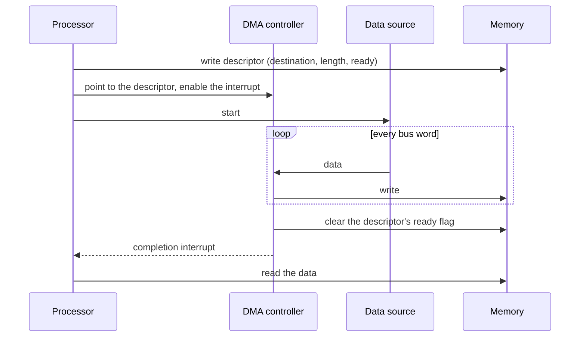

# Direct memory access

Direct memory access (DMA) lets a piece of hardware read or write main memory by itself, without the processor handling each word. This page explains the idea in general terms: what problem it solves, the parts every DMA scheme has, and the costs that are easy to overlook. It needs no board and no tools. The last section points to where each idea appears in this project.

## What it is

A processor can move data between a peripheral and memory in two ways.

**Processor-driven transfer.** The processor reads a word from the peripheral's data register and stores it in memory, then repeats. Every word passes through the processor. The peripheral can deliver data no faster than the processor's loop runs, and while the loop runs that core does nothing else.

**Direct memory access.** The processor describes the transfer once: where the data goes and how much of it there is. A hardware block, the *DMA controller*, then performs the transfer on the memory bus on its own. The processor is told when it is finished.

| | Processor-driven | DMA |
|---|---|---|
| Who moves each word | the processor | the DMA controller |
| Processor work per transfer | proportional to the size | fixed: set up once, handle one completion |
| Rate limit | the processor's loop, plus interrupt or polling overhead | the bus and the memory |
| Extra hardware | none | a controller that can drive the memory bus |
| Extra software concerns | none | buffer placement, caches, completion handling |

A DMA controller is a **bus master**: it issues read and write transactions on the memory bus exactly as a processor would. Everything else about DMA follows from that one fact. Because it is a master, it needs to be told addresses. Because it writes memory behind the processor's back, the processor's caches can be wrong about that memory. Because it is not the processor, nothing stops it from writing where it should not, unless something is put in place to stop it.

## Why it exists

Three reasons, in the order they usually matter.

1. **Throughput.** A data source such as an analogue-to-digital converter, a network interface or a camera produces data continuously. If each word needs a processor instruction sequence, the processor sets the ceiling. A DMA controller moves a full bus word per clock for as long as the memory can take it.
2. **Processor time.** Even when the processor could keep up, a core that spends all its time copying is not available for the work the data is for. With DMA the processor's cost is the same for a transfer of one kilobyte or eight megabytes.
3. **Timing.** A source that cannot wait, such as a converter sampling at a fixed rate, loses data whenever the software is late. A DMA controller responds within clock cycles, every time. Software only has to be on time once per buffer instead of once per word.

DMA is not automatically the right choice. For a few bytes now and then, a status register or a slow serial link, the setup cost exceeds the copy it replaces.

## How it works

### The descriptor

A transfer is described by a small record called a **descriptor**. Its exact layout is specific to each controller, but the content is always the same:

- where the data goes (and, for memory-to-memory transfers, where it comes from);
- how many bytes;
- control flags, such as "this descriptor is ready to be used" and "raise an interrupt when done";
- often, the address of the next descriptor.

Descriptors live either in registers inside the controller or in ordinary memory, in which case the controller is given the address of the first one and reads it over the same bus it uses for data. Keeping them in memory lets software prepare many transfers in advance.

A descriptor is a hand-over point between software and hardware, so ownership matters. Software fills it in, then marks it ready; from that moment it belongs to the controller. The controller clears the ready flag when it has finished, handing it back. Software that changes a descriptor the controller currently owns gets undefined results.

### One transfer, step by step

The order of the first three steps is not a formality. The controller must know where the data goes before the first word arrives. If the source starts first, what happens to the early data depends on the controller, and is rarely what you want.

### Completion

The processor learns that a transfer has ended in one of two ways. It can **poll** a status register or the descriptor's ready flag, which is simple but occupies a core or adds delay. Or the controller raises an **interrupt**, which costs nothing while waiting but adds the interrupt response time to every transfer. For large transfers that time is negligible. For many small ones it dominates, which is the main reason to make buffers larger or to chain descriptors.

A completion signal says the controller has finished. It does not say the data is correct. A transfer can complete with an error flag, or complete normally with data that was already wrong when it arrived.

### Chained and scattered transfers

If each descriptor names a successor, the controller moves on to the next one without the processor. Two common uses:

- **A ring of buffers.** The last descriptor points back to the first. The source runs continuously; software processes each buffer after it fills and marks its descriptor ready again before the controller comes back round to it. If software falls behind, the controller finds a descriptor that is not ready, and the design must define what happens then: stall the source, or drop data and count it.
- **Scatter and gather.** One logical block is spread over several separate memory areas, for example the pages of a buffer that is not contiguous in physical memory.

### Two shapes of transfer

- **Memory to memory.** Both ends are addresses. The controller reads from one and writes to the other. This is a fast copy.
- **Stream to memory** (or memory to stream). One end has no address: data arrives on a streaming interface with a handshake and an end-of-packet marker. The controller writes it to the address in the descriptor. The length is then known in two places, the descriptor's byte count and the packet's end marker, and the two can disagree. Which one the controller obeys is controller-specific and worth finding out early.

## Trade-offs

**Where the buffer lives.** The controller uses *physical* addresses. An application normally sees virtual addresses, and the memory behind them may be scattered, moved or swapped by the operating system. A DMA buffer therefore has to be memory whose physical address is known and fixed: reserved at boot, or allocated through an operating-system interface made for the purpose.

**Caches.** A processor keeps copies of recently used memory in its cache. When a DMA controller writes to memory, the cache does not see it, and the processor may go on reading its old copy. The opposite happens for data the processor wrote and the controller is about to read: it may still be only in the cache. There are three ways to deal with this:

| Approach | Cost |
|---|---|
| Map the buffer without caching | every processor access to it is slow |
| Keep it cached and flush or invalidate around each transfer | extra work per transfer, and a bug if a call is forgotten |
| Hardware that keeps caches and DMA coherent | only available on some systems |

Forgetting this produces the worst kind of fault: stale data that looks plausible, intermittently.

**Alignment.** Controllers move whole bus words. Addresses and lengths that are not multiples of the bus width are either forbidden or handled by slower partial transfers at the ends. Transfers that cross certain address boundaries may be split by the bus protocol. Aligning buffers to the bus width, and preferably to a page, avoids all of it.

**Fixed cost per transfer.** Setting up a descriptor and taking a completion interrupt costs the same for any size. Small transfers are dominated by it. The measured rate of a DMA path therefore depends strongly on the transfer size, and a single headline number means little without it.

**The bottleneck moves.** DMA removes the processor from the transfer. It does not remove it from whatever happens next. If software then copies or checks every byte, that step sets the system's rate, and it is usually far slower than the transfer was.

**Protection.** A bus master with a wrong address corrupts memory silently. Systems that need a guarantee restrict what the controller can reach, with an I/O memory-management unit or bus-level protection. Without one, a correct descriptor is the only safeguard.

**Vendor behaviour.** Descriptor formats, the handling of early or late end-of-packet markers, what happens when a descriptor is not ready, and tolerance for pauses in a stream all differ between controllers and are not always documented. Plan to establish them by test.

## Where to see it here

This project uses one stream-to-memory DMA path. A stream source in the FPGA fabric produces framed test data; a vendor DMA controller, also in the fabric, writes it into DDR; Linux is told by interrupt.

- **Descriptor in memory.** One stream descriptor of three 32-bit words (flags, byte count, destination) sits at the start of a 32 MiB memory window. `arm()` in the capture tool fills it in, writes the flags last, and then gives the controller its address. Only after that is the source started. Module I04 covers the descriptor and the rules this controller follows.
- **Buffer placement and caches.** The window is reserved in the device tree and mapped without caching, the first of the three approaches above, so software always reads what the hardware wrote (module I05). What goes wrong with a cached buffer is the subject of module I08.
- **Completion.** The controller's interrupt reaches Linux, and `wait_done()` blocks until it arrives. It then checks the controller's error flags and that the descriptor's ready flag has been cleared, because the interrupt alone does not prove the transfer ended properly.
- **Real-time mode** keeps four descriptors armed at once and re-arms each after its buffer has been processed: the ring of buffers described above, with drops counted when software falls behind.
- **The bottleneck moves, measured.** On fabric v0.3.0 the fabric's own timestamps put the transfer into DDR at 931 to 947 MB/s for single bursts of 80 KB to 8 MB. On v0.5.1, one U54 core copying those bytes out of the non-cached window, while the DMA fills the next buffer, manages 70.5 MB/s (1 MiB bursts, counter payload), and with every frame also verified the end-to-end rate is 29.6 MB/s. Module P01 takes these layers apart.
- **Vendor behaviour, found by test.** Three case studies come from this one controller: it needs a stream without pauses inside a packet (K03), it does not pick up a descriptor that is armed too late (K04), and an early end-of-packet marker does not end a transfer (K09).

<!-- nav:begin (generated by tools/gen_docs.py from the front matter; do not edit) -->
---

| | |
|---|---|
| **How to run** | No board or tools needed |
| **In the system** | [CoreAXI4DMAController](../system/README.md#dma) · [FIC0 (AXI4, 125 MHz)](../system/README.md#fic0) · [Non-cached window](../system/README.md#ddr-noncached) · [pfdaq_cap](../system/README.md#pfdaq-cap) |
| **Source** | [`yocto/meta-pfdaq/recipes-pfdaq/pfdaq-tools/files/pfdaq_cap.c`](../../yocto/meta-pfdaq/recipes-pfdaq/pfdaq-tools/files/pfdaq_cap.c): `arm`, `wait_done`, `DESC_CFG_ARMED` |
| **Evidence** | [Fabric-side throughput of single bursts, 931 to 947 MB/s](../../evidence/v0.3.0/board/suite-python-x3.txt) (board, fabric v0.3.0, 2026-11-15) [Raw output of the FreeRTOS suite, one JSON object per test](../../evidence/v0.5.1/board/suite-freertos.jsonl) (board, fabric v0.5.1, 2026-11-15) |
| **Related** | [I04 DMA stream descriptors: the rules this core really follows](../modules/I04-dma-stream-descriptors.md) [I05 Buffers the DMA can write: non-cached windows and u-dma-buf](../modules/I05-dma-buffers.md) I08 DMA into cached memory: when you need cache maintenance *(planned)* [P01 Where 940 MB/s becomes 30: throughput layer by layer](../modules/P01-throughput-layers.md) [K03 A DMA core that needs TVALID without gaps](../case-studies/K03-tvalid-gaps.md) [K04 The descriptor that was re-armed too late](../case-studies/K04-descriptor-rearmed-too-late.md) [K09 An early TLAST does not end a transfer](../case-studies/K09-early-tlast.md) |
| **Status** | validated |
<!-- nav:end -->
