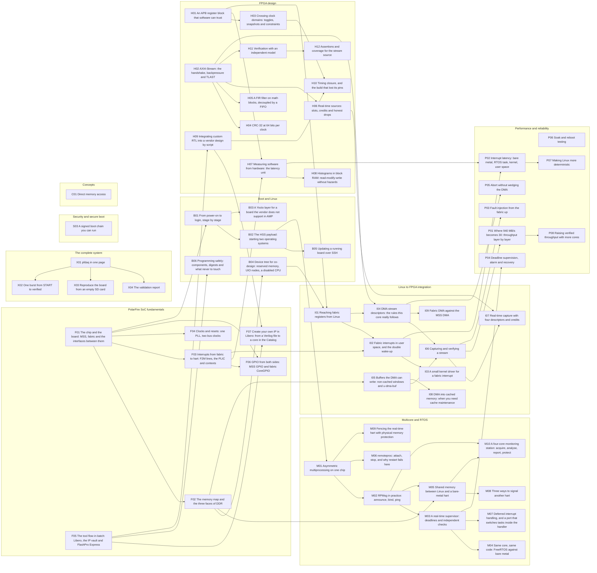

<!-- Generated by tools/gen_docs.py from the page front matter and docs/system/architecture.yaml. Do not edit. -->

# Learning path

Modules are grouped in five levels. Nothing forces an order: every module lists what it needs, and the graph below shows those prerequisites. If you already know a topic, skip it.

## Level 1: fundamentals

- [F01 The chip and the board: MSS, fabric and the interfaces between them](modules/F01-chip-and-board.md). Needs: nothing.
- [F02 The memory map and the three faces of DDR](modules/F02-memory-map-ddr.md). Needs: F01.
- [F05 The tool flow in batch: Libero, the IP vault and FlashPro Express](modules/F05-tool-flow-in-batch.md). Needs: nothing.
- [B01 From power-on to login, stage by stage](modules/B01-power-on-to-login.md). Needs: F01.
- [X01 pfdaq in one page](modules/X01-pfdaq-in-one-page.md). Needs: nothing.
- [C01 Direct memory access](concepts/C01-dma.md). Needs: nothing.

## Level 2: isolated building blocks

- [F03 Interrupts from fabric to hart: F2M lines, the PLIC and contexts](modules/F03-fabric-interrupts.md). Needs: F01.
- [F04 Clocks and resets: one PLL, two bus clocks](modules/F04-clocks-and-resets.md). Needs: F01.
- [F06 GPIO from both sides: MSS GPIO and fabric CoreGPIO](modules/F06-gpio-both-sides.md). Needs: F01, F03.
- [B02 The HSS payload: starting two operating systems](modules/B02-hss-payload.md). Needs: B01.
- [B04 Device tree for co-design: reserved memory, UIO nodes, a disabled CPU](modules/B04-device-tree-codesign.md). Needs: F02.
- [B05 Updating a running board over SSH](modules/B05-update-running-board.md). Needs: B02.
- [B06 Programming safely: components, digests and what never to touch](modules/B06-programming-safely.md). Needs: F05.
- [M01 Asymmetric multiprocessing on one chip](modules/M01-asymmetric-multiprocessing.md). Needs: B02.
- [H01 An APB register block that software can trust](modules/H01-apb-register-block.md). Needs: nothing.
- [H02 AXI4-Stream: the handshake, backpressure and TLAST](modules/H02-axi4-stream.md). Needs: nothing.
- [I01 Reaching fabric registers from Linux](modules/I01-fabric-registers-from-linux.md). Needs: H01, B04.
- [K01 The fabric on the board was not the reference design](case-studies/K01-delivered-fabric.md). Needs: nothing.
- [K02 Python wrote my registers one byte at a time](case-studies/K02-bytewise-register-writes.md). Needs: nothing.
- [S03 A signed boot chain you can run](modules/S03-signed-boot-chain.md). Needs: nothing.

## Level 3: subsystem integration

- [F07 Create your own IP in Libero: from a Verilog file to a core in the Catalog](modules/F07-create-your-own-ip-in-libero.md). Needs: F05, H09.
- [B03 A Yocto layer for a board the vendor does not support in AMP](modules/B03-yocto-layer.md). Needs: B01.
- [M02 RPMsg in practice: announce, bind, ping](modules/M02-rpmsg-in-practice.md). Needs: M01.
- [M03 A real-time supervisor: deadlines and independent checks](modules/M03-real-time-supervisor.md). Needs: M02.
- [M04 Same core, same code: FreeRTOS against bare metal](modules/M04-freertos-vs-bare-metal.md). Needs: M03.
- [M05 Shared memory between Linux and a bare-metal hart](modules/M05-shared-memory-linux-bare-metal.md). Needs: F02, M02.
- [H03 Crossing clock domains: toggles, snapshots and constraints](modules/H03-clock-domain-crossing.md). Needs: H01.
- [H04 CRC-32 at 64 bits per clock](modules/H04-crc32-two-words-per-clock.md). Needs: H02.
- [H05 A FIR filter on math blocks, decoupled by a FIFO](modules/H05-fir-on-math-blocks.md). Needs: H02.
- [H06 Real-time sources: slots, credits and honest drops](modules/H06-real-time-source.md). Needs: H02.
- [H07 Measuring software from hardware: the latency unit](modules/H07-latency-unit.md). Needs: H01, F03.
- [H08 Histograms in block RAM: read-modify-write without hazards](modules/H08-histogram-in-ram.md). Needs: H07.
- [H09 Integrating custom RTL into a vendor design by script](modules/H09-rtl-into-vendor-design.md). Needs: F05.
- [H11 Verification with an independent model](modules/H11-independent-model.md). Needs: H02.
- [I02 Fabric interrupts in user space, and the double wake-up](modules/I02-fabric-interrupts-user-space.md). Needs: I01, F03.
- [I04 DMA stream descriptors: the rules this core really follows](modules/I04-dma-stream-descriptors.md). Needs: H02, I01.
- [I05 Buffers the DMA can write: non-cached windows and u-dma-buf](modules/I05-dma-buffers.md). Needs: F02.
- [I06 Capturing and verifying a stream](modules/I06-capture-and-verify.md). Needs: I04, I05.
- [P03 Fault injection from the fabric up](modules/P03-fault-injection.md). Needs: I06.
- [P04 Deadline supervision, alarm and recovery](modules/P04-deadline-supervision.md). Needs: M03.
- [P06 Soak and reboot testing](modules/P06-soak-and-reboot.md). Needs: nothing.
- [K03 A DMA core that needs TVALID without gaps](case-studies/K03-tvalid-gaps.md). Needs: H02.
- [K04 The descriptor that was re-armed too late](case-studies/K04-descriptor-rearmed-too-late.md). Needs: nothing.
- [K05 Two interrupts for every event](case-studies/K05-two-interrupts-per-event.md). Needs: nothing.
- [K07 Three builds lost to brackets in a constraint file](case-studies/K07-brackets-in-constraints.md). Needs: nothing.
- [K08 Timing met, board dead: the missing pin constraints](case-studies/K08-timing-met-board-dead.md). Needs: nothing.
- [K09 An early TLAST does not end a transfer](case-studies/K09-early-tlast.md). Needs: nothing.
- [K12 One boot in sixty, FreeRTOS never started](case-studies/K12-freertos-no-start.md). Needs: B02.
- [X02 One burst from START to verified](modules/X02-one-burst.md). Needs: X01.
- [X03 Reproduce the board from an empty SD card](modules/X03-reproduce-from-empty-sd.md). Needs: X01.
- [X04 The validation report](modules/X04-validation-report.md). Needs: X01.

## Level 4: the complete application and its hard parts

- [M06 remoteproc: attach, stop, and why restart fails here](modules/M06-remoteproc-attach-stop.md). Needs: M01.
- [M07 Deferred interrupt handling, and a port that switches tasks inside the handler](modules/M07-deferred-interrupt-handling.md). Needs: M03.
- M08 Three ways to signal another hart *(planned)*. Needs: M05.
- [M10 A four-core monitoring station: acquire, analyse, report, protect](modules/M10-four-core-monitoring-station.md). Needs: M02, M05.
- [H10 Timing closure, and the build that lost its pins](modules/H10-timing-closure.md). Needs: H03, H09.
- [H12 Assertions and coverage for the stream source](modules/H12-assertions-and-coverage.md). Needs: H11.
- [I03 A small kernel driver for a fabric interrupt](modules/I03-kernel-driver-fabric-interrupt.md). Needs: I02.
- [I07 Real-time capture with four descriptors and credits](modules/I07-real-time-capture.md). Needs: I06, H06.
- [I08 DMA into cached memory: when you need cache maintenance](modules/I08-dma-cached-memory.md). Needs: I05.
- I09 Fabric DMA against the MSS DMA *(planned)*. Needs: I04.
- [P01 Where 940 MB/s becomes 30: throughput layer by layer](modules/P01-throughput-layers.md). Needs: I06.
- [P02 Interrupt latency: bare metal, RTOS task, kernel, user space](modules/P02-interrupt-latency.md). Needs: H07, I02.
- [P05 Abort without wedging the DMA](modules/P05-abort.md). Needs: I04.
- [K06 The interrupt that stayed masked after one event](case-studies/K06-interrupt-stayed-masked.md). Needs: nothing.
- [K10 Odd frame lengths lose 2 KB chunks](case-studies/K10-odd-frame-lengths.md). Needs: I04.
- [K11 remoteproc cannot restart the hart](case-studies/K11-remoteproc-restart.md). Needs: M01.

## Level 5: advanced engineering

- M09 Fencing the real-time hart with physical memory protection *(planned)*. Needs: M01.
- [P07 Making Linux more deterministic](modules/P07-deterministic-linux.md). Needs: P02.
- [P08 Raising verified throughput with more cores](modules/P08-parallel-verify.md). Needs: P01.

## Prerequisite graph

An arrow means "read this first". Case studies are left out; each names its own background.

