# Device tree for co-design: reserved memory, UIO nodes, a disabled CPU

After this page you can read the 74-line device tree that lets Linux share a chip with a second program, say what each node does, and predict what Linux would do wrong without it.

## Before you start

- **Level 2.** You should know what a device tree is: a description of the hardware that the kernel reads at boot, instead of having it built in. Module F02 explains the memory map this page refers to.
- **Board:** the shared baseline.

## The idea

A normal Linux owns the whole machine: every core, all the memory, every device. Running a second program beside it means taking some of that away **in the description Linux is given**. Linux does not look at the hardware to find out what is free; it believes the device tree. So three things have to be written there:

1. **The core that Linux must not use** is marked disabled.
2. **The memory that Linux must not touch**, and the memory the two sides will share, are *reserved*.
3. **The hardware that user space will use** is described as a device Linux can hand over without a driver of its own.

## On this board

The file is `mpfs-disco-kit-amp.dts`. It starts by including the vendor's Discovery Kit tree and then overrides and adds:

```text
#include "mpfs-disco-kit.dts"

/ {
	model = "Microchip PolarFire-SoC Discovery Kit (AMP)";
```

Its own comment says where the AMP parts come from: they follow the vendor's overlay for the other board's AMP configuration, and "MMUART0 (context B console) and wdt4 are already disabled in mpfs-disco-kit.dts". The result is the model string the kernel prints at boot.


1. The supervisor's own region is `0x91C0_0000`, 1 MiB.
2. The first RPMsg ring follows at `0x91D0_0000`, 32 KiB.
3. The second ring follows at `0x91D0_8000`, 32 KiB.
4. The message buffer pool is at `0x91D1_0000`, 256 KiB.
5. The resource table is at `0x91D5_0000`, 4 KiB.
6. Linux's System RAM resumes at `0x91D5_1000`.
7. The payload (module B02) must start the supervisor at the first address.
8. The firmware's linker script must link it for the same address.
9. The firmware's resource table names the ring and buffer addresses, and the supervisor copies it to `0x91D5_0000` at start.

### 1. The disabled core

```text
&cpu4 {
	status = "disabled"; /* owned by context B */
};
```

Core 4 (a U54) is the supervisor's. Linux therefore boots with three CPUs. Note that disabling it here does not stop anyone from starting it: the boot monitor starts the supervisor before Linux exists (module B01). The device tree only makes sure that Linux does not also try to schedule work there.

### 2. Reserved memory

```text
reserved-memory {
	contextb_reserved: contextb_reserved@91c00000 { reg = <0x0 0x91c00000 0x0 0x100000>; no-map; };
	vdev0vring0:  vdev0vring0@91d00000  { reg = <0x0 0x91d00000 0x0 0x8000>;  no-map; };
	vdev0vring1:  vdev0vring1@91d08000  { reg = <0x0 0x91d08000 0x0 0x8000>;  no-map; };
	vdev0buffer:  vdev0buff@91d10000    { compatible = "shared-dma-pool"; reg = <0x0 0x91d10000 0x0 0x40000>; no-map; };
	rsctable:     rsc-table@91d50000    { reg = <0x0 0x91d50000 0x0 0x1000>;  no-map; };
};
```

(Shortened to one line per region; the file has one block each.) `no-map` means Linux does not even create a mapping for the region: it cannot read or write it by accident. The vendor tree adds three more regions that this project uses, shown here together with the project's:

| Address | Size | Name | Who uses it | Linux sees it as |
|---|---|---|---|---|
| `0x91C0_0000` | 1 MiB | `contextb_reserved` | the supervisor's code and data | nothing (`no-map`) |
| `0x91D0_0000` | 32 KiB | `vdev0vring0` | RPMsg virtqueue, one direction | the remoteproc "vring0" |
| `0x91D0_8000` | 32 KiB | `vdev0vring1` | RPMsg virtqueue, the other direction | "vring1" |
| `0x91D1_0000` | 256 KiB | `vdev0buffer` | the message buffers | "buffer" |
| `0x91D5_0000` | 4 KiB | `rsctable` | the resource table the supervisor copies there at start | "rsc-table" |
| `0x10_3FC0_0000` | 2 MiB | `hss-buffer` (vendor) | the boot monitor's copy of the payload | nothing |
| `0x8800_0000` | 32 MiB | `fabricbuf0ddrc` (vendor) | cached shared memory | `udmabuf-ddr-c0` |
| `0xC800_0000` | 32 MiB | `fabricbuf1ddrnc` (vendor) | non-cached buffers and DMA descriptors | `udmabuf-ddr-nc0` |
| `0xD800_0000` | 32 MiB | `fabricbuf2ddrncwcb` (vendor) | non-cached write-combining window | `udmabuf-ddr-nc-wcb0` (not used by the project) |

The three `udmabuf` nodes in the vendor tree turn each fabric buffer region into a device node user space can open and map (`/dev/udmabuf-ddr-c0` and so on). That is how `pfdaq_cap` reaches the DMA buffers (module I05) and why the stream source's data can be read by an ordinary program.

The first five rows are what makes the second context possible; they must agree with three other places, or the system fails in confusing ways:

- the **payload**, which loads the supervisor at `0x91C0_0000` (module B02);
- the **firmware's linker script**, which links the supervisor for that address;
- the **firmware's resource table**, which names the ring and buffer addresses (the supervisor copies it to `0x91D5_0000` at start).

### 3. The remoteproc node

```text
rproc_contextb: remote-context {
	compatible = "microchip,ipc-sbi-remoteproc";
	memory-region = <&contextb_reserved>, <&rsctable>, <&vdev0vring0>, <&vdev0buffer>, <&vdev0vring1>;
	memory-region-names = "firmware", "rsc-table", "vring0", "buffer", "vring1";
	mboxes = <&ihc 8>;
	status = "okay";
};
```

This describes the supervisor to Linux's remoteproc framework: where its firmware is, where its resource table and message rings are, and which mailbox entry of the inter-hart communication block (`&ihc`, enabled lower in the file) carries its notifications. It is why Linux can say "attaching to remote-context" instead of searching for firmware to load (module B01).

### 4. The fabric register window as a UIO device

```text
pfdaq_src: uio@40000f00 {
	compatible = "generic-uio";
	linux,uio-name = "pfdaq_stream_src";
	reg = <0x0 0x40000f00 0x0 0x100>;
	interrupt-parent = <&plic>;
	interrupts = <119>;
};
```

The project's fabric logic has no kernel driver. This node describes its 256-byte register window and its interrupt (PLIC source 119, which is fabric line 1 plus 118, module F03) as a `generic-uio` device. The kernel's generic UIO driver binds to it because U-Boot puts `uio_pdrv_genirq.of_id=generic-uio` on the kernel command line (module B01). The driver then offers a character device that user space can map and wait on; `linux,uio-name` is the name the tools search for in `/sys/class/uio/uio*/name`.

Two details matter. UIO maps whole pages, so the window at `0x40000F00` is reached by mapping the page at `0x40000000` and adding `0xF00`; and an earlier direct `/dev/mem` approach had needed three fabric drivers unbound after every boot, which this node replaced (decision D20). The DMA controller's UIO device comes from the vendor tree (`dma-controller@60010000`, enabled there) and a vendor kernel driver, not from this file.

### 5. How the file gets into the kernel

The kernel recipe (module B03) copies the file into the kernel source tree and appends one line to the tree's device-tree Makefile. The machine configuration then selects the result, and U-Boot loads it from the `fitImage` on the card together with the kernel.

## Run it

Nothing here is built by hand. These are read-only checks on the running board, as root.

1. Which regions did Linux reserve?

   ```sh
   grep -i -E 'reserved|91c00000|91d' /proc/iomem
   dmesg | grep -i reserved
   ```

2. Which UIO devices exist, and which is which?

   ```sh
   grep -H . /sys/class/uio/uio*/name
   ```

3. How many CPUs does Linux have?

   ```sh
   cat /sys/devices/system/cpu/online
   ```

## What you should see

Recorded on the board (`device-tree-checks`):

```text
91c00000-91d50fff : Reserved
  91d50000-91d50fff : remote-context rsc-table@91d50000
91d51000-91ffffff : System RAM
```

The reserved block runs from `0x91C00000` to `0x91D50FFF`: the firmware region, both rings, the buffer pool and the resource table. Regular memory resumes at `0x91D51000`. The kernel's own messages name the same regions:

```text
OF: reserved mem: 0x0000000091c00000..0x0000000091cfffff (1024 KiB) nomap non-reusable contextb_reserved@91c00000
OF: reserved mem: 0x0000000091d00000..0x0000000091d07fff (32 KiB) nomap non-reusable vdev0vring0@91d00000
OF: reserved mem: 0x0000000091d08000..0x0000000091d0ffff (32 KiB) nomap non-reusable vdev0vring1@91d08000
OF: reserved mem: 0x0000000091d10000..0x0000000091d4ffff (256 KiB) nomap non-reusable vdev0buff@91d10000
OF: reserved mem: 0x0000000091d50000..0x0000000091d50fff (4 KiB) nomap non-reusable rsc-table@91d50000
```

The UIO devices, in the order Linux found them:

```text
/sys/class/uio/uio0/name:fpga_lsram
/sys/class/uio/uio1/name:pfdaq_stream_src
/sys/class/uio/uio2/name:dma-controller@60010000
```

And the CPUs: `0-2`. Three harts belong to Linux; the fourth is the one node `cpu4` marks as disabled.

From the recorded console of a cold boot (`boot-uboot-linux`):

```text
Machine model: Microchip PolarFire-SoC Discovery Kit (AMP)
Kernel command line: earlycon root=/dev/mmcblk0p3 rootwait uio_pdrv_genirq.of_id=generic-uio clk_ignore_unused
remoteproc remoteproc0: remote-context is available
remoteproc remoteproc0: attaching to remote-context
virtio_rpmsg_bus virtio0: creating channel pfdaq-supervisor addr 0x0
```

The model string is the device tree's; the command-line word is the one that makes the UIO node work; the remoteproc lines show the node of section 3 being used.



The figure shows the three checks with the output of `device-tree-checks`. Lines that do not matter here are left out, the kernel timestamps are removed, and only two of the five reserved-memory messages are shown.

1. `/proc/iomem` shows one reserved block from `0x91C00000` to `0x91D50FFF`, with the resource table inside it, and System RAM resuming at `0x91D51000`.
2. The kernel's messages name the regions: the supervisor's firmware region and the resource table, both `nomap`.
3. The fabric registers (`pfdaq_stream_src`) and the DMA controller appear as UIO devices, in the order Linux found them.
4. The online CPUs are `0-2`: hart 4 is disabled in the tree.

## Do the same in your project

Use this when a second program shares the chip with Linux and when fabric logic should be reached from user space. The names are this project's; use your own addresses.

1. **Start from your board's tree.** Begin the file with `#include "mpfs-disco-kit.dts"` (your board's tree) and set `model`, so the boot console shows which tree Linux was given.
2. **Disable the core that is not Linux's.** Write `&cpu4 { status = "disabled"; };` for your core.
3. **Reserve the second program's memory.** Copy the five `reserved-memory` blocks (firmware region, two rings, buffer pool, resource table) with your addresses and sizes. Mark each `no-map`; the buffer pool also has `compatible = "shared-dma-pool"`.
4. **Describe the second program to Linux.** Copy the `remote-context` node: `compatible = "microchip,ipc-sbi-remoteproc"`, the five `memory-region` names in the order shown, the mailbox entry `mboxes = <&ihc 8>`, and enable `&ihc`.
5. **Describe each fabric window you want in user space.** Copy the `uio@40000f00` node and change `reg` (the window), `linux,uio-name` (the name your tools search for) and `interrupts` (here PLIC source 119, which is fabric line 1 plus 118).
6. **Make U-Boot pass the word that binds the node.** U-Boot's `mpfs_set_bootargs` has to carry `uio_pdrv_genirq.of_id=generic-uio`, or the node gets no driver.
7. **Get the file into the build** the way module B03 does: copy it into the kernel source and add it to the device-tree Makefile.
8. **Check it on the board** with the three read-only commands in "Run it": reserved regions, UIO names, online CPUs. Compare them with the recorded output above.

What not to change:

- **Keep `no-map`** on the second program's regions. Without it Linux can map them and corrupt the supervisor at random.
- **Keep the addresses in step** with the payload, the firmware's linker script and its resource table.
- **Keep the `generic-uio` word** on the kernel command line and the node's `compatible` as it is.
- **Map the page, then add the offset.** A UIO window that does not start on a page boundary is reached through the page and an offset, as `0x40000F00` is here.
- **Do not put the supervisor's core back** in Linux's hands: leave `&cpu4` disabled, or Linux brings up four CPUs.

## Evidence

- **Board, running system (`device-tree-checks`):** one run of the three checks above on the proven image, a minute after a warm reboot.
- **Board, cold boot:** the lines above (`boot-uboot-linux`), and the supervisor's side of the same handshake (`supervisor-console`).
- **Board, memory:** the suite's shared-memory test has Linux write a pattern into a reserved region, the supervisor verify it and write the inverse, and Linux verify that: no mismatch in 50 passes of 65,536 words, in the non-cached region (`udmabuf-ddr-nc0`) and the cached one (`udmabuf-ddr-c0`) (`suite-freertos`, rows T7-noncached and T7-cached). It shows that both sides see the same memory at the reserved addresses.
- **Board, UIO and DMA buffers:** every burst test of the suite reads the fabric's data through these devices.

## When it goes wrong

Except for the `mmap` row, these are reasoned from what each node does; none was triggered on purpose.

| Symptom | Cause |
|---|---|
| Linux crashes or corrupts the supervisor at random | the supervisor's region is not `no-map`, or overlaps memory Linux was given |
| `remoteproc` finds no resource table | the `rsctable` region disagrees with where the supervisor copies its table |
| No `uio` device appears for the fabric window | the `generic-uio` word is missing from the kernel command line, or the node's `compatible` was changed |
| `mmap` of the register window fails | the window is not page aligned: map the page and add the offset (an earlier kernel-driver version failed this way; see the failures table in the validation plan) |
| Linux brings up four CPUs | `&cpu4` is not disabled; Linux would schedule onto the supervisor's core |

## Trade-offs and going further

- **A reservation is a promise.** Nothing stops a mistake in the payload, the linker script and this file from disagreeing. The memory map is documented in one table (above and in the architecture reference) for that reason.
- **`no-map` costs nothing and prevents a class of bugs**, but it also hides the region from Linux entirely. That is why the shared-memory test uses separate regions that Linux does map.
- **Exercise:** the cached region at `0x8800_0000` passes the shared-memory test with no cache maintenance, on this chip. Why is that not true in general, and what would you add to the test to find out where it stops being true?

<!-- nav:begin (generated by tools/gen_docs.py from the front matter; do not edit) -->
---

| | |
|---|---|
| **Read first** | [F02 The memory map and the three faces of DDR](F02-memory-map-ddr.md) |
| **How to run** | Runs on the shared baseline: fabric v0.5.1 and the pfdaq image |
| **In the system** | [U54 hart 4](../system/README.md#u54-4) · [Hart 4 image](../system/README.md#ddr-u54-4-image) · [RPMsg shared memory](../system/README.md#ddr-rpmsg) · [Non-cached window](../system/README.md#ddr-noncached) · [Cached shared region](../system/README.md#ddr-cached-shared) · [Stream source](../system/README.md#pfdaq-stream-src) · [Mi-V inter-hart communication](../system/README.md#ihc) · [Linux 6.18.17](../system/README.md#linux-kernel) · [UIO devices](../system/README.md#uio) · [u-dma-buf](../system/README.md#udmabuf) · [remoteproc and RPMsg](../system/README.md#remoteproc-rpmsg) |
| **Source** | [`yocto/meta-pfdaq/recipes-kernel/linux/files/mpfs-disco-kit-amp.dts`](../../yocto/meta-pfdaq/recipes-kernel/linux/files/mpfs-disco-kit-amp.dts): `contextb_reserved`, `vdev0vring0`, `vdev0buffer`, `rsctable`, `rproc_contextb`, `pfdaq_src`, `cpu4`<br>[`yocto/meta-pfdaq/recipes-kernel/linux/linux-mchp_6.%.bbappend`](../../yocto/meta-pfdaq/recipes-kernel/linux/linux-mchp_6.%.bbappend): `do_configure`<br>[`yocto/meta-pfdaq/recipes-bsp/u-boot/files/envs/mpfs-disco-kit-amp.txt`](../../yocto/meta-pfdaq/recipes-bsp/u-boot/files/envs/mpfs-disco-kit-amp.txt): `mpfs_set_bootargs` |
| **Evidence** | [Key lines of the U-Boot and Linux console from OpenSBI to login, including remoteproc attaching to hart 4](../../evidence/v0.5.1/board/boot-uboot-linux.txt) (board, fabric v0.5.1, 2026-11-15)<br>[Board suite with FreeRTOS on hart 4, 27 of 27 functional tests](../../evidence/v0.5.1/board/suite-freertos.md) (board, fabric v0.5.1, 2026-11-15)<br>[Supervisor console during the fresh-card suite, with the alarm and recovery messages](../../evidence/v0.5.1/board/supervisor-console.txt) (board, fabric v0.5.1, 2026-11-15)<br>[Reserved memory, UIO devices, online CPUs and PLIC sources on the running board](../../evidence/v0.5.1/board/device-tree-checks.txt) (board, fabric v0.5.1, 2026-11-15) |
| **Related** | [B01 From power-on to login, stage by stage](B01-power-on-to-login.md)<br>[B02 The HSS payload: starting two operating systems](B02-hss-payload.md)<br>[B03 A Yocto layer for a board the vendor does not support in AMP](B03-yocto-layer.md)<br>[I01 Reaching fabric registers from Linux](I01-fabric-registers-from-linux.md)<br>[I05 Buffers the DMA can write: non-cached windows and u-dma-buf](I05-dma-buffers.md)<br>[M01 Asymmetric multiprocessing on one chip](M01-asymmetric-multiprocessing.md)<br>[M05 Shared memory between Linux and a bare-metal hart](M05-shared-memory-linux-bare-metal.md) |
| **Status** | validated |
<!-- nav:end -->
