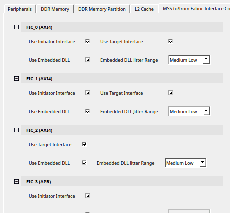
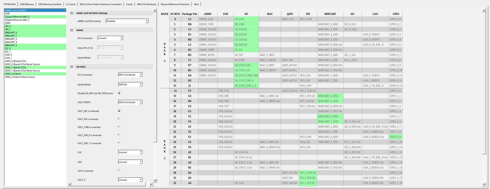

# The chip and the board: MSS, fabric and the interfaces between them

After this page you can say what is hard-wired on the PolarFire SoC and what is programmable, name the five processor cores and what each one runs in this project, and explain which interface a processor uses to reach fabric logic and which one fabric logic uses to reach memory. Everything is checked against the boot console of the board, which prints most of it.

## Before you start

- **Level 1.** No prior knowledge of FPGAs is needed. You should know what a processor core, a bus and a memory map are.
- **Tools:** none. This is a reading page.

## The idea

A PolarFire SoC is two chips on one piece of silicon.

| Half | What it is | Can you change it? |
|---|---|---|
| **MSS** (microprocessor subsystem) | Five RISC-V processor cores, their caches, interrupt controller, DDR memory controller and a set of hard peripherals (UARTs, SD interface, Ethernet MAC, GPIO and others) | Its configuration yes (clocks, which pins, which blocks are enabled); its structure no |
| **FPGA fabric** | An array of programmable logic that becomes whatever a design describes: registers, a DMA controller, a stream generator | Entirely: a new design replaces the old one |

The two halves are joined by a small number of **fabric interface controllers** (FICs). A processor cannot see the fabric until a FIC connects them, and fabric logic cannot reach memory except through one. Everything in this project that is not a processor or a Linux program lives behind a FIC.

## On this board

The board is the Microchip PolarFire SoC Discovery Kit. Its chip is the MPFS095T in an FCSG325 package, with 93,516 logic elements in the fabric and 1 GB of DDR4 on the board.

### Five cores, three jobs

| Core | Kind | Runs here | Privilege |
|---|---|---|---|
| E51 | monitor core, no MMU | the boot monitor (Hart Software Services, HSS), for the whole life of the system | machine |
| U54 1, 2, 3 | application cores | U-Boot, then Linux, as one symmetric system | supervisor, above OpenSBI |
| U54 4 | application core | the pfdaq supervisor, on FreeRTOS or bare metal | machine |

The boot console shows all of this. The HSS prints its own banner (it runs on the E51) and then tracks the four U54 cores as a four-column state line:

```text
[0.785647] PolarFire(R) SoC Hart Software Services (HSS) - version 0.99.53-v2026.04.1
...
[4.606722] boot_service(u54_4):: BOOT_FLAG_SKIP_OPENSBI found
...
[4.862061] u54 State Change:  [Booting] [Booting] [Booting] [Running]
[5.154951] u54 State Change:  [Running] [SBIWaitForColdboot] [SBIWaitForColdboot] [Running]
[22.485161] u54 State Change:  [Running] [Running] [Running] [Running]
```

The columns are U54 1 to 4. Hart 4 reaches `Running` first, which is consistent with it being started without OpenSBI (`SKIP_OPENSBI`). Harts 2 and 3 sit in `SBIWaitForColdboot` while hart 1, the owner of the U-Boot payload, starts. Module B02 covers the payload that makes this happen.

The same console prints the cache setup of the cores:

```text
[0.905284] L2 Cache Configuration:
    L2-Scratchpad:  4 ways (512 KiB)
         L2-Cache:  8 ways (1024 KiB)
           L2-LIM:  4 ways (512 KiB)
```

The shared L2 is split between ordinary cache, a scratchpad and a loosely integrated memory (LIM). Only the cache part matters for this project; module F02 shows why.

### Fabric interfaces

| Interface | Kind | Direction that matters here | Used in this project for |
|---|---|---|---|
| **FIC0** | AXI4, 125 MHz | both: the MSS reaches the fabric, and a fabric DMA reaches DDR | the DMA controller's registers at 0x6001_0000, and the DMA's writes into DDR |
| **FIC1** | clocked at 125 MHz by the fabric design | not used | nothing |
| **FIC2** | clocked at 125 MHz by the fabric design | not used | nothing |
| **FIC3** | APB, 50 MHz | MSS to fabric registers | the stream source and latency unit at 0x4000_0F00, the inter-hart mailbox at 0x5000_0000, and the reference design's own peripherals |

The clock figures are what the fabric design supplies; module F04 shows where they come from. FIC1 and FIC2 are clocked but nothing in this project connects to them, and this page does not describe them further.

The MSS Configurator, which Libero opens from the MSS component, shows the same choices. The fabric interface tab has FIC0 and FIC1 with both an initiator and a target interface, FIC2 with a target interface, and FIC3 (APB) with an initiator interface. Having an interface enabled is not the same as using it: as the table says, nothing in this project connects to FIC1 or FIC2.



The peripherals tab lists what the MSS exposes on the board's pins. Highlighted in green: the Gigabit Ethernet MAC 0, the SD interface on the bank 4 I/Os, SPI 0 and 1, MMUART 0, 1 and 4, I2C 0, GPIO 1 on the bank 2 I/Os and GPIO 2 routed to the fabric.



The picture to keep is this:

```text
  U54 harts ---- FIC3 (APB, registers) ----> fabric: pfdaq_core, mailbox, LEDs ...
       |                                          |
       |  ---- FIC0 (AXI4) <--- DMA writes -------+--> DDR through the MSS
       |  <---- interrupt lines (F2M) ------------+
       v
      DDR (1 GB), shared by all harts and by the DMA
```

Interrupts take a third path: a wire from the fabric into the MSS, described in module F03.

### What is hard and what is programmable, on this board

| Thing | Hard (MSS) | Programmable (fabric) |
|---|---|---|
| Processor cores, L2 cache, DDR controller | yes | no |
| SD card interface, Ethernet MAC | yes | no |
| MMUART0 (the supervisor's console) | the UART | its route to the USB connector goes **through the fabric** |
| Stream source, DMA controller, latency unit, mailbox | no | yes |
| LEDs, DIP switches, the Raspberry Pi header | the pins are fixed on the board | which block drives them is a fabric choice |

The third row is a real trap, and it bit this project once: with the fabric that came on the board, the supervisor's UART had no route to the connector. Case study K01 tells the story.

## Run it

Nothing to run. To see the facts above on your own board, open the HSS console (the first of the three serial ports of the on-board debugger) and power-cycle the board; the lines quoted above scroll past within the first 25 seconds. The recorded boot is under Evidence.

## What you should see

In the recorded boot:

- the HSS version line, and the three build identifiers (hardware abstraction library, DDR driver and mailbox driver versions);
- `DESIGNID: MPFS_DISCOVERY_KIT` and `DESIGNVER: 00.00.6`, which are the name and version number of the fabric design the chip reports about itself. Version 6 is the design version the pfdaq fabric v0.5.1 was built with, so this line tells you which fabric is really programmed;
- the four-column state line moving from `Idle` through `Booting` to `Running`.

## Evidence

- **Boot monitor console** (board, fabric v0.5.1): the lines quoted above, from a cold boot of the final image.
- **U-Boot and Linux console** (board, fabric v0.5.1): shows hart 1 booting Linux (`Booting Linux on hartid 1`), the machine model `Microchip PolarFire-SoC Discovery Kit (AMP)`, and `remoteproc` attaching to hart 4 after Linux is up.

These records show the software view of the chip. They do not measure anything about the interfaces; module F03 and the performance modules do that.

## When it goes wrong

| Symptom | Likely cause |
|---|---|
| No output at all on the supervisor's console | the fabric does not route MMUART0 to the connector (K01) |
| Linux boots but sees only three CPUs | expected here: `cpu4` is disabled in the device tree because hart 4 belongs to the supervisor |
| A fabric register read returns all ones or hangs | the fabric is not the design you think it is; read `DESIGNVER` in the boot console first |

## Trade-offs and going further

- **Why two halves.** The processors give you an operating system and a memory controller that no FPGA of this size could build in logic. The fabric gives you timing and parallelism that no processor can match. The cost is the interfaces between them: every one adds latency, and every one has its own clock and its own rules.
- **Hard blocks you do not use still cost something.** FIC1 and FIC2 here are clocked for nothing. That is a decision of the vendor's reference design, not of this project.
- **Exercise:** from the boot console alone, work out which core the HSS runs on and how you know. Which line tells you that hart 4 was not started through OpenSBI?
- **Exercise:** list every address in the table of interfaces and decide, for each, whether a processor or the fabric initiates the access.

<!-- nav:begin (generated by tools/gen_docs.py from the front matter; do not edit) -->
---

| | |
|---|---|
| **How to run** | Explanation with recorded evidence; nothing to run |
| **In the system** | [PolarFire SoC Discovery Kit](../system/README.md#board) · [MPFS095T system-on-chip](../system/README.md#soc) · [Microprocessor subsystem (MSS)](../system/README.md#mss) · [FPGA fabric](../system/README.md#fabric) · [E51 (hart 0)](../system/README.md#e51) · [U54 harts 1 to 3](../system/README.md#u54-linux) · [U54 hart 4](../system/README.md#u54-4) · [FIC0 (AXI4, 125 MHz)](../system/README.md#fic0) · [FIC3 (APB, 50 MHz)](../system/README.md#fic3) · [Platform-level interrupt controller](../system/README.md#plic) · [DDR4 memory, 1 GB](../system/README.md#ddr) · [Hart Software Services](../system/README.md#hss) |
| **Evidence** | [Boot monitor console from power-up to all four application cores running](../../evidence/v0.5.1/board/boot-hss.txt) (board, fabric v0.5.1, 2026-11-15)<br>[Key lines of the U-Boot and Linux console from OpenSBI to login, including remoteproc attaching to hart 4](../../evidence/v0.5.1/board/boot-uboot-linux.txt) (board, fabric v0.5.1, 2026-11-15)<br>[MSS Configurator, fabric interface controllers tab](../../evidence/v0.5.1/build/libero-mss-fics.png) (build, fabric v0.5.1, 2026-11-15)<br>[MSS Configurator, Peripherals tab: enabled peripherals and I/O mux](../../evidence/v0.5.1/build/libero-mss-peripherals.png) (build, fabric v0.5.1, 2026-11-15) |
| **Related** | [F02 The memory map and the three faces of DDR](F02-memory-map-ddr.md)<br>[F03 Interrupts from fabric to hart: F2M lines, the PLIC and contexts](F03-fabric-interrupts.md)<br>[F04 Clocks and resets: one PLL, two bus clocks](F04-clocks-and-resets.md)<br>[X01 pfdaq in one page](X01-pfdaq-in-one-page.md) |
| **Status** | validated |
<!-- nav:end -->
