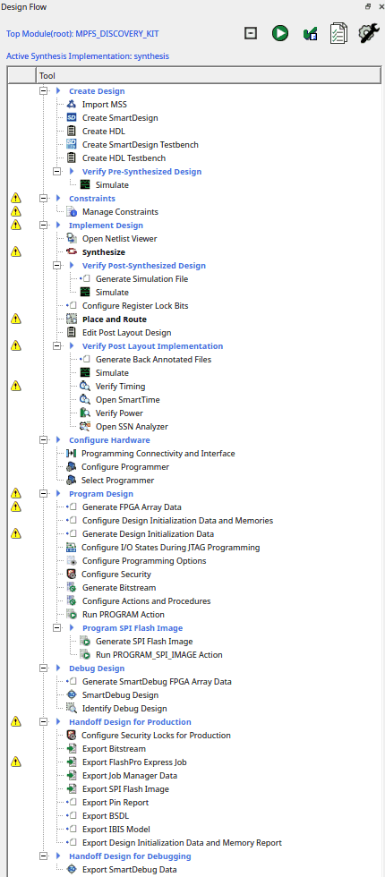
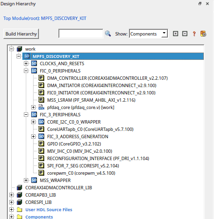

# The tool flow in batch: Libero, the IP vault and FlashPro Express

After this module you can name the four things a fabric build depends on, describe what each build step turns into what, and read the project's build script well enough to know what it protects you from. It is a reading module: the commands are the ones the project ran, shown with their purpose.

## Before you start

- **Level 1.** No FPGA knowledge needed beyond knowing that a design is turned into a configuration file.
- **Tools:** none to read it.

## The idea

A fabric design goes through the same stages whether you click or script them:

| Stage | What goes in | What comes out |
|---|---|---|
| Create the project | HDL files, the vendor's design scripts, IP core choices | a Libero project |
| Synthesis | the project's HDL | a netlist of logic elements |
| Place and route | the netlist and the **constraints** (pin locations, clocks, timing) | a placed design |
| Timing verification | the placed design and the timing constraints | a verdict per corner |
| Programming data | the placed design | the files the programmer writes |
| Programming | a job file and the board | the configured device |

A GUI session lets you see each step. A script lets you rerun all of them identically and record the result, which is the point of a project whose claims must be reproducible.

## On this board

### The four dependencies

| Dependency | What it is | What can go wrong |
|---|---|---|
| **Libero SoC 2026.1** | the design tool; it runs in batch mode when given a script | needs a licence to start |
| **The licence server** | a floating licence served from the PC itself on port 1702; the build scripts point at it through `LM_LICENSE_FILE=1702@localhost` | the server is not running after a reboot of the PC, and the build stops at the first licence check |
| **The IP vault** | the library of vendor IP cores (the DMA controller, the inter-hart communication core and others) that the reference design instantiates | an empty vault makes the design import fail, see below |
| **FlashPro Express** | the programmer, also scriptable; it reads a job file and writes the device | the on-board JTAG interface must be reachable (module B06) |

### The offline vault

Libero normally downloads IP cores from Microchip's online catalogue the first time a design needs them. On this PC the first build failed because the vault was empty and the online download failed. The fix recorded in the project's notes was to unpack the offline vault that comes with the installer and point the tool's vault folder at it. The tool prints an error line ("download_core failed") and continues; it fails later if a needed core is really absent, so that early line is a warning to take seriously only when the build stops later.

### One script for the whole build

`hw/libero/build.sh` is the whole flow in one command:

```sh
hw/libero/build.sh 6        # design version 6; takes the job name as an optional second argument
```

What it does, in order, and why:

1. **Fetches the reference design** at a pinned release tag (v2026.04) into a scratch folder, unless one is given in `PFDAQ_REFDESIGN`. The vendor's design is never copied into this repository.
2. **Applies the project's overlay**: a small patch to the vendor's build script, the project's integration script and constraint file, and the project's RTL (module H09 explains the integration).
3. **Runs Libero in batch**:
   ```sh
   libero script:MPFS_DISCOVERY_KIT_REFERENCE_DESIGN.tcl \
       SCRIPT_ARGS:AXI4_STREAM_DEMO+VERIFY_TIMING+DESIGN_VERSION:$VER
   ```
   The vendor's own script creates the project and runs synthesis, place and route and timing. The argument `AXI4_STREAM_DEMO` selects the variant the overlay replaces, and `DESIGN_VERSION` is the number the finished device reports back.
4. **Watches the log while it runs** and stops the build early in two cases (next section).
5. **Checks the result**, requires that no multi-corner timing check says "violated", and prints the logic-element count.
6. **Exports the programming job** with a second, small script, `export_job.tcl` (module B06 explains why it is separate and why it names the components).

Programming is a separate command, `hw/libero/program.sh <job>`, so that building never touches the board.

### Two guards

A batch flow has no person looking at the screen, so the script looks for the two failures that once cost this project whole builds:

- **A constraint-file error.** If the log contains `Error: SDC00…`, the script stops at once. This is what a constraint that names a register in a way the tool cannot read produces (case study K07).
- **Unplaced pins.** If the line the tool prints after assigning pins says anything other than "0 unfixed", the script stops. A fabric built with its pin constraints missing can pass timing and still leave a dead board (case study K08).

The evidence shows what a good build prints for the second guard:

```text
Info:  I/O Bank and Globals Assigner identified 64 fixed I/O macros, 0 unfixed I/O macros
Info: Timing constraints have been met.
```

### The same flow in the Libero GUI

The scripts drive the steps the GUI lists. The left panel of the GUI is the design flow: create the design, constrain it, synthesise, place and route, verify timing, generate the programming data, program, export. The batch build in `hw/libero/build.sh` walks the same list.



The panel is a screenshot of the project's own build, opened read-only. To see it yourself: run `hw/libero/build.sh` once, start Libero and open `build/libero/work/PFDAQ/PFDAQ.prjx` (Project, Open Project). Opening a project can touch its files, so open a copy of the folder if you want the original left as it is. The yellow triangles are Libero's status markers on steps that finished with warnings; this page does not interpret them one by one.

The design hierarchy of the same project shows what the build assembled: the reference design's four blocks, and under `FIC_0_PERIPHERALS` the one block this project adds, `pfdaq_core`, which is plain Verilog (`pfdaq_core.v`) and so has a different icon from the IP cores around it.



## Run it

This is a reading module. What the project ran, in order, from the repository root:

```sh
hw/libero/build.sh 6                          # build; stops on either guard
hw/libero/program.sh <the job it printed>     # program; shut Linux down on the board first
```

Before the first build after a reboot of the PC, the licence server has to be started again and the two licence variables exported. The vendor's tool names them `LM_LICENSE_FILE` and `SNPSLMD_LICENSE_FILE`; the script defaults both to the local server.

## What you should see

The build prints, at the end, the pin-assignment line and the utilisation table of the finished design (these are from the record of the v0.5.1 build):

```text
| 4LUT                      | 22658 | 93516 | 24.23      |
| DFF                       | 14034 | 93516 | 15.01      |
| Logic Element             | 24334 | 93516 | 26.02      |
```

and the programming prints a checksum, a design version and the component digests, with three `PASSED` lines (shown in module B06).

## Evidence

- **Build:** timing met, 64 of 64 pins placed, 26.02 % of the logic elements in use (record `timing`).
- **Programming:** `PROGRAM`, `VERIFY` and `DEVICE_INFO` passed (record `programming`).
- **Reproducibility:** a build from the repository layout produced a fabric whose component digest was identical to the one validated on the board, so the scripted flow reproduces the manual one.
- **Not shown:** the build log is long and not published. The records are the extracts that carry the verdicts.

## When it goes wrong

| Symptom | Likely cause |
|---|---|
| The build stops at the first step with a licence message | the licence server is not running, or the variables point somewhere else |
| "download_core failed", then a later error about a missing core | the vault is empty or the vault folder is not the offline one |
| The build stops with an `SDC00…` error | a constraint names a register in a form the tool cannot read |
| The build stops with "unplaced I/Os" | a call that replaces a tool's constraint list dropped the pin constraints |
| Programming cannot open the device | the JTAG USB interface is claimed by the serial driver |

## Trade-offs and going further

- **A script replaces a person, not their judgement.** The guards cover what went wrong before. A new kind of failure will pass them, which is why the result is still checked on the board.
- **Fetching the vendor's design at a tag** makes the project small and honest about what is vendor code. The cost is that a later change to the vendor's script can make the overlay stale; the patch fails to apply instead of silently doing something different.
- **Exercise:** pick the stage of the table where an error would be cheapest to find, and say which guard in the script could be made to catch it earlier.
- **Exercise:** the second guard looks at one line of the log. What other single line would you want the script to check?

<!-- nav:begin (generated by tools/gen_docs.py from the front matter; do not edit) -->
---

| | |
|---|---|
| **How to run** | Explanation with recorded evidence; nothing to run |
| **In the system** | [Development PC](../system/README.md#host) · [FlashPro5 on USB-C](../system/README.md#debug-usb) · [FPGA fabric](../system/README.md#fabric) |
| **Source** | [`hw/libero/build.sh`](../../hw/libero/build.sh): `LM_LICENSE_FILE`, `PFDAQ_REFDESIGN`, `DESIGN_VERSION`<br>[`hw/libero/program.sh`](../../hw/libero/program.sh): `FPEXPRESS`<br>[`hw/libero/export_job.tcl`](../../hw/libero/export_job.tcl): `GENERATEPROGRAMMINGDATA`<br>[`hw/libero/sta_without_cdc.tcl`](../../hw/libero/sta_without_cdc.tcl): `VERIFYTIMING`<br>[`hw/libero/overlay/reference-design-v2026.04.patch`](../../hw/libero/overlay/reference-design-v2026.04.patch): `organize_tool_files` |
| **Evidence** | [Place and route result, timing met in all corners, 64 of 64 pins placed, 26 % of the fabric](../../evidence/v0.5.1/build/timing-and-utilisation.txt) (build, fabric v0.5.1, 2026-11-15)<br>[Programming, verify and device read-back of the v0.5.1 fabric](../../evidence/v0.5.1/build/programming.txt) (board, fabric v0.5.1, 2026-11-15)<br>[The Libero design flow as listed for the project](../../evidence/v0.5.1/build/libero-design-flow.png) (build, fabric v0.5.1, 2026-11-15)<br>[The design hierarchy: reference design blocks and the added pfdaq_core](../../evidence/v0.5.1/build/libero-hierarchy.png) (build, fabric v0.5.1, 2026-11-15) |
| **Related** | [B06 Programming safely: components, digests and what never to touch](B06-programming-safely.md)<br>[H09 Integrating custom RTL into a vendor design by script](H09-rtl-into-vendor-design.md)<br>[H10 Timing closure, and the build that lost its pins](H10-timing-closure.md)<br>[K07 Three builds lost to brackets in a constraint file](../case-studies/K07-brackets-in-constraints.md)<br>[K08 Timing met, board dead: the missing pin constraints](../case-studies/K08-timing-met-board-dead.md) |
| **Status** | validated |
<!-- nav:end -->
