# Create your own IP in Libero: from a Verilog file to a core in the Catalog

After this module you can take a Verilog module of your own and make Libero treat it as a block: one that can be dropped on a SmartDesign canvas, with an APB slave and an AXI4-Stream initiator that the tool recognises as buses and lets you wire with one connection each. Then you can put the block into a vault so that it is listed in the Catalog and placed like a vendor core. You will have done both by hand in the GUI, seen the Tcl command behind each click, and replayed that Tcl in empty projects to get the same result.

## Before you start

- **Level 3.** You should know what a SmartDesign canvas is and what the APB register bus is (module H01), and have read how the project scripts the same thing (module H09).
- **Tools:** Libero SoC 2026.1 with a licence, Icarus Verilog for the two small tests, and Python 3 for the packaging script of part 2. Nothing in this module touches the board; every project in it is a scratch project.
- **Files:** everything is in `experiments/libero-ip/`: the register block `pfdaq_demo_regs.v`, a small APB master `pfdaq_demo_master.v` that stands in for the processor, two self-checking tests and a script that does the whole flow.

## The idea

Libero's SmartDesign canvas places **components**. A vendor core such as CoreAPB3 is one. A module of your own Verilog is not, until you make it a **core**: Libero reads the module's ports and parameters and keeps a description of them. Then you tell it which ports form a **bus interface**. Eight loose APB ports then become one pin on the block, and you connect it to another APB pin with a single line instead of eight.

Two things in this flow are easy to miss.

1. **The tool matches ports to bus signals by name.** The standard APB names are `PADDR`, `PSELx`, `PENABLE`, `PWRITE`, `PWDATA`, `PRDATA`, `PREADY`, `PSLVERR`; the AXI4-Stream names are `TDATA`, `TVALID`, `TREADY`, `TLAST` and a few optional ones. A port called by the standard name is matched for you. A port called anything else is left empty, and you pick it from a list. This is why the project's own `pfdaq_core.v` uses the standard names, and why one of its lines in `PFDAQ.tcl` names the select signal explicitly (module H09).
2. **There are two ways to place a core of your own.** Straight after Create Core from HDL it lives in the Design Hierarchy of that project, and you place it from there (steps 1 to 14). It is not in the Catalog. To get it into the Catalog it has to be in a **vault**, the folder the Catalog reads, and the way into a vault is a package file, `.cpz` (steps 15 to 22). Libero has no menu that writes that file for you; this module builds it with a script.

The commands behind the GUI are the ones the project's integration script uses: `create_hdl_core`, `hdl_core_add_bif`, `hdl_core_assign_bif_signal`, `sd_instantiate_hdl_core`, `sd_connect_pins`, `generate_component`. Libero does not print them in its Log window. It writes them when you ask, with Project > Export Script File (step 14).

## On this board

The design in this module is a scratch design, not the project's fabric. It has the same two bus types as `pfdaq_core` and is made with the same commands, but it is small enough to read in a minute.

`pfdaq_demo_regs` has five registers behind an APB slave and sends a burst of 32-bit words, `0, 1, 2, ...`, with `TLAST` on the last one, when you write the start bit:

| Offset | Name | What it does |
|---|---|---|
| `0x00` | CTRL | write bit 0 to start a burst |
| `0x04` | LEN | words in a burst, reset value 4 (the parameter `DEFAULT_LEN`) |
| `0x08` | STATUS | bit 0 busy, bit 1 done |
| `0x0C` | SCRATCH | read and write, nothing else |
| `0x10` | SENT | words sent so far |

`pfdaq_demo_master` is the stand-in processor: after reset it writes `LEN = 8` and then `CTRL = 1`, once. In the design it drives the register block through CoreAPB3, the vendor's APB fabric, so the canvas has a master, a bus and a slave, as the real design has. Before Libero is involved, both blocks are checked by simulation:

```text
$ iverilog -g2005 -o /tmp/tb1.vvp tb_pfdaq_demo_regs.v pfdaq_demo_regs.v && vvp /tmp/tb1.vvp
PASS: 6 words, TLAST on the sixth, registers read back
$ iverilog -g2005 -o /tmp/tb2.vvp tb_pfdaq_demo_top.v pfdaq_demo_master.v pfdaq_demo_regs.v && vvp /tmp/tb2.vvp
PASS: the master started a burst of 8 words, TLAST on the eighth
```

### The path in one picture


### Step 0: the starting point is an empty project

The project was made in batch mode, with no design in it, for the same device as the board (MPFS095T, package FCSG325, speed -1). The options are those the reference design's own script uses:

```tcl
new_project -location {/tmp/ipdemo/demo} -name {demo} -hdl {VERILOG} -family {PolarFireSoC} \
    -die {MPFS095T} -package {FCSG325} -speed {-1} -die_voltage {1.0} -part_range {EXT} \
    -adv_options {IO_DEFT_STD:LVCMOS 1.8V} -adv_options {TEMPR:EXT} -adv_options {VOLTR:EXT}
```

The project used in the GUI was made with the full option list of the reference design; `create_ip_demo.tcl` uses the shorter list shown here and synthesizes to the same numbers. Then Libero was started on the project file in its GUI. Libero shows a dialog asking whether to check for updates; click **No**.

### Step 1: import the Verilog file

File > Import > HDL Source Files. Type the path of `pfdaq_demo_regs.v` in the File name box (library `work`) and press Return.

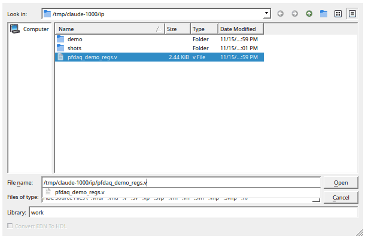

Libero copies the file into the project's `hdl` folder; the log later reads that copy. Tcl:

```tcl
import_files -convert_EDN_to_HDL 0 -library {work} -hdl_source {./pfdaq_demo_regs.v}
```

### Step 2: build the design hierarchy

In the **Design Hierarchy** tab click **Build Hierarchy**. The module appears under `work` as `pfdaq_demo_regs (pfdaq_demo_regs.v) [work]`. Until you build the hierarchy, the tab shows only the file under User HDL Source Files.

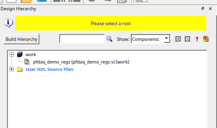

```tcl
build_design_hierarchy
```

### Step 3: Create Core from HDL

Right-click the module in the Design Hierarchy. The menu has **Create Core from HDL...** (and Check HDL File, Set As Root, Show Module Parameters).

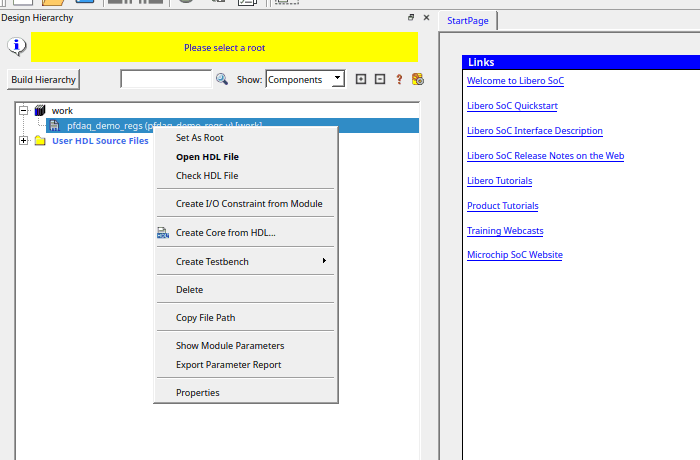

Click it. Libero creates the core at once and then asks: "Signals and Parameters were automatically extracted from HDL ... and core 'pfdaq_demo_regs' was created. Would you like to remove any of the parameters, or add bus interfaces to your core?" Answer **Yes**. The core already exists at this point; the question opens the wizard that edits it.

```tcl
create_hdl_core -file {./demo/demo/hdl/pfdaq_demo_regs.v} -module {pfdaq_demo_regs} -library {work} -package {}
```

### Step 4: ports and parameters

The first wizard page, **Edit Core Definition - Ports and Parameters**, lists what Libero read from the module header: fourteen ports and the parameter `DEFAULT_LEN`. There is no page for a name, a version or a clock: the core takes the module's name, and the clock and reset are ordinary ports (`PCLK`, `PRESETN`) that you wire on the canvas. The picture plays through the three parts of the page.


Nothing needs changing here. The button **Re-extract ports and parameters from HDL** reads the file again (not needed here). The button **Add/Edit bus interfaces...** opens the next page.

### Step 5: add the APB slave interface

On the **Bus Interfaces** page the list on the left is empty: Libero does not guess the buses from the port names on its own. Click **Add Bus Interface...**. A list of bus definitions opens, with name, vendor (AMBA), library and role. Choose **APB, AMBA2, slave** and OK.

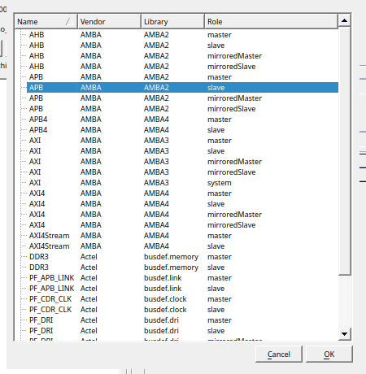

The tool now maps the bus signals to the module's ports by name. Seven of eight are matched at once. `PSELx` is empty, because the module's port is called `PSEL`.


Click in the **Core Signal** cell of the `PSELx` row. The drop-down lists the ports that are still free and can be connected to this signal: `PCLK`, `PRESETN`, `PSEL` and `TREADY`. Choose `PSEL`.

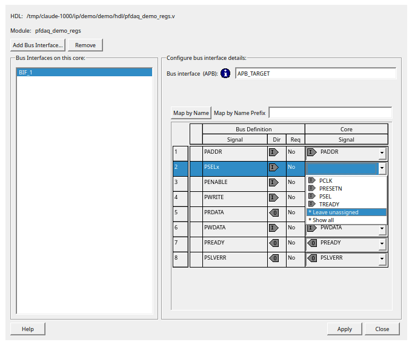

Then rename the interface: click in the **Bus interface** field, select all, type `APB_TARGET` and press **Return**. Press Return: if you click elsewhere first, the name goes back to `BIF_1`. Click **Apply**.

The Tcl, as Libero exported it (the signal assignments are one command each; six are shown as one line here):

```tcl
hdl_core_add_bif -hdl_core_name {pfdaq_demo_regs} -bif_definition {APB:AMBA:AMBA2:slave} -bif_name {BIF_1} -signal_map {}
hdl_core_assign_bif_signal -hdl_core_name {pfdaq_demo_regs} -bif_name {BIF_1} -bif_signal_name {PADDR} -core_signal_name {PADDR}
  ... the same for PENABLE, PWRITE, PRDATA, PWDATA, PREADY, PSLVERR
hdl_core_assign_bif_signal -hdl_core_name {pfdaq_demo_regs} -bif_name {BIF_1} -bif_signal_name {PSELx} -core_signal_name {PSEL}
hdl_core_rename_bif -hdl_core_name {pfdaq_demo_regs} -current_bif_name {BIF_1} -new_bif_name {APB_TARGET}
```

The first line names the bus by its four-part definition `APB:AMBA:AMBA2:slave`; this is the same string `PFDAQ.tcl` uses for the project's own core.

### Step 6: add the AXI4-Stream initiator interface

Click **Add Bus Interface...** again, choose **AXI4Stream, AMBA4, master** and OK. Libero maps `TVALID`, `TREADY`, `TDATA` and `TLAST` by name. The optional signals `TSTRB`, `TKEEP`, `TID`, `TDEST` and `TUSER` stay empty, because the module has no such ports; they are not required. Rename the interface to `AXIS_INITIATOR` (field, select all, type, Return) and press Apply.


"Master" is the initiator role: the core sends the data. `TREADY` is the one input; it comes back from the receiver.

```tcl
hdl_core_add_bif -hdl_core_name {pfdaq_demo_regs} -bif_definition {AXI4Stream:AMBA:AMBA4:master} -bif_name {BIF_2} -signal_map {}
hdl_core_assign_bif_signal -hdl_core_name {pfdaq_demo_regs} -bif_name {BIF_2} -bif_signal_name {TVALID} -core_signal_name {TVALID}
  ... the same for TREADY, TDATA, TLAST
hdl_core_rename_bif -hdl_core_name {pfdaq_demo_regs} -current_bif_name {BIF_2} -new_bif_name {AXIS_INITIATOR}
```

### Step 7: close the wizard and check the log

Click **Close** on the bus interface page and **OK** on the ports page. The Log window ends with the message that the core was created.

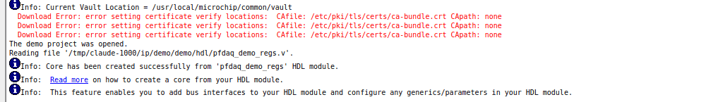

The module is now marked as a core in the Design Hierarchy. Once the hierarchy has been rebuilt, the right-click menu of the core has **Edit Core Definition...** and **Remove Core Definition**, and, when a SmartDesign is open, **Instantiate in** it (step 9).

### Step 8: look for it in the Catalog

Open the **Catalog** tab and type `pfdaq` into the search box: the list is empty. Vendor cores are there; try `CoreAPB3`:

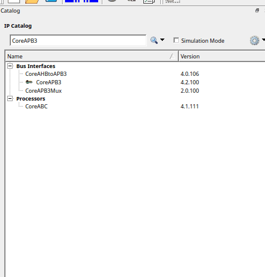

So a core made from HDL is not in the Catalog at this point: it is placed from the Design Hierarchy, as the next step shows. Part 2 of this module (steps 15 to 22) is how to change that. Searching is also how to find the vendor core you need for the bus.

### Step 9: create a SmartDesign and instantiate the core

In the **Design Flow** tab double-click **Create SmartDesign** (a single click only selects it), type `demo_top` and OK. An empty canvas opens. Then, in the Design Hierarchy, right-click the core and choose **Instantiate in demo_top**.

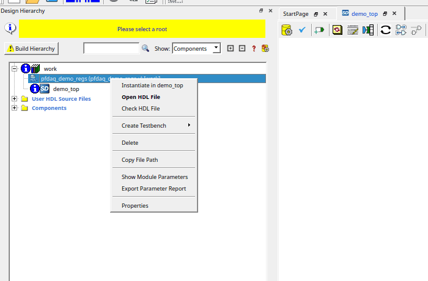

The block `pfdaq_demo_regs_0` appears with four pins: `PCLK`, `PRESETN`, and the two bus interfaces `APB_TARGET` and `AXIS_INITIATOR`, each as one pin. That is the check that the bus interfaces were recognised.

```tcl
create_smartdesign -sd_name {demo_top}
sd_instantiate_hdl_core -sd_name {demo_top} -hdl_core_name {pfdaq_demo_regs} -instance_name {}
```

### Step 10: add a master and the bus, and wire them

A slave needs a master. The scratch project has no processor, so `pfdaq_demo_master.v` is imported, built and turned into a core the same way (steps 1 to 7), with one bus interface, **APB, AMBA2, master**, which Libero matches by name except for `PSELx`, as before (it is called `APB_INITIATOR`). Then:

1. Instantiate the master core in `demo_top`, as in step 9.
2. In the Catalog, search for `CoreAPB3` and double-click it. A dialog asks for the component name (the default `CoreAPB3_C0` was kept); the configurator opens; untick the slave slots 1 to 15 so that one slot is left, and OK. The log says the component was generated, with vendor `Actel`, library `DirectCore`, version 4.2.100.
3. Drag from the `APB_INITIATOR` pin of the master to the `APB3mmaster` pin of CoreAPB3, and from the `APBmslave0` pin of CoreAPB3 to `APB_TARGET` of the register block. Each drag draws one line for the whole bus.

```tcl
create_and_configure_core -core_vlnv {Actel:DirectCore:CoreAPB3:4.2.100} -component_name {CoreAPB3_C0} -params {"APBSLOT0ENABLE:true" ... }
sd_instantiate_component -sd_name {demo_top} -component_name {CoreAPB3_C0} -instance_name {}
sd_connect_pins -sd_name {demo_top} -pin_names {"CoreAPB3_C0_0:APBmslave0" "pfdaq_demo_regs_0:APB_TARGET"}
sd_connect_pins -sd_name {demo_top} -pin_names {"CoreAPB3_C0_0:APB3mmaster" "pfdaq_demo_master_0:APB_INITIATOR"}
```

(The `-params` list has one entry per slot and per option; the full list is in `create_ip_demo.tcl`.)

### Step 11: clock, reset and the stream

Right-click a pin, choose **Promote to Top Level**: the pin becomes a port of the design. Do this for `AXIS_INITIATOR`, `PCLK` and `PRESETN` of the register block. Then drag from the new `PCLK` port to the `PCLK` pin of the master, and the same for `PRESETN`. SmartDesign > Auto Arrange Layout and Zoom To Fit tidy the canvas.


```tcl
sd_connect_pin_to_port -sd_name {demo_top} -pin_name {pfdaq_demo_regs_0:AXIS_INITIATOR} -port_name {}
sd_connect_pin_to_port -sd_name {demo_top} -pin_name {pfdaq_demo_regs_0:PCLK} -port_name {}
sd_connect_pin_to_port -sd_name {demo_top} -pin_name {pfdaq_demo_regs_0:PRESETN} -port_name {}
sd_connect_pins -sd_name {demo_top} -pin_names {"PCLK" "pfdaq_demo_master_0:PCLK"}
sd_connect_pins -sd_name {demo_top} -pin_names {"PRESETN" "pfdaq_demo_master_0:PRESETN"}
```

An empty `-port_name {}` means the port gets the name of the pin.

### Step 12: check the design rules and generate

SmartDesign > **Design Rules Check**. When the clock and reset of the master are not yet connected, this stops with a dialog and two errors in the Message window (see "When it goes wrong"). When they are connected it ends with `design rules check succeeded`. Then SmartDesign > **Generate Component**; the log says `'demo_top' was successfully generated.`

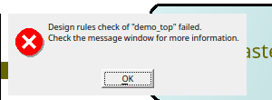

```tcl
generate_component -component_name {demo_top} -recursive 0
```

### Step 13: synthesize

In the Design Hierarchy, rebuild the hierarchy (Build Hierarchy), right-click `demo_top` and choose **Set As Root**. In the Design Flow tab double-click **Synthesize**. The Log window ends with `Synthesis completed.` and the Synthesize row gets a green tick.

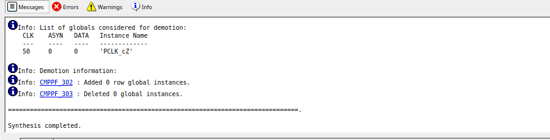

The Synplify report says the design has 74 LUTs and 50 registers, 37 I/O ports (3 inputs, 34 outputs) and one global clock buffer (record `libero-ip-synthesis`). The first attempt did not get this far; see the next section.

```tcl
build_design_hierarchy
set_root -module {demo_top::work}
update_and_run_tool -name {SYNTHESIZE}
```

### Step 14: write the Tcl of the whole session

Project > **Export Script File...**. Tick **Include commands from current session only** and give a file name; the file holds every command of the steps above, in order.

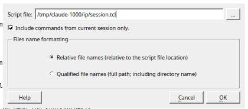

The commands in this module are copied from that file (record `libero-ip-session-tcl`). The export without the tick was not tried.

### Part 2: put the core into the Catalog

### Step 15: what Libero offers, and what it does not

I looked for a menu or command that turns a core into something the Catalog lists. What exists:

- The Catalog's gear menu has **Add Core to Vault**, **Reload Catalog** and **Options...** (Options holds the repositories, the vault location, the display mode and a filter).

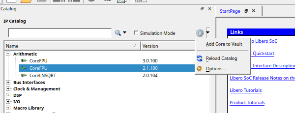

- The right-click menu of a core in the Catalog has **Configure core**, **Remove from vault**, **Show details...** and **Open documentation**. Nothing was chosen here: Remove from vault would delete a core from the vault.

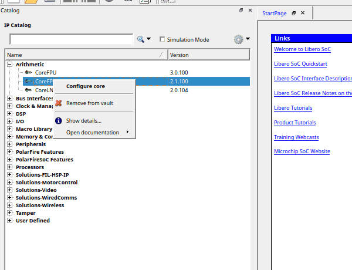

- File > Export offers a netlist, the memory map report, the interrupt map report and the IP core usage report; Tools has only Waveformer Lite; the right-click menu of a SmartDesign in the Design Hierarchy has Export Component Description (Tcl) and its hierarchical form. None of them writes a package.
- Libero's own help, installed under the Libero folder, describes **Add Core to Vault** only for importing a `.cpz` file downloaded from Microchip, and describes a core made from a user module (it calls it an HDL+ core) as something you instantiate from the Design Hierarchy.

I found no menu and no Tcl command that writes a `.cpz`. The Add Core to Vault dialog filters for `*.ccz` and `*.cpz`. So the package has to be made another way.

### Step 16: build the package

A `.cpz` is a zip file. The layout was read from a plain vendor core in the vault, and the content from the description Libero had already written for the HDL core in the project (`component/User/Private/pfdaq_demo_regs/1.0/pfdaq_demo_regs.xml`: the ports, the parameter, the two bus interfaces with their signal maps). `make_cpz.py` writes the package:

```text
python3 make_cpz.py cpz
cpz/pfdaq_demo_regs-1.0.0.cpz
    index_entry.xml     one entry of the vault's index: vendor pfdaq, library Demo, name, version 1.0.0, group "User Defined"
    core_xml.zip        the core description: signals, parameter DEFAULT_LEN, bus interfaces APB_TARGET and AXIS_INITIATOR, the fileset
    other_filesets.zip  the Verilog file
```

None of this is a documented format. It is a copy of the structure of an unprotected vendor core, and Libero accepted it in this version; a different version may not.

### Step 17: use a scratch vault

Adding a core writes files into the vault, and the default vault holds the vendor's cores for every project on the machine. To leave it alone, point Libero at an empty folder first: Project > **Vault/Repositories Settings**, page **Vault location**, type the folder, OK. Libero answers "Successfully updated vault/repositories settings."

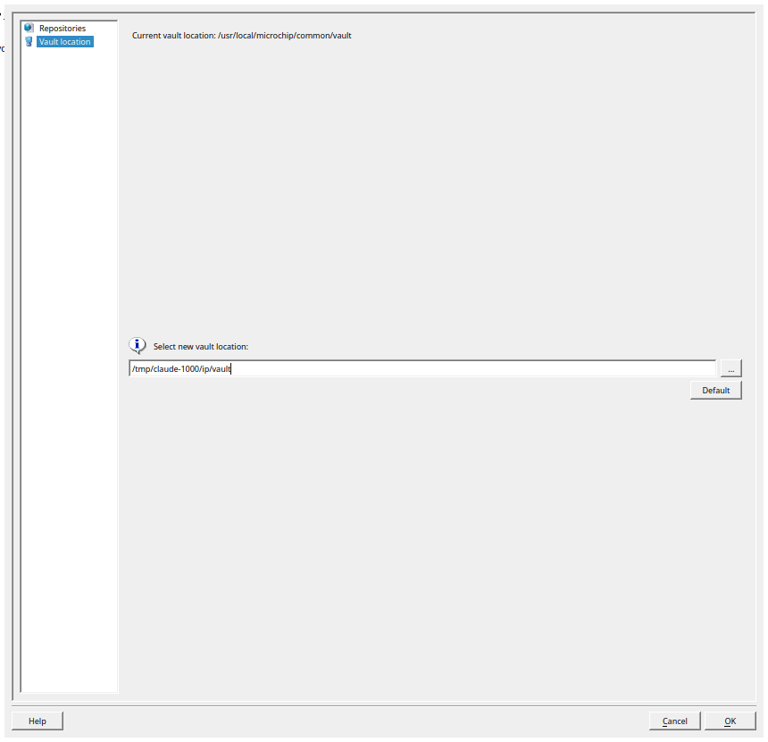

The scratch folder was a copy of an empty vault: an `index.xml` with an empty list of cores and a `Data/Ip` folder (the installation had kept one next to the real vault). The Catalog now shows only the built-in Macro Library.

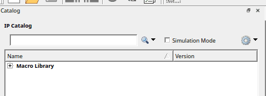

The setting is stored per user and is shared by all Microchip tools: Libero wrote it to a new file, `ipmgr.ini`, in its settings folder, which did not exist before. The Tcl command is `change_vault_location -location <folder>`, and its help says it changes the vault location for all projects. Afterwards I deleted that file to go back to the default vault (the Default button on the same page was not tried).

```tcl
change_vault_location -location {/tmp/ipdemo/vault}
```

### Step 18: Add Core to Vault

In the Catalog click the gear, **Add Core to Vault**, type the path of the `.cpz` and press Return.

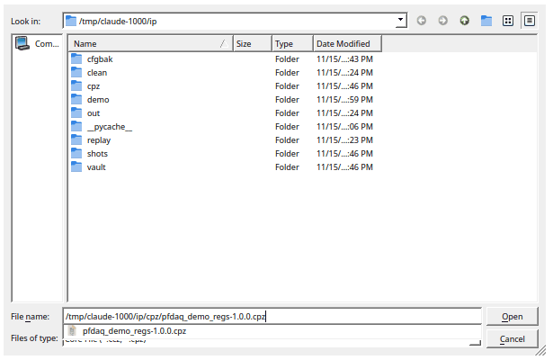

Libero answers "Successfully imported file(s)." and a group **User Defined** appears in the Catalog. Expand it: the core is there, version 1.0.0, and selecting it shows the description from the package.


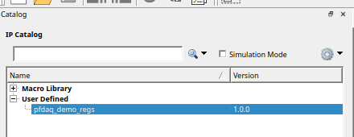

In the scratch vault Libero created `Components/pfdaq/Demo/pfdaq_demo_regs/1.0.0/`, with the package files, and later the extracted Verilog (record `libero-ip-catalog-run`). The command Libero exports for this step is `import_core`, with the path of the package (it is in the exported file; I did not find it in the installed help):

```tcl
import_core -core {./cpz/pfdaq_demo_regs-1.0.0.cpz}
```

### Step 19: place the core from the Catalog

Use a new, empty project (the batch command of step 0), so that the Verilog of the register block is not in it; only the master's HDL core is (made with the commands of step 10, by script). Create the SmartDesign `demo_top`, instantiate the master core from the Design Hierarchy, then double-click `pfdaq_demo_regs` in the Catalog's User Defined group. A dialog asks for the component name (the default `pfdaq_demo_regs_C0` was kept), and then a **configurator** opens, like the one of a vendor core, with the parameter `DEFAULT_LEN`. Change it to 16 and click OK.

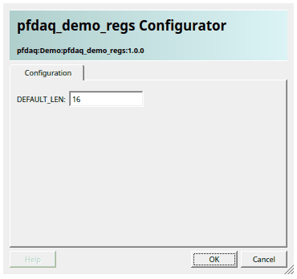

The log says `'pfdaq_demo_regs_C0' was successfully generated.` and the block appears with `PCLK`, `PRESETN`, `APB_TARGET` and `AXIS_INITIATOR`: the bus interfaces from the package were recognised. The generated wrapper instantiates the core with `.DEFAULT_LEN ( 16 )`.

```tcl
create_and_configure_core -core_vlnv {pfdaq:Demo:pfdaq_demo_regs:1.0.0} -component_name {pfdaq_demo_regs_C0} -params {"DEFAULT_LEN:16"}
sd_instantiate_component -sd_name {demo_top} -component_name {pfdaq_demo_regs_C0} -instance_name {}
```

The first argument is the core's identifier: vendor, library, name and version, joined by colons.

### Step 20: wire it, which needs CoreAPB3 in the scratch vault

Dragging from the master's `APB_INITIATOR` pin to the register core's `APB_TARGET` pin did nothing, with no message, in several attempts at two zoom levels. **Smart Search and Connect** (SmartDesign > Tools, or Ctrl+K) lists the pins of both blocks; the two bus pins are shown in grey, and ticking both and pressing **Connect** did nothing either. I did not find the reason. What worked is the arrangement of part 1: master to CoreAPB3 to register core.

The scratch vault was empty, so CoreAPB3 was not in the Catalog. It had to be added the same way, as a package made from the vendor core's own files in the shared vault, which `make_cpz.py` reads and does not change:

```text
python3 make_cpz.py cpz --repack /usr/local/microchip/common/vault DirectCore CoreAPB3 4.2.100
```

Add Core to Vault with that file, and the group **Bus Interfaces** appears with CoreAPB3 4.2.100. Double-click it, keep the name, untick slots 1 to 15, OK, and drag the pins as in step 10. The clock, reset and stream pins are promoted and wired as in step 11.

### Step 21: check, generate, synthesize

SmartDesign > Design Rules Check ends with `design rules check succeeded`; Generate Component ends with `'demo_top' was successfully generated.`. The Design Hierarchy, with `demo_top` as root, now lists `pfdaq_demo_regs_C0 (pfdaq_demo_regs_v1.0.0)` with the IP-core icon, next to `CoreAPB3_C0`.


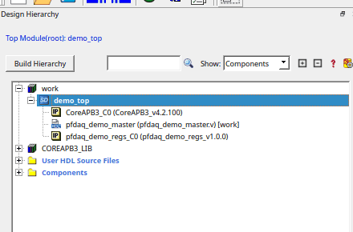

Double-click Synthesize. The log ends with `Synthesis completed.`


The report says 73 LUTs, 50 registers and 37 I/O ports, against 74 LUTs, 50 registers and 37 ports in part 1. `DEFAULT_LEN` was 16 here and 4 there; I did not check that this is why the LUT count differs by one.

### Step 22: the Tcl, and putting the setting back

Project > Export Script File with the session-only box ticked, as in step 14, gives the commands of this part (record `libero-ip-catalog-session-tcl`). It starts at `open_project` of the new project, so the vault change and the first `import_core` are not in it; they happened before that project was opened. The rest is the Tcl shown above, plus `import_core` for CoreAPB3, `generate_component`, `set_root` and `run_tool -name {SYNTHESIZE}`.

When you are done, put the vault location back (step 17).

## Run it

Everything above, in one script, from an empty directory:

```text
mkdir -p /tmp/ipdemo && cd /tmp/ipdemo
libero SCRIPT:<repository>/experiments/libero-ip/create_ip_demo.tcl
```

The script creates the empty project, imports both files, makes the two cores with their bus interfaces, builds the SmartDesign, generates it and synthesizes it. It takes a few minutes, most of it Synplify.

The exported session was also replayed on its own, to check that the commands alone reproduce the GUI result. In an empty project, in batch mode, with three changes: `open_project` replaced by the `new_project` command above, the two file paths pointed at the new project, and one added line, `build_design_hierarchy`, before the final `set_root`. Without that line the replay stopped at synthesis with `ERR0014: Unable to find top level demo_top in library work`: in the GUI the Build Hierarchy click had rebuilt the hierarchy after the last generate, and the exported file does not contain it. With it the replay ended with `The Execute Script command succeeded.` and the same numbers as the GUI run. `create_ip_demo.tcl` is a tidied version (shorter interface names, a loop for the signal assignments) and ran the same way in a third empty directory.

The Catalog route has its own script, `create_ip_catalog_demo.tcl`. It points Libero at an empty scratch vault, adds the two packages, makes a new empty project and builds the same design with the register core taken from the vault:

```text
python3 make_cpz.py cpz
python3 make_cpz.py cpz --repack <a vault that holds CoreAPB3> DirectCore CoreAPB3 4.2.100
mkdir -p /tmp/ipcat && cd /tmp/ipcat
IPCAT_CPZ=<repository>/experiments/libero-ip/cpz IPCAT_VAULT=/tmp/ipcat/vault \
    libero SCRIPT:<repository>/experiments/libero-ip/create_ip_catalog_demo.tcl
```

It prints `Import succeeded for CPZ file pfdaq_demo_regs-1.0.0.cpz.` and the same for CoreAPB3, then `Synthesis completed.` The script changes the vault location of every Microchip tool of your user (the Tcl command is `change_vault_location`); run that command again with your old location when you are done.

## What you should see

- In the GUI: after step 7 the module has a core icon; after step 9 the block `pfdaq_demo_regs_0` shows `APB_TARGET` and `AXIS_INITIATOR` as single bus pins; after step 11 the canvas of the figure above; after step 13 `Synthesis completed.`
- From the script: `Synthesis completed.` and `The Execute Script command succeeded.`
- In the Catalog route: after step 18 a group **User Defined** with `pfdaq_demo_regs 1.0.0`; after step 19 a configurator that offers `DEFAULT_LEN`; after step 21 `Synthesis completed.` again.
- From the tests: the two `PASS:` lines of the section above.

## Evidence

- **Screenshots of every GUI step:** records `libero-ip-import-dialog` to `libero-ip-export-script-dialog` (the first and last of sixteen), scratch project, Libero SoC 2026.1.
- **The commands:** `libero-ip-session-tcl`, as exported by Libero.
- **Synthesis:** `libero-ip-synthesis`: 74 LUTs, 50 registers, 37 I/O ports, with the pin-count error of the first attempt.
- **Replay in batch:** `libero-ip-replay`: the exported script and the tidied script both synthesize to the same resource numbers.
- **Simulation:** `libero-ip-sim`: both tests pass.
- **Catalog route:** records `libero-ip-catalog-gear-menu` to `libero-ip-catalog-core-menu` (eleven screenshots), `libero-ip-catalog-session-tcl` (the exported commands, with `import_core`) and `libero-ip-catalog-run` (the package, the scratch vault it produced, and the batch run: 73 LUTs, 50 registers, 37 I/O ports).
- **Not shown:** place and route, timing and a bitstream. The scratch design was only synthesized; nothing was built for the board, and nothing was run on hardware.

## When it goes wrong

These are messages seen while making this module.

| What you see | Cause and fix |
|---|---|
| The **Bus interface** name goes back to `BIF_1` | the new name was typed but not accepted; press Return in the field before you click anywhere else |
| `PSELx` has no core signal after Add Bus Interface | the module's port is `PSEL`; choose it from the drop-down in the Core Signal cell. Any signal not matched by name is handled this way |
| `Design rules check of "demo_top" failed.` with `Unconnected input pin pfdaq_demo_master_0:PCLK` (and `PRESETN`) | the clock and reset of the second core were never wired; the canvas draws a short stub at the pin even though nothing is connected. Drag the `PCLK` and `PRESETN` ports to those pins and run the check again |
| `Error: Number of I/O modules (113) exceeds the limit (80) of the selected device.` and `The command 'compile' failed.` | the first version promoted the whole CoreAPB3 master side to top-level ports: every pin of the design becomes a chip pin, and a 32-bit APB bus plus a 32-bit stream is more than the device has. Do not leave a bus at the top of a design you want to synthesize; give it a driver. This is why the scratch design has `pfdaq_demo_master`. Configure Options for Synthesize has a script file field; adding `set_option -disable_io_insertion 1` there was tried, but the dialog's OK button did not close in this session, so that route is untested |
| `ERR0014: Unable to find top level demo_top in library work` when running exported Tcl | the hierarchy was not rebuilt after the last generate; add `build_design_hierarchy` before `set_root` |
| `Download Error: error setting certificate verify locations: CAfile: /etc/pki/tls/certs/ca-bundle.crt CAprath: none` three times in the Log when the project opens | Libero tried to reach the vendor's online repositories and could not. The flow worked regardless here: CoreAPB3 came from the local vault |
| A drag from the master's bus pin to the register core's bus pin does nothing, and Smart Search and Connect does nothing either | no message and no known cause. Put CoreAPB3 between them, as in part 1 |
| The Catalog is empty after you change the vault location | the new vault has no cores: add them with Add Core to Vault. Your vendor cores are in the old vault, which is unchanged |
| A double-click on a tree item in the Catalog expands or collapses a group instead of opening a core | the click landed on the group row; the core is one row lower |
| Double-clicking "Create SmartDesign" does nothing | a single click only selects the step; double-click it |
| `Found inferred clock ... Please declare a user-defined clock on port PCLK.` and `Input port bits 31 to 5 of PADDR[31:0] are unused` in the synthesis messages | warnings, not errors: no timing constraint was written for the scratch design, and the register block only decodes five registers. Neither stops synthesis |

## Trade-offs and going further

- **A core made from HDL is not a package, and the package is hand-made.** Without the package the core is a definition inside one project. With it, any project that uses the vault can place the core from the Catalog and configure it, which is how a team shares a block. The cost: the `.cpz` layout is not documented, Libero has no command to write one, and the vault location is a setting of the whole machine. Keep the package script in version control, use a scratch vault while you try it, and test the package again after every Libero upgrade. The script route is the other way to keep a core: the `hdl_core_add_bif` family of commands is plain text you can put in version control; that is what the project does for `pfdaq_core` (module H09).
- **Libero does not print the Tcl.** The Log window shows results, not commands. Export Script File with the session-only tick is the way to get them. The exported file is a faithful record of the clicks, including detours: it contains the promoted-then-deleted `APB3mmaster` port, and it is missing `build_design_hierarchy`. Read it before you reuse it.
- **Name your ports as the standard does.** It saves clicks, and it is what makes the same Verilog work with the script of module H09 on the real design.
- **Exercise:** add `TKEEP` and `TSTRB` outputs (all ones) to `pfdaq_demo_regs`. Which wizard steps change? Does the AXI4-Stream interface pick them up with Map by Name, or do you add them by hand?
- **Exercise:** the package describes the core's parameter and ports in `core_xml()` of `make_cpz.py`. Add a second parameter to the Verilog, add it to the package, and check that the configurator of step 19 offers it.
- **Exercise:** change `VERSION` in `make_cpz.py` to `1.0.1`, add the new package to the same vault and look at the Catalog: which version is listed, and what does Options > Filters > "display only the latest version of a core" change?
- **Exercise:** the real design connects the APB slave to the processor's fabric interface instead of to a stand-in master. Which commands of `PFDAQ.tcl` do what steps 10 and 11 do here?

## Do the same in your project

Use `experiments/libero-ip/create_ip_demo.tcl` as the template and replace the two Verilog files with your own.

1. **Write the module with the standard bus names.** For an APB slave: `PCLK`, `PRESETN`, `PSEL`, `PENABLE`, `PWRITE`, `PADDR`, `PWDATA`, `PRDATA`, `PREADY`, `PSLVERR`. For an AXI4-Stream source: `TDATA`, `TVALID`, `TREADY`, `TLAST`, and `TKEEP`, `TSTRB`, `TID`, `TDEST`, `TUSER` if you need them. Keep each bus on one clock.
2. **Test it in simulation first,** as `tb_pfdaq_demo_regs.v` does: a self-checking test that prints `PASS:` or `FAILED:`. A mistake is found much faster here than after a synthesis run.
3. **Import and build the hierarchy** (steps 1 and 2): `import_files`, `build_design_hierarchy`.
4. **Create the core and add each bus interface** (steps 3 to 7): `create_hdl_core`, then `hdl_core_add_bif` with the bus definition, then `hdl_core_assign_bif_signal` for every signal the tool did not match by name. Look at the exported Tcl, or at the wizard, to see which those are.
5. **Check the interface in the GUI once.** Instantiate the core on a canvas (step 9) and look at its pins: a bus that was recognised shows as one pin with the interface name.
6. **Give the design a driver and a clock** (steps 10 and 11) before you synthesize. In the real design the driver is the processor's fabric interface; for a standalone check use a small master core like `pfdaq_demo_master`.
7. **Generate, set the root, synthesize** (steps 12 and 13), and read the report for the resource numbers and the warnings.
8. **Export the session** (step 14), read it, remove the detours, add `build_design_hierarchy` where Libero did it for you, and keep it as the script of record.

9. **To share the core, package it.** Adapt `make_cpz.py` (vendor, library, name, version, the ports, parameters and bus interfaces, the Verilog file), point Libero at a scratch vault (`change_vault_location`), add the package (`import_core`, or Add Core to Vault), and check that the core is in the Catalog, configures, wires and synthesizes (steps 15 to 21). Only then add it to the vault your team uses.
10. **Put the vault location back** when you used a scratch one.

What not to change:

- **Do not add your test core to the vendor's vault.** Use a scratch vault, as in step 17; remove the setting afterwards.
- **Do not rename a bus signal in the Verilog to match a tool's mood.** Keep the standard names; map the exceptions explicitly in the script.
- **Do not promote wide buses to the top of a design you synthesize.** Every promoted pin is a chip pin.
- **Do not trust an exported script you have not replayed.** The replay in this module needed one added line.

<!-- nav:begin (generated by tools/gen_docs.py from the front matter; do not edit) -->
---

| | |
|---|---|
| **Read first** | [F05 The tool flow in batch: Libero, the IP vault and FlashPro Express](F05-tool-flow-in-batch.md)<br>[H09 Integrating custom RTL into a vendor design by script](H09-rtl-into-vendor-design.md) |
| **How to run** | Libero SoC on a PC, in a scratch project; no board |
| **In the system** | [Development PC](../system/README.md#host) · [pfdaq_core](../system/README.md#pfdaq-core) |
| **Source** | [`experiments/libero-ip/pfdaq_demo_regs.v`](../../experiments/libero-ip/pfdaq_demo_regs.v): `pfdaq_demo_regs`<br>[`experiments/libero-ip/pfdaq_demo_master.v`](../../experiments/libero-ip/pfdaq_demo_master.v): `pfdaq_demo_master`<br>[`experiments/libero-ip/tb_pfdaq_demo_regs.v`](../../experiments/libero-ip/tb_pfdaq_demo_regs.v)<br>[`experiments/libero-ip/tb_pfdaq_demo_top.v`](../../experiments/libero-ip/tb_pfdaq_demo_top.v)<br>[`experiments/libero-ip/create_ip_demo.tcl`](../../experiments/libero-ip/create_ip_demo.tcl): `create_hdl_core`, `hdl_core_add_bif`, `hdl_core_assign_bif_signal`, `sd_instantiate_hdl_core`, `sd_connect_pins`, `generate_component`<br>[`experiments/libero-ip/make_cpz.py`](../../experiments/libero-ip/make_cpz.py): `core_xml`, `repack`<br>[`experiments/libero-ip/create_ip_catalog_demo.tcl`](../../experiments/libero-ip/create_ip_catalog_demo.tcl): `change_vault_location`, `import_core`, `create_and_configure_core`<br>[`hw/libero/overlay/PFDAQ.tcl`](../../hw/libero/overlay/PFDAQ.tcl): `create_hdl_core`, `hdl_core_add_bif`, `hdl_core_assign_bif_signal`, `sd_instantiate_hdl_core` |
| **Evidence** | [The import dialog: choosing the Verilog file of the new core](../../evidence/v0.5.1/build/libero-ip-01.png) (build, 2026-11-15)<br>[The Design Hierarchy after Build Hierarchy: the module pfdaq_demo_regs is listed](../../evidence/v0.5.1/build/libero-ip-02.png) (build, 2026-11-15)<br>[Right-click menu of the module in the Design Hierarchy, with Create Core from HDL](../../evidence/v0.5.1/build/libero-ip-03.png) (build, 2026-11-15)<br>[Create Core from HDL, first page: the ports and the parameter read from the Verilog](../../evidence/v0.5.1/build/libero-ip-04.png) (build, 2026-11-15)<br>[Select Bus Interface Definition: the list of bus types the tool offers](../../evidence/v0.5.1/build/libero-ip-05.png) (build, 2026-11-15)<br>[The APB slave interface after the tool matched seven of eight signals by name, PSELx still empty](../../evidence/v0.5.1/build/libero-ip-06.png) (build, 2026-11-15)<br>[The drop-down for the bus signal PSELx lists the core ports that are still free](../../evidence/v0.5.1/build/libero-ip-07.png) (build, 2026-11-15)<br>[The AXI4-Stream initiator interface: TVALID, TREADY, TDATA and TLAST matched by name, the optional signals left empty](../../evidence/v0.5.1/build/libero-ip-08.png) (build, 2026-11-15)<br>[The Libero log line that confirms the core was created from the HDL module](../../evidence/v0.5.1/build/libero-ip-09.png) (build, 2026-11-15)<br>[The Catalog searched for CoreAPB3: the vendor core is listed with its version, the new core is not in the Catalog](../../evidence/v0.5.1/build/libero-ip-10.png) (build, 2026-11-15)<br>[The right-click menu of a core in the Design Hierarchy offers Instantiate in the open SmartDesign, and Edit Core Definition](../../evidence/v0.5.1/build/libero-ip-11.png) (build, 2026-11-15)<br>[The finished SmartDesign canvas: master, CoreAPB3 and the register core wired by bus interfaces](../../evidence/v0.5.1/build/libero-ip-12.png) (build, 2026-11-15)<br>[The dialog that follows a failed design rules check](../../evidence/v0.5.1/build/libero-ip-13.png) (build, 2026-11-15)<br>[Synthesis error: 113 I/O modules exceed the 80 allowed by the device](../../evidence/v0.5.1/build/libero-ip-14.png) (build, 2026-11-15)<br>[The Libero log after a successful synthesis of demo_top](../../evidence/v0.5.1/build/libero-ip-15.png) (build, 2026-11-15)<br>[Project > Export Script File with Include commands from current session only ticked](../../evidence/v0.5.1/build/libero-ip-16.png) (build, 2026-11-15)<br>[The Tcl commands the Libero GUI exported for the whole by-hand flow](../../evidence/v0.5.1/build/libero-ip-session.tcl) (build, 2026-11-15)<br>[Synthesis of the scratch design: 74 LUTs and 50 registers, and the first attempt that failed on the pin count](../../evidence/v0.5.1/build/libero-ip-synthesis.txt) (build, 2026-11-15)<br>[The exported script replayed in an empty project in batch mode: same synthesis result](../../evidence/v0.5.1/build/libero-ip-replay.txt) (build, 2026-11-15)<br>[Simulation of the two blocks: register access, and a burst of 8 stream words started by the master](../../evidence/v0.5.1/sim/libero-ip-sim.txt) (sim, 2026-11-15)<br>[The Catalog gear menu: Add Core to Vault, Reload Catalog, Options](../../evidence/v0.5.1/build/libero-ip-17.png) (build, 2026-11-15)<br>[Project > Vault/Repositories Settings, Vault location page, a scratch folder typed in](../../evidence/v0.5.1/build/libero-ip-18.png) (build, 2026-11-15)<br>[The Catalog with an empty scratch vault: only the built-in Macro Library](../../evidence/v0.5.1/build/libero-ip-19.png) (build, 2026-11-15)<br>[The Add Core to Vault dialog, filtering for .ccz and .cpz files](../../evidence/v0.5.1/build/libero-ip-20.png) (build, 2026-11-15)<br>[The message after Add Core to Vault: Successfully imported file(s)](../../evidence/v0.5.1/build/libero-ip-21.png) (build, 2026-11-15)<br>[The new core in the Catalog, under User Defined, version 1.0.0](../../evidence/v0.5.1/build/libero-ip-22.png) (build, 2026-11-15)<br>[The configurator Libero opens for the core taken from the Catalog, with its parameter DEFAULT_LEN](../../evidence/v0.5.1/build/libero-ip-23.png) (build, 2026-11-15)<br>[The SmartDesign canvas with the register core placed from the Catalog](../../evidence/v0.5.1/build/libero-ip-24.png) (build, 2026-11-15)<br>[The Design Hierarchy lists the Catalog core as an IP core next to CoreAPB3_C0](../../evidence/v0.5.1/build/libero-ip-25.png) (build, 2026-11-15)<br>[The Libero log after synthesis of the design built from the Catalog core](../../evidence/v0.5.1/build/libero-ip-26.png) (build, 2026-11-15)<br>[Right-click menu of a Catalog core: Configure core, Remove from vault, Show details, Open documentation](../../evidence/v0.5.1/build/libero-ip-27.png) (build, 2026-11-15)<br>[The Tcl commands the Libero GUI exported for the Catalog route, including import_core and create_and_configure_core with the new core](../../evidence/v0.5.1/build/libero-ip-catalog-session.tcl) (build, 2026-11-15)<br>[The package, the scratch vault it produced, and the same flow in batch from an empty vault: 73 LUTs, 50 registers](../../evidence/v0.5.1/build/libero-ip-catalog-run.txt) (build, 2026-11-15) |
| **Related** | [H09 Integrating custom RTL into a vendor design by script](H09-rtl-into-vendor-design.md)<br>[F05 The tool flow in batch: Libero, the IP vault and FlashPro Express](F05-tool-flow-in-batch.md)<br>[H01 An APB register block that software can trust](H01-apb-register-block.md) |
| **Status** | validated |
<!-- nav:end -->
