# AXI4-Stream: the handshake, backpressure and TLAST

After this module you can read an AXI4-Stream interface signal by signal, explain what happens when the receiver is not ready, write an output stage that loses no clock cycles, and check all of it in a simulator with nothing but Icarus Verilog and Python.

## Before you start

- **Level 2.** You should be able to read simple Verilog: registers, `always @(posedge clk)`, `assign`.
- **Tools:** Icarus Verilog 12 and Python 3. No board, no vendor tools.
- **Time:** the simulation runs in under a minute.

## The idea

AXI4-Stream moves data in one direction, from a *source* to a *sink*, with no addresses. One transfer of the data bus is a **beat**. Three signals decide when a beat happens:

| Signal | Driven by | Meaning |
|---|---|---|
| `TVALID` | source | "the data on the bus is real" |
| `TREADY` | sink | "I can take a beat this cycle" |
| `TDATA` | source | the data |

A beat is transferred on a rising clock edge where **both** `TVALID` and `TREADY` are high. Nothing else moves data. Everything that follows comes from two rules the source must keep:

1. **Do not wait for `TREADY`.** The source raises `TVALID` when it has data, whether or not the sink is ready. (If each side waited for the other, nothing would ever start.)
2. **Hold still while stalled.** Once `TVALID` is high, the source keeps it high and keeps every other signal unchanged until the beat is taken.

When the sink drops `TREADY`, the source is *stalled*. This is **backpressure**: the sink slows the source down without any data being lost.

| Clock edge | `TVALID` | `TREADY` | `TDATA` | What happens |
|---|---|---|---|---|
| 1 | 1 | 1 | D0 | D0 transferred |
| 2 | 1 | 0 | D1 | stalled: nothing moves |
| 3 | 1 | 0 | D1 | still stalled: D1 must not change |
| 4 | 1 | 1 | D1 | D1 transferred |
| 5 | 1 | 1 | D2 | D2 transferred |

Side-band signals travel with the data and obey the same rules:

- `TLAST` marks the last beat of a **packet**. What a packet means is up to the two ends.
- `TKEEP` and `TSTRB` say which bytes of the bus carry data, for packets that do not fill the last beat.
- `TDEST` routes a packet to one of several destinations.

Here is the contract in a real simulation of this project's source, with the sink ready on a random 30 % of the clocks (scenario 2). The numbers in the `TDATA` row count the beats of the packet, and a dash means `TVALID` is low.


1. **Stalled.** `TREADY` is low, the source keeps `TVALID` high and `TDATA` unchanged: beat 1 waits and nothing moves.
2. **One beat.** `TVALID` and `TREADY` are both high at the clock edge that ends the cycle: beat 1 transfers.
3. **Stalled again.** `TREADY` drops for two clocks and `TDATA` still shows beat 5. It changes only after beat 5 has gone.
4. **No clock lost.** `TREADY` stays high for two clocks, so beats 5 and 6 go on consecutive edges, one beat per clock.
5. **Last beat.** `TLAST` is high and `TKEEP` is `0F`. This packet has 17 words, so its last beat carries only the CRC word.
6. **Between packets.** `TVALID` is low for 7 clocks (`GAP_CYCLES` is 7 in this scenario). That is allowed, because the packet has ended.

## On this board

The stream source (`pfdaq_stream_src`) feeds the vendor DMA controller. The interface is 64 bits wide because the DMA is configured for 64 bits, so every beat carries **two 32-bit words**, the earlier word in `TDATA[31:0]`.

| Signal | Width | Use here |
|---|---|---|
| `TDATA` | 64 | two frame words per beat |
| `TKEEP`, `TSTRB` | 8 | `0xFF` on every beat; `0x0F` only on the last beat of a packet with an odd number of words |
| `TLAST` | 1 | end of a packet: the whole burst in burst mode, each frame in real-time mode |
| `TDEST` | 2 | which of four DMA descriptors receives the packet (real-time mode) |
| `TREADY` | 1 | driven by the DMA |

The clock is the 125 MHz fabric clock, so the stream can carry 8 bytes × 125 million = 1 GB/s when it is never stalled.

### The output stage

The source produces up to two words per clock in combinational logic and puts them in one register stage in front of the bus. These lines of `hw/rtl/pfdaq_stream_src.v` are the whole handshake:

```verilog
reg         out_valid;
reg  [63:0] out_data;
wire        w_ready = ~out_valid | TREADY;
...
if (out_valid & TREADY)
    out_valid <= 1'b0;
...
end else if (emit) begin            // emit requires w_ready
    out_valid   <= 1'b1;
    out_data    <= two ? {b_word, a_word} : {32'd0, a_word};
```

`w_ready` answers the question "may I load a new beat into the register on this edge?". The answer is yes in two cases: the register is empty, **or** the beat it holds is being taken on this very edge. The second case is what keeps the stream moving at one beat per clock: the register is refilled in the same cycle it is emptied, so `TVALID` never drops while there is data.

Both rules from the previous section hold by construction. `out_valid` is set from the generator's state only, never from `TREADY` (rule 1). While `out_valid` is high and `TREADY` is low, `w_ready` is low, so nothing writes the register (rule 2).



1. **`w_ready`.** The output register's `out_valid` and the sink's `TREADY` feed `w_ready = ~out_valid | TREADY`.
2. **`emit`.** The generator may emit only when `run == R_RUN`, `w_ready` and `fir_ok` hold, and `abort_now` and `abort_fill` are low.
3. **Advance and load.** One `emit` advances the generator state and loads the output register with the next word pair from the two word steps, in the same clock.
4. **The beat.** The register drives `TVALID` and `TDATA` to the DMA controller. Nothing else touches `TVALID`.

The source also counts the cycles it spent stalled. Software reads the total from the `STALL_CYCLES` register, which makes backpressure visible on the board without a logic analyser.

### One requirement beyond the standard

The AXI4-Stream standard lets a source drop `TVALID` between beats of a packet. On the board, this DMA core does not tolerate it: an earlier version of the source that offered a beat every second clock corrupted data and then hung the DMA. The source therefore generates two words per clock, and the testbench treats a gap in `TVALID` inside a packet as an error. The full story is in case study K03.

## Run it

1. From the repository root:

   ```sh
   make -C hw sim-stream
   ```

   This compiles the source and its testbench, runs 20 scenarios, and passes the recorded stream to `hw/tb/check_trace.py`.

2. Look at the recording, `build/sim/sim/trace.txt`. Lines starting with `B` are transferred words: scenario, word, `TLAST`, time in ns, `TDEST`.

3. **Break it on purpose.** In `hw/rtl/pfdaq_stream_src.v`, change the definition of `w_ready` to

   ```verilog
   wire        w_ready = ~out_valid;
   ```

   and run `make -C hw sim-stream` again. The register is now refilled only after it has been seen empty, one clock late. Restore the line afterwards.

## What you should see

Step 1 ends with one line per scenario and a verdict:

```
scenario  1:   5 frames x  12 words, mode 0, ready 100%, sent   5 dropped   0, detected crc=[] seq=[] pay=[]
scenario  2:  20 frames x  17 words, mode 0, ready  30%, sent  20 dropped   0, detected crc=[] seq=[] pay=[]
...
RESULT: PASS
```

"ready 30 %" means the testbench held `TREADY` high on a random 30 % of clock edges. The frames still arrive complete and in order: that is backpressure doing its job.

In the trace of step 2, two words with the same time are one beat. Here the last payload word and CRC of one frame are followed, one clock (8 ns) later, by the header and sequence number of the next:

```
B 1 00000007 0 2364 0
B 1 b023c43c 0 2364 0
B 1 a55a0008 0 2372 0
B 1 00000001 0 2372 0
```

Step 3 fails. The data is still correct, because both handshake rules still hold, but the stream now pauses every second clock, and the testbench reports each pause:

```
   trace: VALID_GAP 2732000
   ...
RESULT: FAIL
```

In the recorded run of this experiment the trace contained 15,487 `VALID_GAP` lines and no `PROTOCOL_ERROR` line. A sink that follows the standard would accept this stream at half the throughput. The DMA on this board would not.

A 120 ns window at the start of scenario 1, from that scratch copy and from the unmodified design, drawn together (in both runs `TREADY` is high on every clock):


1. **As built.** `TVALID` stays high on every clock, and the six beats of the first frame go on six consecutive edges.
2. **With `w_ready = ~out_valid`.** `TVALID` is high only every second clock, so the same six beats take twice as long.
3. **A gap inside the packet.** No data is wrong, but each low clock is a `TVALID` gap and the testbench logs a `VALID_GAP` line. This DMA core needs none.

## Do the same in your project

Use this when you build a source that feeds an AXI4-Stream sink and must neither lose a beat nor change data while the sink stalls. The names are this project's: rename them for yours.

1. **Copy the output stage.** One register stage drives the bus: `out_valid`, `out_data`, `out_keep`, `out_last` and `out_tdest`. The three lines that matter are `wire w_ready = ~out_valid | TREADY;`, the clear `if (out_valid & TREADY) out_valid <= 1'b0;`, and the load under `emit`.
2. **Set the width to your sink's.** Here `out_data` is 64 bits because the DMA is configured for 64 bits; every beat carries two 32-bit words, the earlier one in `TDATA[31:0]`.
3. **Gate everything on `w_ready`.** Compute the next word and the next generator state combinationally, and let both the register load and the state advance happen only in the branch where `emit` is true, as in `pfdaq_stream_src`. A state that moves on a clock where the beat was not loaded loses or repeats a beat.
4. **Drive `TVALID` from `out_valid` alone.** Never make it depend on `TREADY` (rule 1).
5. **Set the side-band signals with the data.** `out_last` is the last beat of your packet; `out_keep` is `8'hFF` on every beat, and `8'h0F` only on the last beat of a packet with an odd number of words.
6. **Decide whether your sink allows gaps.** This project's DMA core does not: a gap in `TVALID` inside a packet corrupted data and then hung it. The source therefore produces a full beat on every clock. Check your own sink's rules before you accept a slower generator.
7. **Count the stalled clocks.** `stall_cycles` goes up on every clock in `R_RUN` or `R_FILL` where `w_ready` is low; `STALL_CYCLES` makes backpressure visible without a logic analyser.
8. **Check it with a random sink.** Copy the three monitors of `hw/tb/tb_pfdaq_stream_src.v` (`PROTOCOL_ERROR`, `VALID_GAP`, `KEEP_ERROR`) and the line that drives `TREADY` high on a random percentage of the clocks, then run your testbench at several percentages between 30 and 100. For this project, `make -C hw sim-stream` runs all 20 scenarios and must end with `RESULT: PASS`. Then make the break of step 3 of "Run it" in a scratch copy: your monitors must report `VALID_GAP`, or they cannot catch the fault.

What not to change:

- **Do not let `TVALID` depend on `TREADY`.**
- **Do not write the output register while `w_ready` is low.** Data would change under a stalled sink.
- **Do not test only with `TREADY` tied high.** A source that is wrong under backpressure passes.
- **Do not leave a `TVALID` gap inside a packet** if your sink is this DMA core (case study K03).

## Evidence

- **Simulation:** all 20 scenarios pass, with `TREADY` high between 30 % and 100 % of the time, frame lengths from 5 to 504 words, even and odd. The checker recomputes every frame independently and the testbench checks three protocol properties on every clock: signals stable while stalled, no `TVALID` gap inside a packet, and legal `TKEEP`/`TSTRB` values.
- **Board:** the same RTL passes every data-integrity test of the board suite, in bursts from one word to 8.19 MB.

Simulation shows that the source keeps the protocol under random backpressure. It does not show how the vendor DMA behaves; that was established on the board.

## When it goes wrong

| Symptom | Likely cause |
|---|---|
| Data changes while `TVALID` is high and `TREADY` is low | The output register is written without checking `w_ready` |
| Every second beat is lost or duplicated under backpressure | The generator advanced its state on a cycle where the beat was not loaded |
| Throughput is exactly half of what the clock allows | The register is refilled only when empty (the experiment in step 3) |
| Simulation passes with `TREADY` tied high but hardware fails | Backpressure was never exercised; randomise `TREADY` as this testbench does |
| The DMA stops after a packet of a few hundred bytes | A `TVALID` gap inside the packet (case study K03) |

## Trade-offs and going further

- **`w_ready` depends combinationally on `TREADY`.** That is the price of full throughput with a single register: the sink's `TREADY` reaches the generator's logic in the same cycle. At 125 MHz in this fabric it meets timing. A longer or faster path would use a two-entry buffer (a "skid buffer"), which registers `TREADY` at the cost of a second data register.
- **Two words per clock** doubles the combinational logic of the generator (two CRC steps in series). The alternative, a FIFO between a one-word generator and the bus, costs memory instead and still has to guarantee that it never runs empty inside a packet.
- **Exercise:** change the 30 % in scenario 2 of `hw/tb/tb_pfdaq_stream_src.v` to 5 % and predict the run time before you simulate.
- **Exercise:** add a `TVALID`-must-not-depend-on-`TREADY` check to the testbench. What would you have to observe to detect a violation?

<!-- nav:begin (generated by tools/gen_docs.py from the front matter; do not edit) -->
---

| | |
|---|---|
| **How to run** | Simulation only: Icarus Verilog and Python, no board |
| **In the system** | [Stream source](../system/README.md#pfdaq-stream-src) · [CoreAXI4DMAController](../system/README.md#dma) |
| **Source** | [`hw/rtl/pfdaq_stream_src.v`](../../hw/rtl/pfdaq_stream_src.v): `pfdaq_stream_src`, `w_ready`, `out_valid`<br>[`hw/tb/tb_pfdaq_stream_src.v`](../../hw/tb/tb_pfdaq_stream_src.v): `VALID_GAP`, `PROTOCOL_ERROR`, `KEEP_ERROR`<br>[`hw/tb/check_trace.py`](../../hw/tb/check_trace.py) |
| **Evidence** | [Stream source simulation, 20 scenarios checked by the Python model](../../evidence/v0.5.1/sim/stream.txt) (sim, fabric v0.5.1, 2026-11-15)<br>[Board suite with FreeRTOS on hart 4, 27 of 27 functional tests](../../evidence/v0.5.1/board/suite-freertos.md) (board, fabric v0.5.1, 2026-11-15) |
| **Related** | [K03 A DMA core that needs TVALID without gaps](../case-studies/K03-tvalid-gaps.md)<br>[H06 Real-time sources: slots, credits and honest drops](H06-real-time-source.md)<br>[H11 Verification with an independent model](H11-independent-model.md)<br>[I04 DMA stream descriptors: the rules this core really follows](I04-dma-stream-descriptors.md) |
| **Status** | validated |
<!-- nav:end -->
