# Measuring software from hardware: the latency unit

After this module you can explain how a hardware block can measure the response time of software without trusting any software clock, read the whole of `pfdaq_latency.v`, and check its behaviour in a simulator with a testbench that plays the part of the software.

## Before you start

- **Level 3.** You should know how a memory-mapped register block is built (module H01) and how a fabric interrupt line reaches a processor core (module F03).
- **Tools:** Icarus Verilog 12 and Python 3. No board.
- **Time:** the simulation runs in well under a minute.
- **Where the measurements are:** this page explains the hardware. The five software responders measured with it, and what their numbers mean, are in module P02.

## The idea

To measure how long software takes to answer an interrupt, you need a stopwatch that starts when the interrupt is raised and stops when software has done something. A stopwatch in software cannot do this: it sits on the far side of the delay it is supposed to measure. A software timestamp taken in the handler leaves out everything before the handler runs, which is where the interesting delays are.

The solution is to let the hardware that raises the interrupt also keep the time:

1. The unit raises an interrupt line and starts counting clock cycles.
2. The line stays high. It is a *level* interrupt, so it only drops when software tells the unit to drop it.
3. Software writes an `ACK` register. The unit stops counting, drops the line, and stores the count.

The count is a measurement made entirely in one clock domain, with a fixed resolution, and software cannot slow it down or speed it up. The only thing software controls is when the `ACK` write arrives, which is exactly the thing being measured.

The unit then keeps statistics itself, so that a run of a hundred thousand events needs no memory on the processor side: the number of events and acknowledges, the minimum, maximum and sum of the latencies, and a histogram (module H08).

## On this board

One channel of the unit is a small set of counters around one flag. The figure follows an event from the timer to the stored result; each box is a register or signal of `pfdaq_latency_ch` in `hw/rtl/pfdaq_latency.v`.


1. The LFSR shifts on every clock; its value, masked by `JITTER_MASK`, is added to `PERIOD` when the timer reloads.
2. The 32-bit `timer` counts down. When it reads 0 and the unit is enabled, the event is due.
3. `pending` is set. It is the interrupt output, `IRQ_LAT0` or `IRQ_LAT1`, and it stays high.
4. `lat_cnt` restarts at 0 and counts while `pending` is high. The line goes to the interrupt controller and then to software.
5. Software writes `ACK` over APB, in the same clock `PCLK` that the unit counts in.
6. `lat_now` is `lat_cnt + 1`.
7. On an `ACK` with an event pending, `lat_now` goes to `LAT_LAST`, `LAT_MIN`, `LAT_MAX`, `LAT_SUM`, `ACKS` and one histogram bin.
8. If the timer is due while an event is still pending, nothing is raised and `OVERRUN` counts it instead.

### Where it sits

`pfdaq_core` places two identical copies of the unit, called channels, behind the same APB slot as the stream source. Both are clocked by `PCLK`, the FIC3 clock, which is 50 MHz in this design, so **one count is 20 ns**.

| Address | Block | Interrupt output | Goes to |
|---|---|---|---|
| `0x4000_0F00` to `0x4000_0F7F` | stream source | none | none |
| `0x4000_0F80` to `0x4000_0FBF` | latency channel 0 | `IRQ_LAT0` | fabric-to-MSS line F2M[1], PLIC source 119, answered by Linux |
| `0x4000_0FC0` to `0x4000_0FFF` | latency channel 1 | `IRQ_LAT1` | fabric-to-MSS line F2M[5], PLIC source 123, answered by hart 4 |

The channels share no state, so a Linux run and a hart 4 run do not disturb each other. The decode in `pfdaq_core.v` is two address bits: bit 7 selects the latency block, bit 6 selects the channel. A read is combinational (`rdata` is a function of the address), so reading a statistic has no side effect.

Because both the interrupt-raising logic and the `ACK` write live in `PCLK`, **there is no clock-domain crossing inside the unit**. The `ACK` write arrives through the same APB bus the processor uses for every other register, synchronous to the clock that counts. What the line goes through between the unit's output and the PLIC is outside this design; how the MSS samples it was not investigated.

### What exactly is measured

```verilog
// latency of the acknowledge being written now: IRQ has been high for lat_cnt + 1 cycles
wire [31:0] lat_now  = lat_cnt + 32'd1;
```

`lat_cnt` is set to 0 on the clock edge that raises the line and counts up on every edge while the line is high. The `ACK` write is recognised in the clock cycle in which the APB access phase presents it. So the latency is the **number of clock cycles the line was high, counting the cycle in which `ACK` arrives**. The smallest possible value is 1.

What the interval contains is everything between those two events: the line's way to the interrupt controller, the core noticing it, the software, and the write's way back through the MSS and the FIC3 bridge. The unit cannot say how the time divides among these steps. P02 gives the full list of what is and is not included, and what was measured.

Because both ends are counted in the same clock, the only quantisation is the 20 ns of the clock itself. A figure such as 0.52 µs is 26 counts, and so on.

The first event of the simulation in this module's "Run it" section shows it. The waveform is channel 0, phase 1, from a run of the unmodified testbench, with the unit's internal signals added to the dump; one division is one `PCLK` clock.



1. `IRQ_LAT0` goes high and `lat_cnt` restarts at 0.
2. `lat_cnt` rises by one every clock while the line is high.
3. The `ACK` write arrives while `lat_cnt` is 11, so `lat_now` is 12: the cycle of the `ACK` itself is counted.
4. The line falls and `LAT_LAST` reads 12 counts, 12 × 20 ns = 240 ns.

### The event generator

A 32-bit down-counter, `timer`, decides when to raise the next event:

```verilog
wire [31:0] interval = period + {16'd0, lfsr & jitter_mask} - 32'd1;
wire        due      = enable && (timer == 32'd0) && !clearing;
```

When `timer` reaches 0 and the unit is enabled, an event is due: the counter reloads with `interval` and the interrupt is raised. The gap between two events is therefore `PERIOD` plus a pseudo-random amount, the **jitter**. The event is raised in the cycle in which the counter reads 0, so reloading with one less makes the gap exactly `PERIOD` plus the jitter. The checker confirms it: with a period of 400 and no jitter, every gap in the run is exactly 400.

Why add jitter? If the events came at an exact period, they would stay in step with anything periodic in the software: a kernel tick, a task switch, a polling loop. The measurement would then repeatedly sample the same point of that cycle and report a number that looks stable but is not typical. The jitter moves each event to a different place relative to the software's rhythm.

It comes from a 16-bit linear-feedback shift register that shifts on every clock, whether or not anything else happens:

```verilog
lfsr <= {lfsr[14:0], lfsr[15] ^ lfsr[13] ^ lfsr[12] ^ lfsr[10]};
```

and is masked, not scaled: the amount added is `lfsr & jitter_mask`. The mask is software's choice, written to `CTRL[31:16]`. A mask of `0x3F` adds 0 to 63 cycles; `0x3FF`, the default of the Linux tool, adds 0 to 1023 cycles (up to 20.46 µs). Both masks used here are runs of low one-bits. The register starts at `0xACE1`; a short calculation (iterating the same feedback in Python) shows that it steps through all 65,535 non-zero 16-bit values before it returns to the start. Its value is sampled at the moment the counter reloads.

### Missed events, not queued ones

If an event falls due while the previous one is still unacknowledged, the unit does not raise another:

```verilog
if (pending && !wr_ack) begin
    overrun <= overrun + 32'd1;
end else begin
    pending    <= 1'b1;
    ...
```

It counts the miss in `OVERRUN` and moves on. This keeps the meaning of the measurement clean: a latency is always from an event to its own acknowledge, and a responder that is slower than the period shows up as a count of events it missed, instead of as a backlog that grows without bound.

The `else` branch also covers the case where the acknowledge and the next event arrive in the same cycle. Then the line stays high with a fresh count: the acknowledge belongs to the old event, and the new event starts at once.

Phase 2 of the testbench makes this happen on purpose: period 120, software up to 300 counts late. The figure is its first event on channel 0, again from the unmodified testbench.



1. `due` is high for one clock, `IRQ_LAT0` rises and `EVENTS` becomes 1. The timer reloads with `PERIOD`, 120.
2. 120 clocks later `due` is high again and nobody has answered. Nothing is raised; `OVERRUN` becomes 1 and the line stays high.
3. After another 120 clocks the same happens: `OVERRUN` is 2. Events are missed, not queued.
4. The `ACK` arrives after 311 counts (6.22 µs). The line drops and `LAT_LAST` reads 311.

### Run lengths

| Control | Effect |
|---|---|
| `CTRL.ENABLE` rising | starts periodic events, zeroes the run's event count, loads the timer |
| `COUNT_LIMIT` = n, not 0 | `ENABLE` clears itself on the n-th raised event |
| `CTRL.ONESHOT` (pulse) | raises one event now, if none is pending |
| `CTRL.CLEAR` (pulse) | zeroes all statistics and the histogram (module H08) |

`STATUS` bit 0 is "interrupt pending" and bit 1 is "enabled". After a counted run, software knows it is finished when both are 0: the last event has been acknowledged and the unit has switched itself off. Both the testbench and the Linux tool use that test. Overruns do not count toward the limit; only raised events do.

### Registers

Each channel has its own 64-byte block. Offsets are from `0x4000_0F80` (channel 0) or `0x4000_0FC0` (channel 1). All accesses are 32-bit.

| Off | Name | Access | Meaning |
|---|---|---|---|
| `0x00` | CTRL | RW, with pulses | bit 0 ENABLE; bit 1 ONESHOT, bit 2 CLEAR (write-only pulses); `[31:16]` JITTER_MASK |
| `0x04` | PERIOD | RW | cycles between events; values below 2 are stored as 2 |
| `0x08` | COUNT_LIMIT | RW | events per run, 0 for no limit |
| `0x0C` | ACK | WO | any write acknowledges the pending interrupt |
| `0x10` | STATUS | RO | bit 0 pending, bit 1 enabled, bit 2 clear sweep in progress |
| `0x14` | EVENTS | RO | interrupts raised |
| `0x18` | ACKS | RO | acknowledges recorded, one latency sample each |
| `0x1C` | OVERRUN | RO | events that fell due while one was pending |
| `0x20` | LAT_LAST | RO | latest latency, cycles |
| `0x24` | LAT_MIN | RO | minimum since CLEAR; `0xFFFFFFFF` if there is no sample |
| `0x28` | LAT_MAX | RO | maximum since CLEAR |
| `0x2C`, `0x30` | LAT_SUM_LO, LAT_SUM_HI | RO | sum of all latencies, 64 bits |
| `0x34` | HIST_SEL | RW | which histogram bin `HIST_DATA` shows, 0 to 63 |
| `0x38` | HIST_DATA | RO | samples in that bin |
| `0x3C` | SPURIOUS | RO | `ACK` writes with nothing pending |

The mean is not stored: software computes it as `SUM / ACKS`. An `ACK` write while nothing is pending increments `SPURIOUS` and changes nothing else, so a wrongly timed acknowledge is visible instead of corrupting a sample.

## Run it

The testbench, `hw/tb/tb_pfdaq_latency.v`, plays the part of software on the APB bus: it waits for an interrupt, waits a random number of cycles, writes `ACK`, and reads `LAT_LAST`. It records what an observer would see to a trace file. A separate Python program, `hw/tb/check_latency.py`, recomputes every latency and every statistic from that trace and compares them with what the unit reported (the method is the subject of module H11).

1. From the repository root:

   ```sh
   make -C hw sim-latency OUT=/tmp/pfdaq-sim
   ```

   (Without `OUT` the files go to `build/sim`.) This compiles `pfdaq_core.v` with its two sources and the testbench, runs it, and passes the trace to the checker.

2. Open the trace, `/tmp/pfdaq-sim/sim/lat_trace.txt`. Lines beginning with `I` are interrupts rising, `K` are `ACK` writes, `R` are register reads. The first event of channel 0:

   ```
   I 1 0 494
   K 1 0 505 1
   R 1 a0 0000000c
   ```

   Phase 1, channel 0: the line rose at clock 494 and the `ACK` write was seen at clock 505. The observer sees the line one edge after the unit sets it, so the latency is 505 − 494 + 1 = 12 counts, and the unit's `LAT_LAST` (register `0xA0` of the testbench's address map, the channel's offset `0x20`) reads `0x0c` = 12. The second event, `I 1 0 894` then `K 1 0 944 1`, gives 51, and the unit reports `0x33` = 51.

   The gap between the two interrupts is 894 − 494 = 400 counts, exactly the `PERIOD` of that run, because it has no jitter.

3. Read the four phases in the testbench:

   | Phase | What it does | What it shows |
   |---|---|---|
   | 1 | Both channels at once. Channel 0: period 400, no jitter, 60 events. Channel 1: period 331, jitter mask `0x3F`, 90 events. Software answers within 100 and 40 counts. | Independent channels; exact period without jitter; bounded jitter with it |
   | 2 | `CLEAR`, then channel 0 with period 120 and 25 events, answered up to 300 counts late | `OVERRUN`: slow software shows as missed events |
   | 3 | Channel 1: two one-shot events, answered up to 40,000 counts late; then one `ACK` with nothing pending | Large latencies, high histogram bins, `SPURIOUS` |

4. **Break the definition on purpose.** In a scratch copy of `hw/`, change `lat_now` so that it no longer adds one:

   ```verilog
   wire [31:0] lat_now  = lat_cnt;
   ```

   and run `make -C hw sim-latency` there. Restore the original afterwards; never edit the repository copy.

## What you should see

The unmodified run prints one line per phase and channel, then a verdict. This is the output of the run for this page; it is the same as the recorded result:

```
phase 1 ch 0: 60 samples, latency min/mean/max 11/61.1/112 cycles, overrun 0, bins used [6, 7, 8, 9, 10, 11, 12, 13], event gap 400..400
phase 1 ch 1: 90 samples, latency min/mean/max 4/29.9/52 cycles, overrun 0, bins used [4, 5, 6, 7, 8, 9, 10, 11], event gap 332..394
phase 2 ch 0: 25 samples, latency min/mean/max 12/139.9/311 cycles, overrun 19, bins used [7, 8, 9, 10, 11, 12, 13, 14, 15, 16], event gap 120..360
phase 3 ch 1: 2 samples, latency min/mean/max 2258/19376.5/36495 cycles, overrun 0, bins used [22, 30], event gap 2270..2270
RESULT: PASS
```

Read it like this:

- **Channel 0, phase 1:** exactly 60 samples, the count limit, and every gap is exactly 400.
- **Channel 1, phase 1:** 90 samples. The gaps run from 332 to 394, within the period 331 plus a jitter of at most 63. The checker requires that every gap lies in that range and that more than ten different values occur.
- **Phase 2:** 19 events were missed, and the gaps between the events that were raised stretch to 360 counts, three periods: the unit skipped over events while one was waiting.
- **Phase 3:** two samples, in bins 22 and 30, a latency of 2,258 counts (45 µs) and one of 36,495 counts (730 µs).

In the trace, the registers confirm the statistics. At the end of phase 1 channel 0 the reads at offsets `0x14`, `0x18` and `0x1C` return 60, 60 and 0 (`EVENTS`, `ACKS`, `OVERRUN`); the minimum and maximum are `0x0b` = 11 and `0x70` = 112. In phase 2, `OVERRUN` reads `0x13` = 19. In phase 3 the stray `ACK` appears as `K 3 1 … 0`, the final 0 saying the line was low when it arrived.

The **exercise in step 4** fails, which is the point. In the run made for this page, the checker reports:

```
RESULT: FAIL
   phase 1 ch 0: LAT_LAST sequence differs: [11, 50, 12, 58, 62, 80] vs [12, 51, 13, 59, 63, 81]
   phase 1 ch 0: reg +0x24 = 10, expected 11
   phase 1 ch 0: reg +0x28 = 111, expected 112
   phase 1 ch 0: reg +0x2c = 3604, expected 3664
   phase 1 ch 0: histogram bin 6 = 4, expected 1
```

with many more lines like these. Every latency the unit reports is one too low, and the minimum, maximum, sum and histogram follow. The unit is internally consistent, but it no longer measures what the observer sees. The `+ 1` is part of the definition of the measurement.

## Do the same in your project

You can use the unit as it is, or copy the idea into a block of your own: a counter that starts in hardware when the interrupt is raised and stops in hardware when software touches the device.

1. **Copy the module.** `pfdaq_latency_ch` in `hw/rtl/pfdaq_latency.v` is one channel with no other dependency. Its ports are `clk`, `rstn` (active low), `wr`, `addr[5:0]`, `wdata`, `rdata` and `irq`.
2. **Wire it to your register bus the way `pfdaq_core.v` does.** `clk` is the clock of the bus that software writes `ACK` through (here `PCLK`); `wr` is high in the access phase of a write to this channel (`sel_lat0 & PENABLE & PWRITE`); `addr` is the word-aligned byte offset inside the channel (`{PADDR[5:2], 2'b00}`); `rdata` goes into your read multiplexer. Give each channel its own 64-byte window, as the two address bits in `pfdaq_core.v` do.
3. **Connect `irq` to your interrupt controller as a level input.** Software must write `ACK` before it completes the interrupt (module F03). A handler that completes without acknowledging gets the same event again.
4. **Rename and rescale.** One count is one period of `clk`, so on a different clock the figures change: at 50 MHz it is 20 ns, at another frequency it is that clock's period. Keep `PERIOD` at 2 or more (smaller values are stored as 2). Choose `JITTER_MASK` as a run of low one-bits, such as `0x3F` or `0x3FF`.
5. **Copy the testbench pattern before you trust it.** Take `hw/tb/tb_pfdaq_latency.v` (the observer that writes `I`, `K` and `R` lines, the `serve` task that answers after a random delay) and `hw/tb/check_latency.py`. The testbench instantiates `pfdaq_core` and reaches it at `32'h40000F00` in its `apb_wr` and `apb_rd` tasks; point both at your own top level. The checker assumes this project's window: the latency registers at offsets `0x80` and `0xC0`, and a read of the stream source's ID and VERSION in phase 0. Change those and nothing else if your window differs. Run it as `make -C hw sim-latency OUT=/tmp/pfdaq-sim` does here; it must end with `RESULT: PASS`.
6. **Prove the checker sees you.** Make the change of step 4 of "Run it" in a scratch copy: remove the `+ 1` from `lat_now`. The checker must fail with every latency one too low.
7. **Use it from software.** The order the project's tool follows: write `CTRL` = 0 and acknowledge a stale pending interrupt; write `CTRL` = `CLEAR`; write `PERIOD` and `COUNT_LIMIT`; write `CTRL` with the jitter mask in bits 31 to 16 and `ENABLE`. Your handler writes `ACK`. The run is over when `STATUS` bits 0 and 1 are both 0.
8. **Read the result.** Mean = `LAT_SUM` / `ACKS`; the distribution comes from `HIST_SEL` and `HIST_DATA` (module H08). `EVENTS` should equal `ACKS`; `OVERRUN` says how many events your responder missed, and `SPURIOUS` how many `ACK` writes had nothing to acknowledge.

What not to change:

- **The `+ 1` in `lat_now`.** It defines the measurement: the cycle in which `ACK` arrives is counted, and the smallest latency is 1.
- **One clock for counting and for `ACK`.** If your `ACK` write arrives in another clock domain, there is a crossing the unit does not have; module H03 covers it.
- **Missed events, not queued ones.** Without the `OVERRUN` branch a slow responder builds a backlog and the latencies stop meaning "event to its own acknowledge".
- **The jitter.** Without it the events stay in step with anything periodic in your software.
- **Do not start an event with `ONESHOT` right after `CLEAR`.** Wait for `STATUS` bit 2 to fall (module H08).

## Evidence

- **Simulation:** four phases pass on fabric v0.5.1's RTL: independent channels, exact and jittered periods, count limits, overruns, a spurious acknowledge, and a 64-bin histogram that matches the checker's own binning for every sample. The checker recomputes each latency from the observed line and strobe, so it does not trust the unit's own counter.
- **Board:** the same unit produced the interrupt-latency measurements of module P02, 100,000 events per row, on the board with the FreeRTOS supervisor. `events` equalled `acks` in every row, which means no interrupt was lost between the unit and its responder.

Simulation shows the unit counts and records correctly with software modelled as a random delay. It says nothing about what the real path between the line and the `ACK` write costs; that is what the board measurements are for.

## When it goes wrong

| Symptom | Likely cause |
|---|---|
| `OVERRUN` rises, `EVENTS` is lower than `COUNT_LIMIT` allows | The responder is slower than `PERIOD`; raise the period or make the responder faster |
| `SPURIOUS` is not zero | An `ACK` was written with nothing pending. Typical cause: the same event woke software twice (see case study K05) |
| `LAT_MIN` reads `0xFFFFFFFF` | No sample since `CLEAR` |
| The run never ends | `COUNT_LIMIT` is 0, so `ENABLE` never clears itself; write `CTRL` with 0 |
| No event arrives for a while after `CLEAR` | The clear sweep is running (`STATUS` bit 2) and holds events off for 64 cycles (module H08) |
| Latencies look suspiciously regular | `JITTER_MASK` is 0, so events are phase-locked to anything periodic in the software |
| Every latency is 1 or 2 counts larger or smaller than expected by hand | Whether the cycle of the `ACK` write itself is counted; here it is |

## Trade-offs and going further

- **Level interrupt, one outstanding event.** A level line that software must clear makes the measurement honest: the line is high exactly as long as the interrupt is unanswered. The cost is that the unit cannot measure a responder that handles several events at once; it counts the extra ones as missed.
- **The unit measures to the first effect on the hardware**, the `ACK` write, not to the end of the handler. That is the right end point for "how soon can software act on a device", and the wrong one for "how long does the whole handler take".
- **Statistics in hardware**, rather than a timestamp per event, keep the run's footprint tiny and make the number of samples unlimited, but lose the order of the events. A run of 100,000 events cannot be asked afterwards whether the slow ones came together.
- **Exercise:** change the jitter mask in phase 1, channel 1 from `0x003F` to `0x00FF` in a scratch copy of the testbench. Predict the range of the event gaps before you run it, then compare with the checker's report.
- **Exercise:** the clock is 50 MHz because that is the bus clock the unit shares. What would you gain, and what would you have to add, to count with the 125 MHz stream clock instead?

<!-- nav:begin (generated by tools/gen_docs.py from the front matter; do not edit) -->
---

| | |
|---|---|
| **Read first** | [H01 An APB register block that software can trust](H01-apb-register-block.md)<br>[F03 Interrupts from fabric to hart: F2M lines, the PLIC and contexts](F03-fabric-interrupts.md) |
| **How to run** | Simulation only: Icarus Verilog and Python, no board |
| **In the system** | [Latency unit (two channels)](../system/README.md#pfdaq-latency) · [Platform-level interrupt controller](../system/README.md#plic) |
| **Source** | [`hw/rtl/pfdaq_latency.v`](../../hw/rtl/pfdaq_latency.v): `pfdaq_latency_ch`, `lat_now`, `interval`, `lfsr`, `overrun`, `limit_hit`<br>[`hw/rtl/pfdaq_core.v`](../../hw/rtl/pfdaq_core.v): `pfdaq_core`<br>[`hw/tb/tb_pfdaq_latency.v`](../../hw/tb/tb_pfdaq_latency.v): `serve`, `wait_clear`<br>[`hw/tb/check_latency.py`](../../hw/tb/check_latency.py): `check` |
| **Evidence** | [Latency unit simulation, four phases checked by the Python model](../../evidence/v0.5.1/sim/latency.txt) (sim, fabric v0.5.1, 2026-11-15)<br>[Board suite with FreeRTOS on hart 4, 27 of 27 functional tests](../../evidence/v0.5.1/board/suite-freertos.md) (board, fabric v0.5.1, 2026-11-15) |
| **Related** | [H08 Histograms in block RAM: read-modify-write without hazards](H08-histogram-in-ram.md)<br>[P02 Interrupt latency: bare metal, RTOS task, kernel, user space](P02-interrupt-latency.md)<br>[I02 Fabric interrupts in user space, and the double wake-up](I02-fabric-interrupts-user-space.md)<br>[K05 Two interrupts for every event](../case-studies/K05-two-interrupts-per-event.md) |
| **Status** | validated |
<!-- nav:end -->
