# Histograms in block RAM: read-modify-write without hazards

After this module you can say why a latency measurement keeps a histogram instead of only a minimum, a mean and a maximum, work out which bin a given latency falls into, and explain how a counter held in a RAM can be incremented on every sample without losing one. You will also know the single case in this design where a sample is lost, because it was found by testing.

## Before you start

- **Level 3.** Read H07 first: it explains the latency unit that this histogram belongs to, and the `ACK` write that triggers each increment.
- **Tools:** Icarus Verilog 12 and Python 3. No board.
- **Time:** the simulation runs in well under a minute.

## The idea

### Why a histogram

The minimum, maximum and mean of a set of latencies hide its shape. Two responders can have the same mean and very different worst cases: one answers every interrupt in about the same time, the other mostly answers quickly and now and then takes a thousand times longer. For a system that must meet a deadline the second is the one that matters, and the mean cannot see it.

A histogram counts how many samples fell into each range of values. From it you can read how often a latency exceeded any threshold, and percentiles: "99 % of the samples were no later than this".

### Why bins grow

Latencies on this board range from half a microsecond to several milliseconds, a factor of ten thousand. Bins of a fixed width cannot cover that range with useful resolution at both ends. A bin of 20 ns, the clock period, would need 250,000 counters to reach 5 ms. Bins that grow with the value solve it: the interesting question about a 5 ms latency is not whether it was 5.00 or 5.02 ms, but that it was milliseconds and not microseconds.

This unit uses two bins per power of two, which gives 64 bins covering every 32-bit count, from 1 cycle to 2³² cycles, 85.9 seconds at 20 ns.

### Incrementing a counter held in a RAM

Counters in a RAM cannot be incremented in one step. A synchronous RAM returns the contents of an address one clock after it is addressed, so "add one to bin b" is three steps: read the old count, add one, write the new count back. While those steps are in flight, another sample could want the same bin and read the same old count. Both would then write the same new count, and one sample would vanish. This is the classic **read-modify-write hazard**, and every design that counts into a RAM has to rule it out or handle it.

## On this board

### The bin function

`bin_of` in `pfdaq_latency.v` maps a latency in clock cycles to one of 64 bins:

```verilog
if (v[31:1] == 31'd0)
    bin_of = {5'd0, v[0]};
else
    bin_of = {m, v[m - 5'd1]};
```

where `m` is the position of the most significant set bit of `v`. A latency of 0 or 1 goes to bin 0 or 1. Any other value goes to bin `2m + s`, where `s` is the bit just below the leading one. So each power-of-two range `[2^m, 2^(m+1))` is split in half: `s = 0` for the lower half, `s = 1` for the upper half. In other words, the bin number is the position of the leading one, followed by one more bit of the value.

The bins, in cycles of 20 ns:

| Bin | Cycles | Time |
|---|---|---|
| 0 | 0 | 0 ns |
| 1 | 1 | 20 ns |
| 2 | 2 | 40 ns |
| 3 | 3 | 60 ns |
| 4 | 4 to 5 | 80 to 100 ns |
| 5 | 6 to 7 | 120 to 140 ns |
| 6 | 8 to 11 | 160 to 220 ns |
| 7 | 12 to 15 | 240 to 300 ns |
| 8 | 16 to 23 | 320 to 460 ns |
| 9 | 24 to 31 | 480 to 620 ns |
| 10 | 32 to 47 | 640 to 940 ns |
| 11 | 48 to 63 | 960 to 1,260 ns |
| 12 | 64 to 95 | 1.28 to 1.90 µs |
| 13 | 96 to 127 | 1.92 to 2.54 µs |
| 22 | 2,048 to 3,071 | 40.96 to 61.42 µs |
| 24 | 4,096 to 6,143 | 81.92 to 122.86 µs |
| 30 | 32,768 to 49,151 | 655 to 983 µs |
| 63 | 3,221,225,472 to 4,294,967,295 | 64.4 to 85.9 s |

The general form is: bin `b ≥ 2` with `m = b / 2` and `s = b mod 2` covers `2^m + s·2^(m−1)` up to `2^m + (s+1)·2^(m−1) − 1`. I checked that this formula and the function agree for every value from 0 to 2²⁰ − 1; the Python checker (`check_latency.py`) has its own one-line version of the function, written independently.

Two consequences matter when reading results:

- **Resolution is relative.** Every bin from 2 up is at most half as wide as its lower edge is large, so the upper edge of a bin is less than 1.5 times its lower edge, and a value taken from an upper edge overstates the real value by less than that factor.
- **Percentiles are upper bounds.** The Linux tool reports the upper edge of the first bin at which the cumulative count reaches the fraction asked for. A figure such as "p99 ≤ 0.62 µs" is bin 9, cycles 24 to 31, whose top is 31 cycles, 620 ns. The "≤ 122.86 µs" of the user-space rows in module P02 is bin 24. The mean and the exact minimum and maximum come from the other registers; only the distribution is quantised.

### Two RAMs, one write port

```verilog
reg  [31:0] hist_a [0:63];   // read-modify-write copy
reg  [31:0] hist_b [0:63];   // APB read copy
...
always @(posedge clk) begin
    if (hw_en) begin
        hist_a[hw_addr] <= hw_data;
        hist_b[hw_addr] <= hw_data;
    end
    ha_q <= hist_a[lat_bin];
    hb_q <= hist_b[hist_sel];
end
```

The unit needs two reads at unrelated addresses in the same cycle: the acknowledge path reads the bin of the sample being recorded, and the bus can read any bin at any time. Rather than share one read port and decide who wins, the design keeps **two copies written identically**, each with a read port wired to exactly one purpose. `hist_a` is read by the acknowledge path, `hist_b` is read by the bus (`HIST_DATA`). There is one write port, and both copies take the same address and data. The cost is twice the memory, 2 × 64 × 32 bits per channel. The benefit is that nothing is ever arbitrated: a software read of the histogram cannot delay or disturb the counting.

Both reads are registered (`ha_q`, `hb_q`): the data appears one clock after the address. Writing the memory as an array with a registered read and a write enable, with no reset, is how a RAM is described so that synthesis can place it in a RAM block instead of building it from logic elements and flip-flops. Which kind of RAM block the tool chose is not shown in the build report extract published with this project, so this page does not say.


1. On an `ACK` with an event pending, `inc_bin` and `inc_pend` are set and `lat_now` (`lat_cnt + 1`) is the latency to bin.
2. `bin_of` turns the latency into one of 64 bins, `lat_bin`.
3. `lat_bin` addresses `hist_a`; the registered read comes out as `ha_q`.
4. `ha_q + 1` is the new count, `hw_data`.
5. The one write port takes `hw_data` for the increment, or a zero from the clear sweep. The sweep has priority.
6. The write goes to `hist_a`, and the same address and data to `hist_b`.
7. The bus selects a bin with `HIST_SEL`; `hist_b` has its own read port, registered as `hb_q`, and `HIST_DATA` shows it. Nothing is arbitrated between counting and reading.

### The increment, cycle by cycle

When `ACK` is written for a pending interrupt, in clock cycle *t*:

| Cycle | What happens |
|---|---|
| *t* | `lat_bin` is computed from the running count. The read port of `hist_a` is addressed with it. At the end of the cycle `ha_q` receives the old count, `inc_bin` receives the bin, and `inc_pend` is set. |
| *t* + 1 | `hw_en` is high, `hw_addr` is `inc_bin`, `hw_data` is `ha_q + 1`. At the end of the cycle the new count is written to both copies. |
| *t* + 2 | A read of the same bin, started in this cycle, returns the new count. |

So one increment takes two cycles, and the read and the write are one cycle apart. The hazard would be a second sample whose read happens in cycle *t* + 1: it would read the old count of the same bin at the same clock edge at which the first sample's write lands.

The waveform is the third acknowledge of channel 0 in phase 1, taken from the unmodified testbench with the unit's internal signals added to the dump. Its latency, 13, goes to bin 7, which already holds one sample (the first, with latency 12).



1. Cycle *t*: `ACK` is written. `lat_bin` is 7 and `ha_q`, which follows `lat_bin` one clock later, already holds the old count of bin 7, 1.
2. Cycle *t* + 1: `inc_pend` is high, `hw_addr` is 7 and `hw_data` is `ha_q + 1`, 2. The new count is written at the end of the cycle.
3. Cycle *t* + 2: `ha_q` still reads 1. A read of bin 7 addressed in *t* + 1 would have returned the old count; this is the hazard.
4. Cycle *t* + 3: `ha_q` reads 2. A read of bin 7 addressed in *t* + 2 sees the increment.

The design avoids this without any forwarding logic, for two independent reasons.

1. **The bus cannot do it.** `ACK` arrives as an APB write. An APB transfer has a setup cycle followed by an access cycle, so two writes cannot have their access phases in consecutive cycles. Two `ACK` strobes are at least two cycles apart, and the second read, in cycle *t* + 2, sees the first write.
2. **Even if it could, the bins differ.** Two valid acknowledges in consecutive cycles need a new event to be raised in the very cycle of the first acknowledge, because the first acknowledge drops the line. The gap between two events is at least `PERIOD`, which is clamped to a minimum of 2 cycles, so the first sample's latency is at least 2. The second sample's latency is then exactly 1, since its line has only just risen. A latency of 1 is bin 1 and a latency of 2 or more is bin 2 or higher, so the two samples never address the same bin.

The second argument comes from reading the RTL and was not proved formally. I tested it in simulation with a scratch testbench, which is not part of the repository, that drives the channel's write strobe directly (so it can do what APB cannot). Period 2, the minimum, with `ACK` strobes on a random 70 % of the clock cycles for 6,000 cycles. The testbench keeps its own count per bin, from the pins and the unit's latency counter. Result of that run:

```
A: valid ACKs 2724, of which on consecutive cycles 431, ACKS reg 2724, histogram total 2724, bins differing 0, overruns 277
```

2,724 samples were recorded, 431 of them acknowledged in the cycle right after another one, and every bin matched the testbench's count.

### Clearing a RAM that cannot be reset

A RAM has no reset. After power-up it holds anything, and a `CLEAR` must set all 64 counters to 0. The unit does this with a **sweep**: a flag `clearing` and a counter `clr_idx` that writes zero to one address per clock, 64 clocks in all. The sweep uses the same single write port as the increments, and has priority over them:

```verilog
if (clearing) begin
    hw_en   = 1'b1;
    hw_addr = clr_idx;
    hw_data = 32'd0;
end else if (inc_pend) begin
    hw_en   = 1'b1;
end
```

The sweep also runs once after reset, which is why the testbench begins by waiting for `STATUS` bit 2 to fall on both channels (`wait_clear`).

While the sweep runs, the unit keeps new samples away from the write port:

- **The event timer holds at 0.** `due` is false while `clearing`, and the counter does not count below 0, so an event that falls due during the sweep waits and is raised in the first cycle after it. It is delayed, not lost. A short delay of up to 64 cycles (1.28 µs) in the schedule is the price.
- **`ONESHOT` is ignored during the sweep.** Unlike a periodic event, a one-shot request is not deferred; it is dropped. Software that writes `CTRL` with `ONESHOT` after `CLEAR` must wait for `STATUS` bit 2 to fall first.

I checked both statements in a second scratch testbench, also not in the repository. With a period of 10 cycles and `CLEAR` written while enabled, no interrupt was raised during the 64-cycle sweep and the first one came one cycle after it ended. A `ONESHOT` written two cycles after `CLEAR` left `EVENTS` at 0; the same write after the sweep made it 1.

`CLEAR` also zeroes `EVENTS`, `ACKS`, the minimum, maximum and sum immediately; only the histogram needs the sweep.

### The one case that loses a sample

There is one way for a sample to reach the statistics registers but not the histogram. If an interrupt is already **pending** when `CLEAR` is written, and software acknowledges it **during the sweep**, the unit records the acknowledge (`ACKS` rises, the latency is stored, the sum is updated) and raises `inc_pend`. In the next cycle the sweep still owns the write port, so the increment is discarded.

I tested exactly this with the same scratch testbench: a one-shot event, ten cycles later `CLEAR`, three cycles later `ACK`.

```
B: ACK during sweep:   ACKS 1, LAT_LAST 17, histogram total 0
B: ACK after sweep:    ACKS 2, LAT_LAST 12, histogram total 1
```

In the first line the unit has one acknowledged sample but an empty histogram. The second line is the control: the same sequence with the acknowledge after the sweep puts the sample in the histogram.

I also drew it as a waveform. For the figure I wrote a third scratch testbench, again not in the repository, that drives one channel's write strobe directly: a one-shot event, `CLEAR` 11 clocks after that write, `ACK` 4 clocks after `CLEAR`. It ends with `ACKS 1, LAT_LAST 15, histogram total 0`. Its clock spacing is not the one of the run quoted above, so the latency differs. The control, with the `ACK` 71 clocks after `CLEAR`, ends with `LAT_LAST 82` and histogram total 1.


1. `CLEAR` is written while the interrupt is still pending. One clock later `clearing` is high.
2. The sweep owns the write port: `hw_addr` steps through the bins and `hw_data` is 0.
3. The `ACK` arrives during the sweep. `pending` falls and `inc_bin` becomes 7, the bin the sample belongs in.
4. `inc_pend` is high for one clock, but `hw_addr` is the sweep's 4 and `hw_data` is 0. Bin 7 is never written.

This is a corner, not a common failure. It needs an interrupt that is pending across a `CLEAR`. The Linux tool `pfdaq_lat` does not hit it: it stops the unit, acknowledges any stale pending interrupt, and only then writes `CLEAR`, before it enables the first event. But software that clears statistics while a measurement is in progress would see a histogram total one lower than `ACKS`, and it is a fact worth knowing when you compare the two. A fix would be to hold the acknowledge's increment until the sweep is done, or to refuse `ACK`-driven increments during `clearing`; neither has been tried, and the design as published is the one in the table of results.

### Reading the histogram

Software writes the bin number to `HIST_SEL` and reads `HIST_DATA`. `hist_sel` is a register, `hb_q` registers the RAM output, so the data is valid two clock edges after the write to `HIST_SEL` (the RTL comment says the same). A normal APB write followed by a read satisfies that without a wait, and the Linux tool simply loops over the 64 bins.

Each bin read is consistent by itself, but while events are still flowing the 64 reads are not a snapshot of one instant. The Linux tool reads after the run has finished and the unit is stopped.

### What it cost

The project's architecture document records that moving the histograms from registers to RAM took the fabric from 29.2 % of the logic elements (fabric v0.4.0, with the histograms in registers) to 26.0 % (fabric v0.5.1). The current figure is in the published build extract: 24,334 logic elements of 93,516, 26.02 %, with 22,658 four-input LUTs and 14,034 flip-flops. The two numbers are two whole-design builds. v0.5.1 also contains payload modes and a real-time mode that v0.4.0 did not, so the difference is not an isolated measurement of the histograms, and their share alone was not measured. For scale, a histogram kept in registers needs at least 64 counters of 32 bits, 2,048 flip-flops per channel and copy, plus the logic to select one for reading and one for incrementing.

## Run it

1. From the repository root:

   ```sh
   make -C hw sim-latency OUT=/tmp/pfdaq-sim
   ```

   (Without `OUT` the files go to `build/sim`.) The testbench reads all 64 bins of each channel through the bus at the end of every phase (task `dump`, lines starting with `H` in the trace). The checker takes every latency it measured itself, bins it with its own `bin_of`, and compares the result with the histogram the unit reported, bin by bin. A single wrong counter anywhere fails the run.

2. Look at one histogram in the trace, `/tmp/pfdaq-sim/sim/lat_trace.txt`. Phase 1, channel 0 has 60 samples:

   ```sh
   grep '^H 1 0' /tmp/pfdaq-sim/sim/lat_trace.txt | awk '$5>0'
   ```

   ```
   H 1 0 6 1
   H 1 0 7 5
   H 1 0 8 3
   H 1 0 9 4
   H 1 0 10 7
   H 1 0 11 8
   H 1 0 12 25
   H 1 0 13 7
   ```

   The fields are phase, channel, bin, count. The counts add up to 60. Bins 6 to 13 cover 8 to 127 cycles, which is 0.16 to 2.54 µs of the testbench's random response delay of up to 100 cycles; the checker's summary for this phase has min 11, max 112 cycles.

3. **Change the bin function.** In a scratch copy of `hw/`, replace the upper-half bit by a constant zero, so the histogram has one bin per octave but is stored in the same 64 slots:

   ```verilog
   bin_of = {m, 1'b0};
   ```

   Run `make -C hw sim-latency` there. Do not edit the repository copy.

## What you should see

The unmodified run ends with `RESULT: PASS`, the four result lines shown in module H07. The histogram check is part of it: for every phase and channel, all 64 bins equal the checker's count.

The modified run fails, and the report names the bins. This is the output from the run for this page:

```
RESULT: FAIL
   phase 1 ch 0: histogram bin 6 = 6, expected 1
   phase 1 ch 0: histogram bin 7 = 0, expected 5
   phase 1 ch 0: histogram bin 8 = 7, expected 3
   phase 1 ch 0: histogram bin 9 = 0, expected 4
   phase 1 ch 0: histogram bin 10 = 15, expected 7
   phase 1 ch 0: histogram bin 11 = 0, expected 8
   phase 1 ch 0: histogram bin 12 = 32, expected 25
   phase 1 ch 0: histogram bin 13 = 0, expected 7
```

Every odd bin from 3 up reads 0 and the even bin below it holds both halves: bin 6 holds the 1 + 5 samples of the expected bins 6 and 7, and bin 12 the 25 + 7 of bins 12 and 13. Everything else in the unit, the latencies, the minimum, the maximum and the sum, still passes, because the histogram does not feed back into them. The checker's own binning is the independent reference that exposes the change.

## Do the same in your project

Use this when you need a distribution of a measured value, in a block RAM, counting at one sample per event with the bus reading at any time.

1. **Choose the bins.** Copy `bin_of` from `hw/rtl/pfdaq_latency.v` for two bins per power of two (64 bins, 6-bit index), or change it for your own range. Write the same function again in your checker, independently, as `check_latency.py` does in one line of Python. The change in step 3 of "Run it", one bin per octave, shows what a different choice does to the report.
2. **Copy the RAM description.** Two arrays of 64 × 32 bits with no reset (`hist_a`, `hist_b`), one clocked block with one write port (`hw_en`, `hw_addr`, `hw_data`) and two registered reads (`ha_q` from `lat_bin`, `hb_q` from `hist_sel`). `hist_a` is for counting and `hist_b` for the bus. Resize the arrays and the 6-bit addresses together.
3. **Copy the increment.** In the cycle where the sample arrives, address `hist_a` with the bin and set `inc_bin` and `inc_pend`; in the next cycle write `ha_q + 1` to `inc_bin`. Keep the combinational block that gives the sweep priority over `inc_pend`.
4. **Copy the clear sweep.** `clearing` and `clr_idx` write 0 to one bin per clock. Reset starts it (`clearing <= 1'b1`), so the RAM is also cleared after power-up. While it runs, hold new events off, as `due` does with `!clearing`, and ignore a one-shot request.
5. **Check the hazard for your design.** The unit needs no forwarding for two reasons: two `ACK` writes are at least two clocks apart on APB, and two samples in consecutive clocks land in different bins (latencies 1 and 2 or more). Write down the equivalent argument for yours. If a second source of increments, or back-to-back samples of equal value, are possible, add forwarding: when the bin being written equals the bin being read, use the value being written.
6. **Read it from software.** Write the bin to `HIST_SEL`, then read `HIST_DATA`; the value is valid two clock edges after the write. Read the 64 bins after the run has finished and the unit has stopped, because they are not a snapshot while events flow.
7. **Run the check.** Add the 64-bin comparison to your testbench and checker (`H` lines in the trace, `Counter` of `bin_of` over every measured latency in `check_latency.py`). `make -C hw sim-latency` must end with `RESULT: PASS`.
8. **Plant the bug.** Replace the upper-half bit of `bin_of` by a constant zero in a scratch copy. The run must fail and name the bins; if it does not, the checker is not independent of the design.

What not to change:

- **The sweep's priority over increments**, and the rule that events wait while it runs.
- **The separate read copy `hist_b`**, unless you take on arbitrating the bus read against the counting.
- **The order in software**: stop, acknowledge anything pending, `CLEAR`, wait for `STATUS` bit 2 to fall, then start. An interrupt that is pending across `CLEAR` and acknowledged during the sweep is counted in `ACKS` but missing from the histogram.
- **The reading of percentiles.** They are upper bin edges, so a value can be overstated by up to 50 %.

## Evidence

- **Simulation (fabric v0.5.1 RTL):** the histogram of every phase and channel equals the checker's count in all 64 bins. This covers the busiest phase (60 and 90 samples in 8 bins), a slow-responder phase with overruns, and a phase with latencies of 2,258 and 36,495 cycles in bins 22 and 30.
- **Scratch tests, not in the repository:** the consecutive-acknowledge test (2,724 samples, 431 in consecutive cycles, 0 bins differing), the acknowledge-during-sweep test (histogram empty, `ACKS` 1), and the deferral and `ONESHOT` checks of the sweep. They ran in separate testbenches against the same `pfdaq_latency.v`.
- **Build:** timing met and 26.02 % of the fabric used with the RAM histograms in fabric v0.5.1 (published build extract).
- **Board:** the histograms behind every percentile in module P02 were read through this interface, 100,000 samples per row. The pass condition of the Linux tool includes that the histogram total equals `ACKS`, and the four hart 4 rows of the suite passed, so the histogram total matched in those runs. The Linux rows are recorded as measurements with missed events and have no such pass flag, so for them the board record does not show that check.

## When it goes wrong

| Symptom | Likely cause |
|---|---|
| Histogram total is one less than `ACKS` after a clear | An interrupt was pending across `CLEAR` and acknowledged during the sweep |
| Histogram counts are far off right after power-up | The power-on sweep has not finished; wait for `STATUS` bit 2 to fall |
| A `ONESHOT` written straight after `CLEAR` does nothing | It arrived during the sweep and was ignored |
| Bins that should differ hold the same counts | The bin function was changed (the exercise), or the two halves of an octave are being read as one |
| Percentiles look too high by up to 50 % | They are upper bin edges; the true value lies within the bin |
| A bin reads a stale value after changing `HIST_SEL` | `HIST_DATA` was read less than two edges after the write |

## Trade-offs and going further

- **Two copies of the RAM** make the bus read and the counting independent at twice the memory. A true dual-port RAM would do it with one copy; this design chose the simpler description of two plain memories and did not try the alternative.
- **Half-octave bins** are a compromise. A bin per octave would halve the memory and make percentiles up to a factor of 2 loose; a quarter octave would double it and tighten the factor to 1.25. The exercise in step 3 shows the coarse end.
- **No forwarding or interlock** keeps the logic small and relies on two properties: acknowledges are never in the same cycle, and consecutive ones land in different bins. A change that allowed back-to-back acknowledges of equal latency, such as a second acknowledge source, would invalidate the argument and need a forwarding path: if the bin being written equals the bin being read, use the value being written.
- **Exercise:** make the sweep non-destructive for samples. Hold `inc_pend` until `clearing` falls, and see which tests still pass. What happens to a sample acknowledged in the last cycle of the sweep?
- **Exercise:** change the histogram so it has one bin per octave in 32 slots, and work out what that does to the percentile figures of module P02, where bin 24 and bin 9 appear.

<!-- nav:begin (generated by tools/gen_docs.py from the front matter; do not edit) -->
---

| | |
|---|---|
| **Read first** | [H07 Measuring software from hardware: the latency unit](H07-latency-unit.md) |
| **How to run** | Simulation only: Icarus Verilog and Python, no board |
| **In the system** | [Latency unit (two channels)](../system/README.md#pfdaq-latency) |
| **Source** | [`hw/rtl/pfdaq_latency.v`](../../hw/rtl/pfdaq_latency.v): `bin_of`, `hist_a`, `hist_b`, `hw_en`, `inc_pend`, `clearing`, `clr_idx`<br>[`hw/tb/check_latency.py`](../../hw/tb/check_latency.py): `bin_of` |
| **Evidence** | [Latency unit simulation, four phases checked by the Python model](../../evidence/v0.5.1/sim/latency.txt) (sim, fabric v0.5.1, 2026-11-15)<br>[Place and route result, timing met in all corners, 64 of 64 pins placed, 26 % of the fabric](../../evidence/v0.5.1/build/timing-and-utilisation.txt) (build, fabric v0.5.1, 2026-11-15) |
| **Related** | [H07 Measuring software from hardware: the latency unit](H07-latency-unit.md)<br>[H11 Verification with an independent model](H11-independent-model.md)<br>[P02 Interrupt latency: bare metal, RTOS task, kernel, user space](P02-interrupt-latency.md) |
| **Status** | validated |
<!-- nav:end -->
