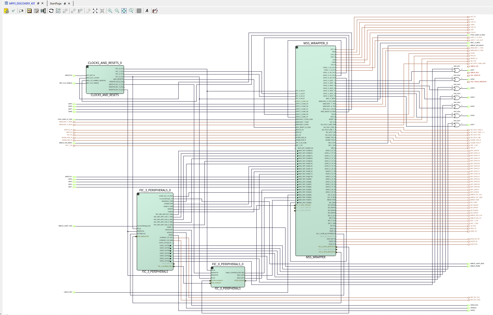
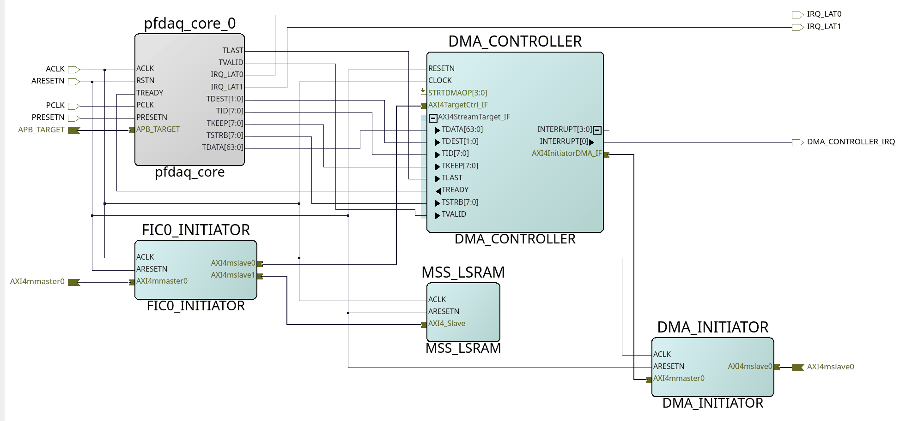
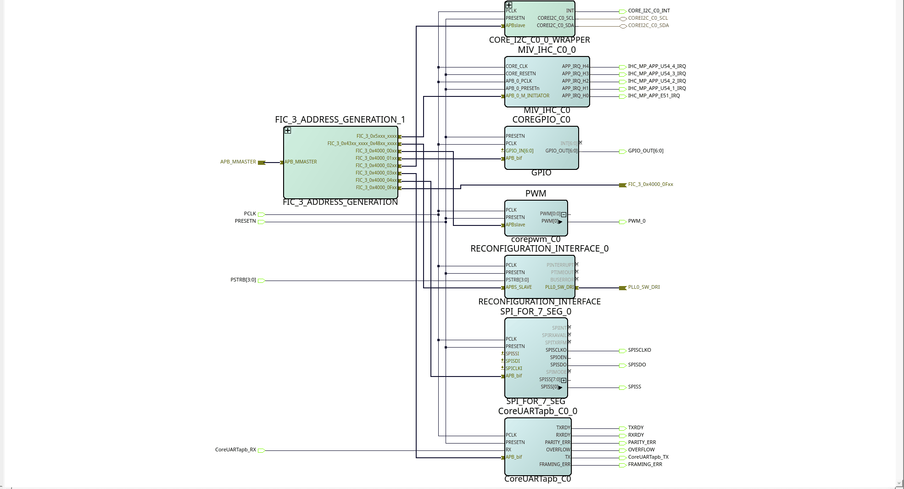

# Integrating custom RTL into a vendor design by script

After this module you can read the project's integration script line by line, say what each group of commands does to the design, and add your own HDL block to Microchip's reference design in a way that survives the vendor releasing a new version.

## Before you start

- **Level 3.** You should know what a SmartDesign is (a block diagram of components) and what the APB register bus is (module H01).
- **Tools:** none to read it. To rerun it you need the flow of module F05.

## The idea

The reference design is a tree of SmartDesign components: a top level `MPFS_DISCOVERY_KIT` that holds the processor subsystem and the peripherals, with sub-designs such as `FIC_0_PERIPHERALS` (everything behind the 125 MHz interface) and `FIC_3_PERIPHERALS` (everything behind the 50 MHz one). A block diagram can be edited by hand, but then the change lives in a binary-ish project file that cannot be reviewed or reproduced.

The alternative is to describe every edit as a command in a Tcl script. The script is text, so it can be diffed, reviewed and rerun, and it states exactly what was changed in a vendor design. The cost is that the commands must be exact and in the right order.

Adding your own RTL needs three kinds of command: **import** the source, **wrap** it as a core with named bus interfaces, and **connect** it into the diagram.

## On this board

### What the project adds

One HDL module, `pfdaq_core`, which holds the stream source and the two latency channels behind a single APB slot. Its top level is deliberately plain Verilog with the standard AMBA signal names, so the tool can recognise its bus. The address decode that splits the slot into three blocks is two lines:

```verilog
wire        sel_src  = PSEL & ~PADDR[7];
wire        sel_lat0 = PSEL &  PADDR[7] & ~PADDR[6];
wire        sel_lat1 = PSEL &  PADDR[7] &  PADDR[6];
```

### The integration script, step by step

`hw/libero/overlay/PFDAQ.tcl` replaces the vendor's own AXI4-Stream demo script. Its stages, with the real commands:

**1. Import the source and build the hierarchy.**

```tcl
import_files -convert_EDN_to_HDL 0 -library {work} \
    -hdl_source {./script_support/hdl/pfdaq/pfdaq_stream_src.v} \
    -hdl_source {./script_support/hdl/pfdaq/pfdaq_latency.v} \
    -hdl_source {./script_support/hdl/pfdaq/pfdaq_core.v}
build_design_hierarchy
```

The tool now knows the modules exist; it does not yet know how to connect them.

**2. Reconfigure the vendor's DMA controller** for a 64-bit AXI4-Stream input (`configure_core … "AXI4_STREAM_IF:true" "AXI_DMA_DWIDTH:64"`), and update its bus initiator to the same width. These are the settings behind the rules in module I04: the stream is as wide as the DMA's data bus.

**3. Add an APB slave slot** for the new block. The vendor's address decoder has a fixed number of slots; the script deletes the existing slot component and re-creates it from the vendor's own AXI-stream variant, so a slot for 0x4000_0F00 exists (`APBmslave15`, renamed `FIC_3_0x4000_0Fxx`), and carries that new port up through the two sub-designs that contain it.

**4. Wrap the RTL as a core.**

```tcl
create_hdl_core -file "${project_dir}/hdl/pfdaq_core.v" -module {pfdaq_core} -library {work} -package {}
hdl_core_add_bif -hdl_core_name {pfdaq_core} -bif_definition {APB:AMBA:AMBA2:slave} -bif_name {APB_TARGET} -signal_map {}
hdl_core_assign_bif_signal -hdl_core_name {pfdaq_core} -bif_name {APB_TARGET} -bif_signal_name {PADDR} -core_signal_name {PADDR}
```

An HDL core is a module the diagram can place. The *bus interface* (BIF) step is what turns eight loose ports into one connectable APB slave: the tool then lets you drag, or here script, one connection instead of eight. The vendor's name for the select signal is `PSELx`; the module's port is `PSEL`, so that one assignment names both sides explicitly.

**5. Instantiate and connect.**

```tcl
sd_instantiate_hdl_core -sd_name {FIC_0_PERIPHERALS} -hdl_core_name {pfdaq_core} -instance_name {}
sd_connect_pins -sd_name {FIC_0_PERIPHERALS} -pin_names {"DMA_CONTROLLER:TVALID" "pfdaq_core_0:TVALID"}
sd_connect_pins -sd_name {FIC_0_PERIPHERALS} -pin_names {"ACLK" "pfdaq_core_0:ACLK"}
```

The stream signals go to the DMA controller one by one: `TDATA`, `TKEEP`, `TSTRB`, `TLAST`, `TVALID`, `TREADY`, `TDEST`, `TID`. The clock and reset ports are tied to the sub-design's own `ACLK` and `ARESETN`. The APB side is brought up as a port and connected in the next level up, to the 50 MHz clock and reset of the FIC3 side, because the register block runs on that clock and the stream on the other (module H03).

**6. Take an interrupt out of the sub-design and into the processor subsystem.** Two of the subsystem's fabric-to-processor interrupt inputs were tied low in the reference design. The script must remove the tie before it can connect a signal:

```tcl
sd_clear_pin_attributes -sd_name {MPFS_DISCOVERY_KIT} -pin_names {MSS_WRAPPER_0:MSS_INT_F2M[1:1]}
sd_connect_pins -sd_name {MPFS_DISCOVERY_KIT} -pin_names {"FIC_0_PERIPHERALS_0:IRQ_LAT0" "MSS_WRAPPER_0:MSS_INT_F2M[1:1]"}
```

Line two connects the first latency channel to line 1, and a similar pair connects the second to line 5 (module F03 explains where those lines arrive). The script's own comment says the tie-off must be removed first; connecting over it without doing so was not tried.

**7. Generate and save.** After each level is edited, `generate_component … -recursive 0` and `save_smartdesign` write it back; the order is bottom up, because a parent refers to the generated version of its child.

**8. Bring in the project's timing constraints** with `import_files … -sdc {…pfdaq_cdc.sdc}`, to be applied after the vendor's script derives its own (module H10).

### The change to the vendor's own script

The vendor's top script chooses which integration file to source by build argument. The project does not edit that logic; it patches three places, in `reference-design-v2026.04.patch`:

| Hunk | What it does |
|---|---|
| project name | names the project `PFDAQ` when the stream variant is selected, so the project's files do not collide with the vendor's |
| the sourced file | runs the project's `PFDAQ.tcl` instead of the vendor's data-generator script |
| constraints | after the vendor derives its constraints, adds the project's file to place and route and to timing verification |

The third hunk is the one with a trap: `organize_tool_files` replaces the tool's file list, so the list must repeat every I/O and floorplan constraint file. The history of that mistake is case study K08.

### What it looks like in Libero

To follow along, open the project (module F05 says how), choose the Design Hierarchy tab at the bottom left and double-click `MPFS_DISCOVERY_KIT`, `FIC_0_PERIPHERALS` and `FIC_3_PERIPHERALS` in turn. Each opens as a canvas.

The reference design's top level is a SmartDesign canvas with four blocks: the clocks and resets, the MSS wrapper, and two blocks of fabric logic, one behind each fabric interface used here.



Inside `FIC_0_PERIPHERALS` is where `pfdaq_core` sits. Its stream outputs (`TDATA`, `TVALID`, `TLAST`, `TDEST`, `TID`, `TKEEP`, `TSTRB`, `TREADY`) go straight into the stream target of the DMA controller, its two latency interrupts leave the block as `IRQ_LAT0` and `IRQ_LAT1`, and its APB slot is reached through `APB_TARGET`. The DMA controller's initiator goes through `DMA_INITIATOR` to the fabric interface, and `FIC0_INITIATOR` also reaches the on-chip SRAM `MSS_LSRAM`.



`FIC_3_PERIPHERALS` is the register side. One address-decode block splits the APB range of the fabric interface into 256-byte slots (`0x4000_00xx` to `0x4000_04xx`, plus `0x4000_0Fxx`, which leaves the block as the port the project's slot is wired to), and behind them sit the reference design's peripherals: the inter-hart mailbox `MIV_IHC_C0`, a GPIO block, a PWM, a UART, a seven-segment SPI block and an I2C wrapper.



## Run it

This is a reading module. The project ran, from the repository root, `hw/libero/build.sh 6`, which applies the patch, copies the files above into the reference design and runs the vendor script with the argument that selects this path (module F05).

## What you should see

A build whose log ends with the pin-assignment line and a timing verdict (shown in modules F05 and H10), and a device that, when asked, reports the design version you gave it (`0006` for the v0.5.1 fabric, record `programming`).

## Evidence

- **Simulation of the wrapped block:** the same `pfdaq_core` runs in the latency testbench, which passes four phases against its Python model (record `sim-latency`).
- **Build:** 64 of 64 pins placed, timing met, 26.02 % of the logic elements (record `timing`).
- **Device:** the design name, checksum and version read back from the programmed chip (record `programming`).
- **Not shown:** the script's own log lines. They are very long and not published.

## When it goes wrong

| Symptom | Likely cause |
|---|---|
| A pin you connect still behaves as if tied low | the reference design tied it to a constant; clear its attributes first, as the script does |
| A BIF connection leaves signals unconnected | a core signal name does not match a standard bus signal name; map it explicitly, as `PSELx` is here |
| An error that a component is out of date | a child was regenerated after its parent; generate bottom up |
| A change to the vendor script stops the patch applying | that is the intended outcome of a patch against a pinned tag: update the overlay deliberately |
| A build that "worked" but the board is dead | an overwritten constraint list, case study K08 |

## Trade-offs and going further

- **A patch against a pinned tag** is the smallest honest statement of what changed in the vendor design. The price is that every new vendor release has to be re-fitted by hand.
- **The vendor's integration style is kept** (an HDL core with a BIF in a sub-design) so a reader who knows the reference design can follow the changes.
- **The script is long because the tool is explicit.** Most of its lines are one connection each. A short helper that connects a list of pin pairs would shorten it; the cost would be hiding what is connected.
- **Exercise:** add a second APB slave block next to `pfdaq_core`. Which stages of the script change, and which do not?
- **Exercise:** the script clears the tie-off on two interrupt inputs. How would you check, from the generated netlist, that no other signal was driving them?

<!-- nav:begin (generated by tools/gen_docs.py from the front matter; do not edit) -->
---

| | |
|---|---|
| **Read first** | [F05 The tool flow in batch: Libero, the IP vault and FlashPro Express](F05-tool-flow-in-batch.md) |
| **How to run** | Explanation with recorded evidence; nothing to run |
| **In the system** | [pfdaq_core](../system/README.md#pfdaq-core) · [FIC3 (APB, 50 MHz)](../system/README.md#fic3) · [Platform-level interrupt controller](../system/README.md#plic) · [CoreAXI4DMAController](../system/README.md#dma) |
| **Source** | [`hw/libero/overlay/PFDAQ.tcl`](../../hw/libero/overlay/PFDAQ.tcl): `create_hdl_core`, `hdl_core_add_bif`, `hdl_core_assign_bif_signal`, `sd_instantiate_hdl_core`, `sd_connect_pins`, `sd_clear_pin_attributes`, `generate_component`<br>[`hw/libero/overlay/reference-design-v2026.04.patch`](../../hw/libero/overlay/reference-design-v2026.04.patch): `organize_tool_files`, `AXI4_STREAM_DEMO`<br>[`hw/rtl/pfdaq_core.v`](../../hw/rtl/pfdaq_core.v): `pfdaq_core`, `sel_src`, `sel_lat0`, `sel_lat1` |
| **Evidence** | [Place and route result, timing met in all corners, 64 of 64 pins placed, 26 % of the fabric](../../evidence/v0.5.1/build/timing-and-utilisation.txt) (build, fabric v0.5.1, 2026-11-15)<br>[Programming, verify and device read-back of the v0.5.1 fabric](../../evidence/v0.5.1/build/programming.txt) (board, fabric v0.5.1, 2026-11-15)<br>[Latency unit simulation, four phases checked by the Python model](../../evidence/v0.5.1/sim/latency.txt) (sim, fabric v0.5.1, 2026-11-15)<br>[Top-level SmartDesign canvas: clocks and resets, MSS, FIC_0 and FIC_3 blocks](../../evidence/v0.5.1/build/libero-top-smartdesign.png) (build, fabric v0.5.1, 2026-11-15)<br>[FIC_0_PERIPHERALS canvas: pfdaq_core, DMA controller, initiator and target interconnects, MSS_LSRAM](../../evidence/v0.5.1/build/libero-fic0-peripherals.png) (build, fabric v0.5.1, 2026-11-15)<br>[FIC_3_PERIPHERALS canvas: APB address decode and the reference design peripherals](../../evidence/v0.5.1/build/libero-fic3-peripherals.png) (build, fabric v0.5.1, 2026-11-15) |
| **Related** | [F05 The tool flow in batch: Libero, the IP vault and FlashPro Express](F05-tool-flow-in-batch.md)<br>[H03 Crossing clock domains: toggles, snapshots and constraints](H03-clock-domain-crossing.md)<br>[H10 Timing closure, and the build that lost its pins](H10-timing-closure.md)<br>[K07 Three builds lost to brackets in a constraint file](../case-studies/K07-brackets-in-constraints.md)<br>[K08 Timing met, board dead: the missing pin constraints](../case-studies/K08-timing-met-board-dead.md) |
| **Status** | validated |
<!-- nav:end -->
