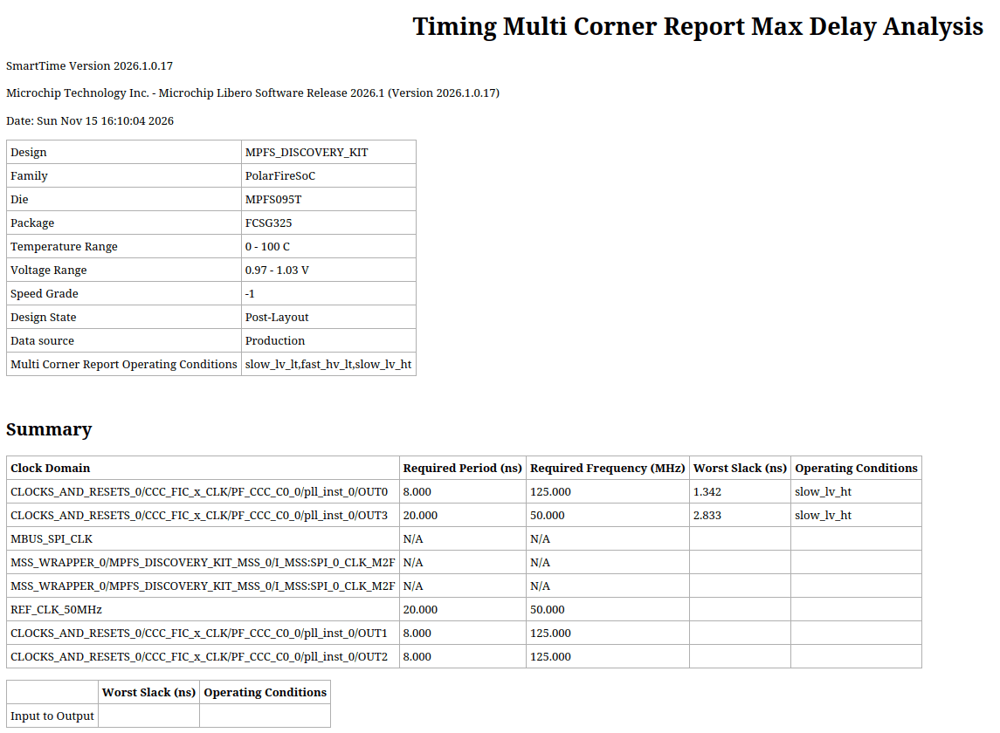

# Timing closure, and the build that lost its pins

After this module you can read a timing result from the build tool, say what a positive or negative slack tells you, explain why "timing met" is a statement about the constraints you gave and not about the board, and describe the build that proved it.

## Before you start

- **Level 4.** You should know what a clock domain is and why a signal that crosses between two needs care (module H03), and how the project's design is built from a script (module H09).
- **Tools:** none to read it.

## The idea

A clocked design works only if every signal gets from one register to the next within one clock period, minus the time the receiving register needs the data held steady. A timing tool checks this for every path.

| Term | Meaning |
|---|---|
| **Setup** | the data must arrive early enough before the capturing clock edge |
| **Hold** | the data must stay stable long enough after the edge |
| **Slack** | the margin: required time minus arrival time. Positive means the path has room; negative means it fails by that much |
| **Corner** | one combination of the chip's manufacturing, voltage and temperature conditions. Delays change with all three, so the tool checks several |
| **Constraint** | a statement you give the tool: a clock's period, a pin's location, a path to ignore. The tool can only check what it has been told |

Two clocks matter in this design: the 50 MHz bus clock (a period of 20 ns) and the 125 MHz stream clock (8 ns).

## On this board

### What the build reports

The record of the v0.5.1 build (`timing`) holds these lines:

```text
Info: Timing constraints have been met.
Info: Multi-Pass: Iteration 1, Seed Index 1,  Worst Slack = 1.342
Info: Multi-Pass: Have met stopping criterion (all timing constraints have been met), so ceasing iterations.
  Total violating paths eligible for improvement: 0
  Total violating paths improved: 0
```

How to read them:

- **"Timing constraints have been met"** is the verdict over every check the tool ran.
- **"Multi-Pass"** is place and route trying different random starting points ("seeds") until the design meets timing. Here the first attempt did, so it stopped.
- **"Worst Slack = 1.342"** is the margin of the tightest path. Slack in this tool is in nanoseconds. Which path it belongs to, and in which of the two clock domains, is not in the published record.
- **"Violating paths: 0"** says nothing needed repairing.

The checks are made for several corners. The build's own check (in `hw/libero/build.sh`) greps the tool's `has_violations` file for the `multi_corner` lines and stops if any says `violated`. The console record of the second analysis shows the corner combinations by name: `slow_lv_lt`, `fast_hv_lt` and `slow_lv_ht`, each with a maximum-delay (setup) and a minimum-delay (hold) report. The names read as process speed, voltage and temperature, for example "slow silicon, low voltage, low temperature". The project's notes record that setup and hold were met in all of them for v0.5.1.

The same result as the vendor's GUI shows it, in the multi-corner max-delay report:



The two clock domains the project uses are the first two rows: the 125 MHz domain (8 ns) with a worst slack of 1.342 ns and the 50 MHz domain (20 ns) with 2.833 ns. The first path listed under the 125 MHz domain starts and ends inside `pfdaq_core`. These are slacks after place and route in the slow corner; the report says nothing about paths the constraints leave out (see the guard below).

### Utilisation

The same record gives the size of the design:

| Resource | Used | Available | Share |
|---|---|---|---|
| 4-input look-up tables | 22,658 | 93,516 | 24.23 % |
| Flip-flops | 14,034 | 93,516 | 15.01 % |
| Logic elements | 24,334 | 93,516 | 26.02 % |

### A failure that the tool did see

Early in the project's history the status read-back path from the stream clock to the bus clock **failed timing by 0.707 ns**. A value that changes every cycle in one domain was being read directly in another. The fix was structural, not a tool setting: copy the status into the bus domain on a synchronised toggle (module H03). That failure is recorded in the project's decision log; the build report itself was not kept.

### Telling the tool what is intentional

Between two clocks that come from the same source, the tool times every crossing as if it were synchronous. The project's crossings are not; they are made safe by design. So `pfdaq_cdc.sdc` marks them:

```tcl
set_false_path -from [ get_cells "$pf/snap_*" ] -to [ get_cells "$pf/snap_*_p*" ]
```

A false path tells the tool not to check that path. This is a statement of trust, so it must be narrow. The proof that it is narrow is the second analysis: the same placed design checked again with the file removed. The published record is the tool's console log, which says "Timing constraints have not been met", and the tool's own reports list the violating paths. The path-level reading is in module H03: all of the 40 worst paths it lists are the intended crossings. The tool lists only the worst 20 per report, so the record supports "the worst paths are the intended ones", not "no others".

## The build that lost its pins

The first build of fabric v0.5.0 finished without error, and its timing report was clean. The board, programmed with it, stopped early in the boot monitor and had to be recovered by programming the previous job.

The cause was one command. The project added its constraint file to place and route with `organize_tool_files`, which **replaces** the tool's file list rather than adding to it. Place and route then had two files, and none of the pin or floorplan constraints. The record of that incident is the case study K08; the relevant fix is in the patch:

```tcl
organize_tool_files -tool {PLACEROUTE} \
    -file "${project_dir}/constraint/MPFS_DISCOVERY_KIT_derived_constraints.sdc" \
    -file "${project_dir}/constraint/pfdaq_cdc.sdc" \
    -file "${project_dir}/constraint/io/MPFS_DISCOVERY_KIT_BANK_SETTINGS.pdc" \
    ...
```

Why did the timing report stay clean? That was not investigated. A reasonable reading is that the tool checks the constraints it has, and pins without constraints are not violations of any of them. That is a hypothesis about the tool.

### What "timing met" does and does not say

| It says | It does not say |
|---|---|
| every constrained path meets setup and hold in the corners analysed | that every pin is where the board needs it |
| the design is no faster than your clock constraints require | that the clocks you gave are the clocks on the board |
| the crossings you marked as false paths are not checked | that those crossings are safe: that is a design argument (module H03), not a tool result |
| the margin of the worst path | that a path you forgot to constrain is fine |

### The guard

The project's answer was a check on the *result of the other stage*. After pins are assigned, the tool prints how many I/O macros it fixed and how many it could not. The build script reads that line and stops unless it says "0 unfixed". The record of the good build:

```text
Info:  I/O Bank and Globals Assigner identified 64 fixed I/O macros, 0 unfixed I/O macros
```

The first version of this guard fired too early and was moved to this line. A guard that looks at the wrong line is as bad as none.

## Run it

This is a reading module. What the project ran: `hw/libero/build.sh 6` for the timing report above, then `hw/libero/sta_without_cdc.tcl` run in the same Libero project for the second analysis. The second script re-lists the verify-timing constraints without the clock-crossing file and runs the tool again.

## What you should see

The lines quoted above, from the build's console output.

## Evidence

- **Timing met, worst slack 1.342 (ns), 64 of 64 pins placed, 26.02 % logic elements:** record `timing`.
- **The same design without the crossing constraints is reported as not meeting timing,** and the 40 worst paths it lists are the intended crossings: record `timing-without-cdc` and module H03.
- **The fabric that resulted works:** the 27-test board suite passes on it and the device reports the version and digests in the record `programming`.
- **Not shown:** the build reports of the earlier failures (the 0.707 ns path and the v0.5.0 build) were not kept; both are described from the project's decision log and notes.

## When it goes wrong

| Symptom | Likely cause |
|---|---|
| Timing fails on one path between two clocks | an unsynchronised crossing: fix the design (module H03), do not just constrain it away |
| Timing "passes" but the board is dead | a constraint list that lost files (case study K08) |
| Timing passes only for some seeds | a path very close to its limit: look at the worst slack, not only the verdict |
| A false-path line matches nothing | a register name in a form the tool cannot read; check by running without the file (case study K07) |
| The guard line does not appear in the log | the tool's message changed; the guard would then never fire, so test it |

## Trade-offs and going further

- **A worst margin of 1.342 ns, against clock periods of 8 ns and 20 ns,** leaves room. The project did not push the clocks, so it did not learn how much more the design could take.
- **Seeds are a way to buy margin, not to find a bug.** A design that needs a lucky seed is one change away from failing.
- **Guards have to be tested.** The project's guard for unplaced pins was first wrong; the way to know a guard works is to make it fail on purpose.
- **Exercise:** list three things the board needs that no timing report would flag if they were missing.
- **Exercise:** the false-path file has five commands. For each, write the sentence that justifies it, and the experiment that would show that sentence to be wrong.

<!-- nav:begin (generated by tools/gen_docs.py from the front matter; do not edit) -->
---

| | |
|---|---|
| **Read first** | [H03 Crossing clock domains: toggles, snapshots and constraints](H03-clock-domain-crossing.md)<br>[H09 Integrating custom RTL into a vendor design by script](H09-rtl-into-vendor-design.md) |
| **How to run** | Explanation with recorded evidence; nothing to run |
| **In the system** | [pfdaq_core](../system/README.md#pfdaq-core) · [Fabric clocks and resets](../system/README.md#fabric-clocks) · [FIC0 (AXI4, 125 MHz)](../system/README.md#fic0) · [FIC3 (APB, 50 MHz)](../system/README.md#fic3) |
| **Source** | [`hw/libero/build.sh`](../../hw/libero/build.sh): `multi_corner`, `violated`, `unfixed`<br>[`hw/libero/sta_without_cdc.tcl`](../../hw/libero/sta_without_cdc.tcl): `VERIFYTIMING`<br>[`hw/libero/overlay/pfdaq_cdc.sdc`](../../hw/libero/overlay/pfdaq_cdc.sdc): `set_false_path`<br>[`hw/libero/overlay/reference-design-v2026.04.patch`](../../hw/libero/overlay/reference-design-v2026.04.patch): `organize_tool_files` |
| **Evidence** | [Place and route result, timing met in all corners, 64 of 64 pins placed, 26 % of the fabric](../../evidence/v0.5.1/build/timing-and-utilisation.txt) (build, fabric v0.5.1, 2026-11-15)<br>[Timing analysis without the clock-crossing constraints (the tool's console log; the 40 worst violating paths it lists are the intended crossings)](../../evidence/v0.5.1/build/timing-without-cdc-constraints.txt) (build, fabric v0.5.1, 2026-11-15)<br>[Programming, verify and device read-back of the v0.5.1 fabric](../../evidence/v0.5.1/build/programming.txt) (board, fabric v0.5.1, 2026-11-15)<br>[Verify Timing report, max delay multi-corner summary](../../evidence/v0.5.1/build/libero-timing-summary.png) (build, fabric v0.5.1, 2026-11-15) |
| **Related** | [H03 Crossing clock domains: toggles, snapshots and constraints](H03-clock-domain-crossing.md)<br>[H09 Integrating custom RTL into a vendor design by script](H09-rtl-into-vendor-design.md)<br>[F05 The tool flow in batch: Libero, the IP vault and FlashPro Express](F05-tool-flow-in-batch.md)<br>[K07 Three builds lost to brackets in a constraint file](../case-studies/K07-brackets-in-constraints.md)<br>[K08 Timing met, board dead: the missing pin constraints](../case-studies/K08-timing-met-board-dead.md)<br>[B06 Programming safely: components, digests and what never to touch](B06-programming-safely.md) |
| **Status** | validated |
<!-- nav:end -->
