# Verification with an independent model

After this module you can explain why this project's testbenches do not decide whether the hardware is right, read the trace they leave behind, say what the Python checkers recompute and compare, and show for yourself that the checker catches a bug by planting one.

## Before you start

- **Level 3.** You should have run a Verilog testbench before and read H02.
- **Tools:** Icarus Verilog 12 and Python 3. No board.
- **Time:** a few minutes to run; longer to read the checkers.

## The idea

The usual way to test a block is a *self-checking testbench*: it drives the inputs, computes the expected outputs, and compares. The expected values are written by the same person, in the same language, often by copying from the design. A misunderstanding of the specification then ends up in both: the design is wrong, the check is wrong in the same way, and the test passes.

The approach here separates the two jobs.

1. **The testbench drives and records.** It applies register writes and backpressure, and writes every observable event to a text file, the **trace**. It does not judge the data.
2. **A separate program judges.** A Python script reads the trace and recomputes, from the specification alone, what the hardware should have produced. It never looks at the RTL. It prints a verdict.


1. `tb_pfdaq_latency.v` plays software on the bus: it writes the registers and acknowledges each interrupt after a random delay.
2. Its observer on the interrupt lines and the bus logs what it sees to the trace.
3. The trace, `sim/lat_trace.txt`, is plain text: `I` for an interrupt rising, `K` for an `ACK` write, `R` for a register read, `H` for a histogram bin.
4. `check_latency.py` reads only the trace. It never reads the RTL, and recomputes the latencies, the statistics and its own histogram.
5. It prints `RESULT: PASS`, or `FAIL` with the first mismatches. `make` succeeds only if the last line says `PASS`.

This helps in three ways. The checker is written in a different language with a different mindset, so it is less likely to repeat the design's mistake. Standard library code does part of the work: the CRC is compared with `zlib.crc32`, which has nothing to do with the Verilog CRC. And the trace is plain text, so a failing run can be read with `grep`.

Independence has a limit. The author of the RTL and of the checker is the same person, working from the same understanding of the specification. The method catches transcription errors and implementation bugs; it cannot catch a wrong specification. That is one reason the board suite exists too (see Evidence, below).

## On this board

Two testbenches, two checkers, one Makefile:

| Testbench (records) | Checker (judges) | Make target | What it covers |
|---|---|---|---|
| `tb_pfdaq_stream_src.v` | `check_trace.py` | `make -C hw sim-stream` | the stream source: frames, payloads, CRC, faults, real-time mode, abort |
| `tb_pfdaq_latency.v` | `check_latency.py` | `make -C hw sim-latency` | the latency unit: timing, statistics, histogram, overrun, spurious acknowledge |

`make -C hw sim` runs both. Each target compiles with `iverilog -g2005`, runs `vvp`, passes the trace to the checker, and succeeds only if the checker's last line is `RESULT: PASS`.

### The stream trace

The testbench writes one line per event to `sim/trace.txt`. The first letter says what it is:

| Line | Meaning | Example |
|---|---|---|
| `S` | start of a scenario: all its parameters | `S 2 13 20 7 1 00000000 30 0 0 0 2 0 0 0` |
| `B` | one 32-bit word transferred on the stream: scenario, data, `TLAST`, time, `TDEST` | `B 1 a55a0008 0 2372 0` |
| `R` | a register read through the bus: scenario, offset, value | `R 1 20 00000005` |
| `P` | a register read before the run, for deltas | |
| `END` | the simulation reached the end | |

A 64-bit beat is logged as two `B` lines, low word first. The full run leaves about 31,000 `B` lines for 20 scenarios.

The checker also fails on any line it does not recognise, so a `VALID_GAP`, `PROTOCOL_ERROR` or `KEEP_ERROR` written by the testbench shows up as `trace: ...` in the result.

### What the stream checker recomputes

For each scenario, `check_trace.py` rebuilds the frames from the `B` lines and then compares every property below. It never reads the RTL; the formulas are written again in Python.

| Property | How it is checked |
|---|---|
| **Header** | word 0 equals `0xA55A0000` plus the payload length |
| **Sequence** | the number starts at `NEXT_SEQ` read before the run and increments by one per frame, accounting for an injected skip; in real-time mode it may jump forward, and the jump is added up as gaps |
| **Payload, three modes** | counter: `{seq[15:0], i}`; PRBS: `xorshift32` seeded with `seq ^ 0x9E3779B9`; FIR: triangle wave through an 8-tap filter with the coefficients read back from the registers. All three are computed in the script |
| **CRC** | `zlib.crc32` over the little-endian bytes of words 0 to N+2, compared with the last word |
| **Fault detection** | for each injected fault (CRC, sequence skip, flipped payload bit), the set of frames the checker finds bad must be exactly the frame that was targeted, no more and no fewer |
| **`TLAST`** | on the last word of the packet only: the whole burst, or each frame in real-time and per-frame mode |
| **`TDEST`** | in real-time mode, frame *i* uses destination `i mod (destinations)` |
| **Timestamps** | strictly increasing; in real-time mode, on the slot grid (multiples of `RATE` apart) |
| **Counters** | `FRAMES_SENT` and `WORDS_SENT` after the run equal what was seen on the stream; `DROPS` is zero outside real-time mode |
| **Drop accounting** | in real-time mode, sent plus dropped equals the slot count; sequence gaps never exceed `DROPS`; credits left equal credits given minus frames sent; `NEXT_SEQ` equals the last sequence number plus the dropped slots after it |
| **Abort** | in a burst: the real frames, then only zero words up to the full armed length, `TLAST` on the last of them only, `STATUS.aborted` set, and the run shorter than requested |
| **Registers** | `ID` and `VERSION` after reset; the eight FIR coefficients read back as written; the status before and after `FORCE_ABORT` |

Scenario 16 gives a sense of how sharp the check is. A burst of 50 frames of 104 words is aborted. The checker finds 13 real frames (read from `FRAMES_SENT`) and requires 3,848 zero words after them, which is the full run minus those 13 frames, and requires `TLAST` on the last of those words and on none before it, and requires the register counters to agree.

### What runs inside the testbench instead

Some properties cannot be judged from a trace after the fact, because they concern what happens in every clock cycle, not what was transferred. The stream testbench checks three of them directly, with an `always @(posedge ACLK)` block, and writes a line to the trace when one is broken:

| Property | Trace line | Why it is checked live |
|---|---|---|
| Signals stable while stalled: if `TVALID` was high and `TREADY` low, the next cycle must show the same data, `TLAST` and `TDEST` | `PROTOCOL_ERROR` | the trace only logs transferred beats, so a change during a stall would never appear |
| No `TVALID` gap inside a packet | `VALID_GAP` | the trace has no idle cycles; a gap is the absence of an event (case study K03) |
| `TKEEP` equals `TSTRB`, and is all ones except on a final 4-byte beat | `KEEP_ERROR` | byte lanes are not part of the word trace |

The split is a rule of thumb: **data goes through the independent model, per-cycle protocol goes through monitors in the testbench.** Both end in the same verdict, because the checker rejects the trace if any monitor line is in it.

### The latency checker

The latency unit has a different kind of output: timing, not data. `tb_pfdaq_latency.v` plays "software" with a random delay before each acknowledge, and an observer on the interrupt lines and the bus logs three kinds of event: `I`, an interrupt line rising; `K`, a write to the `ACK` register together with the state of the line; `R`, a register read. After each phase it reads back every statistic and all 64 histogram bins (`H` lines).

`check_latency.py` recomputes everything from the `I` and `K` lines:

- **Each latency**, as the acknowledge cycle minus the rise cycle plus one (the observer sees the line one edge late). It must match the `LAT_LAST` value read back after every acknowledge, in order.
- **The counters**: `EVENTS` and `ACKS` equal the number of interrupts and acknowledges seen; `MIN`, `MAX` and the 64-bit sum equal the recomputed ones; `SPURIOUS` equals the number of acknowledges with nothing pending.
- **The histogram**: every one of the 64 bins equals the count the checker gets from its own binning function, `bin_of`, two bins per power of two.
- **The phases' purposes**: overruns must be non-zero where the acknowledge was deliberately late and zero where not; the number of events must equal `COUNT_LIMIT`; with no jitter the gap between events is exactly the period; with jitter the gaps lie in the jitter range and take more than ten distinct values.

Here are the first six lines of one channel's trace, picked out with `grep`. They are from a run I made of the unmodified testbench; the checker's own arithmetic is written under the lines.



1. `I 1 0 494`: in phase 1 the line of channel 0 rose at clock 494. The observer in the testbench writes this, not the unit.
2. `K 1 0 505 1`: the `ACK` write was seen at clock 505, and the last field, 1, says the line was high.
3. `R 1 a0 0000000c`: the unit's `LAT_LAST`, read back after the `ACK`, is `0x0c`. The checker computes 505 − 494 + 1 = 12 on its own and compares.
4. The next event gives 944 − 894 + 1 = 51 = `0x33`. Every event of every phase is checked this way, in order.

### Scenarios

The 20 stream scenarios and what each is for:

| Scenario | What it exercises |
|---|---|
| 1 | plain burst, full-speed receiver |
| 2 | per-frame `TLAST` with idle gaps, receiver ready 30 % of the time |
| 3, 4, 5 | one injected fault each: bad CRC, skipped sequence number, flipped payload bit |
| 6 | the shortest frame (one payload word), with a sequence skip on frame 0 |
| 7 | a long burst: 40 frames of 504 words, about 80 kB |
| 8 | an odd number of payload words, hence a 4-byte last beat |
| 10 | PRBS payload |
| 11, 12 | FIR payload, with backpressure and at full rate |
| 13 | real-time, drops for lack of credit |
| 14 | real-time, drops for being busy, FIR payload |
| 15 | real-time with a payload fault |
| 16 | abort in the middle of a burst |
| 20 | abort in a FIR burst with an odd frame length |
| 21 | abort one cycle after `START` |
| 17 | abort between packets |
| 18 | abort in real-time mode |
| 19 | a normal run after a `FORCE_ABORT`, to show the source recovered |

Between scenarios 18 and 19 the testbench also applies `FORCE_ABORT` to a source whose receiver is stalled, and the checker verifies that `STATUS` goes from busy to idle-and-aborted.

## Run it

1. Run both simulations:

   ```sh
   make -C hw sim
   ```

   Each ends with `RESULT: PASS`. The stream checker prints one line per scenario; the latency checker one per phase and channel.

2. Look at the trace the stream checker read, `build/sim/sim/trace.txt`:

   ```sh
   grep '^S ' build/sim/sim/trace.txt | head -3
   grep '^R 1 ' build/sim/sim/trace.txt | head -3
   ```

3. **Plant a bug and watch the model find it.** Work in a copy so the repository stays clean:

   ```sh
   cp -r hw /tmp/hw-bug && cd /tmp/hw-bug
   sed -i '769s/t << 5/t << 6/' rtl/pfdaq_stream_src.v
   make sim-stream OUT=/tmp/hw-bug-out
   ```

   Line 769 is the last line of the `xorshift32` function in the RTL. The change shifts by 6 instead of 5, a one-character error of the kind that is easy to make and hard to see by eye.

## What you should see

Step 1 ends both runs with `RESULT: PASS`. The recorded results are in the evidence entries `sim-stream` and `sim-latency`.

In step 2, the `S` lines show the parameters of each scenario (here scenario 2 has 13 payload words, 20 frames, a gap of 7 cycles, per-frame `TLAST`, and 30 % ready), and the `R` lines show the register values read after scenario 1: `STATUS` 2 (done), `FRAMES_SENT` 5, `WORDS_SENT` 0x3c, which is 60: five frames of 12 words.

In step 3, the checker fails the run and names the scenarios and the first differing word. The result recorded when this experiment was run for this page:

```
RESULT: FAIL
   scenario 10: frame 0 payload differs at word 0
   scenario 10: frame 1 payload differs at word 0
   ...
   scenario 10: detected {'crc': [], 'seq': [], 'pay': [0, 1, 2, 3, 4, 5]}, expected {'crc': [], 'seq': [], 'pay': []}
   scenario 15: frame 0 payload differs at word 0
   ...
```

Three scenarios fail: 10, 15 and 17. These are exactly the three that use the PRBS payload; the counter and FIR scenarios are unaffected. The error message says where to look. The report is detailed enough to localise the bug to the PRBS generator without opening a waveform. Notice also that **the CRC check did not fail**: the RTL computes the CRC over the payload it generated, wrong or not, so the frame is internally consistent. Only the independent recomputation of the payload exposes the error. A testbench that checked only the CRC would have passed.

A second planted bug shows the checker's other layer. Removing the credit decrement from the real-time logic (`credits <= credits + credit_add - {15'd0, due & can_start}` becomes `credits <= credits + credit_add`) gives:

```
   scenario 13: credits left 12, expected -18
   scenario 13: credit-limited run: sent 30 dropped 0, expected 12/18
   scenario 14: credits left 100, expected 90
   scenario 15: credits left 100, expected 88
   scenario 18: credits left 100, expected 95
```

Every frame is still correct, but the credit accounting is not, and the counters are cross-checked against the stream.

The same method catches a bug in the latency unit. Here the planted bug is the one from module H07: in a scratch copy of `hw/`, `lat_now` loses its `+ 1`. I ran it for this page with `make sim-latency` in the copy.


1. The `sed` command changes `lat_now = lat_cnt + 32'd1` to `lat_now = lat_cnt` in `rtl/pfdaq_latency.v` of the copy.
2. `make sim-latency` prints `RESULT: FAIL`. The compile lines and the four phase summaries above it are left out of the figure; the summaries still look normal, because they are computed from the trace.
3. The `LAT_LAST` values the unit reports (11, 50, 12 ...) differ from the trace's (12, 51, 13 ...). The checker never used the unit's own value.
4. The minimum reads 10 instead of 11, the maximum 111 instead of 112 and the sum 3604 instead of 3664: 60 samples, each one count low.
5. Bin 6 holds 4 samples where the checker's own binning counts 1. The report lists more bins and the other phases after these lines.

## Do the same in your project

The method does not depend on this design. It needs a simulator that can write a text file, and a script in another language.

1. **Write the trace format first.** One line per observable event, the first letter saying what it is (`B` for a transferred word, `I` for an interrupt rising, `R` for a register read, `H` for a histogram bin, as here), and a final `END` line. Everything the checker needs must be in the trace, with the clock cycle where timing matters.
2. **Make the testbench drive and record, and nothing else.** Copy the structure of `tb_pfdaq_latency.v`: register-bus tasks (`apb_wr`, `apb_rd`), a task that plays the software (`serve`), an observer in an `always @(posedge PCLK)` block that logs with `$fwrite`, and a global timeout so a hang ends the run.
3. **Put per-cycle rules in monitors inside the testbench.** What a trace of transferred data cannot show (signals stable during a stall, no `TVALID` gap inside a packet, byte lanes) gets an `always @(posedge ACLK)` check that writes a named line (`PROTOCOL_ERROR`, `VALID_GAP`, `KEEP_ERROR`) to the trace.
4. **Write the checker from the specification, not from the RTL.** In Python, recompute every property from the trace and take what you can from a library that has nothing to do with your design (`zlib.crc32` for a CRC). The checker must reject a line it does not recognise and a trace without `END`.
5. **Give every scenario a purpose and an expected outcome.** In `check_latency.py` the slow phase must show overruns and the others none; a counted run must have exactly `COUNT_LIMIT` events; a run without jitter must have the exact period. Fix the random seed (the testbench uses `seed = 7`) so a failure can be replayed.
6. **Fix the verdict contract.** The checker prints `RESULT: PASS` or `RESULT: FAIL` as its last line and exits with a matching status. Copy the Makefile rule of `sim-latency`: compile with `iverilog -g2005`, run `vvp`, pipe the trace to the checker with `tee`, and succeed only if `tail -1` of the result contains `PASS`.
7. **Plant a bug before you believe a pass.** In a scratch copy change one character of the RTL, as in "Run it", and see the checker fail and say where. A planted bug that the checker misses means the checker is a copy of the design.
8. **Write down the limits** as this page does: no coverage measurement, one simulator, one author for both sides.

What not to change:

- **The checker never reads the RTL**, and never takes the unit's own value as the expected one: the latency checker computes each latency from `I` and `K` and only then compares it with `LAT_LAST`.
- **The testbench does not judge data.** If you add a comparison there, it will share the design's misunderstanding.
- **Unknown lines fail.** A checker that ignores what it does not understand lets a monitor's complaint pass.
- **Edit a copy, never the repository,** when you plant a bug.

## Evidence

- **Simulation:** all 20 stream scenarios and all four latency phases pass in the recorded runs (`sim-stream`, `sim-latency`). The two planted-bug runs above were made for this page in scratch copies of `hw/`; nothing under `hw/` was changed, and no record of them is published.
- **Board:** the same idea runs on the board. The capture tool `pfdaq_cap` recomputes every frame it receives in software, using the same payload formulas, and the suite reports sequence, payload and CRC errors per test. Of the 27 functional tests, nine inject a fault (three fault types in each of the three payload modes), and they rely on that recomputation to count the injected faults exactly. Records: `suite-freertos`.

## Limits of this method

- **No coverage measurement.** Nothing reports which lines, states or conditions of the RTL the scenarios reached. The list of scenarios is the coverage statement, and it is only as good as its author's imagination.
- **Constrained-random only in one place.** `TREADY` is random with a chosen probability and a fixed seed. Frame lengths, counts, fault positions and abort times are chosen by hand.
- **No model of the vendor DMA.** The source is tested against a sink that is only ready or not ready. The behaviour of the real DMA, which caused the case study K03, appears only on the board.
- **One simulator.** Icarus Verilog 12 only. A construct that a synthesis tool or another simulator treats differently would not be found here.
- **Clock-domain crossings are not exercised for metastability.** Simulation of RTL has no metastability; module H03 covers what is and is not checked.
- **Same author, same specification.** As said above, a misreading of the requirements would be built into both sides.

## Trade-offs and going further

- **A trace costs disk and time.** The stream run writes about 31,000 lines. A checker that runs live, in the testbench, would avoid the file but give up the second language, which is the point.
- **Checking after the fact cannot steer the stimulus.** The testbench cannot react to a failure, for instance by stopping at the first bad frame. For a design this size that is a fair price.
- **Exercise:** change the polynomial in the checker, not in the RTL, and see what the report looks like when the model is wrong instead of the design. What differs from the report of a design bug?
- **Exercise:** find a bug the checker would *not* catch. Hint: look at what is neither in the trace nor in a register.

<!-- nav:begin (generated by tools/gen_docs.py from the front matter; do not edit) -->
---

| | |
|---|---|
| **Read first** | [H02 AXI4-Stream: the handshake, backpressure and TLAST](H02-axi4-stream.md) |
| **How to run** | Simulation only: Icarus Verilog and Python, no board |
| **In the system** | [Stream source](../system/README.md#pfdaq-stream-src) · [Latency unit (two channels)](../system/README.md#pfdaq-latency) · [pfdaq_cap](../system/README.md#pfdaq-cap) |
| **Source** | [`hw/tb/tb_pfdaq_stream_src.v`](../../hw/tb/tb_pfdaq_stream_src.v): `VALID_GAP`, `PROTOCOL_ERROR`, `KEEP_ERROR`<br>[`hw/tb/check_trace.py`](../../hw/tb/check_trace.py): `xorshift32`, `tri16`<br>[`hw/tb/tb_pfdaq_latency.v`](../../hw/tb/tb_pfdaq_latency.v)<br>[`hw/tb/check_latency.py`](../../hw/tb/check_latency.py): `bin_of`<br>[`hw/Makefile`](../../hw/Makefile) |
| **Evidence** | [Stream source simulation, 20 scenarios checked by the Python model](../../evidence/v0.5.1/sim/stream.txt) (sim, fabric v0.5.1, 2026-11-15)<br>[Latency unit simulation, four phases checked by the Python model](../../evidence/v0.5.1/sim/latency.txt) (sim, fabric v0.5.1, 2026-11-15) |
| **Related** | [H02 AXI4-Stream: the handshake, backpressure and TLAST](H02-axi4-stream.md)<br>[H04 CRC-32 at 64 bits per clock](H04-crc32-two-words-per-clock.md)<br>[H05 A FIR filter on math blocks, decoupled by a FIFO](H05-fir-on-math-blocks.md)<br>[H06 Real-time sources: slots, credits and honest drops](H06-real-time-source.md)<br>[H07 Measuring software from hardware: the latency unit](H07-latency-unit.md)<br>[H08 Histograms in block RAM: read-modify-write without hazards](H08-histogram-in-ram.md)<br>[K03 A DMA core that needs TVALID without gaps](../case-studies/K03-tvalid-gaps.md) |
| **Status** | validated |
<!-- nav:end -->
