# Reaching fabric registers from Linux

After this module you can get a Linux program to read and write a register block in the FPGA fabric, say why the obvious way (`/dev/mem`) stopped working on this board, and name the two rules that keep the access correct: describe the block in the device tree, and use 32-bit stores.

## Before you start

- **Level 2.** You should know what the register block looks like from the hardware side (module H01) and what the device tree does (module B04).
- **Board:** the shared baseline. Every board result on this page comes from earlier runs; nothing was run while the page was written.

## The idea

A fabric register block is just physical addresses on a bus. From Linux there are three ways to reach them:

| Way | What it is | Good for | Cost |
|---|---|---|---|
| `/dev/mem` | map any physical address into a program | a quick look | the kernel may refuse; no interrupts; everything is the program's responsibility |
| **UIO** | a small kernel driver exposes one described block as `/dev/uioN`, with a blocking interrupt | most user-space drivers | the block and its interrupt must be in the device tree |
| A real kernel driver | the block is a device with a proper API | anything others will use | the most work |

This project went through the first two, in that order.

## On this board

### The block and where it sits

The stream source and the latency unit sit in one 256-byte window of the fabric's APB bus, at `0x4000_0F00` (module H01 has the register map). Everything in that 4 KiB page of the bus address space belongs to different fabric blocks:

| Address | Block |
|---|---|
| `0x4000_0000` | PWM (reference design) |
| `0x4000_0200` | I2C (reference design) |
| `0x4000_0300` | UART (reference design) |
| `0x4000_0F00` | **pfdaq: stream source and latency unit** |

That sharing is the first trap.

### Trap 1: a locked-down kernel

Linux on this board is built with `CONFIG_STRICT_DEVMEM=y` and `CONFIG_IO_STRICT_DEVMEM=y`. The first option restricts `/dev/mem` to areas that are not kernel RAM. The second goes further and refuses a mapping of any page whose address range is **already claimed by a driver**. The three reference-design blocks above each have a driver, and they claim parts of the very page the project's registers share. The first Python tool, which opened `/dev/mem`, was refused until the drivers were unbound. The project's setup script at the time did exactly that:

```sh
for p in "mchp-core-pwm 40000000.pwm" "microchip-corei2c 40000200.i2c" "mchp_coreuart 40000300.serial"; do
    ...
    echo $2 > /sys/bus/platform/drivers/$1/unbind
done
devmem2 0x40000F00 w | tail -1
```

It worked but was fragile: it had to be run after every boot, it removed drivers other things might need, and it left no way to wait for an interrupt. The record of the decision (D20) calls it "temporary: the proper fix is a device-tree node for the stream source".

### The fix: a UIO node in the device tree

```dts
pfdaq_src: uio@40000f00 {
    compatible = "generic-uio";
    linux,uio-name = "pfdaq_stream_src";
    reg = <0x0 0x40000f00 0x0 0x100>;
    interrupt-parent = <&plic>;
    interrupts = <119>;
};
```

Three things make this work:

1. `generic-uio` tells the kernel to hand the block to the UIO driver. The boot's command line enables it (`uio_pdrv_genirq.of_id=generic-uio`, visible in the boot record).
2. The UIO driver maps the registers **without requesting the region**, so it does not collide with the three other drivers' claims. The project's own UIO driver (module I03) says so in its comment: "plain ioremap: the region is not requested, exactly like uio_pdrv_genirq".
3. The interrupt, fabric line F2M[1] as PLIC source 119, becomes the device's wake-up (module I02).


1. `/dev/mem` maps any physical address, and the kernel's strict devmem options look at the whole page.
2. The page at `0x4000_0000` holds the PWM, the I2C and the UART of the reference design, each claimed by a driver, so the mapping is refused.
3. The UIO node is bound to the generic UIO driver.
4. That driver maps the page with a plain `ioremap` and does not request the region, so it does not collide with the three claims.
5. The stream source at `0x4000_0F00` is reached through that mapping.

### Trap 1b: UIO maps whole pages

The UIO core can only map page-aligned regions, and `0x4000_0F00` is not aligned. Both the stock driver and the project's driver therefore map the page and record the offset:

```c
p->info.mem[0].addr = r->start & PAGE_MASK;
p->info.mem[0].offs = r->start & ~PAGE_MASK;
p->info.mem[0].size = PAGE_ALIGN(p->info.mem[0].offs + resource_size(r));
```

A program that maps the device from offset 0 gets the **page** at `0x4000_0000` and must add `0xF00` itself. The Linux tools do: `#define SRC_OFF 0xF00u` and `src = (volatile uint32_t *)((uint8_t *)m + SRC_OFF)`. The first version of the driver did not align the region and the kernel refused to map it (`ENODEV`).

### Finding the device

UIO numbers are not stable: which `/dev/uioN` is the stream source depends on probe order. The tools therefore look the device up by the **name** in the device tree:

```c
snprintf(path, sizeof(path), "/sys/class/uio/%s/name", e->d_name);
if (read_str(path, val, sizeof(val)) || strcmp(val, name))
    continue;
snprintf(path, sizeof(path), "/dev/%s", e->d_name);
int fd = open(path, O_RDWR | O_SYNC);
*map = mmap(NULL, maplen, PROT_READ | PROT_WRITE, MAP_SHARED, fd, 0);
```

That is `open_uio` in `pfdaq_cap.c`. The capture tool uses it twice: once for `pfdaq_stream_src` and once for the DMA controller's own UIO device, `dma-controller@60010000`, which the vendor's device tree and driver provide. After mapping, it checks the register block's ID before doing anything else:

```c
if (src[SRC_ID / 4] != SRC_ID_VALUE) { fprintf(stderr, "stream source ID %08x\n", ...); ... }
```

`SRC_ID_VALUE` is `0x50464451`, the ASCII letters "PFDQ". Reading it first catches a wrong device, a wrong offset and an unprogrammed fabric with one comparison.



1. The device-tree node `uio@40000f00` names the device `pfdaq_stream_src` and says it is `generic-uio`.
2. The UIO driver maps the page at `0x4000_0000` and exposes it as `/dev/uioN`.
3. `open_uio` in `pfdaq_cap.c` finds `uioN` by that name, maps the page and adds `SRC_OFF` (`0xF00`).
4. Every access is a 32-bit load or store through a `volatile uint32_t *`; byte stores are decoded as whole-register writes.
5. The stream source answers at `0x4000_0F00` over FIC3.
6. The first read is the ID word, which must be `0x50464451`; if it is not, the tool stops.

### Trap 2: 32-bit stores

The registers belong to an APB slave that has no byte strobes. A byte store to a register is decoded as a whole-register write. Python's memory-mapped slices copy bytes, so the first tool corrupted its own configuration. The fix was a two-line C helper doing a real `*p = v` through a `volatile uint32_t *`. Case study K02 is the full story; the rule is part of the register contract (module H01): **32-bit accesses only**, and the C tools declare every register pointer as `volatile uint32_t *`.

## Run it

These are the commands the project ran. The tools do the opening themselves, so the evidence of success is that the whole board suite runs through them.

```sh
# what the tools look up: UIO devices and their names (the board's output is in the device-tree-checks record)
grep -H . /sys/class/uio/uio*/name

# the capture tool: maps both UIO devices, checks the ID, runs a burst
pfdaq_cap -r -w 252 -f 1024 -n 32
```

To see the old trap, the legacy script `tests/legacy/pfdaq_setup.sh` shows the unbind-then-`devmem2` route; it is kept for register-level tests only and was not run on the final fabric.

## What you should see

- The boot record shows the command line that enables the generic UIO driver for the device-tree node, and the device-tree check shows the three UIO names the kernel created.



1. The kernel command line carries `uio_pdrv_genirq.of_id=generic-uio`, which is what lets `compatible = "generic-uio"` bind (the time stamp of the line is cut in the figure).
2. `pfdaq_stream_src` is the name the device-tree node gave the device, and the name the tools search for.
3. It is `uio1` in this record, but the number depends on probe order; the DMA controller is a second UIO device, also found by name.
- The suite (`suite-freertos`) passes every functional test through UIO: bursts, faults, real-time mode and the latency measurements all reach the registers this way. The capture tool refuses to run if the ID check fails, so a pass implies the mapping and the offset were right.

## Do the same in your project

The goal is a user-space program that reaches your own register block through UIO, finds it by name and cannot silently talk to the wrong place. The names below are this project's; replace them with yours.

1. **Describe the block in the device tree.** Copy the `pfdaq_src` node and change four things: the unit address and `reg` (here `0x40000f00` and `0x100` bytes), `linux,uio-name` (here `pfdaq_stream_src`), `interrupt-parent` and `interrupts` (here PLIC source 119, which the project's tree comments as 118 plus the F2M index). Keep `compatible = "generic-uio"`.
2. **Tell the kernel to use the generic driver.** Put `uio_pdrv_genirq.of_id=generic-uio` on the kernel command line, as the project's boot does.
3. **Work out your page offset.** UIO maps whole pages, so the program maps the page and adds the low 12 bits of your `reg` address itself. Here that is `0xF00`, the constant `SRC_OFF` in `pfdaq_cap.c`.
4. **Copy `open_uio`.** It walks `/sys/class/uio`, reads each `name` file, compares it with your name, then opens `/dev/uioN` with `O_RDWR | O_SYNC` and maps one page with `MAP_SHARED`. Pass your own name; never write `/dev/uio1` into a tool.
5. **Declare every register pointer as `volatile uint32_t *`** and do whole-word loads and stores only. No `memcpy`, no byte helpers, and no Python slices on the mapped memory (case study K02).
6. **Give your block an ID register and read it first.** This project's block has one at offset 0 with the value `0x50464451`; choose your own four letters, define the constant next to the offsets, and make the tool stop if the read differs. It catches a wrong device, a wrong offset and an unprogrammed fabric in one comparison.
7. **Check it.** List the names with `grep -H . /sys/class/uio/uio*/name` and look for yours. Then run your tool: if it gets past the ID check, the name lookup, the mapping and the offset are right. The project's own proof is the suite, which reaches every register through this path.

What not to change:

- Do not map the block through `/dev/mem` on a kernel built with `CONFIG_IO_STRICT_DEVMEM` when a driver has claimed another block in the same page.
- Do not rely on the UIO number; look the device up by name.
- Do not give the UIO core an unaligned address if you write your own driver: map the page and record the offset (`ENODEV` otherwise).
- Do not let a second program map the same register window at the same time.

## Evidence

- **Boot record** (`boot-uboot-linux`): the kernel command line with `uio_pdrv_genirq.of_id=generic-uio`.
- **Device-tree checks** (`device-tree-checks`): the `/sys/class/uio/uio*/name` lines shown above: `fpga_lsram`, `pfdaq_stream_src` and `dma-controller@60010000`.
- **Suite** (`suite-freertos`): 27 of 27 functional tests, all through the UIO devices.
- **Kernel configuration:** `CONFIG_STRICT_DEVMEM` and `CONFIG_IO_STRICT_DEVMEM` are set in the Yocto build's kernel configuration (not part of the repository).
- **The `/dev/mem` refusal** was observed on the board during bring-up and is recorded in the project's notes; the failing output was not kept.

## When it goes wrong

| Symptom | Likely cause |
|---|---|
| `open("/dev/mem")` works but `mmap` fails, or the mapping is refused | The page is claimed by a driver (strict devmem). Use UIO |
| `mmap` of the UIO device fails with `ENODEV` | The driver registered an unaligned region. Map the page and record the offset |
| The ID reads `0xFFFFFFFF` or `0` | Wrong offset (you mapped the page and forgot `0xF00`), or the fabric is not programmed, or the clocks for the bus are off |
| Register values are scrambled after a write | A non-32-bit access (K02). Use `volatile uint32_t *` |
| `/dev/uio0` is the wrong device on a different image | UIO numbers change. Look up by name |
| The tool cannot find `pfdaq_stream_src` | The device-tree node is missing or the generic UIO driver is not enabled on the command line |

## Trade-offs and going further

- **UIO is a good first driver.** It costs a device-tree node and no kernel code, and it gives a blocking interrupt. It gives up everything else a kernel driver offers: permission control beyond file modes, DMA mapping help, a stable API.
- **`/dev/mem` belongs in a debugger's toolbox**, not in a tool. It works only where the kernel allows it, and the kernel's strictness here is a feature.
- **Every driver, including a user-space one, owns one block.** The shared page works because the UIO driver does not claim the region. That is also why the register window must not be mapped by anyone else at the same time.
- **Exercise:** the stream source is 256 bytes at offset `0xF00` and the page ends at `0xFFF`. What would break if a future fabric block were placed at `0x4000_1000`?
- **Exercise:** `open_uio` opens the device with `O_SYNC`. What would you expect to change if it did not, and what would you check?

<!-- nav:begin (generated by tools/gen_docs.py from the front matter; do not edit) -->
---

| | |
|---|---|
| **Read first** | [H01 An APB register block that software can trust](H01-apb-register-block.md)<br>[B04 Device tree for co-design: reserved memory, UIO nodes, a disabled CPU](B04-device-tree-codesign.md) |
| **How to run** | Runs on the shared baseline: fabric v0.5.1 and the pfdaq image |
| **In the system** | [FIC3 (APB, 50 MHz)](../system/README.md#fic3) · [pfdaq_core](../system/README.md#pfdaq-core) · [Stream source](../system/README.md#pfdaq-stream-src) · [UIO devices](../system/README.md#uio) · [pfdaq_uio kernel driver](../system/README.md#pfdaq-uio) · [pfdaq_cap](../system/README.md#pfdaq-cap) · [u-dma-buf](../system/README.md#udmabuf) |
| **Source** | [`yocto/meta-pfdaq/recipes-pfdaq/pfdaq-tools/files/pfdaq_cap.c`](../../yocto/meta-pfdaq/recipes-pfdaq/pfdaq-tools/files/pfdaq_cap.c): `open_uio`, `SRC_OFF`<br>[`yocto/meta-pfdaq/recipes-kernel/pfdaq-uio/files/pfdaq_uio.c`](../../yocto/meta-pfdaq/recipes-kernel/pfdaq-uio/files/pfdaq_uio.c): `pfdaq_uio_probe`<br>[`yocto/meta-pfdaq/recipes-kernel/linux/files/mpfs-disco-kit-amp.dts`](../../yocto/meta-pfdaq/recipes-kernel/linux/files/mpfs-disco-kit-amp.dts): `pfdaq_src`<br>[`tests/legacy/pfdaq_setup.sh`](../../tests/legacy/pfdaq_setup.sh) |
| **Evidence** | [Board suite with FreeRTOS on hart 4, 27 of 27 functional tests](../../evidence/v0.5.1/board/suite-freertos.md) (board, fabric v0.5.1, 2026-11-15)<br>[Key lines of the U-Boot and Linux console from OpenSBI to login, including remoteproc attaching to hart 4](../../evidence/v0.5.1/board/boot-uboot-linux.txt) (board, fabric v0.5.1, 2026-11-15)<br>[Reserved memory, UIO devices, online CPUs and PLIC sources on the running board](../../evidence/v0.5.1/board/device-tree-checks.txt) (board, fabric v0.5.1, 2026-11-15) |
| **Related** | [K02 Python wrote my registers one byte at a time](../case-studies/K02-bytewise-register-writes.md)<br>[H01 An APB register block that software can trust](H01-apb-register-block.md)<br>[I02 Fabric interrupts in user space, and the double wake-up](I02-fabric-interrupts-user-space.md)<br>[I03 A small kernel driver for a fabric interrupt](I03-kernel-driver-fabric-interrupt.md)<br>[I04 DMA stream descriptors: the rules this core really follows](I04-dma-stream-descriptors.md)<br>[B04 Device tree for co-design: reserved memory, UIO nodes, a disabled CPU](B04-device-tree-codesign.md) |
| **Status** | validated |
<!-- nav:end -->
