# A small kernel driver for a fabric interrupt

After this module you can read a complete Linux platform driver that is only 128 lines long, say what each part is for, build it with Yocto, bind it to a device in place of the generic one, and explain what it does to the latency of the interrupt. It is a measuring tool, not a production driver, and the page says where that shows.

## Before you start

- **Level 4.** You should have read [I02](I02-fabric-interrupts-user-space.md) (the generic UIO path and its contract) and know what a platform driver and a device-tree node are.
- **Board:** the shared baseline, with the `pfdaq_uio` module in the image (it is in the image's package list). Everything about the board is quoted from the recorded suite; nothing was re-run for this page.

## The idea

In I02 the user program acknowledges the interrupt, and the kernel waits for it to say so before unmasking the line.

The obvious experiment is to remove the hand-over: let the **kernel handler itself** write the device's `ACK` register. Then the latency of the fabric's interrupt, measured by the fabric, is the kernel's response time alone. What separates it from the user-space figure is everything that user space adds: the wake-up of the program, scheduling and system calls.

The device is the same, the interrupt is the same, the program that reads the statistics is the same. Only the handler differs, so the driver is written to look exactly like the generic one from outside.

## On this board

### What the driver is

```text
pfdaq_uio.c      one platform driver, one UIO device, one handler with two modes
pfdaq-uio_1.0.bb the Yocto recipe that builds it as an out-of-tree module
Makefile         obj-m := pfdaq_uio.o
```

It exposes the same UIO device as the generic driver: the name `pfdaq_stream_src`, one memory map and the same interrupt. That is why `pfdaq_cap` and `pfdaq_lat` run unchanged on either.

### The probe function

`pfdaq_uio_probe` takes five steps, in order, and then one more:

| Step | Line | Why |
|---|---|---|
| get the register resource | `platform_get_resource(pdev, IORESOURCE_MEM, 0)` | the `reg` of the device-tree node |
| map it | `devm_ioremap(...)` | a plain mapping; the source's own comment says the region is not requested, exactly like the generic driver |
| get the interrupt | `platform_get_irq(pdev, 0)` | PLIC source 119 |
| fill in the UIO description | `p->info.name = "pfdaq_stream_src"` and the rest | what user space will see |
| register | `devm_uio_register_device(&pdev->dev, &p->info)` | creates `/dev/uioN`; `devm_` frees everything automatically |

Two details are worth reading closely.

**The page-aligned region.** The UIO core only maps whole pages, but the node's registers start at `0x4000_0F00`. The driver maps the page and records the offset, as the generic driver does:

```c
p->info.mem[0].addr = r->start & PAGE_MASK;
p->info.mem[0].offs = r->start & ~PAGE_MASK;
p->info.mem[0].size = PAGE_ALIGN(p->info.mem[0].offs + resource_size(r));
```

A first version that gave the UIO core the unaligned address failed when user space tried to map it; the fix is recorded in the project's notes, which do not keep that run's output.

**A pending interrupt is dropped at probe.** If an earlier user left the fabric's interrupt raised, the driver acknowledges it before registering:

```c
if (readl(p->base + LAT0_STATUS) & 1)
    writel(1, p->base + LAT0_ACK);
```

### The handler

The two modes are one `if`:

```c
static irqreturn_t pfdaq_uio_handler(int irq, struct uio_info *info)
{
    struct pfdaq_uio *p = info->priv;

    if (kernel_ack) {
        if (!(readl(p->base + LAT0_STATUS) & 1))
            return IRQ_NONE;
        writel(1, p->base + LAT0_ACK);
        kernel_acks++;
        return IRQ_HANDLED;          /* the UIO core counts it as an event */
    }
    spin_lock(&p->lock);
    if (!__test_and_set_bit(0, &p->masked))
        disable_irq_nosync(irq);
    spin_unlock(&p->lock);
    return IRQ_HANDLED;
}
```

- **`kernel_ack` on:** read `STATUS`; if nothing is pending, say so with `IRQ_NONE` (the kernel counts those and can disable a line that misbehaves); otherwise write `ACK`. The line goes low before the handler returns, so there is nothing left for the interrupt controller to latch. Returning `IRQ_HANDLED` is what makes the UIO core count the event and wake readers.
- **`kernel_ack` off:** the generic behaviour. Mask the line (once, remembered in `masked`) and let user space acknowledge and unmask.


1. With `kernel_ack` on (the default), the handler reads `STATUS` and writes `ACK` itself; the line is low before it returns.
2. `IRQ_HANDLED` makes the UIO core count the event and wake readers.
3. `pfdaq_lat -k` then only reads statistics, and `empty_wakeups` is 0.
4. With `kernel_ack` off, the handler masks the line once, and the program does `STATUS`, `ACK` and the 4-byte `1`.
5. That `1` reaches `pfdaq_uio_irqcontrol`, which unmasks the line through the same `masked` bit.

The offsets are hard-wired to channel 0 of the latency unit: `LAT0_ACK` is `0x8C` and `LAT0_STATUS` `0x90`, from the slot base `0x4000_0F00` (channel 0 is at `+0x80`, `ACK` at `+0x0C` and `STATUS` at `+0x10` within it). Channel 1 belongs to hart 4 and is not touched.

### `irqcontrol`: the write(1)

`pfdaq_uio_irqcontrol` is what a user program's 4-byte write reaches. It unmasks or masks the line under a spinlock, and it uses the same `masked` bit as the handler, so the two cannot disagree about whether the line is currently masked:

```c
if (on) {
    if (__test_and_clear_bit(0, &p->masked))
        enable_irq(info->irq);
} else {
    if (!__test_and_set_bit(0, &p->masked))
        disable_irq_nosync(irq);
}
```

The test-and-set pattern matters: `enable_irq` and `disable_irq` nest in the kernel, and one too many `enable_irq` produces a warning, not an unmasked line.

### The module parameters

| Parameter | Mode | Meaning |
|---|---|---|
| `kernel_ack` | 0644, bool, default on | acknowledge in the handler |
| `kernel_acks` | 0444, read only | how many interrupts the handler acknowledged |

`pfdaq_lat -k` refuses to run unless the driver is bound and `kernel_ack` is `Y`. It reads `/sys/module/pfdaq_uio/parameters/kernel_ack` and the device's `driver` symlink to check. The parameter can be changed while the module is loaded; what happens when it is flipped during a run was not tested.

### The Yocto recipe

```bitbake
LICENSE = "GPL-2.0-only"
inherit module
SRC_URI = "file://Makefile file://pfdaq_uio.c"
S = "${WORKDIR}"
RPROVIDES:${PN} += "kernel-module-pfdaq-uio"
```

`inherit module` supplies the kernel build, headers and packaging; the recipe only names the sources. The module is licensed GPL-2.0-only, matching `MODULE_LICENSE("GPL")` in the source, while the rest of the project is MIT. `RPROVIDES` gives the package the name the image list uses: the layer's package-group append adds `kernel-module-pfdaq-uio` next to the tools.

### Binding it, and unbinding it

It is not bound by default; the generic driver owns the device after boot. The header comment of the source gives the three steps, and the suite performs them:

```sh
echo 40000f00.uio > /sys/bus/platform/drivers/uio_pdrv_genirq/unbind
echo pfdaq_uio    > /sys/bus/platform/devices/40000f00.uio/driver_override
echo 40000f00.uio > /sys/bus/platform/drivers/pfdaq_uio/bind
```

and afterwards the reverse, with the generic driver named in `driver_override` and the override cleared. `driver_override` names the one driver that may bind to the device; the suite clears it after switching back.



1. `modprobe pfdaq_uio` loads the module; nothing is bound yet.
2. `unbind` takes `40000f00.uio` away from `uio_pdrv_genirq`.
3. `driver_override` is set to `pfdaq_uio`.
4. `bind` attaches the device to the `pfdaq_uio` driver.
5. `pfdaq_lat -k` reads the device's `driver` link and `kernel_ack`, and refuses to run unless the driver is bound and the parameter is `Y`.

## Run it

The commands are those the board suite ran (`tests/board/pfdaq_final_suite.sh`); nothing was run again for this page.

```sh
modprobe pfdaq_uio
# unbind the generic driver and bind pfdaq_uio, as above
pfdaq_lat -k -p 200 -n 100000          # idle
# with three busy loops and a capture loop running:
pfdaq_lat -k -p 200 -n 100000          # loaded
```

## What you should see

Recorded in the board suite, fabric v0.5.1, 100,000 events each:

| Run | Mean latency | Worst | `overrun` | `empty_wakeups` |
|---|---|---|---|---|
| kernel handler, idle | 4.41 µs | 1298.18 µs | 6 | 0 |
| kernel handler, loaded | 3.95 µs | 1279.66 µs | 11 | 0 |

Compare with module [I02](I02-fabric-interrupts-user-space.md): the same interrupt answered from user space has a mean of 78.31 µs (default priority, idle). The kernel handler is about 18 times faster on average, and `empty_wakeups` is 0 because there is no second delivery to count: the line is already low when the handler returns.

![Two recorded runs of pfdaq_lat on channel 0, 100,000 events each: the generic user-space path with 99,967 empty wake-ups and a mean of 78.31 microseconds, and the in-kernel acknowledge with no empty wake-ups and a mean of 4.41 microseconds; both have a maximum above one millisecond. Unused fields are shown as [...].](../diagrams/lab-i03-two-handlers.svg)

1. `context` says who acknowledged: `linux-uio` (the program) in the first run, `linux-kernel-isr` (the handler) in the second.
2. `empty_wakeups` is 99,967 in user space and 0 with the kernel handler.
3. The mean is 78.31 µs against 4.41 µs, about 18 times faster.
4. The maximum with the kernel handler is still 1298.18 µs.
5. `pass` is false in both rows because the tool's `pass` needs `overrun` 0, and both runs had some (89 and 6); the suite reports them as measurements.

The maximum is **not** small. In each of the two recorded runs the worst case was about 1.3 ms between the fabric raising the interrupt and the handler writing `ACK`, although the mean is a few microseconds. The cause of those stalls was not investigated; module P02 says so too.

## Do the same in your project

The goal is a small UIO driver that acknowledges your block's interrupt in the kernel, while user space keeps seeing an ordinary UIO device. The names are this project's; rename them together.

1. **Start from `pfdaq_uio.c` and keep its shape.** One platform driver, one `struct uio_info`, a handler, an `irqcontrol`, a probe. The probe gets the memory resource and the interrupt, maps the registers with a plain `devm_ioremap` (the region is not requested, like the generic driver), fills in the UIO description and calls `devm_uio_register_device`.
2. **Keep the UIO name identical to the device-tree name.** `p->info.name` is `pfdaq_stream_src` so the existing tools find the device unchanged. Use your own `linux,uio-name` value in both places.
3. **Parameterise the acknowledge.** Replace `LAT0_ACK` (`0x8C`) and `LAT0_STATUS` (`0x90`) with your block's `ACK` and `STATUS` offsets from its base. The project hard-wires channel 0 on purpose; channel 1 belongs to hart 4.
4. **Keep the page-aligned region code** (`addr & PAGE_MASK`, `offs`, `PAGE_ALIGN(offs + size)`) if your registers do not start on a page boundary.
5. **Write the handler in the project's order.** In the acknowledging mode: read `STATUS`, return `IRQ_NONE` if bit 0 is clear, otherwise write `ACK` and return `IRQ_HANDLED`. In the other mode: mask the line once with `__test_and_set_bit` under the spinlock, and let `irqcontrol` unmask it through the same bit.
6. **Drop a pending interrupt in `probe`**, before registering, as the project does.
7. **Build it with Yocto.** Copy `pfdaq-uio_1.0.bb` and the `Makefile` (`obj-m := pfdaq_uio.o`): `inherit module`, `SRC_URI` naming the two files, `S = "${WORKDIR}"`, and an `RPROVIDES` that gives the package the name the image list uses (`kernel-module-pfdaq-uio`, added in the layer's package-group append). Rename the module, the recipe and that name together. The recipe checks the licence line (line 1 of the source) by checksum, so if you change that line, update the recipe's `md5`.
8. **Bind it with the three steps** of the previous section (unbind, `driver_override`, bind), and make your tool refuse to run unless the driver is bound and `kernel_ack` reads `Y`, as `pfdaq_lat -k` does.
9. **Check it.** Run your measurement with the kernel acknowledge: events and acks equal, `empty_wakeups` 0, and `kernel_acks` moving. The recorded runs are `pfdaq_lat -k -p 200 -n 100000`, idle and loaded.

What not to change:

- Do not remove the `STATUS` test before the `ACK` write, and do not return `IRQ_HANDLED` when nothing was pending.
- Keep the `masked` bit shared by the handler and `irqcontrol`; with `enable_irq` nesting, one extra call gives a warning, not an unmasked line.
- Do not point the hard-wired offsets at channel 1 while the supervisor is attached.
- Switch back with `driver_override` cleared; the device is not bound to this driver at boot.
- Treat the driver as a measuring instrument, not a production driver, and re-test a rebuilt module on the board before you rely on it: the project's notes record that a rebuild is not bit-identical to the one measured here.

## Evidence

- **Board, fabric v0.5.1:** rows `T8-linux-kernel-isr-idle` and `T8-linux-kernel-isr-load` of the [raw suite record](../../evidence/v0.5.1/board/suite-freertos.jsonl). Each shows `events` and `acks` of 100,000.
- **Build:** the module is built by Yocto from the recipe above and is in the image's package list. The project's notes record that a rebuild from the restructured repository produced a module that is not bit-identical to the one measured here, and that its re-test on the board is still owed.

## When it goes wrong

| Symptom | Likely cause |
|---|---|
| `pfdaq_lat -k` says "needs the pfdaq_uio driver bound with kernel_ack=Y" | the generic driver still owns the device, or the module was loaded with `kernel_ack=0` |
| Mapping the registers from user space fails with `ENODEV` | the driver gave the UIO core an unaligned address (the first version of this driver) |
| The kernel reports an unhandled interrupt on that line | `STATUS` bit 0 was not set when the handler ran, so it returned `IRQ_NONE`; in the `kernel_ack=0` mode the handler returns `IRQ_HANDLED` without looking |
| `kernel_acks` does not move during a run | the device is still bound to the generic driver |

## Trade-offs and going further

- **A measuring instrument, not a driver for production.** It acknowledges one hard-coded register of one hard-coded channel and knows nothing else about the device. A real driver would carry the register layout in a header shared with the RTL, handle both channels, and report errors.
- **Where the acknowledge lives decides who owns the device.** With `kernel_ack` the kernel owns the interrupt; the program only reads statistics. That is also what a driver exposing the device through a character interface would do.
- **A threaded handler is the usual compromise.** The handler here does two register accesses and returns. If it had real work to do, the standard pattern is a short handler that acknowledges and a threaded part that processes; the acknowledge stays in the first part for the reason shown on this page.
- **Exercise:** change `LAT0_ACK` to the offset of channel 1 and think about what the fabric and hart 4 would then each see. Do not run that on a board with the supervisor attached.
- **Exercise:** add a counter of `IRQ_NONE` returns and bind the driver while the fabric is idle. What should it read?

<!-- nav:begin (generated by tools/gen_docs.py from the front matter; do not edit) -->
---

| | |
|---|---|
| **Read first** | [I02 Fabric interrupts in user space, and the double wake-up](I02-fabric-interrupts-user-space.md) |
| **How to run** | Runs on the shared baseline: fabric v0.5.1 and the pfdaq image |
| **In the system** | [Latency unit (two channels)](../system/README.md#pfdaq-latency) · [Platform-level interrupt controller](../system/README.md#plic) · [U54 harts 1 to 3](../system/README.md#u54-linux) · [pfdaq_uio kernel driver](../system/README.md#pfdaq-uio) · [UIO devices](../system/README.md#uio) · [Linux 6.18.17](../system/README.md#linux-kernel) · [pfdaq_lat](../system/README.md#pfdaq-lat) |
| **Source** | [`yocto/meta-pfdaq/recipes-kernel/pfdaq-uio/files/pfdaq_uio.c`](../../yocto/meta-pfdaq/recipes-kernel/pfdaq-uio/files/pfdaq_uio.c): `pfdaq_uio_handler`, `pfdaq_uio_irqcontrol`, `pfdaq_uio_probe`, `kernel_ack`, `LAT0_ACK`, `LAT0_STATUS`<br>[`yocto/meta-pfdaq/recipes-kernel/pfdaq-uio/pfdaq-uio_1.0.bb`](../../yocto/meta-pfdaq/recipes-kernel/pfdaq-uio/pfdaq-uio_1.0.bb)<br>[`yocto/meta-pfdaq/recipes-kernel/pfdaq-uio/files/Makefile`](../../yocto/meta-pfdaq/recipes-kernel/pfdaq-uio/files/Makefile)<br>[`yocto/meta-pfdaq/recipes-pfdaq/pfdaq-tools/files/pfdaq_lat.c`](../../yocto/meta-pfdaq/recipes-pfdaq/pfdaq-tools/files/pfdaq_lat.c): `kack` |
| **Evidence** | [Raw output of the FreeRTOS suite, one JSON object per test](../../evidence/v0.5.1/board/suite-freertos.jsonl) (board, fabric v0.5.1, 2026-11-15)<br>[Board suite with FreeRTOS on hart 4, 27 of 27 functional tests](../../evidence/v0.5.1/board/suite-freertos.md) (board, fabric v0.5.1, 2026-11-15) |
| **Related** | [I02 Fabric interrupts in user space, and the double wake-up](I02-fabric-interrupts-user-space.md)<br>[K05 Two interrupts for every event](../case-studies/K05-two-interrupts-per-event.md)<br>[P02 Interrupt latency: bare metal, RTOS task, kernel, user space](P02-interrupt-latency.md)<br>[F03 Interrupts from fabric to hart: F2M lines, the PLIC and contexts](F03-fabric-interrupts.md)<br>[H07 Measuring software from hardware: the latency unit](H07-latency-unit.md) |
| **Status** | validated |
<!-- nav:end -->
