# Buffers the DMA can write: non-cached windows and u-dma-buf

After this module you can say where in DDR the project's DMA buffers are, why those addresses were chosen, how a Linux program gets at them, how the buffer is laid out inside, and what a different choice would cost. You will also know exactly what the recorded shared-memory test shows about caches and what it does not.

## Before you start

- **Level 3.** You should know what a DMA descriptor is ([I04](I04-dma-stream-descriptors.md)) and what a cache is. The memory map is the subject of [F02](F02-memory-map-ddr.md); the part of it that this page needs is explained below.
- **Board:** the shared baseline, fabric v0.5.1 with the pfdaq image. Everything about the board is quoted from the recorded suite; nothing was re-run for this page.

## The idea

A DMA controller writes **physical addresses**. A program sees **virtual** ones. A buffer for DMA therefore has to satisfy three conditions:

1. **Contiguous and fixed.** The controller is given one start address and one length. The pages behind it must not move or be swapped.
2. **Reachable by the program.** There must be a way for the program to map those physical pages into its own address space.
3. **Cache-safe.** If a processor has a copy of the buffer in its cache, the DMA's write does not update that copy, and the program can read stale data. If the buffer is uncached, the program always sees what the DMA wrote, at the price of every access going to DDR.

The usual ways to get condition 1 and 2 on Linux are a reserved region of memory and a small driver that exposes it. This project uses a driver called **u-dma-buf**, which turns a reserved region into a device file with a few attributes. Condition 3 is decided by *which address* the region is reached through, as the next section shows.

## On this board

### One DDR, three windows

The boot monitor's segment table, printed at every boot, lists how the chip's address windows map onto DDR:

```text
    Cached: SEG0_0: offset 0x0080000000, physical DDR 0x00000000
Non-cached: SEG1_2: offset 0x00c0000000, physical DDR 0x00000000
Non-cached WCB: SEG1_4: offset 0x00d0000000, physical DDR 0x00000000
```

The three windows at `0x8000_0000`, `0xC000_0000` and `0xD000_0000` all start at the beginning of DDR. So an address's top bits choose how the memory behaves (cached, non-cached, non-cached with write combining), and the low bits choose where in DDR.



1. The three windows at `0x8000_0000`, `0xC000_0000` and `0xD000_0000` all map physical DDR `0x00000000`: cached, non-cached and non-cached with write combining. (The table has three more lines, higher windows that this page does not use; the figure leaves them out.)
2. The kernel reserves one 32 MiB region in each window, at `0x88000000`, `0xC8000000` and `0xD8000000`, marked `nomap`.
3. u-dma-buf attaches to each reserved region and gives user space a device to map.

### Three buffer regions

The vendor's Discovery Kit device tree, which the project's tree includes, reserves one 32 MiB region in each window at the same offset, `0x0800_0000`, and gives each a u-dma-buf device:

| Region | Address | Window | Device |
|---|---|---|---|
| `fabricbuf0ddrc` | `0x8800_0000` | cached | `udmabuf-ddr-c0` |
| `fabricbuf1ddrnc` | `0xC800_0000` | non-cached | `udmabuf-ddr-nc0` |
| `fabricbuf2ddrncwcb` | `0xD800_0000` | non-cached, write-combining | `udmabuf-ddr-nc-wcb0` |

Each region is marked `no-map` and `shared-dma-pool`: Linux leaves the pages alone and treats them as a pool for devices. Each device node has `size = <0x0 0x2000000>` and `sync-mode = <3>`. What `sync-mode` does was not investigated; the cache behaviour that matters here follows from the window, not from that value.

By the segment table above, these three regions are the **same 32 MiB of DDR** seen in three ways. That is a reading of the table; the project never wrote through one alias and read through another, and the capture tool uses only the non-cached one for DMA. The regions' common offset is the reason this page names it.

### What the project uses

| Device | Used by | For |
|---|---|---|
| `udmabuf-ddr-nc0` | `pfdaq_cap` | the DMA descriptors and the buffers the DMA fills; also the non-cached shared-memory test |
| `udmabuf-ddr-c0` | `pfdaq_cap -X ... -c` | the cached shared-memory test with hart 4 |
| `udmabuf-ddr-nc-wcb0` | nothing | not used; nothing was measured with it |

### How a program gets at the buffer

At start, `pfdaq_cap` reads two attributes of the device and maps the device file:

```c
read_str("/sys/class/u-dma-buf/udmabuf-ddr-nc0/phys_addr", buf, sizeof(buf));
ddr_phys = strtoull(buf, NULL, 0);
read_str("/sys/class/u-dma-buf/udmabuf-ddr-nc0/size", buf, sizeof(buf));
ddr_size = strtoull(buf, NULL, 0);
int ddr_fd = open("/dev/udmabuf-ddr-nc0", O_RDWR | O_SYNC);
ddr = mmap(NULL, ddr_size, PROT_READ | PROT_WRITE, MAP_SHARED, ddr_fd, 0);
```

This is the two-address rule from I04 in code. `ddr` is the program's virtual address. `ddr_phys` is what goes into the descriptor. The program never computes one from the other except by adding the same offset to both:

```c
desc[2] = (uint32_t)(ddr_phys + dest_off);      /* physical, what the DMA writes to */
volatile uint32_t *desc = (volatile uint32_t *)(ddr + DESC_OFF);   /* virtual, what the program writes through */
```

The descriptor's destination is a 32-bit word, so a buffer has to live below 4 GiB. All three regions do.


1. `pfdaq_cap` maps `/dev/udmabuf-ddr-nc0` (`ddr`, virtual) and reads `phys_addr` from sysfs (`ddr_phys`).
2. It writes the descriptor through the virtual mapping, at `DESC_OFF`; the destination inside it is `ddr_phys + dest_off`, physical.
3. It gives the DMA the descriptor's physical address, `ddr_phys + DESC_OFF`, in `STREAM_0_ADDR_REG` (`0x460`).
4. The DMA reads the descriptor and writes the burst into the buffer at `BUF_OFF`, by physical address.
5. The program copies the burst out through its virtual mapping and verifies the copy.

### Layout inside the non-cached region

| Offset | What | Constant |
|---|---|---|
| `0x0` | the stream descriptor; in real-time mode four, `0x40` bytes apart | `DESC_OFF`, `RT_DESC_STRIDE` |
| `0x1000` | the first burst buffer | `BUF_OFF` |
| after the first, rounded up to 4 KiB, plus another page | the second burst buffer (the two alternate) | computed in `main` |
| `0x1F0_0000` | scratch for the non-cached shared-memory test, away from the capture buffers | `run_shm` |

The program checks that two bursts fit (`two bursts do not fit the ... byte buffer`); a burst is at most 8 MiB, the core's limit for one stream transaction. Descriptors are 8-byte aligned and buffers page-aligned. Before each burst the first 64 bytes of its buffer are overwritten with `0xEE`, a marker that makes stale data from the previous use recognisable if the DMA did not write there.



1. The descriptor sits at offset `0x0` (`DESC_OFF`); real-time mode keeps four, `0x40` bytes apart.
2. The first burst buffer starts at `0x1000` (`BUF_OFF`).
3. The second starts after the first, rounded up to 4 KiB, plus another page.
4. The shared-memory test uses `0x1F0_0000`, away from the capture buffers.
5. The figure is not drawn to scale.

### Why non-cached

The choice is stated in the source, in a comment above the copy:

```c
/* non-cached DDR is slow to read: copy each burst once into normal memory, verify the copy */
```

Reading non-cached memory is slow, so the tool copies each burst out once into ordinary cached memory and verifies the copy. The recorded cost, for 1 MiB bursts, is the `copy_mb_per_s` column:

| Payload | Copy out of the non-cached buffer | Verify the copy |
|---|---|---|
| counter | 70.5 MB/s | 55.4 MB/s |
| PRBS | 70.3 MB/s | 50.8 MB/s |
| FIR | 66.8 MB/s | 10.2 MB/s |

The benefit is that no cache maintenance appears anywhere in the program: whatever the DMA wrote is what the processor reads. A cached buffer would read faster but would need the program to invalidate the cache lines before reading, and to get that right on every path. Whether that would be faster here was not measured.

## Run it

At start every `pfdaq_cap` run does exactly the reads and the `mmap` above. The shared-memory tests of the board suite exercise both regions; they are the commands the project ran (`tests/board/pfdaq_final_suite.sh`), not run again for this page:

```sh
pfdaq_cap -X 65536 -n 50          # non-cached region, 50 iterations of 65,536 words
pfdaq_cap -X 65536 -n 50 -c       # cached region
```

In each iteration Linux writes a pseudo-random pattern, hart 4 checks it and writes the bitwise inverse, and Linux checks the inverse (the supervisor side is module M05).

## What you should see

Recorded in the board suite, fabric v0.5.1, FreeRTOS on hart 4:

| | Non-cached | Cached |
|---|---|---|
| region | `udmabuf-ddr-nc0` | `udmabuf-ddr-c0` |
| physical address of the test area | `0xc9f00000` | `0x88100000` |
| words per iteration, iterations | 65,536 × 50 | 65,536 × 50 |
| mismatches seen by hart 4 | 0 | 0 |
| mismatches seen by Linux | 0 | 0 |
| mean time per check (includes the message round trip to hart 4) | 31.15 ms | 20.10 ms |

The addresses fit the layout: `0xC800_0000 + 0x1F0_0000 = 0xC9F0_0000` and `0x8800_0000 + 0x10_0000 = 0x8810_0000`.

### What this test shows, and what it does not

It shows that **two processors**, Linux on a cached mapping and hart 4 through its cached window, saw each other's writes in that region with no cache maintenance on either side, in every iteration. The cached run was faster, 20.10 ms against 31.15 ms.

It does **not** show anything about a **DMA controller** writing into a cached buffer. No DMA took part. Whether a cached buffer is safe for the fabric DMA, and what it takes to make it so, was not tested.

## Do the same in your project

The goal is a buffer the DMA can write and a Linux program can read without surprises. The names are this project's.

1. **Read your chip's window table.** The boot monitor prints it at every boot (the `Segment Configuration` lines). Find the cached, non-cached and write-combining windows and check that they map the same physical DDR.
2. **Reserve one region per window you will use**, at the same offset in each, in the device tree, marked `no-map` and `shared-dma-pool`, and give each a u-dma-buf device node. This project's vendor tree does it with 32 MiB at offset `0x0800_0000` (`size = <0x0 0x2000000>`, `sync-mode = <3>`); what `sync-mode` does was not investigated, so copy it as it is.
3. **Choose the window by what the program does.** This project uses the non-cached one (`udmabuf-ddr-nc0`) for everything the DMA writes. The write-combining one was never used here.
4. **Find the buffer at run time.** Read `phys_addr` and `size` from `/sys/class/u-dma-buf/<name>/`, open `/dev/<name>` with `O_RDWR | O_SYNC` and `mmap` the whole size, as the start of `pfdaq_cap` does. Do not hard-code the address.
5. **Keep two addresses and add the same offset to both.** The program writes through `ddr + off`; the descriptor and the DMA register get `ddr_phys + off` (cast to 32 bits).
6. **Lay the region out with named constants.** Descriptor at `DESC_OFF` (`0x0`), buffers at `BUF_OFF` (`0x1000`) and then page-aligned slots, descriptors 8-byte aligned, and a scratch area elsewhere (`0x1F0_0000`). Refuse to start if two bursts do not fit.
7. **Mark the buffer before each burst.** Write `0xEE` into its first 64 bytes, so a stale buffer cannot be mistaken for fresh data.
8. **Copy out once, then verify the copy.** Reads from non-cached memory are slow (about 70 MB/s in the recorded 1 MiB runs); copy the burst into ordinary memory and verify there, so no cache maintenance appears anywhere.
9. **Check it.** Run bursts and confirm the error counters stay at 0 and the `0xEE` marker is gone from the buffer. The project's own checks are the burst rows of the suite, and `pfdaq_cap -X 65536 -n 50` for the shared-memory test with hart 4 (that one needs the supervisor).

What not to change:

- Never put a virtual address in a descriptor or a DMA register.
- Keep buffers below 4 GiB: the descriptor's destination is 32 bits.
- Do not map the same offset through the cached and the non-cached device in the same run. Nothing enforces it; the tools avoid it by using different offsets.
- A cached buffer for DMA is not covered here: the recorded shared-memory test involved no DMA, so if you choose one you must add cache maintenance and test it yourself.

## Evidence

- **Board, fabric v0.5.1:** rows `T7-noncached` and `T7-cached` and the `copy_mb_per_s` fields of rows `T4-counter`, `T4-prbs` and `T4-fir` in the [raw suite record](../../evidence/v0.5.1/board/suite-freertos.jsonl). Single runs.
- **Boot record:** the segment table above is from the [boot monitor record](../../evidence/v0.5.1/board/boot-hss.txt).
- **Reserved regions:** the kernel's own lines for the three 32 MiB regions and the u-dma-buf devices attached to them are in the [device-tree checks](../../evidence/v0.5.1/board/device-tree-checks.txt) (`device-tree-checks`).
- **Not recorded:** the device-tree nodes themselves are taken from the vendor's device tree and the project's tree by reading them; the file that holds the u-dma-buf nodes is the vendor's and is not part of this repository.

## When it goes wrong

| Symptom | Likely cause |
|---|---|
| The program reads data that is one buffer old | a cached mapping of a DMA buffer with no cache maintenance, or a program that did not wait for completion |
| The DMA writes somewhere unexpected | a virtual address went into the descriptor instead of `ddr_phys + offset` |
| The DMA fails on a buffer above 4 GiB | the descriptor's destination is 32 bits |
| `open` of the device fails | the node is missing or the u-dma-buf driver is not in the kernel |
| Copying out is slow | expected: non-cached reads |

## Trade-offs and going further

- **Non-cached DMA buffers trade read speed for simplicity.** The program is easy to get right, and the copy-out step is the visible cost. In the 1 MiB runs the copy is 70 MB/s; the fabric side moves data at 931 to 947 MB/s (measured on an older fabric version; module [P01](P01-throughput-layers.md)), so the copy is a real limit but not the dominant one for the FIR payload.
- **The write-combining window is the third option.** It is meant for streams that are written, not read. The project reads what the DMA writes, so it has no use here, and it was not tried.
- **Same bytes, three views, is a hazard as well as a feature.** If the table is read correctly, a program that touched the same offset through the cached and the non-cached device could see inconsistent data. The tools avoid it by using different offsets and by never running the two tests at once. Nothing enforces it.
- **Exercise:** work out from the layout how many 1 KiB-frame bursts of 8 MiB fit in the 32 MiB region together with the descriptor page, and compare with the check in `main`.
- **Exercise:** the address `0xD800_0000` is in the third window. Which DDR byte does `0xD800_0000` name, by the segment table, and which cached address names the same byte?

<!-- nav:begin (generated by tools/gen_docs.py from the front matter; do not edit) -->
---

| | |
|---|---|
| **Read first** | [F02 The memory map and the three faces of DDR](F02-memory-map-ddr.md) |
| **How to run** | Runs on the shared baseline: fabric v0.5.1 and the pfdaq image |
| **In the system** | [Non-cached window](../system/README.md#ddr-noncached) · [Cached shared region](../system/README.md#ddr-cached-shared) · [CoreAXI4DMAController](../system/README.md#dma) · [u-dma-buf](../system/README.md#udmabuf) · [pfdaq_cap](../system/README.md#pfdaq-cap) |
| **Source** | [`yocto/meta-pfdaq/recipes-pfdaq/pfdaq-tools/files/pfdaq_cap.c`](../../yocto/meta-pfdaq/recipes-pfdaq/pfdaq-tools/files/pfdaq_cap.c): `run_shm`, `arm`, `ddr_phys`, `BUF_OFF`, `DESC_OFF`, `RT_DESC_STRIDE`<br>[`yocto/meta-pfdaq/recipes-kernel/linux/files/mpfs-disco-kit-amp.dts`](../../yocto/meta-pfdaq/recipes-kernel/linux/files/mpfs-disco-kit-amp.dts) |
| **Evidence** | [Raw output of the FreeRTOS suite, one JSON object per test](../../evidence/v0.5.1/board/suite-freertos.jsonl) (board, fabric v0.5.1, 2026-11-15)<br>[Board suite with FreeRTOS on hart 4, 27 of 27 functional tests](../../evidence/v0.5.1/board/suite-freertos.md) (board, fabric v0.5.1, 2026-11-15)<br>[Boot monitor console from power-up to all four application cores running](../../evidence/v0.5.1/board/boot-hss.txt) (board, fabric v0.5.1, 2026-11-15)<br>[Reserved memory, UIO devices, online CPUs and PLIC sources on the running board](../../evidence/v0.5.1/board/device-tree-checks.txt) (board, fabric v0.5.1, 2026-11-15) |
| **Related** | [I04 DMA stream descriptors: the rules this core really follows](I04-dma-stream-descriptors.md)<br>[I06 Capturing and verifying a stream](I06-capture-and-verify.md)<br>[I07 Real-time capture with four descriptors and credits](I07-real-time-capture.md)<br>I08 DMA into cached memory: when you need cache maintenance *(planned)*<br>[F02 The memory map and the three faces of DDR](F02-memory-map-ddr.md)<br>[K10 Odd frame lengths lose 2 KB chunks](../case-studies/K10-odd-frame-lengths.md) |
| **Status** | validated |
<!-- nav:end -->
