# Capturing and verifying a stream

After this module you can read the Linux side of the project's data path from "burst armed" to "burst verified", say what is checked in every frame and by what model, explain how an injected fault shows up in the counters, and see from three recorded numbers why verified throughput is a thirtieth of what the fabric delivers.

## Before you start

- **Level 3.** You should know the DMA rules ([I04](I04-dma-stream-descriptors.md)) and where the buffers are ([I05](I05-dma-buffers.md)). The frame format is in the architecture reference; the three payloads are explained in [H04](H04-crc32-two-words-per-clock.md) (the CRC) and [H05](H05-fir-on-math-blocks.md) (the filter).
- **Board:** the shared baseline, fabric v0.5.1 with the pfdaq image. Everything about the board is quoted from the recorded suite; nothing was re-run for this page.

## The idea

The fabric produces frames whose every word can be computed from a few numbers (the sequence number, the payload mode, the position). The receiver does not compare against a copy of the data. It **recomputes** what the hardware should have produced and compares word by word. A fault anywhere between the source's output register and the processor's load instruction (a bad beat, a lost chunk, a wrong address) shows up as a mismatch.

Four properties of a frame are checked, because each catches a different kind of failure:

| Check | Catches |
|---|---|
| **magic and length** (`0xA55A` in the top half, payload length below) | a frame that starts in the wrong place: lost or shifted data |
| **sequence number** | frames lost, repeated or reordered |
| **payload** against the model | corrupted or misplaced words |
| **CRC-32** over the whole frame | almost any damage, including damage the other checks could miss |

## On this board

### The frame

Frames are arrays of 32-bit words, little-endian:

| Word | Content |
|---|---|
| 0 | `0xA55A0000 \| payload_words` |
| 1 | sequence number |
| 2 | timestamp from the fabric |
| 3 to N+2 | payload |
| N+3 | CRC-32 over words 0 to N+2 |

A frame is `payload + 4` words long. The CRC equals the standard `zlib.crc32` of the raw bytes; the tool computes it with a slicing-by-4 table (`crc32_words`).

### The three payload models

`payload_bad` mirrors the fabric's generators, per mode:

| Mode | Word `k` of a frame | State the model keeps |
|---|---|---|
| counter | `{seq[15:0], k[15:0]}` | none |
| PRBS | the `k+1`-th output of xorshift32 started from `seq ^ 0x9E3779B9` (or 1, if that is 0) | the generator, restarted per frame |
| FIR | the output of an 8-tap filter over a triangle wave | the sample counter and the 8-sample history, continuous across the frames of one burst |

The generators in C are short:

```c
static uint32_t xs32(uint32_t x)
{
    x ^= x << 13;
    x ^= x >> 17;
    x ^= x << 5;
    return x;
}
```

and for FIR the model advances the filter one sample per payload word, even for a frame that turns out to be bad, so a single bad frame does not shift every later comparison:

```c
memmove(md->xh + 1, md->xh, 7 * sizeof(int32_t));
md->xh[0] = tri16((md->fir_i + 1) * md->step);
md->fir_i++;
int64_t y = 0;
for (int t = 0; t < 8; t++)
    y += (int64_t)md->coef[t] * md->xh[t];
if (w[3 + k] != (uint32_t)y) bad = 1;
```

`main` writes the same default coefficients into the fabric's `COEF` registers and into the model, and `model_restart` clears the filter at the start of every burst, because the fabric starts a new run at every START.

### The per-frame check

`verify` walks a burst frame by frame:

```c
if (w[0] != ((MAGIC_HI << 16) | payload)) { st->bad_magic++; continue; }
if (w[1] != *exp_seq) {
    if (allow_gaps && (int32_t)(w[1] - *exp_seq) > 0) st->seq_gap += w[1] - *exp_seq;
    else st->bad_seq++;
}
*exp_seq = w[1] + 1;
if (payload_bad(w, payload, md)) st->bad_payload++;
if (crc32_words(w, flen - 1) != w[flen - 1]) st->bad_crc++;
```

Two details matter. A frame with a bad magic word is counted and skipped; the sequence number and the model do not advance for it. And a sequence number that jumps forward is a **gap** only in real-time mode (`allow_gaps`, module [I07](I07-real-time-capture.md)), where the fabric deliberately drops frames. In burst mode it is an error.



1. Word 0 must be `0xA55A0000 | payload_words`; if it is not, `bad_magic` goes up and the frame is skipped.
2. Word 1 must be the expected sequence number; if not, `bad_seq` goes up (in real-time mode a forward jump goes into `seq_gap`).
3. The timestamp in word 2 is not compared.
4. The payload words are recomputed by the model of the mode (counter, PRBS or FIR); a difference is `bad_payload`.
5. The last word must equal `crc32_words` over words 0 to N+2; a difference is `bad_crc`.

### The burst loop

The tool uses two buffers in the non-cached region and overlaps the work: the next burst is armed and started before the previous one is verified.

| Step | What happens |
|---|---|
| 1 | arm the descriptor for buffer `k`, start the fabric (`src[CTRL] = START`) |
| 2 | **verify the previous burst**: copy it out of its non-cached buffer into ordinary memory, run `verify` over the copy |
| 3 | wait for the DMA's completion interrupt for burst `k` (`wait_done`, module I04) |
| 4 | repeat with the other buffer |

With `-s` ("serial") each burst is verified before the next is started, which keeps DMA timing clean for measurements at the price of overlap. With `-r` every verified burst is reported to the supervisor on hart 4 over RPMsg (module [M03](M03-real-time-supervisor.md)): its number, the next expected sequence number and the error count.

## Run it

These are the commands the project ran, lines of the board suite (`tests/board/pfdaq_final_suite.sh`). They were not run again for this page.

```sh
pfdaq_cap -r -m counter -w 252 -f 1024 -n 32
pfdaq_cap -r -m prbs    -w 252 -f 1024 -n 32
pfdaq_cap -r -m fir -S 333 -w 252 -f 1024 -n 32
```

`-w` is the payload length in words (a 1,024-byte frame), `-f` frames per burst, `-n` bursts. Every run is 32 bursts of 1 MiB, 33,554,432 bytes.

And three fault-injection lines per mode, the first of which is:

```sh
pfdaq_cap -r -m counter -w 252 -f 1024 -n 20 -F crc -i 7 -e 5
```

`-F` chooses the fault (`crc`, `seq` or `payload`), `-i` the frame inside the burst, `-e` how often (every fifth burst).

## What you should see

The first recorded line, shortened:

```text
T4-counter {"pass": true, "bursts": 32, "frames": 32768, "bytes": 33554432, "elapsed_s": 1.133499,
 "mb_per_s_end_to_end": 29.60, "copy_mb_per_s": 70.5, "verify_mb_per_s": 55.4,
 "bad_magic": 0, "bad_seq": 0, "bad_payload": 0, "bad_crc": 0, "faults_injected": 0, "dma_fail": 0, ...}
```

### Integrity

All three payloads, 32 bursts each (about 33.5 MB), and the small and large cases (`T4-fir-37x1004`, `T5-max-burst` of 32.8 MB, `T5-min-frame` of 64 one-word frames) ended with 0 sequence, payload and CRC errors.

### Faults are found, and counted exactly

Each fault type was injected into each payload mode, 20 bursts of 1,024 frames:

| Fault | Injected | `bad_seq` | `bad_payload` | `bad_crc` |
|---|---|---|---|---|
| CRC corrupted (`-e 5`) | 4 | 0 | 0 | 4 |
| sequence number skipped (`-e 4`) | 5 | 5 | 0 | 0 |
| one payload bit flipped (`-e 10`) | 2 | 0 | 2 | 2 |

The counts were the same for counter, PRBS and FIR. The payload row has `bad_crc` equal to `bad_payload` because the fabric computes the CRC over the *intended* payload, so a flipped bit is caught twice. The tool knows that and expects exactly those counts; a run passes only when the counters equal what was injected.

![Three recorded fault-injection runs with the counter payload: a CRC fault injected four times gives bad_crc 4, a sequence fault injected five times gives bad_seq 5, and a payload fault injected twice gives bad_payload 2 and bad_crc 2. Fields not discussed are shown as [...].](../diagrams/lab-i06-fault-counts.svg)

1. A corrupted CRC every fifth burst: 4 faults injected, `bad_crc` 4, and no other counter moves.
2. A skipped sequence number every fourth burst: 5 injected, `bad_seq` 5.
3. A flipped payload bit every tenth burst: 2 injected, `bad_payload` 2 and `bad_crc` 2.
4. `pass` is true in all three because the counters equal what was injected.

### Where the speed goes

| Payload | End to end | Copy out | Verify |
|---|---|---|---|
| counter | 29.60 MB/s | 70.5 MB/s | 55.4 MB/s |
| PRBS | 28.14 MB/s | 70.3 MB/s | 50.8 MB/s |
| FIR | 8.70 MB/s | 66.8 MB/s | 10.2 MB/s |

Take the reciprocals and add the two software stages: copy and verify run one after the other on one core. For the counter payload that is 1/70.5 + 1/55.4 s per MB, or 31.0 MB/s; for FIR, 8.85 MB/s. The recorded end-to-end figures are 2 to 5 % below those sums, close enough that the two stages account for nearly all the time. This is arithmetic on the recorded columns, not a profile of the program.

The fabric side is far faster. The shortest `start_to_irq` in the counter run is 1.218 ms, for the first burst, which has no earlier burst to verify first; 1,048,576 bytes in 1.218 ms is 861 MB/s, and that figure includes the register writes and the wake-up. The mean in the same run is 34.3 ms, because from the second burst on the loop spends its time verifying the previous burst before it waits for the next one. The software, not the DMA, sets the pace.

![Two recorded burst runs of pfdaq_cap, 32 bursts of 1 MiB: the counter payload reaches 29.60 MB/s end to end with a copy rate of 70.5 MB/s and a verify rate of 55.4 MB/s; the FIR payload reaches 8.70 MB/s because its verify rate is 10.2 MB/s. Fields not discussed are shown as [...].](../diagrams/lab-i06-where-the-speed-goes.svg)

1. 32 bursts of 1 MiB, 33,554,432 bytes, and every error counter is 0.
2. The shortest `start_to_irq_s` is 1.218 ms (the first burst); the mean is 34.325 ms.
3. `copy_mb_per_s` 70.5 and `verify_mb_per_s` 55.4 run one after the other, which gives about 31.0 MB/s; the recorded end-to-end rate is 29.60 MB/s.
4. For FIR the copy rate is the same, but `verify_mb_per_s` is 10.2, so the end-to-end rate is 8.70 MB/s.

FIR is slow because its model does eight multiply-adds and a history shift per word. That its verify column is a fifth of the counter's is recorded; that the model's arithmetic is the cause is the natural reading and was not profiled.

## Do the same in your project

The goal is a receiver that proves every word of a stream, and that you can trust because it has caught faults you put there on purpose. The names are this project's.

1. **Make every word computable.** The frame is word 0 `0xA55A0000 | payload_words`, word 1 the sequence number, word 2 a timestamp, the payload, and a CRC-32 over all earlier words as the last word. Choose payload generators that are functions of the sequence number and the position (the project's are a counter, an xorshift32 PRBS and an 8-tap FIR).
2. **Write the model as a second implementation of the generators.** Port `xs32`, `tri16` and `payload_bad` and change only what your fabric does: the PRBS start (`seq ^ 0x9E3779B9`, or 1 if that is 0), the FIR coefficients (written to the fabric's `COEF` registers and to the model from the same table) and the step.
3. **Check in this order for each frame:** magic and length (skip the frame if wrong), sequence number, payload against the model, then CRC. Keep one counter per kind (`bad_magic`, `bad_seq`, `bad_payload`, `bad_crc`).
4. **Let the model state advance on a bad frame.** For a filter, advance it for every payload word even when the frame is bad, and restart it (`model_restart`) at the start of every burst, because the fabric starts a new run at every START.
5. **Copy the burst out of the DMA buffer once and verify the copy**, with two buffers used alternately so that the next burst is armed and started before the previous one is verified (module I05 has the buffers, I04 the arming).
6. **Put fault injection in the source and test the receiver with it.** The project's source takes a fault type (`crc`, `seq`, `payload`), a frame index and an every-n-th-burst count; the tool derives what the counters must read and passes only when they match. Expect a payload fault to count twice, once in `bad_payload` and once in `bad_crc`.
7. **Check the CRC against something that is not yours.** This project's matches the standard `zlib.crc32` of the raw bytes.
8. **Check it.** Run 32 bursts of 1 MiB per payload with no errors, then the three fault types: the recorded counts are 4 `bad_crc`, 5 `bad_seq`, and 2 each of `bad_payload` and `bad_crc`.

What not to change:

- A forward jump in the sequence number is an error in burst mode; only the real-time mode allows gaps.
- Keep the refusal of an odd frame length in a multi-frame burst (case study K10); `-O` is for characterisation only.
- Do not compute the expected counts from what the receiver saw: derive them from what was injected.
- A C model written by the same person from the same description can share a misreading with the RTL; keep an independent model in simulation, as the project does (module H11).

## Evidence

- **Board, fabric v0.5.1:** rows `T4-*`, `T5-*` and `T9-crc-*`, `T9-seq-*`, `T9-pay-*` of the [board suite](../../evidence/v0.5.1/board/suite-freertos.md) and its [raw record](../../evidence/v0.5.1/board/suite-freertos.jsonl). Single runs; the same suite passed again from a freshly written SD card.
- **Simulation:** the fabric's side of the contract, the frame format and the three payloads, is checked by an independent Python model in 20 scenarios ([record](../../evidence/v0.5.1/sim/stream.txt)), module [H11](H11-independent-model.md).

### What the board check cannot see

The C model was written to mirror the RTL, by the same author, from the same description. A misreading shared by both would pass. Two things limit that risk: the simulation model is a different program in a different language, and the CRC matches the standard library's, so at least the CRC is checked against something that is not this project's own. The payload models have no such outside reference.

## When it goes wrong

| Symptom | Likely cause |
|---|---|
| Many `bad_magic` | frames shifted by DMA or buffer problems (see K10 for the one case found); or a payload length that does not match what the fabric was configured with |
| `bad_seq` without injected faults | frames lost; not seen in the recorded runs |
| `bad_payload` without `bad_crc` | a model mismatch (wrong mode or step) rather than corrupted data, since the CRC is computed over the intended data |
| An odd frame length in a multi-frame burst is refused | a known data-corruption case; see [K10](../case-studies/K10-odd-frame-lengths.md). `-O` overrides it for characterisation only |
| End-to-end rate far below 30 MB/s | a payload whose model is slow (FIR), or a loaded CPU |

## Trade-offs and going further

- **Verify everything or sample?** Checking every word costs 30 MB/s of throughput. A tool that only checks headers and a CRC would run faster and still catch most faults; the project chose full checking because the goal was to catch faults, not to measure speed.
- **One core for everything.** The per-stage rates above are for one thread. Splitting copy and verify across the three Linux cores has not been tried.
- **Exercise:** from the table, compute the burst size at which a 1 ms DMA time would equal the copy-plus-verify time for the counter payload.
- **Exercise:** in the fault table the payload row has `bad_crc` equal to `bad_payload`. What would `bad_crc` read for that row if the fabric computed the CRC over the data as sent instead of the intended data?

<!-- nav:begin (generated by tools/gen_docs.py from the front matter; do not edit) -->
---

| | |
|---|---|
| **Read first** | [I04 DMA stream descriptors: the rules this core really follows](I04-dma-stream-descriptors.md)<br>[I05 Buffers the DMA can write: non-cached windows and u-dma-buf](I05-dma-buffers.md) |
| **How to run** | Runs on the shared baseline: fabric v0.5.1 and the pfdaq image |
| **In the system** | [Stream source](../system/README.md#pfdaq-stream-src) · [FIR payload source](../system/README.md#pfdaq-fir-src) · [CoreAXI4DMAController](../system/README.md#dma) · [Non-cached window](../system/README.md#ddr-noncached) · [pfdaq_cap](../system/README.md#pfdaq-cap) |
| **Source** | [`yocto/meta-pfdaq/recipes-pfdaq/pfdaq-tools/files/pfdaq_cap.c`](../../yocto/meta-pfdaq/recipes-pfdaq/pfdaq-tools/files/pfdaq_cap.c): `verify`, `payload_bad`, `crc32_words`, `xs32`, `tri16`, `model_restart`, `struct stats`, `main` |
| **Evidence** | [Board suite with FreeRTOS on hart 4, 27 of 27 functional tests](../../evidence/v0.5.1/board/suite-freertos.md) (board, fabric v0.5.1, 2026-11-15)<br>[Raw output of the FreeRTOS suite, one JSON object per test](../../evidence/v0.5.1/board/suite-freertos.jsonl) (board, fabric v0.5.1, 2026-11-15)<br>[Stream source simulation, 20 scenarios checked by the Python model](../../evidence/v0.5.1/sim/stream.txt) (sim, fabric v0.5.1, 2026-11-15) |
| **Related** | [I04 DMA stream descriptors: the rules this core really follows](I04-dma-stream-descriptors.md)<br>[I05 Buffers the DMA can write: non-cached windows and u-dma-buf](I05-dma-buffers.md)<br>[I07 Real-time capture with four descriptors and credits](I07-real-time-capture.md)<br>[H04 CRC-32 at 64 bits per clock](H04-crc32-two-words-per-clock.md)<br>[H05 A FIR filter on math blocks, decoupled by a FIFO](H05-fir-on-math-blocks.md)<br>[H11 Verification with an independent model](H11-independent-model.md)<br>[K10 Odd frame lengths lose 2 KB chunks](../case-studies/K10-odd-frame-lengths.md)<br>[P01 Where 940 MB/s becomes 30: throughput layer by layer](P01-throughput-layers.md) |
| **Status** | validated |
<!-- nav:end -->
