# Real-time capture with four descriptors and credits

After this module you can read the Linux side of the project's real-time mode: how four DMA transfers are kept armed at once, how a buffer is turned around and handed back to the fabric, how the tool decides that a run was consistent even though frames were dropped on purpose, and why several of the recorded rows say `pass: false` and are still the right data.

The fabric side, slots, credits and drops, is module [H06](H06-real-time-source.md). This page is about the software that has to keep up with it.

## Before you start

- **Level 4.** You should know the descriptor rules ([I04](I04-dma-stream-descriptors.md)), the buffer layout ([I05](I05-dma-buffers.md)) and the verification loop ([I06](I06-capture-and-verify.md)), and have read H06.
- **Board:** the shared baseline, fabric v0.5.1 with the pfdaq image. Everything about the board is quoted from the recorded suite; nothing was re-run for this page.

## The idea

In burst mode the fabric can wait: if the software is late, the stream is stalled by backpressure and nothing is lost. A source that models a converter cannot wait. It produces a frame every slot whether or not anyone is ready, and the only honest way to keep that contract is to **count what could not be delivered**.

The contract is built on *credits*. A credit means "there is a buffer ready for one frame". The fabric sends a frame only if it holds a credit and is idle; otherwise it drops that slot and counts it. Software returns a credit only after it has re-armed the buffer the frame landed in. So the fabric can never send into a buffer that is not ready, and a slow consumer shows up as a drop count, not as corruption.

The DMA has one descriptor per stream destination, up to four. With four armed, software has the time of four slots to turn a buffer around before the fabric runs out of credits.

## On this board

### One run, step by step

`run_realtime` in `pfdaq_cap.c` is the whole of the mode. Its comment states the design:

```c
/*
 * Real-time capture: frames arrive on their own schedule, one packet each, rotating over
 * ndest descriptors. Frame n lands in buffer n % ndest; the UIO event count says how many
 * have completed. After a frame is copied out its descriptor is re-armed and one credit is
 * handed back, so the fabric can never send into a descriptor that is not armed.
 */
```


1. The stream source sends a frame only while it holds a credit; otherwise it drops the slot and counts it.
2. The DMA controller writes frame `n` into descriptor `n % ndest`, and so into buffer `BUF_OFF + k * slot_sz`.
3. Each completion raises the DMA interrupt, and the UIO event count says how many frames have completed.
4. The program copies buffer `k` out.
5. It re-arms descriptor `k` with `arm_rt`.
6. Only then does it return one credit (`SRC_CREDIT = 1`), which the source holds from that moment.
7. Last, it verifies the copy, with gaps allowed.

**Set-up** (before the fabric is started):

| Step | Register or memory | Why |
|---|---|---|
| snapshot the fabric's counters | `CTRL` snapshot, then read `NEXT_SEQ`, frames sent, `DROPS` | the run is measured as differences from these |
| configure | `PAYLOAD`, `FRAME_COUNT` (here: slots), `RATE`, `FAULT`, `MODE` = payload \| real-time bit \| destinations-1 | the contract of H06 |
| arm every descriptor | `arm_rt(k, ...)` for `k` in 0 to ndest-1 | all four transfers ready before the first frame |
| replace the credit count | write `0x80000000 \| ndest` to `CREDIT` | bit 31 means "replace", so the fabric holds exactly as many credits as there are armed descriptors |
| start | `CTRL` = START | last, after everything is armed (rule 1 of I04) |

**Arming one descriptor** is the I04 sequence with a different stride and explicit ordering:

```c
static void arm_rt(int k, uint32_t buf_off, uint32_t nbytes)
{
    volatile uint32_t *desc = (volatile uint32_t *)(ddr + DESC_OFF + k * RT_DESC_STRIDE);
    desc[1] = nbytes;
    desc[2] = (uint32_t)(ddr_phys + buf_off);
    fence_io();
    desc[0] = DESC_CFG_ARMED;
    fence_io();
    dma[DMA_STREAM0 / 4 + k] = (uint32_t)(ddr_phys + DESC_OFF + k * RT_DESC_STRIDE);
    fence_io();
}
```

Descriptor `k` is `0x40` bytes after the previous one and is announced in stream address register `k` (`0x460`, `0x464`, `0x468`, `0x46C`). Byte count and destination are written first, then a fence, then the configuration word that marks it valid, then another fence, and only then does the DMA learn its address. The fences matter because these are stores to memory the DMA reads: the "valid" word must not become visible before the fields it vouches for.



1. Byte count (`desc[1]`) and destination (`desc[2]`) first.
2. A fence, then `desc[0] = DESC_CFG_ARMED` (`0xD`), which marks the descriptor valid.
3. A fence, then the descriptor's address into `dma[DMA_STREAM0 / 4 + k]` (`0x460 + 4 * k`).
4. A last fence; the loop then returns the credit.
5. A credit returned before the re-arm could let the fabric send into a descriptor the DMA still believes is complete (case study K04).

**Each buffer is a page-aligned slot** in the non-cached region (module I05): buffer `k` starts at `BUF_OFF + k * slot_sz`, with `slot_sz` the frame size rounded up to 4 KiB.

### The loop

```c
for (;;) {
    if (poll(&p, 1, 5) > 0 && read(dma_fd, &cnt, 4) == 4)
        ev = cnt - base;
    else
        ev = uio_events("dma-controller@60010000") - base;
    while (processed < ev) {
        int k = processed % ndest;
        memcpy(copy, ddr + BUF_OFF + k * slot_sz, fbytes);
        arm_rt(k, BUF_OFF + k * slot_sz, fbytes);
        src[SRC_CREDIT / 4] = 1;
        verify(copy, 1, payload, &exp_seq, &st, md, 1);
        processed++;
        last_progress = now_s();
    }
    ...
}
```

Four things to see:

1. **Completions are counted, not matched.** Frames are sent into descriptors in rotation, and a dropped slot does not advance the rotation, so frame number `n` is in buffer `n % ndest`. The program needs only the *number* of completed transfers, which the UIO event count of the DMA interrupt gives it. When `poll` times out after 5 ms it reads the count from sysfs instead (`uio_events`), so a missed wake-up cannot stall the loop.
2. **Turn the buffer around first, verify second.** The order is copy, re-arm, credit, verify. The buffer is free as soon as it has been copied out, so it is handed back before the slower verification step. That shortens the time a descriptor is unavailable to the time of one `memcpy`.
3. **The credit is returned after the re-arm, never before.** This is the rule that makes drops safe. A credit before the re-arm could let the fabric send into a descriptor the DMA still believes is complete; module K04 is the story of what that does.
4. **The check allows gaps.** The last argument of `verify` is `allow_gaps`: a sequence number that jumps forward is counted in `seq_gap`, not as an error, because the fabric drops frames and still advances the numbering.

### Stopping, and the consistency check

The loop ends when the fabric is done and the number of frames it reports sent equals the number processed, or when no frame has been processed for `timeout_ms` (2,000 ms by default). Then the run is judged against the fabric's own counters:

```c
int consistent = sent + drops == slots && st.seq_gap <= drops && next_seq == seq0 + slots +
                 ((fault & 2) && fault_frame < sent ? 1 : 0);
```

Every slot is either sent or dropped; the gaps the receiver saw cannot exceed the drops; and the fabric's next sequence number advanced by exactly one per slot (plus one if a sequence-skip fault was injected). A run passes when that holds, nothing timed out, every sent frame was processed, there is no bad magic or sequence number, and the CRC and payload error counts equal what was injected.

## Run it

These are the commands the project ran, lines of the board suite (`tests/board/pfdaq_final_suite.sh`), not run again for this page:

```sh
pfdaq_cap -m prbs -w 252 -T 125000 -n 4000 -d 4    # a slot every 1 ms
pfdaq_cap -m prbs -w 252 -T 6250   -n 4000 -d 4    # a slot every 50 us
pfdaq_cap -m counter -w 252 -T 6250 -n 4000 -d 1  # the same slot with one descriptor
```

`-T` is the slot interval in 8 ns fabric cycles, `-n` the number of slots, `-d` the number of destinations, `-w 252` a 1,024-byte frame. The suite also runs 12,500, 2,500, 1,250 and 625 cycles, a FIR payload at 6,250, and a payload fault at 12,500.

## What you should see

Recorded, fabric v0.5.1, 4,000 slots of 1 KiB frames, PRBS payload, four descriptors unless stated (the one-descriptor and the fault rows used the counter payload, as the suite lines above show):

| Slot | Sent | Dropped | Gaps seen | Verified | Ended by timeout | `pass` |
|---|---|---|---|---|---|---|
| 1,000 µs | 4,000 | 0 | 0 | 4,000 | no | true |
| 100 µs | 3,999 | 1 (0.03 %) | 1 | 3,998 | yes | false |
| 50 µs | 3,208 | 792 (19.8 %) | 788 | 3,205 | yes | false |
| 20 µs | 1,318 | 2,682 (67.0 %) | 2,677 | 1,316 | yes | false |
| 10 µs | 586 | 3,414 (85.3 %) | 3,397 | 583 | yes | false |
| 5 µs | 463 | 3,537 (88.4 %) | 3,509 | 460 | yes | false |
| 50 µs, **one descriptor** | 1,993 | 2,007 (50.2 %) | 2,006 | 1,993 | no | true |
| 100 µs, payload fault at frame 10 | 1,000 of 1,000 | 0 | 0 | 1,000 | no | true |

![Three recorded real-time runs of pfdaq_cap: at a 1,000 microsecond slot nothing is dropped; at 50 microseconds with four descriptors 792 slots are dropped and the run ends by timeout, so pass is false; with one descriptor 2,007 are dropped and the run passes. Fields not discussed are shown as [...].](../diagrams/lab-i07-drop-rows.svg)

1. At a 1,000 µs slot: 4,000 sent, 0 dropped, 4,000 verified, and the run passes.
2. At 50 µs with four descriptors: 3,208 sent plus 792 dropped is 4,000, and `seq_gaps` (788) does not exceed the drops.
3. In that run 3,205 were verified against 3,208 sent and `timed_out` is 1, so `pass` is false.
4. With one descriptor at the same slot, 1,993 were sent and 2,007 dropped; every sent frame was verified and there was no timeout, so it passes.

In every row, `sent + dropped` equals the 4,000 slots, the gaps never exceed the drops, and there are no sequence, payload or CRC errors beyond the injected one (a flipped payload bit shows up as one payload error and one CRC error, as in I06).

### Why most rows say `pass: false`

In the rows with several descriptors and drops, the tool ended by its no-progress timeout: `elapsed_s` is 2.4 s at 100 µs (the 0.4 s of slots plus 2.0 s of waiting), 2.2 s at 50 µs, and so on down to 2.02 s at 5 µs. Each of those runs left **1 to 3 frames** counted as sent by the fabric but never processed (3,999 against 3,998, 3,208 against 3,205). The tool requires `verified == sent`, so `pass` is false.

Why those last frames were not processed was not investigated. The shortfall never exceeds three, one fewer than the four descriptors, which suggests a relation to the number of descriptors. That is an observation and a guess, not a cause.

The suite's summary script treats these rows as measurements, not as tests: it labels every `T6-rt-*` row except the one-descriptor row as "measured". The one-descriptor row and the fault row use the same tool and pass.

### Why the delivered rate looks tiny

The tool prints `delivered_mb_per_s` as verified bytes divided by `elapsed_s`, which includes the 2-second timeout. At 100 µs, 3,998 frames of 1,024 bytes over 2.401 s is 1.7 MB/s, although the frames were offered at 10.24 MB/s and 3,999 of 4,000 were sent. The figure is real arithmetic and a misleading measure. The sent and dropped counts are the data.

## Do the same in your project

The goal is a capture loop that keeps up with a source that cannot wait, and says honestly what it could not deliver. The fabric side is module H06; the names below are this project's.

1. **Build the credit contract into the source first.** It sends a frame only when it holds a credit and is idle, otherwise it drops the slot and counts it; it advances the frame numbering on a drop and the destination rotation only on a sent frame. Give software a credit register where a write with bit 31 set replaces the count (`0x80000000 | ndest`) and a write of 1 hands one credit back.
2. **Choose the number of descriptors** (the project allows 1 to 4, `-d`). It is also the number of credits you start with.
3. **Lay out the memory.** Descriptor `k` at `DESC_OFF + k * RT_DESC_STRIDE` (`0x40`), buffer `k` at `BUF_OFF + k * slot_sz`, with `slot_sz` the frame size rounded up to 4 KiB, all in the non-cached region of module I05. Refuse to run if `BUF_OFF + ndest * slot_sz` does not fit.
4. **Set up in this order:** snapshot the fabric's counters, configure payload, slot count, rate, fault and mode (payload, real-time bit, destinations minus one), arm every descriptor with `arm_rt`, write the credits, restart the model, read the DMA's UIO event count as a base, and write START last.
5. **Copy `arm_rt` with its fences.** Byte count and destination, fence, the valid word, fence, then the descriptor's address into stream address register `k` (`0x460`, `0x464`, `0x468`, `0x46C`), fence.
6. **Write the loop as copy, re-arm, credit, verify.** `poll` the DMA's UIO file with a 5 ms timeout; on timeout read the event count from sysfs (`uio_events`) so a missed wake-up cannot stall you. For every completed frame take buffer `k = processed % ndest`, copy it out, `arm_rt`, write one credit, then verify the copy with gaps allowed.
7. **End the run** when the fabric is done and the frames it reports sent equal the frames you processed, or when nothing has been processed for `timeout_ms` (2,000 ms by default).
8. **Judge the run against the fabric's own counters.** It is consistent when `sent + drops == slots`, the gaps you saw do not exceed the drops, and the fabric's next sequence number advanced by one per slot (plus one if a sequence-skip fault was injected). Pass only if nothing timed out and every sent frame was processed.
9. **Check it.** At a slow slot (1,000 µs, four descriptors) you should see 4,000 sent, 0 dropped, 4,000 verified and `pass: true`. At faster slots the books must still balance, even where `pass` is false.

What not to change:

- Return the credit after the re-arm, never before.
- Copy first, verify second: the buffer is free as soon as it is copied out.
- Do not assume the rotation advances on drops; it advances only when a frame is sent.
- Keep the no-progress timeout, and do not read `delivered_mb_per_s` as a throughput when a run ended by timeout: it divides by an elapsed time that includes the wait.
- Read the sent and dropped counts, not the delivered rate, when you compare slot times.

## Evidence

- **Board, fabric v0.5.1:** rows `T6-rt-*` of the [raw suite record](../../evidence/v0.5.1/board/suite-freertos.jsonl) and the [summary](../../evidence/v0.5.1/board/suite-freertos.md). Single runs. The fields `timed_out`, `elapsed_s` and `delivered_mb_per_s` used above are in the raw record.
- **Simulation:** the fabric's credit and drop accounting is checked in scenarios 13, 14, 15 and 18 ([record](../../evidence/v0.5.1/sim/stream.txt)); see H06.

## When it goes wrong

| Symptom | Likely cause |
|---|---|
| Drops with plenty of credit | the source was busy: the slot interval is shorter than the time a frame needs on the stream (the second kind of drop in H06) |
| Drops with an empty credit count | software did not turn a buffer around in time |
| A frame lands in the wrong buffer | the program assumed the rotation advances on drops; it advances only when a frame is sent |
| The DMA ignores a re-armed descriptor | a credit was returned before the re-arm finished, or the descriptor was written in the wrong order |
| A run ends by timeout with a few frames missing | the shortfall described above |

## Trade-offs and going further

- **More descriptors buy time.** At 50 µs per slot, four descriptors drop 19.8 % of the slots and one drops 50.2 %. Each extra descriptor adds one slot of slack.
- **A paper budget.** For the PRBS payload the burst-mode figures are about 70 MB/s for the copy and 51 MB/s for the verification, which is roughly 15 µs plus 20 µs, or 35 µs per 1 KiB frame. That is not far below a 50 µs slot, before the cost of `poll`, `read`, the register writes and the re-arm. The figures were measured on 1 MiB bursts, not on single frames, so this is only a rough scale; it does not explain the measured drop rate and was not tested.
- **The knee is a software limit.** The simulation shows the source does exactly what the credit contract says; the rate at which the Linux side hands credits back is what bends the curve (see H06).
- **Exercise:** from the table, how many frames can the fabric send before it runs out of credits if software returns none? Compare with the descriptor count.
- **Exercise:** the loop copies, then re-arms, then verifies. What would change in the table if it verified first?

<!-- nav:begin (generated by tools/gen_docs.py from the front matter; do not edit) -->
---

| | |
|---|---|
| **Read first** | [I06 Capturing and verifying a stream](I06-capture-and-verify.md)<br>[H06 Real-time sources: slots, credits and honest drops](H06-real-time-source.md) |
| **How to run** | Runs on the shared baseline: fabric v0.5.1 and the pfdaq image |
| **In the system** | [Stream source](../system/README.md#pfdaq-stream-src) · [CoreAXI4DMAController](../system/README.md#dma) · [Non-cached window](../system/README.md#ddr-noncached) · [pfdaq_cap](../system/README.md#pfdaq-cap) · [UIO devices](../system/README.md#uio) |
| **Source** | [`yocto/meta-pfdaq/recipes-pfdaq/pfdaq-tools/files/pfdaq_cap.c`](../../yocto/meta-pfdaq/recipes-pfdaq/pfdaq-tools/files/pfdaq_cap.c): `run_realtime`, `arm_rt`, `uio_events`, `fence_io`, `RT_DESC_STRIDE`, `SRC_CREDIT`, `DMA_STREAM0` |
| **Evidence** | [Board suite with FreeRTOS on hart 4, 27 of 27 functional tests](../../evidence/v0.5.1/board/suite-freertos.md) (board, fabric v0.5.1, 2026-11-15)<br>[Raw output of the FreeRTOS suite, one JSON object per test](../../evidence/v0.5.1/board/suite-freertos.jsonl) (board, fabric v0.5.1, 2026-11-15) |
| **Related** | [H06 Real-time sources: slots, credits and honest drops](H06-real-time-source.md)<br>[I04 DMA stream descriptors: the rules this core really follows](I04-dma-stream-descriptors.md)<br>[I05 Buffers the DMA can write: non-cached windows and u-dma-buf](I05-dma-buffers.md)<br>[I06 Capturing and verifying a stream](I06-capture-and-verify.md)<br>[K04 The descriptor that was re-armed too late](../case-studies/K04-descriptor-rearmed-too-late.md)<br>[P01 Where 940 MB/s becomes 30: throughput layer by layer](P01-throughput-layers.md) |
| **Status** | validated |
<!-- nav:end -->
