# DMA into cached memory: when you need cache maintenance

After this module you can say, for this board, what a Linux program reads when the fabric DMA has written memory that the program has cached, in which of two ways of pointing the DMA at the memory this goes wrong and in which it does not, what a program can do about it, and what the cached buffer would buy. Every statement comes from runs on the board; the module also says what those runs cannot show.

## Before you start

- **Level 4.** You should know how the DMA is armed ([I04](I04-dma-stream-descriptors.md)), where the project's buffers are and what the three windows of DDR are ([I05](I05-dma-buffers.md), [F02](F02-memory-map-ddr.md)), and what a processor cache does: it keeps copies of memory lines, and a store may stay in the cache for a while before it reaches memory.
- **Board:** the shared baseline, fabric v0.5.1 with the pfdaq image. The runs were made on 2026-11-15 with the board idle and nothing else using the stream source or the DMA.
- **Tools:** a RISC-V Linux GCC on the PC for the one small program of this module, `experiments/I08-dma-cached-memory/cached_dma.c`. It writes only into the 32 MiB regions that the kernel reserved for test buffers, never into memory that Linux uses.

## The idea

A processor cache is a copy. If something else changes the memory behind the copy, the processor keeps reading the old copy until the line leaves the cache. If the processor holds a *modified* line, the opposite can happen: the line is written back later and overwrites what the other agent wrote. The two failures are called stale data and lost data, and the usual remedy is cache maintenance: before the DMA writes, write back (flush) the lines the processor modified; after it, drop (invalidate) the lines the processor holds, so that the next read goes to memory.

Whether you need it depends on whether the hardware that writes the memory takes part in the cache's bookkeeping. That is a property of the *path*, not of the DMA controller alone, and on this chip the path is chosen by the address the DMA writes to: the same DDR bytes are reachable through a cached and a non-cached window (I05). So the experiment is to point the DMA at both windows, give the processor lines of the same memory in each possible state, and look.

The kernel is built for the other case. It has `CONFIG_RISCV_DMA_NONCOHERENT=y` and `CONFIG_MPFS_DMA_NONCOHERENT=y`, which say that DMA on this chip may not be coherent and that the kernel has hooks for cache operations. The same kernel reports `dma_coherent=1` for the two u-dma-buf devices used here. The data has to be read against that.

## On this board

### Two windows, one buffer

The test area is 1 MiB at offset `0x40_0000` of the two 32 MiB regions that the project's device tree reserves in the cached and the non-cached window:

| | Cached | Non-cached |
|---|---|---|
| device | `udmabuf-ddr-c0` | `udmabuf-ddr-nc0` |
| physical address of the region | `0x8800_0000` | `0xC800_0000` |
| program's mapping | plain `mmap`, cacheable | `mmap` with `O_SYNC` |

By the boot monitor's segment table (I05) these are the same DDR bytes. The program uses that on purpose, and keeps the descriptor at offset 0 of the non-cached region, as `pfdaq_cap` does. Both mappings exist at once in the program, which I05 advises against in normal use: nothing enforces that they are used consistently. Here that is the point. Reading through the non-cached mapping shows what is in DDR, because that window does not go through the processor's caches.


1. The fabric DMA writes one burst, 16 frames of 1 KiB.
2. With the destination in the cached window, `0x8800_0000` plus the offset, the data lands in the caches (observed, see below).
3. The Linux program reads it through its cached mapping and sees the new data.
4. It reaches DDR later, by write-back.
5. With the destination in the non-cached window, `0xC800_0000` plus the offset, the data goes straight to DDR.
6. A cached read of the same bytes returns the old copy if the processor holds those lines.

### The method

Every run is one burst of the counter payload from the stream source, into the test area. Before the burst the program puts the area into one of three states, using the non-cached mapping to write DDR without involving the caches, and a pass over 8 MiB elsewhere in the region (`thrash`) to push the area's lines out of the caches whenever it needs them gone:

| State | DDR holds | The processor's caches hold |
|---|---|---|
| `cold` | OLD | nothing of the area |
| `clean` | OLD | the area, unmodified (the processor read it) |
| `dirty` | PRE | the area, modified: the processor wrote OLD through the cache |

OLD and PRE are pseudo-random words that cannot be a counter payload. After the DMA the program reads the area and counts each word as NEW (what the DMA wrote), OLD, PRE or other. It reads it four times: through the cached mapping, through the non-cached mapping (what DDR holds), and both again after reading 8 MiB elsewhere, which pushes whatever the area still has in the caches out to DDR. The timestamp word and the CRC word of each frame are not counted, so a 16-frame burst has 4,064 counted words and a 1 MiB burst 260,096. The word "stale" below means a counted word that is not NEW.

A **control** comes first, because "no stale data" is only worth something if the method could have seen stale data. In the control there is no DMA: the processor reads the area (its lines hold PRE), then writes OLD to the same DDR bytes through the non-cached mapping, and reads again through the cached mapping.

### What was run

`run_all.sh` ran, with ten runs per condition unless stated:

- the three states with the DMA writing the cached window, for 16 frames (16 KiB, fits the 32 KiB first-level cache) and 1,024 frames (1 MiB, larger than it);
- the clean and dirty states with the DMA writing the non-cached window, same sizes;
- a 24-byte burst written into the middle of a line of which the processor holds a modified copy, through each window;
- the control, 16 frames and 1,024 frames;
- the two maintenance methods below, five runs per combination;
- the time per 1 MiB burst with the buffer in each window (five runs of 32 bursts);
- the read speed of the two mappings (three runs).

## Run it

```sh
make -C experiments/I08-dma-cached-memory CROSS_COMPILE=riscv64-linux-gnu-
scp experiments/I08-dma-cached-memory/cached_dma experiments/I08-dma-cached-memory/run_all.sh root@<board>:/tmp/
```

On the board, as root, after `pfdaq_cap -L 0` to check that the supervisor answers:

```sh
cd /tmp
./cached_dma -S dirty -f 16 -D c              # DMA through the cached window
./cached_dma -S dirty -f 16 -D nc             # DMA through the non-cached window
./cached_dma -S dirty -f 16 -D nc -M evict    # the same, with maintenance by reading 8 MiB
./cached_dma -S control -f 16                 # the control
sh run_all.sh 10                              # the whole matrix, about one minute
```

Each run prints one JSON line. Do not run it while `pfdaq_cap` or another program uses the stream source.

## What you should see

### DMA through the cached window: no stale word in any run

| State | Frames | Runs | Stale words in the cached read |
|---|---|---|---|
| cold | 16 and 1,024 | 10 + 10 | 0 |
| clean | 16 and 1,024 | 10 + 10 | 0 |
| dirty | 16 and 1,024 | 10 + 10 | 0 |

In all 60 runs the cached read returned every counted word as NEW, the DMA reported completion without error, and after the 8 MiB pass DDR held every NEW word too: the processor's modified OLD lines did not overwrite the DMA's data later. The partial-line case agrees: a 24-byte burst written into the middle of a line that the processor had modified left the six burst words NEW and the 250 other words of the 1 KiB OLD, in the cached read and in DDR after the 8 MiB pass, in all 10 runs.


1. The `dirty` state: the program wrote OLD through its cache; the DMA now writes the same addresses.
2. Cached window: the cached read returns 4,064 new words. DDR itself holds only 348 of them at that moment.
3. After the 8 MiB pass DDR holds all 4,064.
4. The same preparation, but the DMA writes the non-cached alias.
5. The cached read returns 4,033 old words, and after the lines are written back DDR holds 31 new words.
6. With maintenance by eviction around the DMA, all 4,064 are new.

So the tested path is coherent from the program's side: the DMA's data was found by the processor, and modified lines did not overwrite it. The observation does not say how. The runs do not distinguish the first-level cache from the L2, and the cache controller's registers were not read.

### DDR lags behind the cache

Reading the same bytes through the non-cached mapping right after the DMA completed showed DDR still holding old data for part of the burst. Over the ten `cold` runs DDR held a mean of 319 of the 4,064 new words (205 to 427) for 16 frames and 174,544 of 260,096 (170,180 to 180,214) for 1 MiB; in the `clean` and `dirty` runs the means were 400 and 358 of 4,064 (16 frames) and 134,627 and 132,939 of 260,096 (1 MiB). The rest arrives by write-back; after the 8 MiB pass all words were there in every run. A reader that bypasses the caches, such as a second DMA or hart 4 reading through the non-cached window, would have seen the old data in that interval. That was **not tested**: only the program's own non-cached mapping looked.

### DMA through the non-cached window over cached lines: stale and lost data

| State | Frames | Stale words in the cached read, mean (min to max) | New words in DDR after the 8 MiB pass |
|---|---|---|---|
| clean | 16 | 3,717 of 4,064 (3,588 to 3,812) | 4,064 (all, every run) |
| clean | 1,024 | 108,653 of 260,096 (104,950 to 110,601) | 260,096 (all, every run) |
| dirty | 16 | 4,041 of 4,064 (4,017 to 4,064) | 22 (0 to 47) |
| dirty | 1,024 | 162,846 of 260,096 (160,110 to 164,449) | 97,249 (95,647 to 99,986) |

Ten runs per row. With clean lines the program reads old data but DDR is right: invalidating the lines would cure it. With modified lines the program reads old data, and when the lines are written back they replace the DMA's data in DDR: the data is lost, not only hidden. The 1 MiB rows have a smaller fraction of stale words than the 16 KiB rows. A 1 MiB area does not fit the first-level cache, so part of it had probably left the cache before the DMA wrote; that was not examined. The partial-line run through the non-cached window behaved the same way: in all 10 runs the six burst words read OLD, also after the 8 MiB pass, and the 250 neighbours stayed OLD.

The control shows that the method can see a stale line: 4,085 of 4,096 words (4,048 to 4,096) read stale PRE through the cached mapping for 16 frames, and 112,976 of 262,144 (109,056 to 119,104) for 1 MiB, with DDR holding OLD in every word of every run.

### What a program can do about it

| Method | Result |
|---|---|
| Read 8 MiB elsewhere before and after the DMA (`-M evict`) | 0 stale words in all 20 runs: clean and dirty, 16 and 1,024 frames, five each. DDR held all NEW words. |
| `sync_for_cpu` of the u-dma-buf device, through sysfs (`-M sync`) | No cure. In the dirty runs the count of stale words before and after the call was identical (mean 4,035 of 4,064 for 16 frames; 161,713 of 260,096 for 1 MiB). In the clean runs it fell (3,637 to 3,186 for 16 frames; 106,639 to 56,138 for 1 MiB) but most words stayed stale. The call took 82 to 181 µs. |

The eviction pass is a crude substitute for cache maintenance, not an interface: it relies on the replacement policy of the caches, it needs an area at least several times their size, and it costs time (the program reads 8 MiB twice per pass). On the kernel's call, the only thing the runs show is that it did not make the data fresh; the partial improvement in the clean runs is probably the kernel path itself pushing lines out, which was not investigated, and why the call does nothing for a device that the kernel treats as coherent (`dma_coherent` reads 1 for the u-dma-buf devices) was not looked up in the driver's source. The instruction set reported by `/proc/cpuinfo` is `rv64imafdc_zicntr_zicsr_zifencei_zihpm_zaamo_zalrsc_zca_zcd`: it lists no cache-block-operation extension, so a user program has no instruction to flush or invalidate a line.

### What the cached buffer would buy

The project copies each burst out of the non-cached window (22.8 MB/s for plain 32-bit loads, 22.7 to 22.9 in three runs; the `memcpy` in `pfdaq_cap` reaches about 70 MB/s, I06) because reading non-cached memory is slow. A cached read of the same 1 MiB ran at 185.6 MB/s the first time (185.1 to 185.9) and 255.1 MB/s the second time (254.4 to 256.1), in three runs. The program also receives and verifies bursts of 1 MiB, magic, sequence number, counter payload and CRC-32, one burst at a time without the supervisor:

| DMA writes | Read path | DMA wait per MiB | Copy per MiB | Verify per MiB | End to end |
|---|---|---|---|---|---|
| cached window | verify in place | 1.869 ms (1.843 to 1.887) | none | 17.48 ms | 54.18 MB/s (54.14 to 54.28) |
| non-cached window | copy out, verify the copy | 1.262 ms (1.250 to 1.279) | 14.33 ms (14.20 to 14.51) | 17.85 ms | 31.35 MB/s (31.06 to 31.55) |

Five runs of 32 bursts each; no bad frame in any of them. Taking the copy out removes 14.3 ms of 33.4 ms per MiB, but the DMA itself is slower into the cached window: 1.869 ms against 1.262 ms per MiB, about 48 % more.



1. Cached window: the DMA wait is 1.87 ms; verifying reads the buffer directly.
2. Non-cached window: the DMA wait is 1.26 ms.
3. The copy out of the non-cached window takes 14.33 ms.
4. Verifying the copy takes 17.85 ms.
5. The totals are 19.35 ms and 33.44 ms per MiB; the bars are the means of five runs.

## Evidence

All on the board, fabric v0.5.1, one board:

- [Raw runs](../../evidence/v0.5.1/board/i08-cached-dma-matrix.txt) (`i08-cached-dma-matrix`): one JSON line per run, labelled by condition.
- [Per-condition minimum, mean and maximum](../../evidence/v0.5.1/board/i08-cached-dma-summary.txt) (`i08-cached-dma-summary`), computed from the raw runs.
- [The five runs of the figures](../../evidence/v0.5.1/board/i08-cached-dma-figure-runs.txt) (`i08-cached-dma-figure-runs`).
- [Kernel, instruction set, L2 cache line and u-dma-buf attributes](../../evidence/v0.5.1/board/i08-board-state.txt) (`i08-board-state`).
- The reserved regions and the u-dma-buf devices are in the [device-tree checks](../../evidence/v0.5.1/board/device-tree-checks.txt) (`device-tree-checks`).

### What this does and does not show

It shows, in these runs: the DMA through the cached window was seen by the processor in every state tried and did not lose data to modified lines; the DMA through the non-cached window over cached lines gave stale reads and lost data; the method can see stale lines (control); eviction cured the stale case and the kernel's `sync_for_cpu` did not.

It does **not** show that the cached window is safe in general. Untried, and so unknown: the memory-to-stream direction of the DMA (a DMA that reads memory the processor has modified), other payload types, other sizes than 16 KiB and 1 MiB, other offsets (the area is at `0x40_0000`; alignment of the destination was 64-byte except in the 24-byte case at byte offset 8), several DMA channels at once, hart 4 or another bus master reading the memory, a loaded system (the board was idle), and many hours. A run that finds no stale data cannot prove there is none: ten runs per condition bound the problem only for those conditions. The method does not say which cache absorbed the DMA's data.

## When it goes wrong

| Symptom | Likely cause |
|---|---|
| A cached read returns the previous burst's data, DDR (read through the non-cached window) is right | the DMA wrote through the non-cached window while the processor held clean lines: invalidate or choose one window |
| A burst appears in memory, then part of it is overwritten with old values some time later | the DMA wrote through the non-cached window over lines the processor had modified; the write-back replaced it |
| Another reader sees old data just after the completion interrupt, but the processor does not | the data is still in the caches; a reader that bypasses them has to wait for the write-back or use the cached window |
| `cached_dma` fails to start | the stream source or the DMA is in use, or the device nodes are missing |
| `sync_for_cpu` changes nothing | observed here; do not rely on it for this device |
| A control run reports no stale words | the lines were not in the cache: the method failed, not the system |

## Trade-offs and going further

- **The project's choice was a safe one.** The project keeps every DMA buffer in the non-cached window and never touches the cached one. This module found a faster path, 54 against 31 MB/s for a counter payload, that needs no maintenance in the tested cases, at the price of a slower DMA and the open questions above. For the FIR payload, whose verify rate is 10.2 MB/s (I06), the saved copy is a much smaller part of the time; that was not measured here.
- **The risky configuration is mixing windows.** Of the cases measured, only the ones where the DMA and the processor used different windows for the same bytes went wrong, and then they went wrong badly (lost data). The rule that falls out of the data is to pick one window per buffer for everybody.
- **A copy is cache maintenance in disguise.** The non-cached window gives correctness by never caching; the price is the 14.3 ms per MiB of the copy. The cached window gives speed if the interconnect keeps the caches informed, which the tested paths did.
- **Exercise:** change `AREA_OFF` so the area starts at an offset that is not a multiple of 64 bytes and write a one-frame burst there, with the processor's modified line around it. Which words does the processor read?
- **Exercise:** make hart 4 the second reader: run it on the cached and on the non-cached window after the DMA completes, and find out whether it sees the lag of the section "DDR lags behind the cache".
- **Exercise:** `-B` shows 255 MB/s for a cached read and 22.9 MB/s for a non-cached one with plain loads. Find the burst size at which the first-level cache stops helping the second pass.

## Do the same in your project

The goal is to find out, for your chip and your DMA, whether the processor sees what the DMA wrote and what it takes to make it so. The names are this project's.

1. **List the windows.** The boot monitor prints the segment table at every boot. Find the cached and the non-cached window and check that they map the same DDR bytes (module I05).
2. **Reserve a test region in each,** at the same offset, with one u-dma-buf device each (`udmabuf-ddr-c0` and `udmabuf-ddr-nc0` here), away from any memory Linux uses. Map both: the cached one with `mmap` as it is, the non-cached one with `O_SYNC`.
3. **Pick words that cannot be mistaken.** Use two pseudo-random patterns, OLD and PRE, that cannot occur in the data the DMA writes, and a function that tells what the DMA writes word by word (here, the counter payload of the stream source). Leave out words that the model does not know (the timestamp and the CRC here).
4. **Write a control first.** Read the area through the cached mapping so that its lines hold PRE, then write OLD through the non-cached mapping, read again through the cached mapping and expect stale PRE. If nothing is stale, your lines were not in the cache and no later "all fresh" result means anything.
5. **Prepare the three states.** For `cold`, write OLD through the non-cached mapping and push the lines out by reading several times the L2 size elsewhere. For `clean`, add a read of the area through the cached mapping. For `dirty`, write PRE through the non-cached mapping, push the lines out, then write OLD through the cached mapping.
6. **Fire one burst at each window** and classify every word through the cached mapping, then through the non-cached one, then again after pushing the lines out. Do it with a burst that fits the first-level cache and with one that does not, and with a burst that starts in the middle of a line.
7. **Repeat each condition ten times** and report the minimum, mean and maximum of the counts, with the number of runs. Say which conditions you did not try.
8. **Try the maintenance you plan to use,** in the same matrix. Check, before relying on a kernel call, that it does something: here `sync_for_cpu` did not, and the chip's instruction set had no cache-block instruction.
9. **Check it:** in your result, the stale count through the wrong window must be large, the control must be stale, and the count through the window you will use must be zero in all runs.

What not to change:

- Never point the DMA at one window while the processor reads the same bytes through the other, unless you have measured that case and added maintenance.
- Do not read a single clean result as a proof; keep the control and the numbers of runs next to the claim.
- Keep the experiment in a region reserved for it. The program writes patterns over everything it uses.

<!-- nav:begin (generated by tools/gen_docs.py from the front matter; do not edit) -->
---

| | |
|---|---|
| **Read first** | [I05 Buffers the DMA can write: non-cached windows and u-dma-buf](I05-dma-buffers.md) |
| **How to run** | Runs on the shared baseline: fabric v0.5.1 and the pfdaq image |
| **In the system** | [Cached shared region](../system/README.md#ddr-cached-shared) · [Non-cached window](../system/README.md#ddr-noncached) · [CoreAXI4DMAController](../system/README.md#dma) · [Stream source](../system/README.md#pfdaq-stream-src) · [U54 harts 1 to 3](../system/README.md#u54-linux) · [u-dma-buf](../system/README.md#udmabuf) · [UIO devices](../system/README.md#uio) |
| **Source** | [`experiments/I08-dma-cached-memory/cached_dma.c`](../../experiments/I08-dma-cached-memory/cached_dma.c): `classify`, `thrash`, `run_control`, `run_partial`, `run_bench`, `bandwidth`<br>[`experiments/I08-dma-cached-memory/run_all.sh`](../../experiments/I08-dma-cached-memory/run_all.sh) |
| **Evidence** | [Raw output of the cached-DMA experiment: one JSON line per run, 199 lines, ten runs per main condition](../../evidence/v0.5.1/board/i08-cached-dma-matrix.txt) (board, fabric v0.5.1, 2026-11-15)<br>[Per-condition minimum, mean and maximum of the cached-DMA runs](../../evidence/v0.5.1/board/i08-cached-dma-summary.txt) (board, fabric v0.5.1, 2026-11-15)<br>[Five single runs of cached_dma used for the figures and the page](../../evidence/v0.5.1/board/i08-cached-dma-figure-runs.txt) (board, fabric v0.5.1, 2026-11-15)<br>[Kernel, instruction set, L2 cache and u-dma-buf attributes of the board when the cached-DMA runs were made](../../evidence/v0.5.1/board/i08-board-state.txt) (board, fabric v0.5.1, 2026-11-15)<br>[Reserved memory, UIO devices, online CPUs and PLIC sources on the running board](../../evidence/v0.5.1/board/device-tree-checks.txt) (board, fabric v0.5.1, 2026-11-15) |
| **Related** | [I04 DMA stream descriptors: the rules this core really follows](I04-dma-stream-descriptors.md)<br>[I05 Buffers the DMA can write: non-cached windows and u-dma-buf](I05-dma-buffers.md)<br>[I06 Capturing and verifying a stream](I06-capture-and-verify.md)<br>[F02 The memory map and the three faces of DDR](F02-memory-map-ddr.md)<br>[M05 Shared memory between Linux and a bare-metal hart](M05-shared-memory-linux-bare-metal.md)<br>[P01 Where 940 MB/s becomes 30: throughput layer by layer](P01-throughput-layers.md)<br>[P08 Raising verified throughput with more cores](P08-parallel-verify.md) |
| **Status** | validated |
<!-- nav:end -->
