# Fabric DMA against the MSS DMA

After this module you can say, for this board, what the hard DMA of the processor subsystem is, how a Linux program starts a copy on it without any kernel change, and what that copy costs next to the fabric DMA and next to a plain `memcpy`, for the same number of bytes landing in the same kind of DDR buffer. The comparison is measured with one small program; the module also says where the two engines do not do the same work, because that limits what the numbers mean.

## Before you start

- **Level 4.** You should know how the fabric DMA is armed ([I04](I04-dma-stream-descriptors.md)), what the cached, the non-cached and the write-combining window of DDR are ([I05](I05-dma-buffers.md)), and, for the cached window, what [I08](I08-dma-cached-memory.md) found.
- **Board:** the shared baseline, fabric v0.5.1 with the pfdaq image, board idle, supervisor attached. The runs were made on 2026-11-16, in one session, with nothing else using the stream source, the DMA controller or the PDMA.
- **Tools:** a RISC-V Linux GCC on the PC for `experiments/I09-dma-comparison/dma_compare.c`. The program writes only into the 32 MiB regions that the kernel reserved for test buffers. Nothing is installed on the board and nothing in it is changed: no module, no device-tree change, no sysfs write.

## The idea

There are two DMA engines on this chip, and they are not the same kind of thing.

- The **fabric DMA** is the CoreAXI4DMAController in the FPGA fabric. In this project it is wired and used as a stream receiver: a stream source in the fabric sends packets, the DMA writes them into DDR where a descriptor says (I04). It never reads DDR here. Using this core for memory-to-memory copies was not tried.
- The **MSS DMA** is the PDMA, a hard block of the processor subsystem. It has four channels and copies memory to memory. It has no stream input.

So "the same transfer" cannot mean the same work. The fabric DMA writes DDR; the PDMA reads DDR and writes DDR. What can be made equal, and is, is the *outcome*: the same number of bytes ends up in a buffer of the same kind, in DDR, and the program that waits for it measures from just before the transfer is armed to just after it is done. A copy with the processor (`memcpy`) is the reference that the other two have to beat to be worth using.

Four things are measured for every transfer:

1. **Time** and the throughput that follows from it.
2. **The program's own processor time** around the transfer: the CPU clock of the program's thread. A DMA transfer that the program only starts and waits for should leave this small; a `memcpy` fills the whole time.
3. **Cores not idle**, from the idle time of the three Linux CPUs over the whole loop. This also counts interrupt handling and wake-ups that happen outside the program's thread.
4. **Correctness:** before the timed loop, one transfer is checked word for word, with the destination first filled with a different pattern.

## On this board

### What the board offers for the MSS DMA

Read from the running board with `board_state.sh`, which only reads (evidence `i09-board-state`):

| Question | Answer |
|---|---|
| Device-tree node | `dma-controller@3000000`, compatible `microchip,mpfs-pdma` and `sifive,pdma0`, registers at `0x0300_0000` (32 KiB), 4 channels, interrupts PLIC 5 to 12 in pairs |
| Linux driver | `sf-pdma` (`CONFIG_SF_PDMA=y`, built in) is bound to `3000000.dma-controller`; the channels are `/sys/class/dma/dma0chan0` to `dma0chan3` |
| Channels free? | No. All four read `in_use=1`: they are taken by the proxy driver below |
| dmatest | Not available: `CONFIG_DMATEST` is not set, no module is loaded |
| A way to drive the engine from user space | **Yes.** A second node, `mpfs-dma-proxy` (compatible `microchip,mpfs-dma-proxy`, `dma-names` `dma-proxy0` to `dma-proxy3`), is bound to the built-in driver `mpfs_dma_proxy` (`CONFIG_MPFS_DMA_PROXY=y`). It makes the character devices `/dev/dma-proxy0` to `/dev/dma-proxy3` (root only) |
| Kernel tree for an out-of-tree module | It exists on the development PC (the Yocto build tree of the same kernel, release string identical to the board's, `Module.symvers` present). It was not needed, nothing was built or loaded from it |

The proxy driver is in the vendor's kernel tree (`drivers/misc/mpfs-dma-proxy.c`, header `include/uapi/misc/mpfs-dma-proxy.h`). It has two ioctls and no read or write:

- `MPFS_DMA_PROXY_START_XFER` takes a structure of a source physical address, a destination physical address and a length, and submits one `dmaengine` memory-copy descriptor on that channel.
- `MPFS_DMA_PROXY_FINISH_XFER` sleeps until the completion callback (3 s limit) and returns a status: success, busy, timeout or error.

Two consequences, both from reading the driver and both used by the program. The addresses are *physical* and go to the engine unchanged: the driver maps nothing and does no cache maintenance, so the caller is responsible for giving it memory the engine may touch (here the reserved regions) and for the caches. And the channel counters in `/sys/class/dma/dma0chan*/memcpy_count` and `bytes_transferred` are not maintained by this driver: they read 0 after thousands of copies.

### The three movers, one program

`dma_compare` has one mode per mover:


1. The stream source sends 1 KiB frames of the counter payload.
2. The fabric DMA, armed with a descriptor as `pfdaq_cap` does it, writes them into the destination buffer.
3. For the MSS DMA the program passes the source and destination physical addresses and the length to `/dev/dma-proxy0`.
4. The proxy driver submits one memory copy to the PDMA.
5. The PDMA reads the source buffer.
6. And writes the destination buffer.
7. The reference: the program copies the same bytes itself.
8. A hart does every load and store.

The buffers are inside the three 32 MiB regions that the device tree reserves for u-dma-buf: `udmabuf-ddr-c0` (cached window, `0x8800_0000`), `udmabuf-ddr-nc0` (non-cached, `0xC800_0000`) and `udmabuf-ddr-nc-wcb0` (non-cached, write-combining, `0xD800_0000`). They are the same DDR bytes seen through three windows (I05), so a source or a destination is chosen by window letter: `c`, `nc` or `wcb`. Destinations are at offset `0x40_0000`, sources at `0x100_0000`, the fabric descriptor at offset 0 of the non-cached region.

For each configuration the program:

1. reads 8 MiB elsewhere to push out of the caches whatever an earlier program left there (see "When it goes wrong" for why);
2. fills the source with one pseudo-random pattern and the destination with another, does **one** transfer and compares every word, through the destination's own window and again, after another 8 MiB read, through the non-cached window (what DDR really holds). For the fabric DMA the expected words are the counter payload, without the timestamp and CRC words;
3. repeats the transfer for at least one second and at least eight times, with a monotonic clock and the thread CPU clock read around each transfer. The two clock calls put about 8 microseconds of CPU time into every measured interval; the program measures that with an empty loop and the figures below have it subtracted;
4. reads the idle time of all CPUs from `/proc/stat` over the whole loop.

The program is the same for all three movers except the line that moves the data. A `-C` option reads 8 MiB before every transfer, untimed, so that a source in the cached window is not in the caches.

### What was run

`run_all.sh` ran five passes of the whole matrix:

- sizes 4 KiB, 64 KiB, 1 MiB and 4 MiB;
- the fabric DMA into each of the three windows;
- the PDMA and `memcpy`, each with source and destination `nc` to `nc`, `c` to `c`, `wcb` to `wcb`, `c` to `nc` and `nc` to `c`;
- the PDMA and `memcpy` again with the source out of the caches (`-C`) for `c` to `c` and `c` to `nc`;
- the PDMA with 2 and 4 channels at once (1 MiB each, `nc` to `nc` and `c` to `c`);
- an idle measurement of 2 s at the start and the end of each pass: with nothing running, the three CPUs were not idle by 0.0035 cores on average (0.001 to 0.006).

That is 377 lines of output in the matrix (360 measured runs, 72 per pass, the rest comments and idle measurements) and no failed transfer. In the same session, the project's own `cached_dma -S bench` from I08 was run three times per window as a cross-check of the fabric side.

## Run it

```sh
make -C experiments/I09-dma-comparison CROSS_COMPILE=riscv64-linux-gnu-
BOARD=root@pfdaq-board
scp experiments/I09-dma-comparison/{dma_compare,run_all.sh,board_state.sh} $BOARD:/tmp/
ssh $BOARD 'sh /tmp/board_state.sh'                  # what the board offers; read-only
```

On the board, as root, after stopping anything that uses the stream source or the DMA:

```sh
cd /tmp
./dma_compare -m fabric -b 1048576 -D nc             # the fabric DMA into the non-cached window
./dma_compare -m pdma   -b 1048576 -R nc -D nc       # the MSS DMA, non-cached to non-cached
./dma_compare -m pdma   -b 1048576 -R nc -D c        # the MSS DMA, copy-out to the cached window
./dma_compare -m memcpy -b 1048576 -R nc -D c        # the processor does the same copy
nohup sh run_all.sh 5 > /root/i09-matrix.txt 2>&1 < /dev/null &    # the whole matrix, about 2 minutes per pass
```

Read the matrix file only after it has finished: a login while it runs puts work on the processors and changes the numbers. Each run prints one JSON line. On the PC, `python3 summarise.py matrix.txt` gives the mean and the minimum to maximum over the passes for every configuration.

## What you should see

### One MiB into the non-cached buffer


1. The fabric DMA writes the stream source's 1 MiB into the non-cached buffer.
2. The MSS DMA copies non-cached to non-cached.
3. The MSS DMA copies from the non-cached buffer to a cached one, which is the copy-out step of the project's capture loop.
4. The same copy by `memcpy`.

Mean over five passes of the whole matrix (minimum to maximum of the five means), 1 MiB:

| Mover | Window of source, destination | Time per MiB | Throughput | Program on a CPU, per transfer | Cores not idle |
|---|---|---|---|---|---|
| Fabric DMA | stream, `nc` | 1.202 ms (1.191 to 1.210) | 873 MB/s | 0.039 ms | 0.09 |
| Fabric DMA | stream, `c` | 1.645 ms (1.639 to 1.656) | 637 MB/s | 0.080 ms | 0.13 |
| MSS DMA | `nc`, `nc` | 2.840 ms (2.836 to 2.842) | 369 MB/s | 0.039 ms | 0.03 |
| MSS DMA | `c`, `nc` | 0.615 ms (0.605 to 0.653) | 1,706 MB/s | 0.072 ms | 0.35 (0.25 to 0.71) |
| MSS DMA | `nc`, `c` | 0.912 ms (0.908 to 0.916) | 1,150 MB/s | 0.076 ms | 0.17 |
| `memcpy` | `c`, `nc` | 2.477 ms (2.469 to 2.490) | 423 MB/s | 2.478 ms | 1.00 |
| `memcpy` | `nc`, `c` | 13.05 ms (13.02 to 13.07) | 80 MB/s | 13.05 ms | 1.00 |
| `memcpy` | `nc`, `nc` | 27.82 ms | 38 MB/s | 27.81 ms | 1.00 |



1. Fabric DMA into the non-cached window: 1.20 ms.
2. MSS DMA, non-cached to non-cached: 2.84 ms.
3. MSS DMA, non-cached to cached: 0.91 ms.
4. `memcpy` of the same bytes: 13.05 ms, and a hart is busy for all of it.

What the table says:

- **Both DMAs leave the processor free.** The program's own CPU time for one transfer is about 0.04 ms for either DMA into a non-cached buffer, the same at every size from 4 KiB to 4 MiB (0.037 to 0.041 ms for the PDMA, 0.039 to 0.041 ms for the fabric DMA); it is a fixed cost per transfer, not per byte. The `memcpy` is busy for all of its time. For 1 MiB the program's thread is on a CPU 0.04 to 0.08 ms for a DMA transfer, against 2.5 to 27.8 ms for a `memcpy` of the same bytes; the rest of the transfer time is the processor's to use.
- **The cores-not-idle column is larger than the program's own time,** by interrupt handling and wake-ups outside the program, and it is the noisier of the two: the range for `c` to `nc` is 0.25 to 0.71 over the five passes. Both DMAs stay between 0.03 and 0.35 cores at 1 MiB, against 1.0 for `memcpy`. That the non-idle time is higher when the destination is the cached window is observed, not explained.
- **The fabric DMA into the non-cached window is fast because of what it is doing.** 873 MB/s at 1 MiB and 915 MB/s at 4 MiB, against a source that offers 1,000 MB/s at most (125 MHz times 8 bytes). It only writes.
- **The PDMA copy from one non-cached buffer to another is the slowest DMA case,** 369 MB/s, and it is flat: 59, 291, 369 and 374 MB/s for 4 KiB to 4 MiB, and 373 and 375 MB/s in total when two or four channels run at once, each with its own 1 MiB buffers. More channels did not raise the ceiling for this combination. When the source is read through the cached window the same engine did much better: 1,706 MB/s at 1 MiB and 1,289 at 4 MiB, and 1,063 and 1,271 with the source pushed out of the caches first. What limits the non-cached case was not investigated; reads of the non-cached window are the slow part of this system (I08 measured 22.8 MB/s for a processor loading from it).
- **The destination decides the PDMA's CPU cost.** With a cached destination (`c` to `c`) the program's CPU time per transfer was 0.19 ms at 1 MiB and 0.21 ms at 4 MiB, and with 2 and 4 channels at once 1.2 ms and 3.1 ms per set of transfers, while the same engine into a non-cached buffer cost 0.04 ms. The cause was not investigated.

### Across sizes

Time per transfer in ms, with throughput in MB/s in brackets; means of five passes. Windows are source, destination.

| | 4 KiB | 64 KiB | 1 MiB | 4 MiB |
|---|---|---|---|---|
| Fabric DMA into `nc` | 0.0807 (51) | 0.147 (445) | 1.202 (873) | 4.584 (915) |
| Fabric DMA into `c` | 0.0801 (51) | 0.150 (438) | 1.645 (637) | 17.72 (237) |
| MSS DMA `nc`, `nc` | 0.0691 (59) | 0.225 (291) | 2.840 (369) | 11.20 (375) |
| MSS DMA `nc`, `c` | 0.0659 (62) | 0.0927 (707) | 0.912 (1,150) | 8.646 (485) |
| MSS DMA `c`, `nc` | 0.0577 (88) | 0.0855 (767) | 0.615 (1,706) | 3.254 (1,289) |
| MSS DMA `c`, `c` | 0.0557 (96) | 0.0742 (884) | 2.195 (478) | 10.03 (418) |
| `memcpy` `nc`, `nc` | 0.111 (37) | 1.741 (38) | 27.82 (38) | 111.3 (38) |
| `memcpy` `nc`, `c` | 0.0471 (87) | 0.767 (85) | 13.05 (80) | 69.74 (60) |
| `memcpy` `c`, `nc` | 0.0064 (636) | 0.129 (506) | 2.477 (423) | 27.07 (155) |
| `memcpy` `c`, `c` | 0.0057 (722) | 0.144 (455) | 9.682 (108) | 44.95 (93) |

What stands out:

- **A DMA transfer has a fixed cost of about 55 to 80 microseconds,** for the fabric DMA and for the PDMA alike (4 KiB takes 0.08 ms for the fabric DMA and 0.056 to 0.069 ms for the PDMA, although the data could move in a few microseconds). Below that the processor wins: a 4 KiB `memcpy` between cached buffers took 5.7 microseconds, and `nc` to `c` took 47 against the PDMA's 66.
- **The crossover is between 4 KiB and 64 KiB.** At 64 KiB the PDMA's `nc` to `c` copy took 0.093 ms against 0.767 ms for `memcpy`, and the ratio is 14 at 1 MiB (0.91 against 13.05 ms) and 8 at 4 MiB (8.65 against 69.7 ms).
- **The fabric DMA slows down in the cached window when the burst outgrows the caches:** 637 MB/s at 1 MiB and 237 MB/s at 4 MiB, against 873 and 915 into the non-cached window. This matches I08's finding that the cached window costs the DMA time (1.645 against 1.202 ms per MiB here); the 4 MiB case is new, and the reason (lines evicted to DDR while the burst arrives) is a guess that was not tested.
- **The write-combining window gave the same times as the non-cached one** for both DMAs (fabric DMA 1.202 ms per MiB, PDMA 2.839 ms), and a faster `memcpy` (50.0 against 37.7 MB/s from `wcb` to `wcb` against `nc` to `nc` at 1 MiB). Nothing that reads the buffers was measured through that window beyond the correctness check.

### Correctness

In all five passes, for every configuration, the checked transfer had **0 wrong words**: through the destination's own window and through the non-cached window after the processor had read 8 MiB elsewhere. That includes the PDMA writing a destination in the cached window over lines that the processor had just modified (the destination is filled through the cached mapping before the transfer), and the PDMA reading a source in the cached window whose newest data was only in the processor's caches (the source is also filled through its mapping). Together with I08's result for the fabric DMA, that is what the tested states show: both engines, through the cached window, saw and wrote coherent data. Not tested: clean or cold lines, hart 4 as a second reader, a loaded system, sizes above 4 MiB, unaligned buffers.

### Cross-check with the project's own tool

The fabric DMA time is also measured by `cached_dma -S bench` of I08. Run in the same session, three times per window: DMA wait 1.273 to 1.285 ms per MiB into the non-cached window and 1.883 to 1.890 ms into the cached one, copy-out 14.22 to 14.38 ms, end to end 31.30 to 31.71 MB/s (non-cached) and 54.04 to 54.12 MB/s (cached). That agrees with I08's page (1.262 and 1.869 ms, 31.35 and 54.18 MB/s). `dma_compare` gives 1.202 and 1.645 ms for the same two DMAs. One difference is that I08's loop verifies the buffer between bursts, which leaves it in the caches; whether that explains the gap was not tested.

### What this means for the capture loop

The copy-out in I08's bench takes 14.2 to 14.4 ms per MiB. The PDMA moved 1 MiB from a non-cached to a cached buffer in 0.91 ms with the program on a CPU for 0.08 ms of it. If a capture loop used it for the copy-out, 1.26 + 0.91 + 17.85 ms per MiB (I08's DMA wait and verify, with the PDMA's copy) would come to about 20 ms instead of 33.4 ms. That sum is arithmetic from three separate measurements. **No capture loop was built or run with it.** The verify step would then be the limit, as in P01.

### What this does and does not show

It shows, in these runs: the board offers the PDMA to user space through `/dev/dma-proxy0` to `3` with no change to the installed image; the two DMAs cost the program about 0.04 ms per transfer into a non-cached buffer and the processor's copy costs all of its time; the PDMA beats the fabric DMA's 1.2 ms per MiB only when a cached window is on one side of the copy (`nc` to `c` and `c` to `nc`, not `c` to `c`) and is limited to about 370 MB/s from non-cached to non-cached; the fabric DMA reaches 915 MB/s; below some tens of KiB the processor's copy is cheaper than either DMA; and no word was wrong in the transfers that were checked.

It does **not** show: the two engines running at the same time (do they share a path to DDR and slow each other? not run); the fabric DMA doing memory-to-memory copies; the PDMA at a load other than idle, or with a cached source that is cold and then dirty in other ways than tested; sizes above 4 MiB; the effect of the PDMA's traffic on the supervisor on hart 4; the power. The cached numbers depend on what is in the L2, which the program does not control, and one board was used.

## When it goes wrong

| Symptom | Likely cause |
|---|---|
| Wrong words in the "DDR view" for a non-cached or write-combining destination, hundreds to tens of thousands per MiB, with the "own view" mostly right | modified lines of the same DDR bytes left in the processor's caches by an earlier program that wrote them through the cached window; written back after the transfer, they overwrite it (I08's lost-data mechanism, seen here between two runs of the program). Read 8 MiB elsewhere before filling the buffer. This is what the first matrix of the session showed (evidence `i09-dma-compare-first-matrix`), before the program evicted first; the second matrix has none |
| `/dev/dma-proxy0` missing | the kernel lacks `CONFIG_MPFS_DMA_PROXY` or the device tree lacks the `mpfs-dma-proxy` node; `board_state.sh` shows which |
| `memcpy_count` and `bytes_transferred` stay 0 | normal for this driver: the counters are not updated; verify copies by comparing data |
| `dma_compare -m fabric` prints "stream source busy" or cannot open a UIO device | another program, or the supervisor's capture, uses the stream source or the DMA; stop it first |
| A DMA transfer seems to take 0.07 ms whatever its size | that is the fixed cost of one transfer on both engines, see the table |
| The program's CPU share is above 1 for tiny copies | the two clock calls are inside the interval; the first matrix, before the clock cost was subtracted, showed 2.0 for a 4 KiB copy |
| Different time per MiB from I08's tool for the same DMA | the programs time slightly different things and leave the caches differently; compare numbers of one program only |
| Numbers jump when you log in during a run | another login adds work on the processors; start the run, disconnect, read the file afterwards |

## Evidence

All on the board, fabric v0.5.1, one board, 2026-11-16:

- [Raw matrix, five passes](../../evidence/v0.5.1/board/i09-dma-compare-matrix.txt) (`i09-dma-compare-matrix`): one JSON line per run, labelled `mover/source>destination/size`.
- [Mean, minimum and maximum over the passes](../../evidence/v0.5.1/board/i09-dma-compare-summary.txt) (`i09-dma-compare-summary`), computed from the raw matrix.
- [The single runs of the figure and the cross-check with `cached_dma`](../../evidence/v0.5.1/board/i09-dma-compare-figure-runs.txt) (`i09-dma-compare-figure-runs`).
- [What the board offers for the MSS DMA](../../evidence/v0.5.1/board/i09-board-state.txt) (`i09-board-state`): device-tree nodes, drivers, channels, kernel options.
- [The first matrix of the session](../../evidence/v0.5.1/board/i09-dma-compare-first-matrix.txt) (`i09-dma-compare-first-matrix`), made before the program evicted stale lines, with the wrong words described under "When it goes wrong". Its timings agree with the second matrix; its "DDR view" counts are the artefact.

## Trade-offs and going further

- **They are different tools.** The fabric DMA receives a stream and can do nothing else here. The PDMA copies buffers and cannot see a stream. Where data arrives from the fabric, the fabric DMA is the only choice; the PDMA is a candidate for what happens next to the buffer.
- **The best use found for the PDMA is the copy-out.** It turns 13 ms of processor time per MiB into 0.08 ms and frees the core for verification. The price: a physical-address interface with no safety net (the driver trusts the caller), and the fixed 70 to 80 microseconds per transfer that makes it a loss for transfers of a few KiB.
- **The cached window helps the PDMA and hurts the fabric DMA at large sizes,** in these runs. Choose by measuring the combination, not by rule.
- **Exercise:** run the fabric DMA and a PDMA copy at the same time and see whether either slows down. Start the PDMA from a second thread while `dma_compare -m fabric` loops.
- **Exercise:** put the PDMA copy-out into the multi-threaded capture program of [P08](P08-parallel-verify.md) and compare the end-to-end rate with 31 and 54 MB/s.
- **Exercise:** find the size, between 4 KiB and 64 KiB, at which the PDMA's `nc` to `c` copy overtakes `memcpy`.
- **Exercise:** find out why the PDMA from a non-cached source stops at about 370 MB/s however many channels run.

## Do the same in your project

The goal is to find out what a second DMA engine on your chip offers and what it costs against the first one and against the processor. The names are this project's.

1. **Ask the board what it has,** before writing anything. In the device tree: the DMA node and its compatible strings (here `dma-controller@3000000`, `microchip,mpfs-pdma`). In the running system: the driver bound to it, `/sys/class/dma`, the interrupt lines, and `zcat /proc/config.gz` for the DMA engine, the controller's driver, any proxy driver and `DMATEST`. `board_state.sh` does all of it read-only.
2. **Look for a way to start a copy from user space without a kernel change:** a test client such as `dmatest` (not built here), or a proxy driver (built in here). If neither exists, a small out-of-tree module needs a build tree of exactly the running kernel; check that one exists (here it does and was not needed) before planning on it.
3. **Define the transfer:** the number of bytes, the kind of buffer it lands in, and the interval that is timed. Say plainly where the engines do different work (here, the stream receiver only writes).
4. **Measure the references first:** an idle machine (the floor of the processor-use figure) and a plain `memcpy` between the same kinds of buffer.
5. **Time each transfer with a monotonic clock and the thread CPU clock,** and subtract the cost of the clock calls, measured with an empty loop. Add the idle time of all cores over the loop for the part that happens outside your thread.
6. **Check the data before timing.** Fill the destination with a pattern that cannot be the data, transfer once, compare every word through each window you use. Push the caches' content out first: modified lines of an earlier program can overwrite a non-cached destination after the transfer.
7. **Sweep the size** from a few KiB to a few MiB. The fixed cost per transfer decides where the processor's copy is better.
8. **Repeat the whole matrix in passes** (five here), run each configuration for at least a second, and report the mean with the minimum and maximum over the passes. Do not log in while it runs.
9. **Write down what you did not try:** the engines at the same time, a loaded system, other sizes.
10. **Check it:** every checked transfer has 0 wrong words, the idle floor is near 0, and the `memcpy` row shows a processor share of 1.

What not to change:

- Do not give a proxy driver addresses you have not reserved: it passes them to the hardware unchanged.
- Do not compare numbers between different programs without saying how each times the transfer.
- Do not install a module or change the device tree on the board for this: nothing here needed either.

<!-- nav:begin (generated by tools/gen_docs.py from the front matter; do not edit) -->
---

| | |
|---|---|
| **Read first** | [I04 DMA stream descriptors: the rules this core really follows](I04-dma-stream-descriptors.md) |
| **How to run** | Runs on the shared baseline: fabric v0.5.1 and the pfdaq image |
| **In the system** | [CoreAXI4DMAController](../system/README.md#dma) · [MSS PDMA](../system/README.md#mss-pdma) · [Stream source](../system/README.md#pfdaq-stream-src) · [Non-cached window](../system/README.md#ddr-noncached) · [Cached shared region](../system/README.md#ddr-cached-shared) · [U54 harts 1 to 3](../system/README.md#u54-linux) · [dma-proxy (MSS DMA)](../system/README.md#dma-proxy) · [u-dma-buf](../system/README.md#udmabuf) · [UIO devices](../system/README.md#uio) |
| **Source** | [`experiments/I09-dma-comparison/dma_compare.c`](../../experiments/I09-dma-comparison/dma_compare.c): `op_fabric`, `op_pdma`, `op_memcpy`, `clock_overhead`, `proc_stat`<br>[`experiments/I09-dma-comparison/run_all.sh`](../../experiments/I09-dma-comparison/run_all.sh)<br>[`experiments/I09-dma-comparison/board_state.sh`](../../experiments/I09-dma-comparison/board_state.sh)<br>[`experiments/I09-dma-comparison/summarise.py`](../../experiments/I09-dma-comparison/summarise.py) |
| **Evidence** | [Raw output of the DMA comparison: fabric DMA, MSS DMA (PDMA) and memcpy, four sizes, five passes, one JSON line per run (377 lines)](../../evidence/v0.5.1/board/i09-dma-compare-matrix.txt) (board, fabric v0.5.1, 2026-11-16)<br>[Mean, minimum and maximum over the five passes of every configuration of the DMA comparison](../../evidence/v0.5.1/board/i09-dma-compare-summary.txt) (board, fabric v0.5.1, 2026-11-16)<br>[Six single runs of dma_compare (1 MiB) used for the figure, and six runs of the project's cached_dma bench as a cross-check](../../evidence/v0.5.1/board/i09-dma-compare-figure-runs.txt) (board, fabric v0.5.1, 2026-11-16)<br>[What the board offers for the MSS DMA: PDMA and dma-proxy device-tree nodes, drivers, DMA channels, kernel options, u-dma-buf regions](../../evidence/v0.5.1/board/i09-board-state.txt) (board, fabric v0.5.1, 2026-11-16)<br>[The first matrix of the session, before dma_compare pushed stale cache lines out: non-cached and write-combining destinations show wrong words in the DDR view](../../evidence/v0.5.1/board/i09-dma-compare-first-matrix.txt) (board, fabric v0.5.1, 2026-11-16) |
| **Related** | [I04 DMA stream descriptors: the rules this core really follows](I04-dma-stream-descriptors.md)<br>[I05 Buffers the DMA can write: non-cached windows and u-dma-buf](I05-dma-buffers.md)<br>[I06 Capturing and verifying a stream](I06-capture-and-verify.md)<br>[I08 DMA into cached memory: when you need cache maintenance](I08-dma-cached-memory.md)<br>[P01 Where 940 MB/s becomes 30: throughput layer by layer](P01-throughput-layers.md)<br>[P08 Raising verified throughput with more cores](P08-parallel-verify.md) |
| **Status** | validated |
<!-- nav:end -->
