# Three ways to signal another hart

After this module you can say, for a Linux program and a real-time hart that share one chip, what each of three signalling methods costs and what it leaves out: a message through RPMsg, a word in shared memory that both sides poll, and an interrupt raised by one register write. You can run the measurement program that compares them, read its table of minimum, median, 95th percentile and maximum round trips with the counts of late and lost answers, and you know why a fourth method, a RISC-V inter-processor interrupt sent from Linux with the SBI, does not exist on this board.

**Status: validated, one session.** The measurement ran on the board with the M08 variant of the hart 4 firmware: 2,000 trials per method, once with the board idle and once with the other two Linux cpus busy. The first run found a bug in the firmware variant (the ping answer did not echo its request number); it was fixed, and everything on this page is from the second run, with the first kept as evidence. It is one board in one session: the numbers say what happened, not how much they vary from day to day.

## Before you start

- **Level 4.** You should have read module M05 (shared memory between Linux and a bare-metal hart) and, for the message path, M02 (RPMsg in practice). M07 and F03 help for the interrupt path.
- **Board:** the shared baseline plus one change that is reversible: a payload with a variant of the hart 4 firmware (see "Run it"). The only thing written on the board is the raw payload partition of the SD card, with a backup first and a restore afterwards, the same procedure as module M10. Nothing touches the boot monitor, its flash, boot-mode settings, keys or locks.
- **Tools:** the PC toolchain of M10 (the Yocto cross compiler, taken read only from the Yocto tree), the SmartHLS RISC-V compiler for the Linux program, and `qemu-riscv64` for the host tests.

## The idea

Two processors that must react to each other need a way for one to say "now" to the other. There are three families, and they trade differently:

1. **A message.** Data and a doorbell: the sender writes a message into memory both can see and rings a bell on the other core. Costly, because a message layer, a mailbox and a scheduler wake-up sit in the way, but the receiver can sleep and the message carries data.
2. **A flag that both sides poll.** The sender writes a word, the receiver reads it in a loop. The cheapest path there is, but the receiver must spend a whole core's time looking, and it must not do anything else meanwhile.
3. **An interrupt.** The sender causes an interrupt on the other core, whose handler reacts at once, with no polling and no message layer. The receiver can do other work until it fires.

A fair comparison needs the same question put to all three: how long from just before the sender makes its request visible until it sees the other side's answer? That round trip includes everything in between, in both directions, and the clock reads on the sender's side. It does not separate the outward from the return trip; one clock, one core, no clock to synchronise.

## On this board

### What each method is here

| Method | Sender (Linux) | Receiver (hart 4) | Answer |
|---|---|---|---|
| `rpmsg-query` | write a QUERY message to `/dev/rpmsgN` | supervisor task wakes from the Mi-V mailbox interrupt, takes its fabric snapshot (a 1 ms wait, module M02), answers | RPMsg message back |
| `rpmsg-ping` | write a PING message (a type of this variant) | the same task, answered before the snapshot | RPMsg message back, with the request number echoed |
| `flag` | store `req = n` in the shared page | a loop inside one RPMsg call polls `req` and stores `ack = n` | Linux polls `ack` |
| `irq` | store `irq_req = n`, then write `CTRL.ONESHOT` of latency channel 1 | the interrupt handler of fabric interrupt F2M 5 (PLIC source 123) stores `irq_ack = n`, then acknowledges the fabric | Linux polls `irq_ack` |

`rpmsg-query` is the ping of module M02, exactly as the production firmware answers it, so its round trip contains that module's 1 ms snapshot wait. `rpmsg-ping` exists so that the cost of the transport can be seen without it: M02 states that what the minimum would be without the wait was not measured, and this is that measurement.


1. Method 1 is the message path of M02. Linux writes to the character device, the message goes through the shared rings, the mailbox interrupt wakes hart 4, and the answer comes back the same way.
2. Method 2 uses one page of non-cached memory that both sides read and write. Hart 4 has to be polling it: the variant provides a loop that runs inside one RPMsg call.
3. Method 3 uses the same page only for the request number. The doorbell is one register write that makes the fabric raise an interrupt, and hart 4's handler answers.

### The shared page and why it is safe

The page is 4 KiB at physical `0xC9E0_0000`, that is, offset `0x1E0_0000` into the non-cached window of module M05 (`udmabuf-ddr-nc0`, 32 MiB at `0xC800_0000`). It lies below the `0x1F0_0000` offset the shared-memory test of M05 uses, and away from the buffers the capture tool uses at the start of the window. Linux maps it through `/dev/udmabuf-ddr-nc0` opened with `O_SYNC`, which gives the non-cached mapping; hart 4 uses the same physical address directly, in machine mode with no translation, exactly as `memchk` does. Both sides therefore bypass their caches for these words, and there is nothing to flush or invalidate.

Each word has one writer: Linux writes `magic`, `req`, `irq_req` and `stop`; hart 4 writes `ack`, `irq_ack`, `irq_count`, `poll_state` and `poll_answers`. No read-modify-write is shared, so no atomic instruction is needed. Hart 4 also refuses any address that is not a page inside the non-cached window (`m08_block_ok`), so a wrong address from Linux cannot make it write somewhere else.

### The third method, and the one that does not exist

The obvious software interrupt on RISC-V is the SBI inter-processor interrupt (`sbi_send_ipi`), which makes OpenSBI set the machine software interrupt of the target hart. That cannot reach hart 4 from Linux on this board, for three separate reasons found in the sources:

- **A user program cannot make an SBI call.** An `ecall` in user mode is a system call to Linux. Only kernel code calls the SBI.
- **The kernel has no cpu for hart 4.** The device tree disables `cpu4` ("owned by context B", module M01), so the kernel's IPI code has no cpu to address.
- **OpenSBI would drop it anyway.** `sbi_ipi_send_many` sends only to harts in the sender's domain, and the boot monitor registers the Linux domain with hart mask `0xe`, harts 1 to 3 (the boot record quoted in M01). Hart 4 runs outside OpenSBI (`skip-opensbi`).


1. A user program has no SBI. Its `ecall` is a system call.
2. The kernel would have to send the IPI, and the device tree takes cpu 4 away from it.
3. In OpenSBI the IPI goes only to harts of the sender's domain, here harts 1 to 3. Hart 4 is not in it.

The nearest mechanisms that do exist:

- **The mailbox doorbell** (Mi-V inter-hart communication, IHC). It is what RPMsg rings. In this design Linux reaches it only through the kernel's mailbox driver, which calls a Microchip vendor extension of the SBI (`SBI_EXT_IPC_SEND`) that the boot monitor serves, and hart 4 receives it as an external interrupt. There is no user-space interface to send a bare doorbell without a message, and writing the IHC registers at `0x5000_0000` from user space was not tried: they are the same registers the kernel's mailbox state machine uses, and the acknowledge interrupt of such a write would arrive on a line the kernel driver owns.
- **A fabric interrupt raised by a register write.** The latency unit of the project's fabric (module H07, P02) has a `ONESHOT` pulse in its control register: one write makes channel 1 raise an interrupt now. Channel 1 is wired to hart 4 (F2M 5, PLIC source 123, handled by `PLIC_f2m_5_IRQHandler`, module M07), and the page where it is mapped is the one `pfdaq_cap` already maps through UIO. This is a real interrupt taken by hart 4 in machine mode, started by a store from Linux user space, with no change to the boot monitor or the kernel. It is not an SBI IPI and not a mailbox doorbell, and the page calls it by its exact name: **latency channel 1 `ONESHOT` raising F2M 5**.

That is the method 3 of this lab. The code that answers it is two lines.



1. The polling loop notices a change of `req` with one load per pass.
2. It answers with one store to `ack`. The clock is not read on this path.
3. Every 256 passes it looks at the clock, so a Linux that never sets `stop` cannot hold hart 4 for more than the 10 s cap.
4. The interrupt hook is called from the handler before it writes the acknowledge to the fabric.

### How a trial is counted

Each method runs `N` trials (default 2000, after 50 warm-up trials that are not counted) on one Linux cpu chosen with `-c` (default 2; Linux cpu N is hart N+1), pinned with `sched_setaffinity`. A trial ends in one of three ways:

- **ok:** answered within the timeout (default 5 ms);
- **late:** answered after the timeout but within the grace time (default 50 ms); it is counted and its round trip is part of the maximum;
- **lost:** not answered at all. For `flag` and `irq` the program goes on with the next request number, so a stale answer cannot be mistaken for a new one. For the two RPMsg methods it stops at the first lost answer, because the answer of a production QUERY carries no number and later answers could not be matched to their requests.

The table has minimum, median, 95th percentile (nearest rank) and maximum over the answered trials. The program also prints how many requests hart 4 says it answered, which must equal the number sent, and for `irq` the fabric's own reading of interrupt raised to acknowledged (`LAT_LAST`, in fabric clock cycles, read after the timed part).

### What is in the variant, and what is not

The hart 4 firmware variant is the production supervisor plus three blocks under `#ifdef PFDAQ_AMP_M08` in `pfdaq_supervisor.c`: a banner line, the three message types `SETUP`, `POLL` and `PING` (answered before the fabric snapshot), and one hook in the interrupt handler. The build script first builds the production supervisor and stops unless its loadable image is byte-identical to the proven ELF, then builds the variant. Variants of the other experiments (M10's station, M09's PMP test) are excluded by a compile-time check, so each payload holds one of them only.

## Run it

Steps 1 to 3 ran on the PC. Steps 4 to 7 ran on the board, in the order given here.

1. Build the variant, its payload and the offline checks:

   ```sh
   experiments/amp-m08/build_firmware.sh
   ```

   It prints that the production build equals the proven ELF, builds `build/amp-m08/payload.bin`, and runs `verify_payload.py` (header, U-Boot chunk, hart 4 chunks against the ELF) and `check_variant.py` (the M08 strings are in the variant and not in the production ELF, and no string of another variant is).

2. Run the host tests (unit tests, the program against a simulated hart 4 with injected drops and delays, the RISC-V build under `qemu-riscv64`, the scripts against stand-ins):

   ```sh
   experiments/amp-m08/tests/run_tests.sh
   experiments/amp-m08/tests/test_run_m08.sh
   experiments/amp-m08/tests/test_deploy.sh
   ```

3. Build the board program:

   ```sh
   make -C experiments/amp-m08 board
   ```

4. On the board. Backup first, then install, then reboot:

   ```sh
   experiments/amp-m08/deploy_payload.sh backup
   experiments/amp-m08/deploy_payload.sh install
   ssh root@pfdaq-board reboot
   ```

   The hart 4 console must show `[m08] AMP demo variant M08: ...` when it is up.

5. Measure:

   ```sh
   experiments/amp-m08/run_m08.sh
   ```

   It copies one binary to `/root`, checks that hart 4 runs the variant (`--probe`), runs two passes (`idle`, then `loaded` with busy loops on the other two Linux cpus), pings hart 4 twenty times afterwards, and records the reports, JSON lines, a CSV of every trial and the hart 4 console under `logs/m5/m08/<time>/`.

6. Look at the console lines the variant prints (`[m08] shared block at ...`, `[m08] poll ended: ...`).

7. Go back to the proven payload and reboot:

   ```sh
   experiments/amp-m08/deploy_payload.sh restore
   ssh root@pfdaq-board reboot
   ```

## What you should see

The recorded run, microseconds, round trip measured by the sender on Linux cpu 2 (`m08-report-idle`, `m08-report-loaded`):

```text
idle pass
method           ok  late  lost       min    median       p95       max
rpmsg-query    2000     0     0    1803.0    1888.0    1900.0    3891.0
rpmsg-ping     2000     0     0     827.0     890.0     900.0     926.0
flag           2000     0     0       3.0       3.0       4.0       4.0
irq            2000     0     0       3.0       4.0       4.0       5.0
             fabric reading, interrupt raised to acknowledged: min 54 median 54 p95 65 max 74 cycles

loaded pass (the other two Linux cpus run a busy loop)
rpmsg-query    1996     4     0    1180.0    1896.0    1902.0    5034.0
rpmsg-ping     2000     0     0     751.0     895.0     900.0    3000.0
flag           2000     0     0       3.0       3.0       4.0       4.0
irq            2000     0     0       3.0       4.0       4.0       5.0
```

Hart 4 counted 2,050 answers for the 2,050 requests of the flag method and of the interrupt method (2,000 trials and 50 warm-up) in both passes. A trial is `late` if it took more than 5 ms and `lost` if nothing arrived within the time limit plus a grace period.

1. **The two shared-memory-style methods are about 300 times faster than a message.** The flag takes 3 µs and the interrupt 4 µs at the median; RPMsg takes 0.89 ms for the transport alone (`rpmsg-ping`) and 1.89 ms for the production ping (`rpmsg-query`).
2. **The production ping is slow because it does more.** It is answered after the supervisor's 1 ms fabric snapshot wait (module [M02](M02-rpmsg-in-practice.md)); the ping type that skips that wait takes 1 ms less, which is the difference between the two rows. What the remaining 0.89 ms consists of (the virtio kick, the mailbox interrupt, the supervisor task being woken, the same on the way back) was not broken down.
3. **The interrupt costs one microsecond more than the flag.** It includes a store across the fabric bus to start the interrupt, hart 4 taking the interrupt, and a store back to say it was handled. The fabric's own count from the interrupt being raised to being acknowledged is 54 cycles at the median (65 at the 95th percentile); at the 50 MHz the project's register block runs at, that is about 1.1 µs, but the clock frequency was not read in this run.
4. **Load on the other cpus did not change the two fast methods** (same minimum, median, 95th percentile and maximum), and moved only the tail of RPMsg: 4 of 2,000 `rpmsg-query` trials were late in the loaded pass, with a maximum of 5.0 ms, and the largest `rpmsg-ping` was 3.0 ms against 0.93 ms idle. A likely reason, not tested here: both RPMsg answers come back through Linux's interrupt and scheduler path, while the flag and interrupt rows are answered to a program that is spinning on its own cpu.
5. **Every figure includes the cost of reading the clock**, about 2 µs on this cpu (printed by the program), and the output has whole microseconds. For the two fast methods that is most of the number, so the fast rows say "a few microseconds", not "3 µs with a margin of 0.1".
6. **Hart 4 answered RPMsg normally afterwards** (20 of 20 pings after the passes).

## Evidence

- `m08-report-idle`, `m08-report-loaded`: the two text tables as printed. `m08-trials-idle`, `m08-trials-loaded`: every trial (8,200 rows each: four methods, warm-up and measured trials), with the round trip in nanoseconds. `m08-console`: the hart 4 console lines of the run.
- `m08-first-run-report-idle`: the first run, with the first build of the firmware variant. The `rpmsg-ping` row is empty there: the program matches each answer to its request by the number the answer echoes, and the variant's answer did not echo it, so every answer was discarded and the method stopped at the first lost one. The other three rows of that run (1,889 µs, 3 µs and 4 µs medians) match the run above. The firmware was fixed (the answer now carries the request number) and the whole measurement was run again on the fixed build.
- The host tests and offline checks done before the board run are described in the experiment's README: statistics against known vectors, hart 4's own loop and interrupt routine run against threads, the program against a simulated hart 4, and the payload structure checks. They did not catch the ping bug: the simulated hart 4 echoed the number as the program expected, which is the weakness of a stand-in written by the same author.
- The proven payload was written back after the session, read back and compared by SHA-256, and the board suite passed 27 of 27 (`m0809-suite-after`).

### What the result does and does not show

- **One clock, one core.** A round trip is outward plus return plus the receiver's reaction, measured by the sender. It does not tell which direction is slow.
- **The two RPMsg rows differ on purpose.** `rpmsg-query` includes the supervisor's 1 ms snapshot wait; `rpmsg-ping` does not. Neither includes the other's work.
- **The flag method has a cost the table does not show.** While polling, hart 4 does nothing else, including serving RPMsg and its deadline monitor. The table shows the speed, not the price.
- **The interrupt row includes a write over the fabric bus.** The store to `CTRL.ONESHOT` crosses FIC3 to the fabric before the interrupt line rises; the program starts its clock before that store.
- **One board, one session.** Linux cpu load and the hart 4 supervisor's other duties were not varied beyond the two passes, and the measurement cpu was always cpu 2.

## When it goes wrong

One of these was met on the board (the first); the others are what the scripts are written to catch.

| Symptom | What it would mean, and what the script does |
|---|---|
| `rpmsg-ping` row empty, "stopped at the first lost answer" (met) | The program matches a ping's answer by the request number it echoes. A variant whose answer does not echo it is discarded every time. This happened in the first run; the firmware answer now carries the number. |
| `probe failed` or "hart 4 sees 00000000 at the shared block" | The production payload is running, not the variant (it answers unknown types with a plain acknowledgement), or the window is not the one the program expects. Nothing is measured. |
| No answer to `POLL`, or "hart 4 did not end the polling loop" | Hart 4 is stuck in the loop (the 10 s cap should end it) or crashed. Reboot; if the supervisor does not come up, restore the proven payload. |
| `irq` refuses: "enabled or has an interrupt pending" | Latency channel 1 is in use by a periodic test of P02 or left pending. The program does not touch it unless run with `--force`. |
| `irq` stops: "the interrupt stayed pending" | Hart 4 did not acknowledge. It may not be running the variant, or the PLIC enable of F2M 5 was changed. |
| Many late answers in the loaded pass | A Linux cpu that is preempted delays only its own side. In the recorded run 4 of 2,000 `rpmsg-query` trials were late. |

## Trade-offs and going further

- **Polling buys latency with a core.** Hart 4 cannot do anything else while it polls. For a supervisor that must also watch deadlines, polling is acceptable only for short bursts, which is how this lab uses it.
- **An interrupt keeps the core free, but needs a path.** Here the path is a fabric block that the project designed. A design without one would need a way to raise a PLIC source from software, or a core-local software interrupt, which this boot flow does not give Linux.
- **A message carries data; the other two do not.** Method 2 and 3 pass one word each. Anything bigger needs shared memory and a protocol on top, which is what the RPMsg rings already are.
- **Exercise:** before the measurement, write down which order of medians you expect for the four rows and why. Then predict what happens to `flag` if Linux's cpu is preempted for 10 ms in the middle of a trial.
- **Exercise:** the program reads `LAT_LAST` after the timed part. Work out from the register map in `hw/rtl/pfdaq_latency.v` which part of the `irq` round trip that figure covers and which parts it cannot.

<!-- nav:begin (generated by tools/gen_docs.py from the front matter; do not edit) -->
---

| | |
|---|---|
| **Read first** | [M05 Shared memory between Linux and a bare-metal hart](M05-shared-memory-linux-bare-metal.md) |
| **How to run** | Runs on the shared baseline: fabric v0.5.1 and the pfdaq image |
| **In the system** | [U54 harts 1 to 3](../system/README.md#u54-linux) · [U54 hart 4](../system/README.md#u54-4) · [Mi-V inter-hart communication](../system/README.md#ihc) · [Platform-level interrupt controller](../system/README.md#plic) · [Latency unit (two channels)](../system/README.md#pfdaq-latency) · [FIC3 (APB, 50 MHz)](../system/README.md#fic3) · [Non-cached window](../system/README.md#ddr-noncached) · [RPMsg shared memory](../system/README.md#ddr-rpmsg) · [OpenSBI](../system/README.md#opensbi) · [pfdaq supervisor](../system/README.md#supervisor) · [remoteproc and RPMsg](../system/README.md#remoteproc-rpmsg) · [u-dma-buf](../system/README.md#udmabuf) · [UIO devices](../system/README.md#uio) |
| **Source** | [`firmware/u54_4-supervisor/pfdaq_m08.h`](../../firmware/u54_4-supervisor/pfdaq_m08.h): `m08_poll`, `m08_irq_answer`, `m08_block_ok`, `m08_shm`<br>[`firmware/u54_4-supervisor/pfdaq_supervisor.c`](../../firmware/u54_4-supervisor/pfdaq_supervisor.c): `PFDAQ_AMP_M08`, `m08_handle`, `PLIC_f2m_5_IRQHandler`, `fabric_snapshot`<br>[`experiments/amp-m08/m08_rtt.c`](../../experiments/amp-m08/m08_rtt.c): `rpmsg_trial`, `trial_flag`, `trial_irq`, `compute_stats`, `run_method`<br>[`experiments/amp-m08/build_firmware.sh`](../../experiments/amp-m08/build_firmware.sh)<br>[`experiments/amp-m08/deploy_payload.sh`](../../experiments/amp-m08/deploy_payload.sh)<br>[`experiments/amp-m08/run_m08.sh`](../../experiments/amp-m08/run_m08.sh)<br>[`hw/rtl/pfdaq_latency.v`](../../hw/rtl/pfdaq_latency.v): `pfdaq_latency_ch`, `oneshot` |
| **Evidence** | [Round trips of the four signalling methods, idle pass: text table and the fabric reading of the interrupt](../../evidence/v0.5.1/board/m08-report-idle.txt) (board, fabric v0.5.1, 2026-11-16)<br>[The same, loaded pass: the other two Linux cpus run a busy loop](../../evidence/v0.5.1/board/m08-report-loaded.txt) (board, fabric v0.5.1, 2026-11-16)<br>[Every trial of the idle pass: method, sequence number, phase, class, round trip in nanoseconds](../../evidence/v0.5.1/board/m08-trials-idle.csv) (board, fabric v0.5.1, 2026-11-16)<br>[Every trial of the loaded pass](../../evidence/v0.5.1/board/m08-trials-loaded.csv) (board, fabric v0.5.1, 2026-11-16)<br>[The hart 4 console lines of the M08 variant during the run (shared block, polling windows)](../../evidence/v0.5.1/board/m08-console.txt) (board, fabric v0.5.1, 2026-11-16)<br>[The first run, before the fix: the rpmsg-ping method got no answer because the answer did not echo the request number; the other three methods are the same within noise](../../evidence/v0.5.1/board/m08-first-run-report-idle.txt) (board, fabric v0.5.1, 2026-11-16) |
| **Related** | [M01 Asymmetric multiprocessing on one chip](M01-asymmetric-multiprocessing.md)<br>[M02 RPMsg in practice: announce, bind, ping](M02-rpmsg-in-practice.md)<br>[M05 Shared memory between Linux and a bare-metal hart](M05-shared-memory-linux-bare-metal.md)<br>[M06 remoteproc: attach, stop, and why restart fails here](M06-remoteproc-attach-stop.md)<br>[M07 Deferred interrupt handling, and a port that switches tasks inside the handler](M07-deferred-interrupt-handling.md)<br>[F03 Interrupts from fabric to hart: F2M lines, the PLIC and contexts](F03-fabric-interrupts.md)<br>[P02 Interrupt latency: bare metal, RTOS task, kernel, user space](P02-interrupt-latency.md) |
| **Status** | validated |
<!-- nav:end -->
