# Where 940 MB/s becomes 30: throughput layer by layer

After this module you can say what "throughput" means at each layer of this system, why the figure drops from about 940 MB/s in the fabric to about 30 MB/s at the end of the chain, which layer is responsible, and which of the numbers you may compare with each other. The answer is a small piece of arithmetic that closes to within about one percent.

## Before you start

- **Level 4.** You should have read I06 (how a capture is verified) and I04 (how a burst reaches memory). The words "burst" (one DMA transfer of many frames) and "frame" (one header, payload and CRC) are used as they are there.
- **Tools:** the board with the shared baseline, for the measurements. The arithmetic needs only a calculator.
- **Time:** a full-size run takes one to four seconds per payload type.

## The idea

A data path has one throughput per stage, and the throughput you can claim for the whole path is limited by the slowest stage, or, if stages cannot overlap, by their sum of times. Quoting only the best stage ("940 MB/s") describes the hardware. Quoting only the last ("30 MB/s") describes the whole system. Both are true; they answer different questions, and the useful result is the explanation of the gap.

Two rules keep such a comparison honest:

1. **Say what is measured and where.** "MB/s" over what bytes, between which two instants, taken by whom.
2. **Compare like with like.** A figure from a different version of the hardware is a different experiment, even when it looks the same.

## On this board

One burst in the standard test is 1 MiB: 1,024 frames of 256 words (252 payload words plus a four-word header and CRC), which is 131,072 beats of 8 bytes on the stream. The capture tool double-buffers: while the fabric fills one buffer, it copies the other out of the non-cached DMA window into ordinary memory (`copy`) and then checks every frame against a software model (`verify`). Between bursts it reports to the supervisor and waits for the answer. These are the stages, and the time each takes per megabyte.



1. **Stream source:** about 933 MB/s, 1.12 ms per MiB. Derived from the stall counters (stage 1 below), not measured directly.
2. **DMA to DDR:** about 861 MB/s, 1.22 ms per MiB, from the smallest start-to-interrupt time (stage 2).
3. **Copy:** 70.5 MB/s, 14.9 ms per MiB, measured by the tool (stage 3).
4. **Verify:** 55.4 MB/s, 18.9 ms per MiB, measured by the tool (stage 4). Counter payload.
5. **End to end:** 29.6 MB/s, 35.4 ms per MiB, the whole loop. The rate falls where software starts.

### Stage 1: the fabric and the DMA

The stream source offers one 8-byte beat per 125 MHz clock whenever the DMA accepts it, so the ceiling is 1 GB/s. It counts the clocks it was held off:

```verilog
if (((run == R_RUN) || (run == R_FILL)) & ~w_ready)
    stall_cycles <= stall_cycles + 32'd1;
```

Two records exist for this stage.

| What | MB/s | Fabric | How |
|---|---|---|---|
| Single bursts of 80 KB, 524 KB and 8.19 MB | 947.3, 933.3, 931.6 | v0.3.0 | the fabric's own 125 MHz timestamps, taken by the earlier Python tool (record `fabric-throughput-v030`) |
| 1 MiB burst, derived from stall counters | about 933 | v0.5.1 | 131,072 beats plus 9,411 stall cycles per burst (301,159 stall cycles over 32 bursts, record `suite-freertos-raw`), at 8 ns per cycle |

The second line is arithmetic, not a measurement: 1,048,576 bytes in (131,072 + 9,411) × 8 ns = 1.124 ms, which is 933 MB/s. It assumes one beat per clock whenever the source is not stalled, which is how the source is built. It agrees with the direct v0.3.0 measurement, and the stall count per burst is the same in both versions: 9,411 in the v0.5.1 test, 9,406 in the ten-minute soak (159,896,050 stall cycles over 17,000 bursts, record `soak-v030`). That is the best evidence that the fabric stage did not change between the versions.

### Stage 2: what software sees of the DMA

The tool reports the time from writing START to the DMA interrupt. The smallest value in the v0.5.1 record is 1.218 ms for 1 MiB, or about 861 MB/s: the 1.124 ms the data takes, plus roughly 0.1 ms for the register writes and for waking a user process. The mean is 34.3 ms, but that number says nothing about the DMA, because the tool waits for the interrupt only after it has finished verifying the previous burst. The DMA is idle most of that time.

### Stage 3: copying out of non-cached memory

The DMA window is mapped without caching so software always reads what the hardware wrote (module I05). Reading it is slow, so the tool copies each burst once with `memcpy` and works on the copy.

### Stage 4: verifying

For each frame the tool recomputes the payload from a software model of the generator, checks the header and the sequence number, and computes the CRC-32. Counter payloads are cheap to recompute; the FIR payload needs eight multiply-adds per word:

```c
for (int t = 0; t < 8; t++)
    y += (int64_t)md->coef[t] * md->xh[t];
```

### The record

All rows below are from one run each of the board suite, FreeRTOS supervisor on hart 4, fabric v0.5.1, 32 bursts of 1 MiB with supervision on (`-r`). "End to end" is total bytes divided by the wall-clock time of the loop.

| Payload | Copy | Verify | End to end | Copy + verify, from the two rates | Supervisor round trips, mean | Sum | Measured loop time |
|---|---|---|---|---|---|---|---|
| Counter | 70.5 MB/s | 55.4 MB/s | **29.6 MB/s** | 1.082 s | 32 × 1.974 ms = 0.063 s | 1.145 s | 1.133 s |
| PRBS | 70.3 MB/s | 50.8 MB/s | **28.14 MB/s** | 1.138 s | 32 × 2.071 ms = 0.066 s | 1.204 s | 1.193 s |
| FIR | 66.8 MB/s | 10.2 MB/s | **8.7 MB/s** | 3.792 s | 32 × 2.134 ms = 0.068 s | 3.860 s | 3.858 s |

Each "copy + verify" cell is 33,554,432 bytes divided by the copy rate plus the same divided by the verify rate. The supervisor cell uses the mean round trip of the record for the 32 status messages. The sums land within about 1 % of the measured loop time in every row.


1. **Fabric and DMA:** 32 bursts at 1.124 ms each, 0.036 s in all. It is a sliver of every lane below, and it overlaps with them.
2. **Counter:** 0.476 s copying, 0.606 s verifying, 0.063 s on supervisor round trips; the sum of 1.145 s against a measured 1.133 s.
3. **PRBS:** nearly the same copy time, a slightly longer verify (0.661 s); the sum of 1.204 s against 1.193 s.
4. **FIR:** the copy is unchanged (0.502 s) but the verify takes 3.29 s, so the sum of 3.860 s is almost all verification. Only that step changes with the payload.

The blocks are the totals drawn side by side; the tool actually alternates copy, verify and report burst by burst. The copy and verify times are 33,554,432 bytes divided by the rates of the table, so they are derived, as are the sums.

## What this says

- **The DMA is not the limit.** It needs about 1.1 ms per mebibyte, and the software needs about 34 ms per mebibyte for counter payload (copy 14.9 ms plus verify 18.9 ms). The DMA is busy about 3 % of the time.
- **The limit is one Linux core doing two things in series.** Copying and verifying run on the same thread, so their times add, and the loop time is their sum. A burst of the fabric overlaps with it, which is why the DMA time does not appear in the sum at all.
- **The payload decides the verified rate.** The same fabric and the same copy give 29.6 MB/s for a counter and 8.7 MB/s for the FIR filter, because only the verification step changes.
- **Supervision costs about five percent.** The 32 round trips take about 63 ms of the counter run's 1,133 ms. An unsupervised run was not recorded in the published evidence, so the exact saving is not known here.

A second pair of numbers supports the reading. The ten-minute soak (17.8 GB, counter payload, same command) gives copy 70.4 MB/s, verify 53.0 MB/s and end to end 28.9 MB/s, on fabric v0.3.0. Its software path is the same as the v0.5.1 test, and the three rates are within 5 % of it. That is consistent with a software-limited path, but it is not a measurement of the new fabric, and the soak was never repeated on v0.5.1.

## Run it

These are the commands the project ran; the results are in the evidence records named above. The board was not used to write this page.

```sh
pfdaq_cap -r -m counter -w 252 -f 1024 -n 32           # T4-counter
pfdaq_cap -r -m prbs    -w 252 -f 1024 -n 32           # T4-prbs
pfdaq_cap -r -m fir -S 333 -w 252 -f 1024 -n 32        # T4-fir
```

Each prints one JSON line. The fields used here are `mb_per_s_end_to_end`, `copy_mb_per_s`, `verify_mb_per_s`, `start_to_irq_s` and `fabric_stall_cycles`; the supervisor's round trips are in `supervisor.rtt_us`.

Then repeat the arithmetic: bytes divided by each rate, summed, plus 32 times the mean round trip, against `elapsed_s`.

## What you should see

For the counter run, in the v0.5.1 record:

```text
"elapsed_s": 1.133499, "mb_per_s_end_to_end": 29.6,
"copy_mb_per_s": 70.5, "verify_mb_per_s": 55.4,
"start_to_irq_s": {"min": 0.001218, "mean": 0.034325, "max": 0.039303},
"fabric_stall_cycles": 301159,  ...  "rtt_us": {"min": 1249, "mean": 1974, "max": 10020}
```



The figure shows the same record with the line folded; fields marked `...` are left out. In order:

1. `elapsed_s` and `mb_per_s_end_to_end`: 33,554,432 bytes in 1.133 s, which is 29.6 MB/s.
2. `start_to_irq_s`: the smallest value, 1.218 ms, is the DMA and its wake-up. The mean of 34.3 ms mostly measures waiting for the previous burst to be verified.
3. `copy_mb_per_s` and `verify_mb_per_s`: 14.9 ms and 18.9 ms per MiB, one after the other on one core.
4. `fabric_stall_cycles`: 301,159 over 32 bursts, 9,411 per burst, which is the 933 MB/s of stage 1.
5. `rtt_us`: 32 round trips at a mean of 1.974 ms are 0.063 s of the 1.133 s.

## Do the same in your project

The method is the same for any producer, memory and consumer chain: count where the producer is held off, time each software stage on its own, and check that the parts add up to the whole.

1. **Name your stages and their two end points.** Here they are fabric to DDR, copy out of the DMA window, verify, and the whole loop. For each, write down which bytes are counted, between which two instants, and who takes the time (rule 1 above).
2. **Count the producer's stalls in hardware.** Copy the `stall_cycles` expression of `hw/rtl/pfdaq_stream_src.v`: a 32-bit counter that adds one in every clock in which the source has data to offer (`run == R_RUN` or `R_FILL`) and the sink is not ready (`~w_ready`). Rename the two signals to your own producer's. Expose the counter through a register and read it before and after a burst, as the tool does with `SRC_SNAP_STALL`.
3. **Turn the stall count into a rate.** Bytes per burst divided by (beats + stall cycles) × the clock period. Here 1,048,576 bytes in (131,072 + 9,411) × 8 ns gives 933 MB/s. This assumes one beat per clock when not stalled, so check it against one direct measurement of your own, as the v0.3.0 record does.
4. **Time the software stages separately.** In `pfdaq_cap.c`, `copy_s` and `verify_s` accumulate the seconds of each stage over the run, and the tool prints bytes divided by each (`copy_mb_per_s`, `verify_mb_per_s`) next to the wall-clock rate (`mb_per_s_end_to_end`) and `start_to_irq_s`. Keep each stage in its own accumulator.
5. **Do the arithmetic.** Per stage, bytes divided by rate; add the stages, add the round trips to any supervisor or peer (count × mean), and compare with the measured loop time. The sums here land within about 1 %. A larger gap means something else is using the core.
6. **Run every payload type you have.** The same fabric and copy gave 29.6, 28.14 and 8.7 MB/s here because only the verify step changed. If your verify cost depends on the data, one run says little.
7. **Write the fabric version next to every number.** Compare only runs of the same version, as the page does when it calls the 933 MB/s derived and the v0.3.0 soak a consistency check.

Check that it works: the arithmetic in step 5 closes within a few percent for every payload, and the stall count per burst is the same from run to run (here 9,411 in the suite and 9,406 in the ten-minute soak).

**What not to change**

- Do not quote the best stage as the throughput of the path, and do not quote the last without saying why it is lower.
- Do not compare a rate from another version of the hardware or another frame size with these rows.
- Keep the copy out of the non-cached window (module I05) unless you add cache maintenance around each transfer.
- Keep the software model that verifies the data independent of the fabric's own check; that independence is why it is slow and why it is trusted.
- Treat a rate with bad headers in the run as meaningless: skipped frames make the verify look fast (K10).

## Evidence

- **Board, fabric v0.3.0:** fabric-side rate of single bursts, 931.6 to 947.3 MB/s (record `fabric-throughput-v030`); ten-minute soak with copy, verify and end-to-end rates (record `soak-v030`).
- **Board, fabric v0.5.1:** the three T4 rows with copy, verify, end-to-end, stall and round-trip figures (records `suite-freertos`, `suite-freertos-raw`).
- **Derived here, not measured:** the 933 MB/s of stage 1 at v0.5.1 and the sums in the table.

## When it goes wrong

| Symptom | Likely cause |
|---|---|
| End-to-end rate is far below the sum of copy and verify | something else is running on the same core; the suite's latency tests deliberately load all three Linux cores |
| `start_to_irq_s` mean is tens of milliseconds | expected, because the tool waits after verifying; look at the minimum for the transfer itself |
| A rate from a different payload or frame size does not match this table | the verify cost depends on the payload type; 1,000-word FIR frames gave 8.21 MB/s, 252-word ones 8.7 MB/s |
| A rate is implausibly high | frames with a bad header are skipped before the payload and CRC are checked, so a corrupted run does less work: the odd-length known-issue run (K10) reports a verify rate of 313 MB/s and 121 bad headers; its rates mean nothing |

## Trade-offs and going further

- **Same core, two jobs.** Splitting copy and verify across two cores would make them overlap and move the limit to the slower of the two. Neither this nor spreading the frames of one burst over several cores has been tried, so nothing on this page claims it works.
- **The copy exists because of the memory map.** A cached mapping would read faster but needs cache maintenance around each transfer (module I05).
- **Check in the fabric instead.** The CRC could be checked next to the DMA and only a pass flag read, at the price of trusting the hardware's own check. The software model is the independent one, which is why it is kept.
- **Exercise:** from the table, predict the end-to-end rate if verification were twice as fast. Then predict it for infinitely fast verification, and say which stage becomes the limit.

<!-- nav:begin (generated by tools/gen_docs.py from the front matter; do not edit) -->
---

| | |
|---|---|
| **Read first** | [I06 Capturing and verifying a stream](I06-capture-and-verify.md) |
| **How to run** | Runs on the shared baseline: fabric v0.5.1 and the pfdaq image |
| **In the system** | [Stream source](../system/README.md#pfdaq-stream-src) · [CoreAXI4DMAController](../system/README.md#dma) · [Non-cached window](../system/README.md#ddr-noncached) · [FIC0 (AXI4, 125 MHz)](../system/README.md#fic0) · [pfdaq_cap](../system/README.md#pfdaq-cap) · [pfdaq supervisor](../system/README.md#supervisor) |
| **Source** | [`yocto/meta-pfdaq/recipes-pfdaq/pfdaq-tools/files/pfdaq_cap.c`](../../yocto/meta-pfdaq/recipes-pfdaq/pfdaq-tools/files/pfdaq_cap.c): `copy_s`, `verify_s`, `verify`, `payload_bad`, `wait_done`<br>[`hw/rtl/pfdaq_stream_src.v`](../../hw/rtl/pfdaq_stream_src.v): `stall_cycles`, `w_ready`<br>[`tests/board/pfdaq_final_suite.sh`](../../tests/board/pfdaq_final_suite.sh): `T4-counter` |
| **Evidence** | [Fabric-side throughput of single bursts, 931 to 947 MB/s](../../evidence/v0.3.0/board/suite-python-x3.txt) (board, fabric v0.3.0, 2026-11-15)<br>[Ten-minute supervised soak, 17.8 GB, no errors](../../evidence/v0.3.0/board/soak-10min.json) (board, fabric v0.3.0, 2026-11-15)<br>[Board suite with FreeRTOS on hart 4, 27 of 27 functional tests](../../evidence/v0.5.1/board/suite-freertos.md) (board, fabric v0.5.1, 2026-11-15)<br>[Raw output of the FreeRTOS suite, one JSON object per test](../../evidence/v0.5.1/board/suite-freertos.jsonl) (board, fabric v0.5.1, 2026-11-15) |
| **Related** | [P02 Interrupt latency: bare metal, RTOS task, kernel, user space](P02-interrupt-latency.md)<br>[P08 Raising verified throughput with more cores](P08-parallel-verify.md)<br>[I04 DMA stream descriptors: the rules this core really follows](I04-dma-stream-descriptors.md)<br>[I05 Buffers the DMA can write: non-cached windows and u-dma-buf](I05-dma-buffers.md)<br>[I06 Capturing and verifying a stream](I06-capture-and-verify.md)<br>[H04 CRC-32 at 64 bits per clock](H04-crc32-two-words-per-clock.md)<br>[H05 A FIR filter on math blocks, decoupled by a FIFO](H05-fir-on-math-blocks.md)<br>[K10 Odd frame lengths lose 2 KB chunks](../case-studies/K10-odd-frame-lengths.md) |
| **Status** | validated |
<!-- nav:end -->
