# Interrupt latency: bare metal, RTOS task, kernel, user space

After this module you can say how long each kind of software on this chip takes to answer a hardware interrupt, where each figure comes from, and which of them you may rely on as a bound. You will also be able to repeat every measurement with one command.

## Before you start

- **Level 4.** You should have read H07 (how the latency unit works) and I02 (fabric interrupts in Linux user space). F03 explains how the interrupt reaches each hart.
- **Tools:** the board with the shared baseline. For the bare-metal row, the bare-metal payload built by `firmware/build_payload.sh`.
- **Time:** the eleven measurements take about six minutes of run time in total.

## The idea

"How fast does the system react to an interrupt?" has no single answer, because several layers of software can do the reacting. The same event can be answered

1. by an interrupt handler with no operating system at all,
2. by an interrupt handler under a real-time operating system,
3. by a task that the real-time operating system wakes,
4. by an interrupt handler inside a general-purpose kernel,
5. by an ordinary program that the general-purpose kernel wakes.

Each step down the list adds work between the event and the answer, and, more importantly, adds things that can delay the answer by an amount nobody controls.

Two numbers describe a responder. The **typical** latency tells you what the path costs. The **worst** latency tells you what you can promise. A responder is usable for hard real-time work only if its worst case is bounded, and a measurement can only ever show that a bound was not exceeded *in this run*.

Measuring this from software is unreliable: the timer you would read is on the far side of the delays you want to see. Here the measurement is made by hardware that software cannot slow down.

## On this board

### What exactly is measured

The latency unit in the fabric (`hw/rtl/pfdaq_latency.v`) raises a level interrupt on a schedule and counts 50 MHz clock cycles until software writes the channel's `ACK` register.

```verilog
// latency of the acknowledge being written now: IRQ has been high for lat_cnt + 1 cycles
wire [31:0] lat_now  = lat_cnt + 32'd1;
```

One count is 20 ns. The interval runs **from** the first clock cycle in which the interrupt line is high **to** the clock cycle in which the APB write of `ACK` arrives in the fabric.

| Included | Not included |
|---|---|
| The line's way from the fabric into the PLIC | Completing the interrupt in the PLIC |
| The hart noticing the interrupt and entering its trap code | Returning from the handler |
| Claiming the interrupt and finding the handler | Any work the application would do after acknowledging |
| Everything the software does before the write | |
| The write itself: through the MSS, FIC3 and the APB bus into the fabric | |

So the figure is the time to the *first effect on hardware*, which is what matters when an interrupt asks for something to be done to a device.


1. **The unit starts counting** 50 MHz cycles (20 ns each) from the first cycle in which the interrupt line is high.
2. **The line reaches the PLIC** (source 119 for channel 0, source 123 for channel 1).
3. **The responder runs:** the hart notices, enters its trap code, claims the interrupt, finds the handler and does whatever it does before it writes `ACK`.
4. **The `ACK` write comes back** through the MSS, FIC3 and the APB bus; the count stops in the cycle in which it arrives. Completing the interrupt and returning are after that and are not counted.

The unit keeps its statistics itself: minimum, maximum, sum, and a histogram with two bins per power of two. Software reads them after the run. Two details of the unit shape how the results must be read:

- **Jitter.** A pseudo-random value of 0 to 1023 cycles (0 to 20.46 µs) is added to every interval, so events do not stay in step with a periodic software tick.
- **Missed events.** If an event comes due while the previous one is still unacknowledged, it is not raised. It is counted in `OVERRUN` instead. A responder that is slower than the period therefore shows up as missed events, not as an ever-growing queue.

Percentiles are read from the histogram, so they are upper bounds: "p99 ≤ 0.62 µs" means the 99th percentile lies in the bin that ends at 0.62 µs.

### The five responders

There are two channels, so that two software contexts can be measured independently. Channel 0 interrupts Linux (F2M[1], PLIC source 119). Channel 1 interrupts hart 4 (F2M[5], PLIC source 123).

| Responder | Channel | Who writes `ACK` | Code |
|---|---|---|---|
| Bare-metal handler | 1 | the interrupt handler on hart 4, bare-metal build | `PLIC_f2m_5_IRQHandler` |
| FreeRTOS handler | 1 | the same handler, FreeRTOS build | `PLIC_f2m_5_IRQHandler` |
| FreeRTOS task | 1 | a task at the highest priority, woken by the handler | `lat1_task` |
| Linux kernel handler | 0 | the handler of the `pfdaq_uio` driver | `pfdaq_uio_handler` |
| Linux user space | 0 | `pfdaq_lat`, woken through the generic UIO driver | `main` in `pfdaq_lat.c` |

The two hart 4 handlers are literally the same function, compiled with or without FreeRTOS. In handler mode it is three lines:

```c
SRC_REG(LAT1_ACK) = 1u;         /* this write drops the line and stops the fabric timer */
lat1_isr_count++;
return EXT_IRQ_KEEP_ENABLED;
```

In task mode the handler masks the source, gives a semaphore and switches to the waiting task, which acknowledges and unmasks:

```c
PLIC_DisableIRQ(PLIC_F2M_5_INT_OFFSET);
(void)xSemaphoreGiveFromISR(lat1_sem, &woken);
portEND_SWITCHING_ISR(woken);
```

The Linux kernel handler checks that the fabric really has an interrupt pending and acknowledges it, all inside the kernel's interrupt context:

```c
if (!(readl(p->base + LAT0_STATUS) & 1))
    return IRQ_NONE;
writel(1, p->base + LAT0_ACK);
```

In user-space mode the kernel's part is the generic UIO handler, which only masks the interrupt and wakes the program. `pfdaq_lat` then returns from `poll`, reads the UIO event, reads `STATUS`, and writes `ACK`.

### The Linux side of the test conditions

Linux 6.18.17 on harts 1 to 3, built from the vendor configuration: no kernel preemption (`CONFIG_PREEMPT_NONE=y`), a 250 Hz tick that stops on idle CPUs (`CONFIG_HZ=250`, `CONFIG_NO_HZ_IDLE=y`). No interrupt affinity was set and no CPU was isolated.

## Run it

All commands run on the board as root. Each `pfdaq_lat` call prints one JSON object and takes 21 s (200 µs period) or 51 s (500 µs period). The full sequence is also part of `tests/board/pfdaq_final_suite.sh`.

1. **Hart 4, interrupt handler** (FreeRTOS image, or the bare-metal payload):

   ```sh
   pfdaq_cap -L 0
   pfdaq_lat -c 1 -p 200 -n 100000
   ```

2. **Linux user space**, default scheduling and then real-time priority with locked memory:

   ```sh
   pfdaq_lat -c 0 -p 500 -n 100000
   pfdaq_lat -c 0 -p 500 -n 100000 -R 80
   ```

3. **Hart 4, FreeRTOS task** (FreeRTOS only), then back to handler mode:

   ```sh
   pfdaq_cap -L 1
   pfdaq_lat -c 1 -p 200 -n 100000
   pfdaq_cap -L 0
   ```

4. **Linux kernel handler.** Move the device from the generic UIO driver to `pfdaq_uio`, measure, and move it back:

   ```sh
   D=40000f00.uio
   modprobe pfdaq_uio
   echo $D > /sys/bus/platform/drivers/uio_pdrv_genirq/unbind
   echo pfdaq_uio > /sys/bus/platform/devices/$D/driver_override
   echo $D > /sys/bus/platform/drivers/pfdaq_uio/bind
   sleep 1
   pfdaq_lat -k -p 200 -n 100000
   echo $D > /sys/bus/platform/drivers/pfdaq_uio/unbind
   echo uio_pdrv_genirq > /sys/bus/platform/devices/$D/driver_override
   echo $D > /sys/bus/platform/drivers/uio_pdrv_genirq/bind
   sleep 1
   echo > /sys/bus/platform/devices/$D/driver_override
   ```

5. **Under load.** Start the load, repeat any of the measurements, stop the load. The load is one busy loop per Linux CPU plus a capture that never stops:

   ```sh
   for i in 1 2 3; do (while :; do :; done) & echo $! >> /tmp/lat_load.pids; done
   (while :; do pfdaq_cap -w 252 -f 1024 -n 64 >/dev/null 2>&1; done) & echo $! >> /tmp/lat_load.pids
   # ... measurements ...
   for p in $(cat /tmp/lat_load.pids); do kill $p; done; rm -f /tmp/lat_load.pids; killall pfdaq_cap
   ```

6. **Bare metal.** Build the bare-metal payload with `firmware/build_payload.sh`, write it to SD partition 2, reboot, and repeat step 1 (`tests/board/pfdaq_bm_suite.sh` does this with and without load). Write the image's own payload back afterwards.

## What you should see

Step 1 on the FreeRTOS image, from the recorded run (the histogram entries are `[from µs, to µs, samples]`):

```
{"pass": true, "channel": 1, "context": "u54_4", "period_us": 200, "jitter_mask": 1023, "rt_prio": 0,
 "events": 100000, "acks": 100000, "overrun": 0, "spurious": 0, "empty_wakeups": 0, "timeouts": 0, "elapsed_s": 20.906,
 "latency_us": {"min": 0.52, "mean": 0.52, "max": 2.10, "p50_le": 0.62, "p90_le": 0.62, "p99_le": 0.62, "p999_le": 0.94},
 "resolution_ns": 20,
 "histogram_us": [[0.48, 0.64, 99601], [0.64, 0.96, 324], [0.96, 1.28, 61], [1.28, 1.92, 12], [1.92, 2.56, 2]]}
```

The lines that matter: `events` equals `acks`, `overrun` is 0, and 99,601 of 100,000 samples are in one bin.

The first command of step 2, from the same run:

```
{"pass": false, "channel": 0, "context": "linux-uio", "period_us": 500, ...
 "events": 100000, "acks": 100000, "overrun": 89, "spurious": 0, "empty_wakeups": 99967, ...
 "latency_us": {"min": 4.18, "mean": 78.31, "max": 5130.60, "p50_le": 81.90, "p90_le": 122.86, "p99_le": 122.86, "p999_le": 163.82},
 "histogram_us": [..., [40.96, 61.44, 8499], [61.44, 81.92, 78470], [81.92, 122.88, 12814], [122.88, 163.84, 111], ...,
                  [1310.72, 1966.08, 6], [1966.08, 2621.44, 3], [2621.44, 3932.16, 3], [3932.16, 5242.88, 5]]}
```

`"pass": false` means only that `overrun` is not zero. For the Linux rows that is the result, not a fault of the test. `empty_wakeups` is the second wake-up per event described in I02.



The figure shows both records with the lines folded; fields marked `...` are left out.

1. **The hart 4 run:** channel 1 at a 200 µs period, answered by the handler on hart 4.
2. **Nothing lost:** `events` equals `acks` and `overrun` is 0.
3. **One bin holds almost everything:** 99,601 of 100,000 samples are between 0.48 and 0.64 µs; the largest value is 2.10 µs.
4. **The Linux user-space run:** channel 0 at a 500 µs period, answered by a program through the generic UIO driver.
5. **Missed events and double wake-ups:** `overrun` is 89 and `empty_wakeups` is 99,967.
6. **Typical 60 to 80 µs, tail to 5 ms:** 78,470 samples are between 61.44 and 81.92 µs, and the last bin, 3.93 to 5.24 ms, still holds 5.

## Do the same in your project

You can measure the interrupt latency of any responder in your own design the same way: let hardware start the clock when it raises the line and stop it when software acknowledges.

1. **Build the measuring unit in your fabric.** Take `pfdaq_latency_ch` from `hw/rtl/pfdaq_latency.v`. It counts clock cycles while its interrupt line is high; the acknowledge write latches `lat_now = lat_cnt + 1`. It keeps the minimum, maximum and sum, a histogram with two bins per power of two in block RAM, and an `OVERRUN` count. Change only the clock: here one count is one 50 MHz cycle, 20 ns.
2. **Decide where the interval ends and write it down.** Here it ends at the APB write of the channel's `ACK` register. Copy the included and not-included table above and edit it for your responder.
3. **Keep the jitter and the missed-event rule.** The unit adds a pseudo-random 0 to 1023 cycles to every interval so events do not stay in step with a software tick, and it does not raise an event while the previous one is unacknowledged but counts it in `OVERRUN`. Without the jitter, a periodic responder can hide behind a periodic tick.
4. **Give each responder its own channel and line.** Here channel 0 is F2M[1], source 119, for Linux, and channel 1 is F2M[5], source 123, enabled only for hart 4 (module F03). Replace the source numbers with your own.
5. **Write the smallest responder first.** The handler body is one write to `ACK` (`SRC_REG(LAT1_ACK) = 1u`) and a counter. For a task, mask the source in the handler, give a semaphore and let the task acknowledge and unmask (`PLIC_DisableIRQ`, `xSemaphoreGiveFromISR`, `portEND_SWITCHING_ISR`). For Linux, acknowledge in a kernel handler after checking that the unit really has an interrupt pending (`pfdaq_uio_handler`), or from a program woken through the generic UIO driver.
6. **Print one record per run** with `events`, `acks`, `overrun`, the minimum, mean, percentiles, maximum and the histogram, as `pfdaq_lat` does. The call is `pfdaq_lat -c <channel> -p <period in µs> -n <events>`, plus `-R 80` for real-time priority in user space and `-k` for the kernel handler.
7. **Run each responder idle and loaded, 100,000 events each,** and tabulate minimum, mean, p99 upper bound, maximum and missed events. The load here is one busy loop per Linux CPU plus a capture that never stops.

Check that it works: `events` equals `acks` in every row, and your simplest handler row is a single bin with a maximum a few counts above the minimum (here 0.52 µs mean, 2.10 µs maximum, 99,601 of 100,000 in one bin).

**What not to change**

- Do not read a software clock to time the response; the timer would sit on the far side of the delays you want to see.
- Keep `ACK` as the end of the interval, and say what is not counted. Work done after it is not in the figure.
- Use a longer period for the slow responders. The user-space rows use 500 µs because a period shorter than the typical latency shows up as missed events.
- Report the maximum and the missed events, not only the mean. One run of 100,000 events can only show that a bound was not exceeded in that run.
- Read percentiles as upper bounds: the histogram bins are about a factor of 1.5 wide.
- Record the kernel configuration with the Linux rows (here no preemption, 250 Hz tick, no CPU isolation, default affinity).

## Evidence

All figures are from fabric v0.5.1 on one board, one run of 100,000 events per row, in µs. The event period is 200 µs for the hart 4 and kernel rows and 500 µs for the user-space rows, plus the jitter. "Loaded" is the load of step 5. "Missed" is the `OVERRUN` count.

| Who acknowledges | Load | Min | Mean | p99 ≤ | Max | Missed |
|---|---|---|---|---|---|---|
| Bare-metal handler (hart 4) | idle | 0.50 | 0.50 | 0.62 | 3.10 | 0 |
| Bare-metal handler (hart 4) | loaded | 0.50 | 0.51 | 0.94 | 2.44 | 0 |
| FreeRTOS handler (hart 4) | idle | 0.52 | 0.52 | 0.62 | 2.10 | 0 |
| FreeRTOS handler (hart 4) | loaded | 0.52 | 0.53 | 0.94 | 1.94 | 0 |
| FreeRTOS task (hart 4) | idle | 2.00 | 2.04 | 2.54 | 11.66 | 0 |
| FreeRTOS task (hart 4) | loaded | 2.00 | 2.09 | 3.82 | 9.36 | 0 |
| Linux kernel handler | idle | 1.36 | 4.41 | 10.22 | 1298.18 | 6 |
| Linux kernel handler | loaded | 1.50 | 3.95 | 10.22 | 1279.66 | 11 |
| Linux user space | idle | 4.18 | 78.31 | 122.86 | 5130.60 | 89 |
| Linux user space, `SCHED_FIFO` 80 | idle | 2.58 | 76.10 | 122.86 | 1673.76 | 7 |
| Linux user space, `SCHED_FIFO` 80 | loaded | 2.24 | 73.58 | 122.86 | 1815.34 | 18 |

The FreeRTOS and Linux rows come from the FreeRTOS suite, the bare-metal rows from the bare-metal suite; both raw outputs hold the complete histograms. The suite did not measure Linux user space with default scheduling under load.

In every row `events` equals `acks`: no interrupt was lost on its way to the responder. On channel 1 no event was missed in any run.


1. **FreeRTOS handler on hart 4:** mean 0.52 µs, p99 ≤ 0.62 µs, maximum 2.10 µs, no missed events.
2. **FreeRTOS task on hart 4:** the handler masks the source, gives a semaphore and the port switches to the task. Mean 2.04 µs, maximum 11.66 µs, no missed events.
3. **Linux kernel handler:** mean 4.41 µs but a maximum of 1,298.18 µs, and 6 missed events.
4. **Linux user space:** the kernel wakes the program, which returns from `poll`, reads and only then writes `ACK`. Mean 78.31 µs, maximum 5,130.60 µs, 89 missed events (500 µs period).

The numbers are the idle rows of the table above.

### Reading the table

**Bare metal and FreeRTOS handlers are equal to within one count.** The difference in the minimum and the mean is 20 ns, the resolution of the instrument. The handler is the same function and the vendor code that claims the interrupt and calls it is the same in both builds. What accounts for the one count was not investigated. An RTOS does not, by itself, make a handler slower.

**A task costs about 1.5 µs more than a handler.** The mean goes from 0.52 µs to 2.04 µs. In that time the handler masks the source, gives the semaphore and the port switches to the task, which then does the write. The worst case grows too, from 2.10 µs to 11.66 µs idle, with single samples in the highest bins (one sample between 10.24 and 15.36 µs in the idle run). What delayed those samples was not investigated. Nothing else in the supervisor runs at that task's priority, so this figure is the cost of the mechanism, not of competition between tasks.

**Load on Linux reaches hart 4 only slightly.** Under load the hart 4 handler's minimum and mean do not move, and no event is missed. The tail does change: in the FreeRTOS handler run the samples above 0.64 µs rise from 399 to 3,531 of 100,000, and p99 moves up one bin. The load runs on the other three harts, which share the L2 cache, the memory system and the FIC3 register bus with hart 4. Which of these causes the shift was not investigated.

**The Linux kernel handler is fast typically and unbounded in the tail.** 90 % of the idle samples are between 3.84 and 5.12 µs, and the mean of 4.41 µs is about nine times the bare-metal figure. But the maximum is 1.3 ms in both runs, with one sample (idle) and two samples (loaded) between 0.98 and 1.31 ms, and 6 and 11 events were missed at a 200 µs period. The cause of these stalls was not investigated. They occur with the board idle as well as loaded, so the load applied here is not what produces them.

**Linux user space is a different order of magnitude.** The typical figure is 60 to 80 µs: the kernel handler, the scheduler waking the program, the return from `poll`, a `read`, a register read, and only then the write. Real-time priority with locked memory hardly changes the mean (78.31 to 76.10 µs) but cuts the worst case from 5.13 ms to 1.67 ms and the missed events from 89 to 7. It does not remove the tail: the remaining maximum is of the same order as the kernel handler's own.

**Linux's mean is slightly lower under load than idle** (73.58 against 76.10 µs with `SCHED_FIFO`; 3.95 against 4.41 µs in the kernel handler). The kernel is built to stop its tick on idle CPUs. Whether waking an idle CPU explains the difference was not investigated.

### What this supports

- On this board, in these runs, hart 4 answered every one of 600,000 events within 12 µs, as a handler within 3.1 µs, regardless of what Linux was doing.
- Linux, even inside the kernel, showed stalls of more than 1 ms. It is characterised here, not given a bound.

## When it goes wrong

| Symptom | Likely cause |
|---|---|
| `pfdaq_lat -k` refuses to run | The device is still bound to the generic UIO driver, or `pfdaq_uio` was loaded with `kernel_ack=N` |
| `"timeouts": 1` on channel 1 and `acks` stays 0 | Nothing on hart 4 is answering: the supervisor is not running, or the source was left masked (case study K06) |
| `empty_wakeups` close to `events` in user-space runs | Expected with the generic UIO driver (I02, case study K05) |
| `spurious` not zero | Something acknowledged with no interrupt pending, for example two programs driving the same channel |
| `overrun` large and `acks` far below the requested count in a user-space run | The period is shorter than the typical latency; use a longer period |
| Capture tools fail after step 4 | The device was not rebound to `uio_pdrv_genirq`; run the last four lines of step 4 |
| The first run after a reboot differs from the table | These are single runs on one board; expect the tail figures to vary between runs |

## Trade-offs and going further

**What this measurement cannot tell you.**

- It is one board and one run per row. The maxima are the largest values seen in 100,000 events, about 21 or 51 seconds. A longer run can only raise them.
- It is one kernel configuration: no preemption, no real-time patches, no CPU isolation, default interrupt affinity. None of the Linux figures say anything about a kernel built with `PREEMPT_RT`.
- The resolution is one 50 MHz cycle. Differences of 20 ns, such as bare metal against FreeRTOS, are at the limit of the instrument.
- The interval ends at the register write. A handler that must do real work before it can acknowledge will be slower by that work.
- Channel 1 was measured with an otherwise idle supervisor. A supervisor that runs other code with interrupts disabled would add that time.
- The histogram has two bins per power of two, so percentiles are known only to within a factor of about 1.5.

**Design choices.**

- **Measuring in the fabric** costs logic (the unit and two histograms in block RAM) but needs no trust in any software clock, and measures every event rather than a sample.
- **Not raising an event while one is pending** keeps the measurement honest when the responder is too slow: latency is always measured from a real edge, and the shortfall appears in a separate counter.
- **Acknowledging in the kernel** needs a driver written for this device. The generic UIO driver needs none, and costs a factor of about 18 in the mean on this board (78.31 against 4.41 µs).

**Exercises.**

- Shorten the period for channel 1 until `overrun` is no longer zero. Compare the period at which that happens with the maximum in the table.
- Run the user-space measurement with `-j 0` (no jitter). Does the histogram change shape? What would a tick-synchronous event stream hide?
- The task-mode handler masks the source before waking the task. Read case study K06 and explain what happens if it relies on the trap code to mask it afterwards instead.

<!-- nav:begin (generated by tools/gen_docs.py from the front matter; do not edit) -->
---

| | |
|---|---|
| **Read first** | [H07 Measuring software from hardware: the latency unit](H07-latency-unit.md)<br>[I02 Fabric interrupts in user space, and the double wake-up](I02-fabric-interrupts-user-space.md) |
| **How to run** | Runs on the shared baseline: fabric v0.5.1 and the pfdaq image |
| **In the system** | [Latency unit (two channels)](../system/README.md#pfdaq-latency) · [Platform-level interrupt controller](../system/README.md#plic) · [U54 hart 4](../system/README.md#u54-4) · [U54 harts 1 to 3](../system/README.md#u54-linux) · [pfdaq_lat](../system/README.md#pfdaq-lat) · [pfdaq_uio kernel driver](../system/README.md#pfdaq-uio) · [pfdaq supervisor](../system/README.md#supervisor) |
| **Source** | [`hw/rtl/pfdaq_latency.v`](../../hw/rtl/pfdaq_latency.v): `pfdaq_latency_ch`, `lat_now`, `overrun`<br>[`yocto/meta-pfdaq/recipes-pfdaq/pfdaq-tools/files/pfdaq_lat.c`](../../yocto/meta-pfdaq/recipes-pfdaq/pfdaq-tools/files/pfdaq_lat.c): `empty_wakeups`, `bin_range`<br>[`yocto/meta-pfdaq/recipes-kernel/pfdaq-uio/files/pfdaq_uio.c`](../../yocto/meta-pfdaq/recipes-kernel/pfdaq-uio/files/pfdaq_uio.c): `pfdaq_uio_handler`, `kernel_ack`<br>[`firmware/u54_4-supervisor/pfdaq_supervisor.c`](../../firmware/u54_4-supervisor/pfdaq_supervisor.c): `PLIC_f2m_5_IRQHandler`, `lat1_task`<br>[`tests/board/pfdaq_final_suite.sh`](../../tests/board/pfdaq_final_suite.sh): `load_on`<br>[`tests/board/pfdaq_bm_suite.sh`](../../tests/board/pfdaq_bm_suite.sh): `load_on` |
| **Evidence** | [Board suite with FreeRTOS on hart 4, 27 of 27 functional tests](../../evidence/v0.5.1/board/suite-freertos.md) (board, fabric v0.5.1, 2026-11-15)<br>[Raw output of the FreeRTOS suite, one JSON object per test](../../evidence/v0.5.1/board/suite-freertos.jsonl) (board, fabric v0.5.1, 2026-11-15)<br>[Board suite with the bare-metal supervisor on hart 4, 8 of 8](../../evidence/v0.5.1/board/suite-baremetal.md) (board, fabric v0.5.1, 2026-11-15)<br>[Raw output of the bare-metal suite](../../evidence/v0.5.1/board/suite-baremetal.jsonl) (board, fabric v0.5.1, 2026-11-15) |
| **Related** | [F03 Interrupts from fabric to hart: F2M lines, the PLIC and contexts](F03-fabric-interrupts.md)<br>[I03 A small kernel driver for a fabric interrupt](I03-kernel-driver-fabric-interrupt.md)<br>[M04 Same core, same code: FreeRTOS against bare metal](M04-freertos-vs-bare-metal.md)<br>[M07 Deferred interrupt handling, and a port that switches tasks inside the handler](M07-deferred-interrupt-handling.md)<br>[K05 Two interrupts for every event](../case-studies/K05-two-interrupts-per-event.md)<br>[K06 The interrupt that stayed masked after one event](../case-studies/K06-interrupt-stayed-masked.md)<br>[P07 Making Linux more deterministic](P07-deterministic-linux.md) |
| **Status** | validated |
<!-- nav:end -->
