# Making Linux more deterministic

After this module you can say which runtime settings change the interrupt latency of a Linux user-space program on this board, by how much, and which ones did not help in these runs. You will also know one trap of the measurement itself that cost this module its first series of results: the observer can be the disturbance.

## Before you start

- **Level 5.** You should have read P02 (the latency unit, the Linux rows, the load) and know what `taskset`, `chrt`, `SCHED_FIFO` and `/proc/irq` are.
- **Board:** the shared baseline, fabric v0.5.1 with the pfdaq image. Runs made on 2026-11-15 and 16.
- **Constraint of this module:** only settings that can be changed while the system runs. Boot arguments, the U-Boot environment and the SD card were not touched, so everything that needs a reboot (`isolcpus`, `nohz_full`, `irqaffinity=`) is out of scope. The kernel could not do the first two anyway: `CONFIG_NO_HZ_FULL` and `CONFIG_CPUSETS` are not set, and it is not preemptible (`CONFIG_PREEMPT_NONE=y`, 250 Hz tick).

## The idea

P02 left a question: Linux answered a fabric interrupt in 78 µs typically, but with stalls of 1 to 5 ms that the idle board had as well. Four things can be changed at run time to act on that:

1. **Where the interrupt is taken.** The PLIC can route a source to any Linux CPU (`/proc/irq/N/smp_affinity`).
2. **Where the program runs.** `taskset` pins it, with or without the CPU that takes the interrupt.
3. **How it is scheduled.** `SCHED_FIFO` with locked memory (`pfdaq_lat -R 80`), and the priority of the kernel thread that serves the interrupt (`chrt`).
4. **What else shares its CPU.** Moving other tasks and other interrupts to different CPUs, a poor man's isolation.

The measurement is P02's, unchanged: the latency unit in the fabric counts 20 ns cycles from the interrupt line going high to the `ACK` write.

## On this board

### Where interrupts go by default

All device interrupts of the board are taken by CPU0 (hart 1): the fabric source (PLIC 119, `irq 80`), the DMA, the Ethernet, the SD card, the inter-hart mailbox, the UART. `/proc/interrupts` shows counts on CPU0 only for them, and the affinity mask of each is 7 (all three CPUs) with an effective CPU of 0. `ps` lists a kernel thread `irq/80-pfdaq_stream_src` at `SCHED_FIFO` 50 for this interrupt; its role in the path to the program was not traced.



1. The fabric line reaches the PLIC as source 119.
2. `smp_affinity` of the interrupt chooses the Linux CPU that takes it.
3. A kernel thread serves it (`chrt` can change its priority).
4. The program, started with `taskset` and `-R 80`, reads the event.
5. It writes `ACK`, which stops the fabric timer.

### The harness

`p07_run.sh` saves the affinity of every interrupt and task and the priority of the interrupt thread, applies a setting, runs `pfdaq_lat -c 0 -p 500 -n 100000` five times (51 s each), prints the JSON of every run, and restores everything on exit. After each run it prints the per-CPU interrupt counts, so the routing is measured rather than assumed.



1. By default 200,000 interrupts for 100,000 events, all on CPU0.
2. After writing 2 to `smp_affinity` the effective affinity is CPU1 and the counts grow there.
3. The same with mask 4 for CPU2.

## Run it

```sh
scp experiments/P07-deterministic-linux/p07_run.sh root@<board>:/tmp/
ssh root@<board> 'cd /tmp && sh p07_run.sh quick'      # about a minute, checks the harness
ssh root@<board> 'cd /tmp && nohup sh p07_run.sh user 5 > /tmp/p07_user.txt 2>&1 < /dev/null &'
```

The full series takes about 55 minutes. **Do not log in to the board while it runs.** Wait, then read the result file.

## What you should see

### The quiet series

Five runs of 100,000 events each (500,000 events per row), nobody logged in, 500 µs period. "Max" is the range of the five per-run maxima. `FIFO 80` means `pfdaq_lat -R 80`. Load "P02" is one busy loop per CPU plus a capture loop, as in P02.

| Condition | Mean µs | Max µs (range of 5) | Missed of 500,000 | p99 ≤ µs |
|---|---|---|---|---|
| default, not pinned, idle | 80.2 | 316 to 5,089 | 18 | 122.9 |
| FIFO 80, not pinned, idle | 77.0 | 161 to 525 | 1 | 122.9 |
| FIFO 80 on CPU0 (the CPU that takes the interrupt) | 53.3 | 130 to 174 | 0 | 61.4 |
| FIFO 80 on CPU1, interrupt on CPU0 | 76.3 | 168 to 530 | 1 | 122.9 |
| FIFO 80 on CPU1, interrupt moved to CPU1 | 53.0 | 145 to 404 | 0 | 61.4 |
| FIFO 80 on CPU2, interrupt moved to CPU2 | 53.0 | 129 to 493 | 0 | 61.4 |
| as above, interrupt thread at FIFO 90 | 54.9 | 132 to 287 | 0 | 81.9 |
| P02 load, default | 142.8 | 8,836 to 9,205 | 73,322 | 3,932 |
| P02 load, FIFO 80, not pinned | 73.1 | 579 to 700 | 26 | 122.9 |
| busy loop on CPU2, program on CPU2, default | 118.6 | 5,467 to 5,477 | 56,517 | 3,932 |
| the same, FIFO 80, interrupt on CPU2 | 50.0 | 110 to 149 | 0 | 81.9 |
| "isolated", P02 load on CPUs 0 and 1, FIFO 80 on CPU2 | 77.2 | 325 to 642 | 3 | 122.9 |

In every run `events` equals `acks`. "Isolated" means: the fabric interrupt, every other interrupt that accepted a mask, and the 42 of 89 tasks that accepted one (the rest are per-CPU kernel threads) were moved so that CPU2 was left to the program. The raw lines are in the evidence; the `#` lines record each change and the interrupt counts.

What these runs show:

- **Real-time priority is the largest single effect under load.** With a busy loop on the program's own CPU, the default program had a mean of 118.6 µs and lost 56,517 of 500,000 events (11 %); with `SCHED_FIFO` 80 it had 50.0 µs and lost none. With the P02 load on all CPUs, FIFO 80 cut the maximum from about 9 ms to 0.6 to 0.7 ms.
- **Running on the CPU that takes the interrupt cuts the typical latency by about 24 µs** (77.0 to 53.3 µs mean, p99 from 122.9 to 61.4 µs). Pinning the program to another CPU than the interrupt's did nothing (76.3 µs). Moving the interrupt along with the program (CPU1 or CPU2) gave the same 53.0 µs: on a quiet board it is the sharing of one CPU that matters, not which CPU it is.
- **Raising the interrupt thread to FIFO 90 did not help:** the mean rose from 53.0 to 54.9 µs.
- **On a quiet board the ms stalls were rare in every FIFO condition.** The largest maximum of any FIFO run was 700 µs (with the P02 load). In the default idle condition two of five runs had maxima of 1.1 and 5.1 ms, 18 missed events in 500,000; that condition has no real-time priority.
- **The "isolated" row is not better than the others.** With three CPUs of work moved away its mean was 77.2 µs, the same as an unpinned program on an idle board, and its maxima were 325 to 642 µs. Why its mean is not the 53 µs of the other pinned conditions was not investigated.

### The login traffic

The first series of this module was taken while the PC polled the board over ssh every 30 to 240 seconds. It showed maxima of 1.4 to 1.9 ms in most FIFO conditions and was discarded, which is what led to the quiet series above. To check that the polling was the cause, five conditions were repeated while the PC logged in with `ssh root@<board> true` every 10 seconds:

| Condition | Mean µs | Max µs (range of 5) | Missed of 500,000 | Samples at or above 0.98 ms |
|---|---|---|---|---|
| default, not pinned | 79.5 | 3,934 to 5,116 | 317 | 72 |
| FIFO 80, not pinned | 76.4 | 1,601 to 3,899 | 56 | 17 |
| FIFO 80 on CPU1, interrupt on CPU1 | 53.0 | 271 to 6,781 | 33 | 5 |
| FIFO 80 on CPU2, interrupt on CPU2 | 53.1 | 430 to 1,682 | 4 | 1 |
| "isolated", FIFO 80 on CPU2 | 86.6 | 1,693 to 1,863 | 61 | 22 |

With logins, every condition had stalls of 0.4 to 6.8 ms. Moving the interrupt, pinning, FIFO and the isolation did not remove them; the isolated configuration had a stall of 1.7 to 1.9 ms in every run and the highest mean. So the login's work reached a CPU that the program shared or depended on, in spite of the moves. Which part of the login (network interrupt, the softirq, the encryption in the SSH daemon, the memory traffic) and which resource was not investigated.

### What this does and does not say about P02

P02's stalls of 1.3 to 5 ms occurred with the idle board. This module cannot say that logins caused them: how the P02 runs were started and whether anything was logged in at the time was not checked. What it shows is that on this board a login every 10 seconds is enough to produce stalls of that size, and that on a quiet board no run with `SCHED_FIFO` (45 of the 60 runs, 100,000 events each) had a maximum above 0.7 ms.

### Not tested

- The in-kernel acknowledge path (`pfdaq_lat -k`) was not run in this module. Everything above is the user-space path.
- Anything that needs a reboot: `isolcpus`, `nohz_full`, `irqaffinity`, a `PREEMPT_RT` kernel. The kernel has no cpusets.
- Longer runs: the maxima are the largest of 500,000 events (about four minutes). A longer run can only raise them.
- Load other than P02's and a single busy loop; other interrupt rates; other login patterns.
- Whether the stalls come from interrupts, from softirq work or from something else: no tracing was available (the kernel has no ftrace or perf).

## Evidence

All on the board, fabric v0.5.1, one board:

- [Quiet series, raw lines](../../evidence/v0.5.1/board/p07-latency-quiet.txt) (`p07-latency-quiet`): 12 conditions, 5 runs each, with the setting changes and interrupt counts.
- [Series with logins every 10 s, raw lines](../../evidence/v0.5.1/board/p07-latency-noisy.txt) (`p07-latency-noisy`).
- [Per-condition summary of both](../../evidence/v0.5.1/board/p07-latency-summary.txt) (`p07-latency-summary`).
- P02's single runs are in the [raw suite record](../../evidence/v0.5.1/board/suite-freertos.jsonl) (`suite-freertos-raw`).

## When it goes wrong

| Symptom | Likely cause |
|---|---|
| Stalls of milliseconds appear in some runs and not in others | something else ran: a login, a transfer, a cron job. Check what touched the board during the run |
| `echo 2 > /proc/irq/N/smp_affinity` fails | that interrupt cannot be moved (per-CPU interrupts such as the timer) |
| The interrupt count still grows on CPU0 after the write | wrong interrupt number: look it up by name in `/proc/interrupts`; it changes when the driver is rebound |
| The board is slow after a run | settings were not restored: `p07_run.sh` restores them on exit; if it was killed, reboot or write the saved masks back |
| `pfdaq_lat` fails with `sched_setscheduler` | not root |

## Trade-offs and going further

- **Priority first.** In these runs the cheapest effective setting was `SCHED_FIFO` with locked memory for the program: no change to the system, large effect under load. A real-time program that spins or blocks the system can lock it up; the harness used no real-time busy loops.
- **Sharing the interrupt's CPU is better than not.** The program was fastest when it ran on the CPU that took the interrupt. That is the opposite of the instinct to move the interrupt away, and it holds on a quiet board.
- **Isolation by hand did not pay off here.** It costs a few lines, it moves half of the tasks only, and it did not beat simpler settings. A boot-time isolation might; it was not tried.
- **Observation is load.** Any real-time measurement on this board should state what was connected to it while it ran. Better: record the interrupt counts of the network interface before and after.
- **Exercise:** repeat the "noisy" series with the program on CPU2 and everything network related, including the interrupt of the Ethernet, kept on CPU0. Does the stall survive?
- **Exercise:** find the login's stall without a login: send the board ping packets at 100 per second and compare.

## Do the same in your project

The goal is to find out which settings help your latency figure, and not to fool yourself with the measurement.

1. **Start from a hardware-timed measurement,** as in P02. Software clocks sit on the wrong side of the delays.
2. **Keep the board quiet and say so.** No login, no file transfer during a run. Start the run, wait, read the file. Record what else was connected.
3. **Look up where the interrupt goes.** `/proc/interrupts` per CPU, and the mask and effective affinity under `/proc/irq/N/`. Print the counts before and after each run.
4. **Change one thing at a time,** restore it, and run at least five runs of 100,000 events or more per setting. Report mean, p99 bound, maximum and missed events, with the range over the runs.
5. **Try the cheap settings first:** real-time priority with locked memory, then pinning to the interrupt's CPU, then the interrupt's priority.
6. **Add a control that you expect to fail:** here the interrupt thread at a higher priority, and the program pinned away from the interrupt.
7. **Test the harness on the disturbance itself.** Add one run with a deliberate disturbance (here a login every 10 s) to see what your numbers react to.
8. **Say what is not covered:** reboot-time settings, longer runs, other loads.

What not to change:

- Do not publish a series that was taken while you were watching the board.
- Do not run a real-time busy loop on a CPU that you need for something else: the scheduler's real-time throttle (`sched_rt_runtime_us`, here 950,000 of 1,000,000 µs) is the only guard.
- Do not leave settings changed: save the original masks and restore them.

<!-- nav:begin (generated by tools/gen_docs.py from the front matter; do not edit) -->
---

| | |
|---|---|
| **Read first** | [P02 Interrupt latency: bare metal, RTOS task, kernel, user space](P02-interrupt-latency.md) |
| **How to run** | Runs on the shared baseline: fabric v0.5.1 and the pfdaq image |
| **In the system** | [Latency unit (two channels)](../system/README.md#pfdaq-latency) · [Platform-level interrupt controller](../system/README.md#plic) · [U54 harts 1 to 3](../system/README.md#u54-linux) · [pfdaq_lat](../system/README.md#pfdaq-lat) · [Linux 6.18.17](../system/README.md#linux-kernel) · [UIO devices](../system/README.md#uio) |
| **Source** | [`experiments/P07-deterministic-linux/p07_run.sh`](../../experiments/P07-deterministic-linux/p07_run.sh): `steer_irq`, `steer_others`, `move_tasks`, `load_start`, `cond`, `save_state`, `restore_state`<br>[`yocto/meta-pfdaq/recipes-pfdaq/pfdaq-tools/files/pfdaq_lat.c`](../../yocto/meta-pfdaq/recipes-pfdaq/pfdaq-tools/files/pfdaq_lat.c): `rt_prio`, `empty_wakeups` |
| **Evidence** | [Interrupt latency of Linux user space under runtime settings, board otherwise idle: raw lines, 12 conditions of 5 runs](../../evidence/v0.5.1/board/p07-latency-quiet.txt) (board, fabric v0.5.1, 2026-11-15)<br>[The same measurement for five conditions while another machine logged in to the board every 10 seconds](../../evidence/v0.5.1/board/p07-latency-noisy.txt) (board, fabric v0.5.1, 2026-11-16)<br>[Per-condition minimum, mean and maximum of the latency runs, quiet and noisy series](../../evidence/v0.5.1/board/p07-latency-summary.txt) (board, fabric v0.5.1, 2026-11-16)<br>[Raw output of the FreeRTOS suite, one JSON object per test](../../evidence/v0.5.1/board/suite-freertos.jsonl) (board, fabric v0.5.1, 2026-11-15) |
| **Related** | [P02 Interrupt latency: bare metal, RTOS task, kernel, user space](P02-interrupt-latency.md)<br>[I02 Fabric interrupts in user space, and the double wake-up](I02-fabric-interrupts-user-space.md)<br>[F03 Interrupts from fabric to hart: F2M lines, the PLIC and contexts](F03-fabric-interrupts.md)<br>[K05 Two interrupts for every event](../case-studies/K05-two-interrupts-per-event.md)<br>[P01 Where 940 MB/s becomes 30: throughput layer by layer](P01-throughput-layers.md) |
| **Status** | validated |
<!-- nav:end -->
