# Raising verified throughput with more cores

After this module you can say how much faster the capture on this board gets when the copy and the verification are spread over the three Linux cores, with no change to what is checked, what stays in the way, and what the change costs. The before and after are measured; the module also shows how to know that the faster program still finds every fault.

## Before you start

- **Level 5.** You should have read P01 (where 940 MB/s becomes 30), I06 (what the capture verifies) and I05 (the non-cached buffer). Threads, mutexes and condition variables are used without explanation.
- **Board:** the shared baseline, fabric v0.5.1 with the pfdaq image, board idle. The runs were made on 2026-11-15.
- **Tools:** a RISC-V Linux GCC on the PC for `experiments/P08-parallel-verify/pfdaq_cap_mt.c`, which is `pfdaq_cap`'s burst loop with the verification moved to worker threads. The project's own tool is not changed.

## The idea

P01 ends with the finding that one Linux core does two things in series for every burst, copy it out of non-cached memory and verify it, and that the DMA, busy about 3 % of the time, waits for it. The remedy that follows is to let several cores do the two things for different bursts at the same time. A burst is independent of the others for verification: the sequence number it must start with is known from the one before the first burst, and the payload models restart at every burst. So the work parallelises by burst.

Three questions decide whether it works. Does the speed grow with the number of cores, or does something shared flatten it? Does the faster program still catch what the slower one caught? What does it take from the rest of the system?

## On this board

### The program

`pfdaq_cap_mt` keeps the checks of `pfdaq_cap` and changes who does the work:

- The **main thread** only drives the DMA: it takes a free buffer from a ring of buffers in the non-cached region, arms the descriptor, starts the stream source, waits for the DMA interrupt, and hands the finished burst to the workers.
- Each **worker** copies a finished burst out of its non-cached buffer with `memcpy`, gives the buffer back to the ring at once, and verifies its private copy: magic and length, sequence number, payload against the model of the mode, CRC-32.
- The checks, the three payload models and the pass rule are copied from `pfdaq_cap.c` (`verify`, `payload_bad`, `crc32_words`, fault injection `-F -i -e`). What is not copied: supervision over RPMsg (`-r`), the real-time mode, the abort test and the shared-memory test.



1. The main thread takes a free buffer from the ring, arms the descriptor and starts the stream source.
2. The stream source and the DMA write one 1 MiB burst into that buffer.
3. The main thread hands the finished burst to the workers.
4. A worker copies it out of the non-cached buffer, gives the buffer back to the ring and verifies its copy.
5. With three workers all three Linux cores are busy. Hart 4 stays with the supervisor.

The expected sequence number of a burst is `seq0 + burst * frames`, plus one for every earlier burst in which a sequence fault was injected, because a skipped number moves the fabric's counter for good. That is the one place where the new loop needs a rule the old one got for free from verifying in order.

## Run it

```sh
make -C experiments/P08-parallel-verify CROSS_COMPILE=riscv64-linux-gnu-
scp experiments/P08-parallel-verify/pfdaq_cap_mt experiments/P08-parallel-verify/run_all.sh root@<board>:/tmp/
```

On the board, as root, with the supervisor running (`pfdaq_cap -L 0` answers):

```sh
pfdaq_cap -m counter -w 252 -f 1024 -n 32                 # before: one thread, no supervision
/tmp/pfdaq_cap_mt -m counter -w 252 -f 1024 -n 32 -j 3    # after: three workers
/tmp/pfdaq_cap_mt -m fir -S 333 -w 252 -f 1024 -n 32 -j 3
/tmp/pfdaq_cap_mt -m counter -n 20 -j 3 -F crc -i 7 -e 5  # fault injection, as in I06
sh /tmp/run_all.sh 8                                      # the whole matrix, about five minutes
```

Nothing else may use the stream source or the DMA while it runs. Every run is 32 bursts of 1 MiB, 33,554,432 bytes, and prints one JSON line.

## What you should see

### Before and after

Verified end-to-end rate in MB/s, mean with minimum and maximum of 8 runs each. "Original" is `pfdaq_cap` without `-r`; "workers" is `pfdaq_cap_mt -j N`.

| Payload | Original | 1 worker | 2 workers | 3 workers | 3 workers against original |
|---|---|---|---|---|---|
| counter | 31.07 (30.79 to 31.26) | 30.90 (30.77 to 31.02) | 52.84 (52.60 to 53.09) | 70.64 (70.35 to 70.93) | 2.27 times |
| PRBS | 29.91 (29.69 to 30.14) | 28.38 (28.04 to 28.81) | 49.02 (48.91 to 49.19) | 66.12 (65.82 to 66.69) | 2.21 times |
| FIR | 8.97 (8.95 to 9.00) | 8.65 (8.64 to 8.66) | 16.56 (16.55 to 16.57) | 23.49 (23.43 to 23.54) | 2.62 times |

In all 8 × 3 × 4 runs the error counters were 0 and the run passed. The 1-worker column is the check that the new loop is not simply faster for another reason: with one worker it does what the original does, and it is within 0.5 to 5 % of it, a little slower. For comparison, the original *with* supervision (`-r`, as the suite runs it) gave 29.32, 28.11 and 8.80 MB/s in 8 runs each, which is what P01 reports (29.6, 28.14, 8.7).



1. The original tool, one thread, without supervision.
2. 33,554,432 bytes in 1.073 s, 31.26 MB/s.
3. The mean time from START to the DMA interrupt is 32.5 ms against 1.24 ms at the shortest: the DMA waits for software before the next burst can start.
4. The same checks with three workers.
5. 0.473 s, 70.93 MB/s, and the run still passes.
6. The mean START to interrupt time is 1.35 ms: the DMA no longer waits for the verification.
7. Each worker is slower than the one thread was (copy 51.8 and verify 47.1 MB/s against 71.7 and 55.7), and 1.34 s of CPU time are used in 0.47 s.



1. Counter, original and one worker: the same time to within 1 %.
2. Two and three workers: 0.635 s and 0.475 s.
3. FIR, original and one worker: 3.741 s and 3.880 s.
4. Two and three workers: 2.026 s and 1.428 s.

### Why not three times

The speed-up with three workers is 2.2 to 2.6, not 3. The recorded numbers explain most of the gap. Means of 8 runs:

| | Copy per worker, MB/s | Verify per worker, MB/s | Worker time per MiB, ms | CPU time ÷ elapsed time |
|---|---|---|---|---|
| counter, 1 worker | 72.6 | 54.0 | 33.9 | 1.00 |
| counter, 2 workers | 58.2 | 49.2 | 39.3 | 1.98 |
| counter, 3 workers | 51.0 | 47.3 | 42.7 | 2.85 |
| FIR, 1 worker | 72.0 | 9.8 | 121.2 | 1.00 |
| FIR, 2 workers | 58.9 | 9.7 | 126.2 | 1.99 |
| FIR, 3 workers | 51.5 | 9.6 | 129.3 | 2.89 |

Three things follow from the table.

- **The cores are the limit now.** With three workers 2.85 cores of the three are busy (2.89 for FIR). The program cannot go faster without another core, and hart 4 is not available: it runs the supervisor.
- **Each core gets slower when the others work.** The copy out of the non-cached buffer falls from 72.6 to 51.0 MB/s per worker, 30 %, and the counter verify from 54.0 to 47.3 MB/s, 12 %. The sum of the copy rates still grows (72.6, 116.3, 153.0 MB/s), so the read path from the non-cached window is not saturated, but each reader gets less. What is shared here (the read path, the L2, the memory controller) was not isolated. The FIR verify, which is arithmetic on data in cache, falls only 2 %.
- **The elapsed time is the busiest worker's.** With 32 bursts over three workers the split is 11, 11 and 10. Eleven bursts at 42.7 ms is 0.470 s; the measured mean is 0.475 s. With two workers, 16 bursts at 39.3 ms is 0.629 s against 0.635 s measured. A burst count that divides by the number of workers would save about 4 %; that was not run.

### The DMA no longer waits, but the main thread can be late

With the original, the mean time from START to the DMA interrupt is 32.7 ms (counter) and 113.3 ms (FIR): the loop spends its time on verification before it waits. With the workers the mean is 1.24 ms with one and two workers and 1.37 ms with three, against 1.19 ms at the shortest, and the maximum over all 8 runs is at most 1.35 ms with one or two workers and 5.26 ms (counter) and 5.46 ms (FIR) with three. With three workers the main thread competes with three busy threads for three cores, and wakes up to several milliseconds late. That costs nothing here because the buffers are ready in advance, but it shows that the DMA's own timing is now at the mercy of the Linux scheduler.

### Ring size and pinning

| Buffers in the ring (3 workers, counter) | 3 | 4 | 5 | 8 | 14 |
|---|---|---|---|---|---|
| End to end, MB/s, mean | 70.49 | 70.05 | 70.48 | 70.45 | 70.41 |

Eight runs each. Three buffers for three workers are already enough, and more buffers do not help. Pinning the threads (`-p`: main on CPU 0, workers on CPUs 1, 2 and 0) gave 52.89 MB/s with two workers (52.78 to 53.01) and 69.84 with three (64.88 to 71.16), no better than leaving the placement to the scheduler (52.84 and 70.64), and the three-worker minimum (64.88) was the lowest of the three-worker runs in the matrix, probably because pinning puts a worker on the core of the main thread.

### The faults are still counted exactly

Fault injection as in I06, with three workers and 20 bursts, one run per row, and the same line for the original:

| Fault | Injected | `bad_seq` | `bad_payload` | `bad_crc` | Pass, three workers | Pass, original |
|---|---|---|---|---|---|---|
| CRC corrupted (`-e 5`) | 4 | 0 | 0 | 4 | yes, all 3 payloads | yes |
| sequence skipped (`-e 4`) | 5 | 5 | 0 | 0 | yes, all 3 payloads | yes |
| one payload bit flipped (`-e 10`) | 2 | 0 | 2 | 2 | yes, all 3 payloads | yes |

The counts equal the injected counts and the ones in I06. This is one run per row: it shows the mechanism works, not that it never fails.

## Evidence

All on the board, fabric v0.5.1, one board:

- [Raw runs of the whole matrix](../../evidence/v0.5.1/board/p08-parallel-matrix.txt) (`p08-parallel-matrix`): one JSON line per run, labelled `base`, `base_r` (with supervision), `mt/<payload>/j<N>`, the pinned and ring-size runs and the fault runs.
- [Per-condition minimum, mean and maximum](../../evidence/v0.5.1/board/p08-parallel-summary.txt) (`p08-parallel-summary`), computed from the raw runs.
- The supervised original, for comparison with P01, is in the [raw suite record](../../evidence/v0.5.1/board/suite-freertos.jsonl) (`suite-freertos-raw`).

### What this does and does not show

It shows that on this board the verified rate of a capture grows from about 31 to about 71 MB/s (counter) and from 9 to 23.5 MB/s (FIR) when three threads do the copy and the verification, with the same checks and the same fault counts.

It does **not** show: the effect on the rest of the system while three cores are busy (the board was otherwise idle and nothing else was measured); the effect on the Linux latency figures of P02 (the load of this program is not the load measured there); supervision with several workers (the status messages of `-r` are not implemented in `pfdaq_cap_mt`); real-time mode; runs longer than 32 bursts, or any soak; or other burst sizes.

## When it goes wrong

| Symptom | Likely cause |
|---|---|
| `bad_seq` is not zero in a run without faults | a worker was given the wrong first sequence number: the base must be `seq0 + burst * frames` plus the sequence faults injected earlier |
| The DMA runs out of buffers and the run slows down | fewer buffers than workers; the ring needs at least as many buffers as workers |
| Rate with N workers is no better than with one | the threads share one core (taskset, a busy system) or the machine has fewer cores than threads |
| `stream source busy at start` | another program, `pfdaq_cap` included, is using the stream source |
| Run time varies between runs with three workers | the main thread competes with three busy workers; its wake-up is up to several milliseconds late |
| A verified burst fails only with several workers | a worker verifies a buffer the DMA is still writing: the buffer must be given back only after the copy has finished |

## Trade-offs and going further

- **More throughput costs the Linux cores.** At 2.85 busy cores out of three, nothing is left for the rest of Linux. For a capture that must run alongside other work, two workers (52.8 MB/s) leave a core.
- **The speed-up is capped by the memory path as much as by the cores.** Each worker slows by 12 to 30 % when the others work. The module does not say which part of the memory system is responsible.
- **The better first move may be to do less work per byte.** The per-byte cost of copy and verify is the ceiling for each core. The cached buffer of module I08 removes the copy (54 MB/s with one thread for the counter payload in that module's test), at the cost of the open questions listed there; combining it with several workers was not tried.
- **The supervisor is out of the loop.** The original reports every burst to hart 4 over RPMsg (M03) as soon as it is verified. With workers the bursts finish in no fixed order, so a supervision scheme for this loop would have to collect the results first. That was not built.
- **Exercise:** choose the number of bursts so that it divides by three and repeat the three-worker run. How close does the elapsed time come to the arithmetic of the table?
- **Exercise:** add the cached buffer of I08 to `pfdaq_cap_mt` (verify in place, give the buffer back after the verification) and measure with one, two and three workers. How many buffers does the ring need now?
- **Exercise:** the FIR verify is arithmetic. Which change to `payload_bad` would make it cheaper without changing what it finds? Measure it against the fault counts above.

## Do the same in your project

The goal is to find out whether the work between your DMA and your answer parallelises, and to raise throughput without weakening a check. The names are this project's.

1. **Measure the stages first.** Time the copy and the verify separately, as P01 does, and find out what the DMA waits for. If the DMA is idle most of the time and the software is the limit, there is something to gain; if the DMA is the limit, there is nothing here.
2. **Check that the work splits.** Here each burst is independent: the first sequence number is known in advance and the models restart per burst. If your checks carry state from one unit of work to the next, you must either split at a point where the state is known or pass it along in order.
3. **Separate driving the DMA from using its data.** One thread arms, starts and waits; the others only consume finished buffers. Keep the descriptor handling in the one thread.
4. **Use a ring of buffers and give a buffer back as soon as its contents are copied out.** Do not hold a DMA buffer while verifying a private copy. The ring needs at least as many buffers as workers; here three were enough for three workers.
5. **Copy the checks, do not rewrite them.** The functions that decide pass or fail must be the same code as in the single-thread tool. Here `verify`, `payload_bad` and `crc32_words` are copied without a change.
6. **Run with one worker first.** It must match the original to within a few percent. If it does not, the difference is in your loop, not in the parallelism.
7. **Run the fault injection with the new loop.** The counters must equal what you inject, for every payload. Do this before you look at the speed.
8. **Measure N = 1, 2, 3 with at least 5 runs each** and report minimum, mean and maximum. Also log the CPU time (`getrusage`) next to the elapsed time, so that the number of busy cores is a measurement, not a guess.
9. **Explain the gap to the ideal.** Take the per-worker rates at each N and the number of bursts each worker handled. Here the arithmetic reproduced the elapsed time to within 1 %.

What not to change:

- Do not let a worker verify a buffer the DMA can still write.
- Do not claim the same pass rule without the fault test: a faster program that misses a fault is worse than a slow one.
- Do not feed the supervisor's per-burst reports from several workers without deciding how they are put in order.

<!-- nav:begin (generated by tools/gen_docs.py from the front matter; do not edit) -->
---

| | |
|---|---|
| **Read first** | [P01 Where 940 MB/s becomes 30: throughput layer by layer](P01-throughput-layers.md) |
| **How to run** | Runs on the shared baseline: fabric v0.5.1 and the pfdaq image |
| **In the system** | [Stream source](../system/README.md#pfdaq-stream-src) · [CoreAXI4DMAController](../system/README.md#dma) · [Non-cached window](../system/README.md#ddr-noncached) · [U54 harts 1 to 3](../system/README.md#u54-linux) · [pfdaq_cap](../system/README.md#pfdaq-cap) · [u-dma-buf](../system/README.md#udmabuf) · [UIO devices](../system/README.md#uio) |
| **Source** | [`experiments/P08-parallel-verify/pfdaq_cap_mt.c`](../../experiments/P08-parallel-verify/pfdaq_cap_mt.c): `worker_main`, `verify`, `payload_bad`, `crc32_words`, `arm`, `wait_done`<br>[`experiments/P08-parallel-verify/run_all.sh`](../../experiments/P08-parallel-verify/run_all.sh)<br>[`yocto/meta-pfdaq/recipes-pfdaq/pfdaq-tools/files/pfdaq_cap.c`](../../yocto/meta-pfdaq/recipes-pfdaq/pfdaq-tools/files/pfdaq_cap.c): `verify`, `payload_bad`, `copy_s`, `verify_s` |
| **Evidence** | [Raw output of the multi-threaded capture experiment: one JSON line per run, eight runs per main condition](../../evidence/v0.5.1/board/p08-parallel-matrix.txt) (board, fabric v0.5.1, 2026-11-15)<br>[Per-condition minimum, mean and maximum of the multi-threaded capture runs](../../evidence/v0.5.1/board/p08-parallel-summary.txt) (board, fabric v0.5.1, 2026-11-15)<br>[Raw output of the FreeRTOS suite, one JSON object per test](../../evidence/v0.5.1/board/suite-freertos.jsonl) (board, fabric v0.5.1, 2026-11-15) |
| **Related** | [P01 Where 940 MB/s becomes 30: throughput layer by layer](P01-throughput-layers.md)<br>[I05 Buffers the DMA can write: non-cached windows and u-dma-buf](I05-dma-buffers.md)<br>[I06 Capturing and verifying a stream](I06-capture-and-verify.md)<br>[I08 DMA into cached memory: when you need cache maintenance](I08-dma-cached-memory.md)<br>[P02 Interrupt latency: bare metal, RTOS task, kernel, user space](P02-interrupt-latency.md)<br>[M03 A real-time supervisor: deadlines and independent checks](M03-real-time-supervisor.md) |
| **Status** | validated |
<!-- nav:end -->
