# A signed boot chain you can run

After this lab you have signed a boot payload with the same tool and format the PolarFire SoC boot monitor uses, checked the signature with two independent programs, and seen a small chain of trust stop every attack you throw at it.

## Before you start

- **Level 2.** Module B02 shows where the signed payload comes from; this lab only needs the idea below.
- **Tools:** Python 3 with the `cryptography` package, OpenSSL. For part 2 also the HSS payload generator (the Yocto build contains one) and the bare-metal payload that `firmware/build_payload.sh` builds.
- **Board:** none. Nothing in this lab is written to a board or an SD card.

## The idea

A secure boot answers one question at every stage: *is the code I am about to run the code its owner signed?* A small, unchangeable piece of code (the root of trust) holds the owner's public key and checks a signature on the next stage; only if it passes is that stage started, and it then checks the one after it. A version number that cannot go back stops an attacker from replaying an old, genuinely signed image.

A signature is made over the whole image by the owner's private key. Anyone holding the public key can check it; nobody without the private key can forge it. In both parts of this lab the checker holds only a public key.

## Part 1: a toy chain of trust



The ROM holds only the root public key and the lowest version it will accept. Each image carries the public key for the next link inside the part its own signature covers. Algorithms: SHA-384 and ECDSA on curve P-384, the same as the boot monitor.

### Run it

```sh
python3 experiments/secure-boot-chain/chain_demo.py
```

### What you should see

Six scenarios. The first boots; the other five stop at the first link that fails:

```text
== 1. Everything is genuine
   ROM: stage 1 (version 2) is genuine, starting it
   stage 1: stage 2 (version 1) is genuine, starting it
   stage 2: application (version 1) is genuine, starting it
   application running: 'hello from the application'
   -> BOOTED

== 5. An old, genuinely signed stage 1 (rollback)
   HALT  stage 1: version 1 is older than the minimum 2 (rollback)
   -> stopped, nothing further was run
...
6 of 6 scenarios behaved as a chain of trust should.
```

Scenario 5 is the interesting one: the old image's signature is perfectly valid. Only the version check stops it.

## Part 2: the real format, offline

### Run it

```sh
firmware/build_payload.sh                      # builds the payload and its YAML under build/payload-bm
experiments/secure-boot-chain/sign_and_verify.sh
```

The script makes throwaway keys, builds the payload unsigned and signed (`hss-payload-generator -c … -p …`), then verifies four images with the vendor tool (`-d … -u …`) and with `verify_boot_image.py`.


### What you should see

```text
   signed, right key                  vendor tool: passed | independent verifier: VALID
   signed, one bit flipped            vendor tool: failed | independent verifier: NOT VALID
   never signed                       vendor tool: failed | independent verifier: NOT VALID
   signed, someone else's key         vendor tool: failed | independent verifier: NOT VALID
```

The same run as recorded, with the part before the verdicts:



1. The signed and the unsigned image are both 842,208 bytes. The same YAML builds both; `-p` adds the signature.
2. With the right public key, both checkers accept the signed image.
3. One flipped bit in the middle of the image makes both refuse it.
4. An image that was never signed is refused: a field of zeros is simply not a valid signature.
5. A signed image checked against another key's public half is refused by both.

Two things to notice. The vendor tool wants the public key as DER, not PEM; with PEM it stops on an assertion. And an unsigned image fails not because the check sees "no signature" but because a field of zeros is not a valid signature: there is no special case to get wrong.

### How the independent verifier finds the signature

The signature field's position depends on constants chosen when the boot monitor is built, so the verifier does not hard-code it. It looks for the 8-byte image length, which must equal the file size, directly in front of a 144-byte field, zeroes that field, and checks that SHA-384 of the result equals the digest stored in the field before it trusts anything. In the image used here the field starts at byte 1488 of a 842,208-byte file.

## Do the same in your project

You can use the toy chain as a template for the image format and the checks of your own boot chain, and the signing script for your own payload. Everything here runs on a PC; nothing in it flashes a device.

1. **Decide what the root of trust holds.** In `main()` of `chain_demo.py` that is `rom_pub`, the root public key as an uncompressed P-384 point (97 bytes), and `rom_min`, the lowest version it accepts. Nothing else is trusted from the start.
2. **Choose the image format.** In `sign_image` an image is a header (`'<4sII'`: magic, version, payload length), the payload, and a 96-byte signature (r then s, 48 bytes each) over everything before it. Give each stage its own magic (`b'ST1.'`, `b'ST2.'`, `b'APP.'` here), so an image cannot be mistaken for another stage's.
3. **Put the next link's key inside the signed part.** Stage 1's payload is stage 2's public key, so what stage 1 trusts is covered by the signature that the ROM checks. `build()` shows the three signatures and who signs what.
4. **Write one check and use it at every link.** `check_image(blob, trusted_pub, magic, min_version, name)` checks the header, then the signature, then the version. `boot()` calls it three times, passing the key taken from the previous image.
5. **Generate keys per stage and keep the private ones offline.** The scripts make throwaway keys with `new_key()` and `openssl`; a real signing key must never be created or kept like that.
6. **Run the six scenarios against your chain** and change `chain_demo.py` until each of your stages appears in them: genuine, one flipped bit, an image signed by someone else, a replacement stage that names the attacker's key, an old but genuinely signed image, an embedded key swapped. The run must end with `N of N scenarios behaved as a chain of trust should.`
7. **For a real HSS payload, repeat the signing run.** Build the payload as `firmware/build_payload.sh` does, then run `experiments/secure-boot-chain/sign_and_verify.sh`; pass your own YAML as its argument. It builds the image unsigned and signed with the vendor generator and checks four variants with the vendor tool and with `verify_boot_image.py`. Give the vendor tool the public key as DER.
8. **Keep a second, independent verifier.** `verify_boot_image.py` finds the signature field by the image length in front of it, zeroes the field, and checks the stored SHA-384 digest before it trusts anything. Two programs that agree on four images are more convincing than one.

What not to change:

- **Check the signature with a public key only.** The checker never holds a private key.
- **Keep the version check separate from the signature check.** Scenario 5 passes the signature; only the version stops it.
- **Do not add a special case for "unsigned".** An unsigned image fails because zeros are not a signature; a special case is one more place to get wrong.
- **Do not enable the real check on a device from this lab.** The signed payload was never flashed, and enabling the check on the chip means rebuilding the boot monitor and rewriting the boot flash, which this project does not do.

## Evidence

Both outputs above are recorded (host-side runs; no board, no fabric). Keys are random per run, so only the messages are reproducible.

## When it goes wrong

| Symptom | Cause |
|---|---|
| The vendor tool aborts with an assertion on the public key | the key is PEM; it wants DER (`openssl ec -pubout -outform DER`) |
| `sign_and_verify.sh` cannot find the generator | set `HSS_PAYLOAD_GENERATOR` |
| The verifier says "no image-length field matching the file size" | the file is not an HSS payload, or has been truncated or padded |

## Trade-offs and going further

- **This is a model, not the chip.** It shows that the format and the algorithm are understood. The signed payload was never flashed, so it says nothing about how the boot monitor inside this chip treats one. Enabling the real check means rebuilding that monitor with a public key and rewriting the chip's boot flash, which this project does not do.
- **Exercise:** add a second signer to the toy chain, so that stage 2 may be signed by either of two keys. What does the ROM now have to trust?
- **Exercise:** let the ROM's minimum version be stored in the image's own header. Which of the six scenarios now pass that should not?
- **Exercise:** change the signature algorithm to Ed25519 in `chain_demo.py`. What changes in the sizes?

<!-- nav:begin (generated by tools/gen_docs.py from the front matter; do not edit) -->
---

| | |
|---|---|
| **How to run** | Simulation only: Icarus Verilog and Python, no board |
| **In the system** | [Hart Software Services](../system/README.md#hss) |
| **Source** | [`experiments/secure-boot-chain/chain_demo.py`](../../experiments/secure-boot-chain/chain_demo.py): `check_image`, `boot`, `sign_image`<br>[`experiments/secure-boot-chain/verify_boot_image.py`](../../experiments/secure-boot-chain/verify_boot_image.py): `verify`<br>[`experiments/secure-boot-chain/sign_and_verify.sh`](../../experiments/secure-boot-chain/sign_and_verify.sh) |
| **Evidence** | [Toy chain of trust, six scenarios](../../evidence/host/secure-boot/chain-demo.txt) (host, 2026-11-15)<br>[Signing an HSS payload offline and verifying it with two independent implementations](../../evidence/host/secure-boot/sign-and-verify.txt) (host, 2026-11-15) |
| **Related** | [B06 Programming safely: components, digests and what never to touch](B06-programming-safely.md)<br>[B02 The HSS payload: starting two operating systems](B02-hss-payload.md) |
| **Status** | validated |
<!-- nav:end -->
