# One burst from START to verified

After this module you can follow one burst of data through every block of the system, say which register write or which line of code causes each step, and explain from recorded numbers why the system verifies 30 MB/s of a stream that the fabric can deliver at about 930. It is the page where the parts from the other modules meet.

## Before you start

- **Level 3.** Module X01 describes the system in one page. Modules H02 (the stream interface) and I04 (the DMA descriptors) cover the two hardest steps.
- **Board:** the shared baseline for the commands; this page quotes the recorded run.

## The idea

One burst is a relay race with four runners:

1. **Linux** prepares the destination and starts the race.
2. The **fabric** produces the data.
3. The **DMA** carries it into memory and shouts when it is done.
4. **Linux** checks every frame, and tells a **second processor** how the race went.

Each hand-over is a single register write or interrupt. What matters for performance is which runner is waiting for which.

## On this board

The run followed here is the first functional test of the board suite:

```sh
pfdaq_cap -r -m counter -w 252 -f 1024 -n 32
```

Read the flags as: supervised by the other core (`-r`), counter payload (`-m counter`), 252 payload words per frame (`-w`), 1,024 frames per burst (`-f`), 32 bursts (`-n`).

| Quantity | Value | How |
|---|---|---|
| Frame | 256 words = 1,024 bytes | 252 payload words + header, sequence number, timestamp and CRC (module H04) |
| Burst | 1,024 frames = 1,048,576 bytes (1 MiB) | arithmetic from the flags |
| Run | 32 bursts = 33,554,432 bytes | matches the recorded `bytes` |

### The steps

First, once, before any burst: the tool opens the stream source and the DMA through their UIO devices, finds the non-cached buffer, and checks that the source answers with the right identity (`0x50464451`) and is not busy. It then writes the payload mode, takes a snapshot of the source's sequence counter to know which sequence number to expect, and writes the frame length and count:

```c
src[SRC_CTRL / 4] = 0x2;
usleep(1000);
uint32_t exp_seq = src[SRC_SNAP_SEQ / 4], stall0 = src[SRC_SNAP_STALL / 4];
src[SRC_PAYLOAD / 4] = payload;
src[SRC_FRAMES / 4] = frames;
src[SRC_GAP / 4] = 0;
```

Control bit 1 is SNAPSHOT (a snapshot of the source's counters, module H01); `payload` is 252 and `frames` is 1,024.

It also unmasks the DMA's interrupt, clears old status, and drains any completion left over from an earlier run.

Then, **for each burst**, in this order:

| # | Who | What happens | The real code or register |
|---|---|---|---|
| 1 | Linux | marks the first 64 bytes of the destination as stale, so a missing write is visible | `memset(ddr + buf_off[k], 0xEE, 64)` |
| 2 | Linux | writes the descriptor: byte count, destination (a physical address), then the control word `0xD` last | `desc[1]`, `desc[2]`, `desc[0] = DESC_CFG_ARMED` in `arm()` |
| 3 | Linux | tells the DMA where the descriptor is | `dma[DMA_STREAM0 / 4]` = register `0x460` |
| 4 | Linux | starts the source | `src[SRC_CTRL / 4] = 0x1` (START) |
| 5 | Fabric | the source sends the burst as one AXI4-Stream packet, two words per 125 MHz clock, `TVALID` held high | module H02, H06 |
| 6 | DMA | turns the stream into AXI4 write bursts into the buffer; the descriptor named the address | module I04 |
| 7 | DMA | when the byte count is reached, clears the descriptor's ready bit and raises its interrupt (fabric line F2M[2], PLIC source 120) | module F03 |
| 8 | Linux | the blocking read on the DMA's UIO device returns; the tool checks the error bits and the descriptor | `wait_done()` |
| 9 | Linux | copies the burst out of the non-cached buffer into ordinary memory, then checks every frame | `memcpy`, then `verify()` |
| 10 | Linux | reports the burst number, the next expected sequence number and the error count to the supervisor | `sup_xfer(SUP_STATUS, ...)` |
| 11 | Hart 4 | restarts its deadline, snapshots the fabric's own sequence counter and compares | module M03 |

Steps 1 to 4 are a handful of short memory and register writes. Notice that **the order of 2, 3 and 4 is not optional**: the descriptor must be valid before the source starts (rule 1 in module I04, case study K04).

What `verify()` checks for every frame: the magic and length in word 0, the sequence number, the payload against a software model of the generator, and the CRC-32 over all earlier words (the same arithmetic as module H04, in C). A failure is counted by kind.

### Two buffers, so two things happen at once

The tool uses two buffers in the non-cached window, laid out after the descriptor:

| Offset in the window | Content |
|---|---|
| +0x0 | the descriptor |
| +0x1000 | buffer 0 (1 MiB) |
| +0x102000 | buffer 1 (1 MiB, one page of gap) |

Burst *b* is armed into one buffer, and **while the fabric fills it, Linux copies and verifies burst *b*-1 out of the other**. Only then does it wait for the interrupt of burst *b*. In the code, step 9 for the previous burst comes *before* the wait in step 8 for the current one:



The fabric needs about a millisecond per burst; Linux needs about thirty-five. So the fabric is idle for most of every cycle, and the whole system waits for Linux.

## Run it

These are the commands the project ran, from the board suite `tests/board/pfdaq_final_suite.sh`; the result is quoted below.

```sh
pfdaq_cap -r -m counter -w 252 -f 1024 -n 32
```

The source side of the same stream is checked in simulation with `make -C hw sim-stream` (module H02), which is a way to see steps 5 and 6 without a board.

## What you should see

The recorded output is one JSON line. The fields that matter, from the FreeRTOS suite record (`suite-freertos-raw`):

| Field | Value |
|---|---|
| `pass` | true |
| `bursts`, `frames`, `bytes` | 32, 32,768, 33,554,432 |
| `bad_magic`, `bad_seq`, `bad_payload`, `bad_crc` | 0, 0, 0, 0 |
| `elapsed_s` | 1.1335 |
| `mb_per_s_end_to_end` | 29.60 |
| `start_to_irq_s` min / mean / max | 1.218 ms / 34.33 ms / 39.30 ms |
| `copy_mb_per_s`, `verify_mb_per_s` | 70.5, 55.4 |
| `fabric_stall_cycles` | 301,159 |
| supervisor: `status_rx`, `deadline_miss`, `seq_mismatch` | 32, 0, 0 |
| supervisor `rtt_us` min / mean / max | 1,249 / 1,974 / 10,020 |

The same record as the tool printed it (one line; here wrapped at its fields):


1. The command: supervised (`-r`), counter payload, 252 words per frame, 1,024 frames per burst, 32 bursts.
2. Size and rate: 32 bursts, 33,554,432 bytes in 1.1335 s, which is 29.60 MB/s from START to the last verified frame.
3. `start_to_irq_s` is not the transfer time: its mean is 34.3 ms because Linux verifies the previous burst between START and the wait. The minimum is 1.218 ms.
4. Software sets the rate: copy at 70.5 MB/s and verify at 55.4 MB/s are about 15 ms and 19 ms for each 1 MiB burst.
5. Every check is clean: no bad magic, sequence, payload or CRC, no injected fault and no DMA failure in 33.5 MB.
6. The DMA applied little back-pressure: 301,159 stalled clocks at 8 ns is about 2.4 ms over the whole run.
7. The supervisor agrees: 32 STATUS messages, no miss, no mismatch, its own `fabric_seq` of 32,768 equal to `next_seq`, and a mean round trip of 1,974 µs.

## Where the time goes

The recorded numbers explain themselves. All of this is arithmetic on the table above, not a new measurement:

| Piece | Calculation | Result |
|---|---|---|
| Fabric time per burst, no stalls | 1,048,576 bytes at 8 bytes per 125 MHz clock = 131,072 clocks | 1.05 ms |
| Linux copy of one burst | 1,048,576 bytes at 70.5 MB/s | 14.9 ms |
| Linux verify of one burst | 1,048,576 bytes at 55.4 MB/s | 18.9 ms |
| Supervisor round trip | recorded mean | 2.0 ms |
| One burst of Linux work | 14.9 + 18.9 + 2.0 | 35.8 ms |
| Whole run | 32 × 35.8 ms | 1.146 s |

The measured run was 1.1335 s, within about 1 %. So Linux, not the fabric, sets the rate: 33.55 MB in 1.13 s is the 29.6 MB/s the test reports, and a burst's 1 MiB is moved by hardware in about three percent of the time that software takes to look at it.

Two more readings of the table:

- **`start_to_irq` is not the transfer time.** The tool takes its start time just before step 4 and stops it after step 8, and Linux's verification of the previous burst sits in between. If the first burst, which has nothing to verify, is the minimum of 1.218 ms (plausible, not shown in the record), the other 31 averaged 35.4 ms, which matches the 35.8 ms above. The minimum of 1.218 ms against the 1.05 ms of fabric time is the closest the record gets to the cost of the transfer itself.
- **The DMA applied little back-pressure.** 301,159 stalled clocks at 8 ns is 2.4 ms over the whole run. Adding that to 32 × 1.05 ms gives 36.0 ms of fabric time for 33.55 MB, which is about 930 MB/s, consistent with the 931 to 947 MB/s measured on an earlier fabric version. That figure is an estimate from this record; this version of the tool does not print the fabric rate directly.

## Do the same in your project

You have a source of data, a DMA into memory, and a Linux program that must check every frame. This is the order in which the project wires one burst, and what to check at each step.

1. **List your hand-overs.** Write down who does what between "start" and "verified": which program prepares the destination, which block produces the data, what moves it into memory and how it signals completion, who checks it and who is told. Then find which runner waits for which; that decides your rate.
2. **Do the one-time setup before the first burst.** Open the source and the DMA, check the source's identity (`0x50464451` here) and that it is not busy, write the payload mode, take a SNAPSHOT of the sequence counter to learn which number to expect (START does not reset it), then write the frame length and the frame count. Unmask the DMA's interrupt, clear old status, and drain any completion left over from an earlier run.
3. **Arm in this order, for every burst.** Mark the first 64 bytes of the destination with `0xEE`; write the descriptor's byte count and destination, and its control word `0xD` last; write the descriptor's address to the DMA register `0x460`; only then write START to the source. The order of the last three is not optional (module I04, case study K04).
4. **Use two buffers.** Lay them out after the descriptor: the descriptor at +0x0, buffer 0 at +0x1000, buffer 1 one page of gap after the first. Arm burst *b* into one, and verify burst *b*-1 out of the other before you wait for the interrupt of burst *b*.
5. **Copy out of the non-cached buffer, then verify the copy.** Non-cached reads are slow, so read the burst once into ordinary memory and check there.
6. **Verify every frame against a model.** Magic and length, sequence number, payload against a software model of the generator, and the CRC-32 over all earlier words; count each kind of failure separately. Check the DMA's error bits and the descriptor after the interrupt.
7. **Report to the second processor after each burst.** The burst number, the next expected sequence number and the error count (module M03).
8. **Check it.** The run must report `pass` true, zero for each of `bad_magic`, `bad_seq`, `bad_payload` and `bad_crc`, and a supervisor with no miss and no mismatch. Then do the arithmetic of "Where the time goes" with your own numbers: the fabric's time per burst, the copy time, the verify time. If your measured elapsed time is within a few percent of the sum, you understand your pipeline. A `read()` that never returns points back to step 3, and first frames that are still `0xEE` mean the DMA did not write.

What not to change:

- **The order of descriptor, DMA register and START.**
- **The snapshot before the first burst.** Without it the first frames look like sequence errors.
- **Odd frame lengths.** The open defect of case study K10; the tool refuses them unless told otherwise.
- **The stale marker.** It is what makes a missing DMA write visible.

## Evidence

- **Board, fabric v0.5.1:** the recorded run above, from the full board suite and from the same suite on a freshly written card. All 27 functional tests pass, this one with no sequence, payload or CRC error in 33.5 MB.
- **Simulation, fabric v0.5.1:** the stream source's side of the interface is checked beat by beat by the stream testbench, 20 scenarios.

The record is a single run. The fabric rate in this table is derived, not measured on this fabric version.

## When it goes wrong

| Symptom | Likely cause |
|---|---|
| `read()` on the DMA never returns | the descriptor was not valid when the source started, or the packet is shorter than the byte count (module I04, case studies K04 and K09) |
| The first frames are `0xEE` bytes | the DMA did not write; the stale marker from step 1 is still there |
| Sequence errors right at the start of a run | the source's sequence counter is never reset by START; the expected number must be snapshotted before the first burst, as the tool does |
| 2 KB pieces missing in a multi-frame burst | an odd frame length: the open defect of case study K10; the tool refuses it unless told otherwise |
| `deadline_miss` counts up | Linux took longer than the supervisor's deadline between two reports (module P02 on Linux's stalls) |

## Trade-offs and going further

- **Software sets the rate.** Moving the copy to a second core, or checking inside the fabric, are ways to shorten the 35 ms; neither was tried here. The tool's own comment says why it copies first: non-cached reads are slow (module F02).
- **Two buffers hide the transfer, not the verification.** They let the 1 ms transfer overlap Linux's work, which saves at most that millisecond in each 36. Because Linux is the slower runner, more buffers would not raise the rate.
- **Exercise:** change the burst to 8,192,000 bytes (500 frames of 4,092 words, the largest the suite uses). Predict the end-to-end rate from the table above before you look at the recorded value in the suite.
- **Exercise:** with the arithmetic above, what rate would you expect if verification took no time at all, and what would then be the limit?

<!-- nav:begin (generated by tools/gen_docs.py from the front matter; do not edit) -->
---

| | |
|---|---|
| **Read first** | [X01 pfdaq in one page](X01-pfdaq-in-one-page.md) |
| **How to run** | Runs on the shared baseline: fabric v0.5.1 and the pfdaq image |
| **In the system** | [pfdaq_core](../system/README.md#pfdaq-core) · [Stream source](../system/README.md#pfdaq-stream-src) · [CoreAXI4DMAController](../system/README.md#dma) · [FIC0 (AXI4, 125 MHz)](../system/README.md#fic0) · [FIC3 (APB, 50 MHz)](../system/README.md#fic3) · [Platform-level interrupt controller](../system/README.md#plic) · [Non-cached window](../system/README.md#ddr-noncached) · [U54 harts 1 to 3](../system/README.md#u54-linux) · [U54 hart 4](../system/README.md#u54-4) · [pfdaq_cap](../system/README.md#pfdaq-cap) · [UIO devices](../system/README.md#uio) · [u-dma-buf](../system/README.md#udmabuf) · [remoteproc and RPMsg](../system/README.md#remoteproc-rpmsg) · [pfdaq supervisor](../system/README.md#supervisor) |
| **Source** | [`yocto/meta-pfdaq/recipes-pfdaq/pfdaq-tools/files/pfdaq_cap.c`](../../yocto/meta-pfdaq/recipes-pfdaq/pfdaq-tools/files/pfdaq_cap.c): `arm`, `wait_done`, `verify`, `sup_xfer`<br>[`hw/rtl/pfdaq_stream_src.v`](../../hw/rtl/pfdaq_stream_src.v): `pfdaq_stream_src` |
| **Evidence** | [Raw output of the FreeRTOS suite, one JSON object per test](../../evidence/v0.5.1/board/suite-freertos.jsonl) (board, fabric v0.5.1, 2026-11-15)<br>[Board suite with FreeRTOS on hart 4, 27 of 27 functional tests](../../evidence/v0.5.1/board/suite-freertos.md) (board, fabric v0.5.1, 2026-11-15)<br>[Stream source simulation, 20 scenarios checked by the Python model](../../evidence/v0.5.1/sim/stream.txt) (sim, fabric v0.5.1, 2026-11-15) |
| **Related** | [X01 pfdaq in one page](X01-pfdaq-in-one-page.md)<br>[I04 DMA stream descriptors: the rules this core really follows](I04-dma-stream-descriptors.md)<br>[H01 An APB register block that software can trust](H01-apb-register-block.md)<br>[H02 AXI4-Stream: the handshake, backpressure and TLAST](H02-axi4-stream.md)<br>[H04 CRC-32 at 64 bits per clock](H04-crc32-two-words-per-clock.md)<br>[H06 Real-time sources: slots, credits and honest drops](H06-real-time-source.md)<br>[F02 The memory map and the three faces of DDR](F02-memory-map-ddr.md)<br>[P02 Interrupt latency: bare metal, RTOS task, kernel, user space](P02-interrupt-latency.md)<br>[K04 The descriptor that was re-armed too late](../case-studies/K04-descriptor-rearmed-too-late.md) |
| **Status** | validated |
<!-- nav:end -->
