# Reproduce the board from an empty SD card

After this page you know the whole path from a new Discovery Kit, a blank microSD card and a PC with the tools to a board that passes the project's 27 functional tests, and you know where each step can go wrong.

**Read this first.** The project did not run this page as one unbroken session. It ran the steps in pieces over several days: the fabric was built and programmed, the Linux image was built, and the final image was then written to a card and tested from a cold start with nothing else changed. That last run, recorded as the fresh-card suite, is what shows the pieces fit together. The commands below are the ones the project ran, collected in order. They were not re-run for this page.

## Before you start

- **Level 3.** Module X01 describes what the system is. Module B06 lists the things you must never do to this board; read it first.
- **Hardware:** a Microchip PolarFire SoC Discovery Kit (MPFS-DISCO-KIT, device MPFS095T), a microSD card (the image has three partitions and needs about 560 MiB), a USB-C cable to the board's debug connector, and Ethernet.
- **Host:** Ubuntu 24.04 on x86-64 with Libero SoC 2026.1 (including FlashPro Express and a licence), Python 3 and OpenSSL, and enough disk for a Yocto build (the project's tree was 22 GB). The exact versions of everything are in `VERSIONS.md`; nothing else has been tried.
- **Time:** the fabric build takes roughly 40 minutes. The first Yocto build time was not recorded.

### Two things that protect the board

1. **Program only the job built for this board.** The Icicle Kit reference design is a different board's design and must never be programmed here.
2. **The programming jobs contain the fabric and sNVM components only.** Nothing on this page writes the chip's boot flash (eNVM) and nothing sets a boot mode, key or security lock. The eNVM digest was identical before and after every programming (record: programming).

## The idea



Three things make a working board, and they are independent:

| What | Where it lives | How it gets there |
|---|---|---|
| The **FPGA design** (stream source, latency unit, DMA, vendor blocks) | the chip's fabric | FlashPro Express over JTAG |
| The **boot monitor** (HSS) | the chip's boot flash | already there; never touched by this project |
| **Everything else**: the boot payload, the kernel, the root file system | the SD card | one image file |

The SD card holds a partition table with three partitions: a 64 MiB boot partition (the kernel image and U-Boot environment), an 8 MiB payload partition that the boot monitor reads, and a 488 MiB root file system. The boot monitor takes the payload from the second partition, which its console calls "Boot Partition found at index 1".

## On this board

| Console (USB interface) | Is | Used for |
|---|---|---|
| interface 1 | MMUART1 | the boot monitor |
| interface 2 | MMUART4, `ttyS1` on the target | the Linux console |
| interface 3 | MMUART0, through the fabric | the hart 4 supervisor |
| interface 0 | JTAG | FlashPro Express |

By default only interface 2 appears as a serial port. To get the other two, the project registered the device's USB id with the serial driver and then unbound the JTAG interface from it (`echo 1514 2008 > /sys/bus/usb-serial/drivers/ftdi_sio/new_id`, then unbind `<bus>:1.0` from `ftdi_sio`). A udev rule that automates it is in `tools/host/`. FlashPro Express needs interface 0 **not** to be bound to the serial driver.

## Run it

### 1. Build the fabric

```sh
hw/libero/build.sh 6 PFDAQ_v0_5_1
```

The script fetches the vendor's reference design v2026.04 from GitHub, applies the project's overlay (the RTL, the integration script, the clock-crossing constraints), runs Libero, and exports a FlashPro job to `build/libero/`. It aborts early on two conditions that once produced a board that met timing but would not boot: a constraint-file error, and any pin left unplaced (case study K08). At the end it prints the I/O placement line, the multi-corner timing verdict and the logic-element count.

Libero needs its licence: the script defaults to a licence daemon on the local machine (`LM_LICENSE_FILE=1702@localhost`); set the variable if yours is elsewhere. The design version (`6`) is a number written into the device; the validated fabric was design version 6, checksum D78D.

The project later rebuilt this fabric from the repository layout as design version 7 and got the identical fabric component digest. That check is recorded in the project's notes; the raw build log is not published.

### 2. Program the fabric

With the board powered, the USB-C cable connected, interface 0 unbound from the serial driver, and Linux shut down on the board if anything is running:

```sh
hw/libero/program.sh build/libero/PFDAQ_v0_5_1.job
```

This runs FlashPro Express with the actions PROGRAM, VERIFY and DEVICE_INFO in turn. Expect:

```text
Design Name: MPFS_DISCOVERY_KIT
EXPORT CHECKSUM[16] = d78d
EXPORT DESIGNVER[16] = 0006
EXPORT ENVM digest[256] = 55b852781b9995a44c939b64e441ae2724b96f99c8f4fb9a141cfc9842c4b0e3
Executing action DEVICE_INFO PASSED.
Executing action PROGRAM PASSED.
Executing action VERIFY PASSED.
```

That is the project's record of the latest programming. The eNVM digest is the boot monitor's: it is the same value before and after every programming. This unit also reported "Device Integrity Status: FAIL" before the project ever programmed it, with all integrity bits zero; programming and verify passed regardless. Why was not investigated.

### 3. Build the Linux image and the firmware

Assemble the Yocto layers at the versions in `VERSIONS.md` (OpenEmbedded-Core `yocto-5.0.15`, meta-openembedded, meta-mchp `linux4microchip-2026.04`; how the project first cloned them was not recorded, and any method that gives those versions works), add `yocto/meta-pfdaq` to `conf/bblayers.conf`, then:

```sh
source openembedded-core/oe-init-build-env build-mpfs
MACHINE=mpfs-disco-kit-amp bitbake mchp-base-image
```

All project changes live in the one layer; no vendor layer is edited. The layer adds the machine, the boot payload definition (U-Boot on harts 1 to 3, the supervisor on hart 4), the device tree, the Linux tools and the `pfdaq_uio` kernel driver. For the hart 4 firmware, its recipe takes the source from `firmware/u54_4-supervisor` and applies it to Microchip's `polarfire-soc-amp-examples` v2025.07, so the firmware is built inside the same bitbake run.

The build leaves, under `tmp-glibc/deploy/images/mpfs-disco-kit-amp/`, a `.wic.gz` image with its `.wic.bmap`, the `payload.bin` the boot monitor reads, the `fitImage` and the device tree.

### 4. Write the card

**Check the device name twice before you run this. Writing to the wrong device destroys its contents.** Compare `lsblk` with the card removed and inserted, and confirm the size.

```sh
lsblk -o NAME,SIZE,MODEL,TRAN
sudo bmaptool copy --bmap <image>.wic.bmap <image>.wic.gz /dev/sdX     # sdX: your card, checked
```

The project wrote every image with `bmaptool`; the exact command line was not recorded, and this is that tool's standard form. Afterwards the project compared the payload partition, the `fitImage` and the Linux tools on the card with the files in the deploy directory by SHA-256.

### 5. Cold start

Put the card in the board, then power-cycle it by unplugging and replugging the USB-C cable. Have the consoles open. The project's earlier "SDCARD ... Failed" message from the boot monitor turned out to be bad card contact: three failed insertions, then a fourth that booted.

On the boot-monitor console, the milestones of the recorded cold boot are:

```text
[0.785647] PolarFire(R) SoC Hart Software Services (HSS) - version 0.99.53-v2026.04.1
[4.410823] Attempting to select SDCARD ... Passed
[4.486903] Boot Partition found at index 1
[4.570249] Boot image set name: "PolarFire-SoC-HSS::Disco Linux + freertos AMP"
[4.733328] boot_service(u54_1)::Processing boot image: "u-boot.bin"
[4.755671] boot_service(u54_4)::Processing boot image: "polarfire-soc-freertos-amp-demo.elf"
[22.485161] u54 State Change:  [Running] [Running] [Running] [Running]
```

On the Linux console, from OpenSBI to the login prompt:

```text
U-Boot 2025.07-linux4microchip-2026.04 (Apr 29 2026 - 08:52:30 +0000)
Starting kernel ...
[    0.000000] Machine model: Microchip PolarFire-SoC Discovery Kit (AMP)
[    1.751180] remoteproc remoteproc0: remote processor remote-context is now attached
[    1.938361] virtio_rpmsg_bus virtio0: creating channel pfdaq-supervisor addr 0x0
mpfs-disco-kit-amp login:
```

The supervisor on hart 4 is already running before Linux boots; its console shows the channel being announced after Linux attaches (record: supervisor console).

### 6. First login and network

The image forces a root password change at first login; choose your own. Find the board's address from the Linux console or your router, and install your SSH key, so the tests and the reboot script can run without passwords.

### 7. Run the suite

Copy the suite to the board, run it there, and summarise on the PC. The project's notes do not record the exact transport command; this is the plain form:

```sh
scp tests/board/pfdaq_final_suite.sh root@<board>:/tmp/
ssh root@<board> sh /tmp/pfdaq_final_suite.sh > suite.txt
python3 tests/host/summarise_suite.py suite.txt
```

The suite prints one line per test and ends with `SUITE_DONE`. The summary ends with:

```text
27/27 functional tests passed, 13 measurements, 2 known issues
```

The two known issues are the two the project reports openly: odd frame lengths in multi-frame bursts (case study K10) and the restart of hart 4 through remoteproc (K11). The suite runs them last and counts them as known, not as failures.

## What you should see

| Step | Result |
|---|---|
| Fabric build | timing met in all corners; 64 of 64 I/Os placed; 24,334 logic elements (26.02 %) |
| Programming | PROGRAM, VERIFY and DEVICE_INFO passed; eNVM digest unchanged |
| Cold boot | all four application harts Running; Linux with 3 CPUs; remoteproc attached; channel `pfdaq-supervisor` created |
| Suite | 27/27 functional tests, 13 measurements, 2 known issues, kernel `6.18.17-linux4microchip-2026.04.1`, hart 4 context FreeRTOS |

## Evidence

- **Fresh-card cold boot and full suite, board, fabric v0.5.1:** the final image written to a card with bmaptool, cold start, suite passes 27/27. Record: [fresh-card suite](../../evidence/v0.5.1/board/suite-fresh-card.md).
- **Boot consoles from the same final image:** [boot monitor](../../evidence/v0.5.1/board/boot-hss.txt), [U-Boot and Linux](../../evidence/v0.5.1/board/boot-uboot-linux.txt), [supervisor console](../../evidence/v0.5.1/board/supervisor-console.txt).
- **Programming and build:** [programming](../../evidence/v0.5.1/build/programming.txt), [timing and utilisation](../../evidence/v0.5.1/build/timing-and-utilisation.txt).
- **Repeatability of the start-up:** 30 warm reboots, each with remoteproc attached, the supervisor channel present and a supervised capture passing; 46 to 61 seconds from the reboot command to SSH. Record: [reboot test](../../evidence/v0.5.1/board/reboot-30.csv). Cold starts: three fresh-card boots over the project (images v0.3, v0.4 and the final one); only the final one has a published record.

**What this does not cover.** The fresh-card proof was made with the final image built *before* the repository was restructured. Rebuilding from the current layout reproduced the fabric component digest, the hart 4 firmware (same SHA-256), the Linux tools and the device tree exactly, but the kernel image, the `pfdaq_uio` kernel module and the payload file differ byte for byte from the proven ones, so they are equivalent by construction and not yet proven by a boot. That boot is still owed. The project has not run this page from an empty card in the new layout.

## When it goes wrong

| Symptom | Cause |
|---|---|
| FlashPro Express cannot find the device | the JTAG interface (USB interface 0) is bound to the serial driver; unbind it |
| Only one serial port appears | by default only the Linux console binds; register the device id as described above |
| Boot monitor prints "SDCARD ... Failed" | card contact; reseat it, and verify the card on the PC |
| Boot monitor stuck in a loop at "Initializing Mi-V IHC" | a fabric built without its pin constraints (case study K08); reprogram a good job |
| Hart 4 console silent and no `pfdaq-supervisor` channel | the supervisor did not start; seen once in about sixty boots, not explained (case study K12) |
| Suite: the remoteproc test reports a known issue | expected; stop works, restart does not (case study K11) |
| No network after boot | the Linux console shows no link; check the cable first |

## Trade-offs and going further

- **Two ways to update a board.** The project iterated over SSH, replacing the kernel image, the payload partition and the tools on a running board, and only proved the final image from a freshly written card. Iterating is fast; the fresh-card run is the one that proves nothing is left over from earlier steps.
- **A fabric-only change needs no card.** Programming the fabric does not touch the SD card, and a software change does not touch the fabric.
- **Exercise:** run the bare-metal comparison. `firmware/build_payload.sh` builds the same supervisor without the RTOS; write that payload to the payload partition and run `tests/board/pfdaq_bm_suite.sh`. The project's record is 8 of 8 functional tests.
- **Exercise:** work out which of the steps above could be done on a second board with nothing else changed, and which depend on the state of the first.

<!-- nav:begin (generated by tools/gen_docs.py from the front matter; do not edit) -->
---

| | |
|---|---|
| **Read first** | [X01 pfdaq in one page](X01-pfdaq-in-one-page.md) |
| **How to run** | Runs on the shared baseline: fabric v0.5.1 and the pfdaq image |
| **In the system** | [MPFS095T system-on-chip](../system/README.md#soc) · [eNVM boot flash](../system/README.md#envm) · [microSD card](../system/README.md#sd-card) · [FlashPro5 on USB-C](../system/README.md#debug-usb) · [Gigabit Ethernet](../system/README.md#ethernet) · [Development PC](../system/README.md#host) · [Hart Software Services](../system/README.md#hss) · [U-Boot](../system/README.md#u-boot) · [Linux 6.18.17](../system/README.md#linux-kernel) · [pfdaq_cap](../system/README.md#pfdaq-cap) · [pfdaq supervisor](../system/README.md#supervisor) |
| **Source** | [`hw/libero/build.sh`](../../hw/libero/build.sh)<br>[`hw/libero/program.sh`](../../hw/libero/program.sh)<br>[`firmware/build_payload.sh`](../../firmware/build_payload.sh)<br>[`yocto/meta-pfdaq/recipes-mchp/polarfire-soc-amp-examples/polarfire-soc-freertos-amp-demo.bbappend`](../../yocto/meta-pfdaq/recipes-mchp/polarfire-soc-amp-examples/polarfire-soc-freertos-amp-demo.bbappend)<br>[`tests/board/pfdaq_final_suite.sh`](../../tests/board/pfdaq_final_suite.sh)<br>[`tests/host/summarise_suite.py`](../../tests/host/summarise_suite.py) |
| **Evidence** | [The same suite on a freshly written SD card, 27 of 27](../../evidence/v0.5.1/board/suite-fresh-card.md) (board, fabric v0.5.1, 2026-11-15)<br>[Boot monitor console from power-up to all four application cores running](../../evidence/v0.5.1/board/boot-hss.txt) (board, fabric v0.5.1, 2026-11-15)<br>[Key lines of the U-Boot and Linux console from OpenSBI to login, including remoteproc attaching to hart 4](../../evidence/v0.5.1/board/boot-uboot-linux.txt) (board, fabric v0.5.1, 2026-11-15)<br>[Supervisor console during the fresh-card suite, with the alarm and recovery messages](../../evidence/v0.5.1/board/supervisor-console.txt) (board, fabric v0.5.1, 2026-11-15)<br>[Programming, verify and device read-back of the v0.5.1 fabric](../../evidence/v0.5.1/build/programming.txt) (board, fabric v0.5.1, 2026-11-15)<br>[Place and route result, timing met in all corners, 64 of 64 pins placed, 26 % of the fabric](../../evidence/v0.5.1/build/timing-and-utilisation.txt) (build, fabric v0.5.1, 2026-11-15)<br>[Thirty warm reboots, both systems up and a supervised capture passing each time](../../evidence/v0.5.1/board/reboot-30.csv) (board, fabric v0.5.1, 2026-11-15) |
| **Related** | [X04 The validation report](X04-validation-report.md)<br>[B06 Programming safely: components, digests and what never to touch](B06-programming-safely.md)<br>[K08 Timing met, board dead: the missing pin constraints](../case-studies/K08-timing-met-board-dead.md)<br>[K11 remoteproc cannot restart the hart](../case-studies/K11-remoteproc-restart.md)<br>[K12 One boot in sixty, FreeRTOS never started](../case-studies/K12-freertos-no-start.md)<br>[B01 From power-on to login, stage by stage](B01-power-on-to-login.md)<br>[B02 The HSS payload: starting two operating systems](B02-hss-payload.md) |
| **Status** | validated |
<!-- nav:end -->
