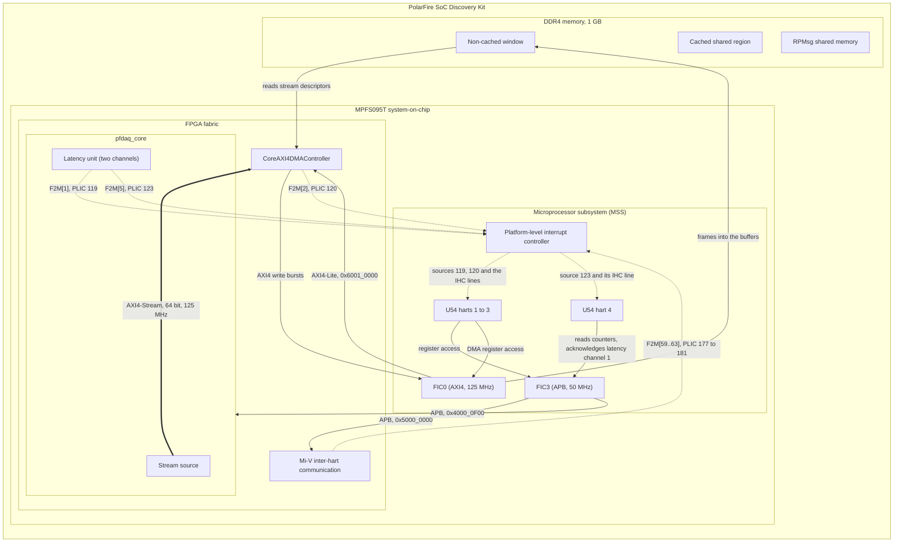
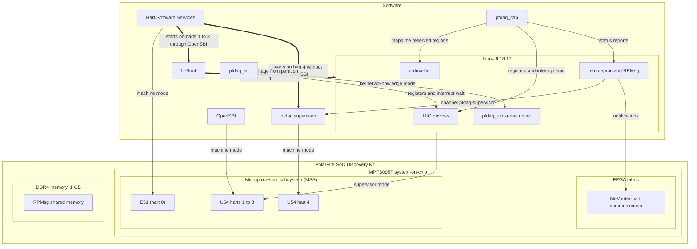

<!-- Generated by tools/gen_docs.py from the page front matter and docs/system/architecture.yaml. Do not edit. -->

# The system, component by component

Baseline: pfdaq-v0.5.1 on the MPFS-DISCO-KIT (MPFS095T-FCSG325), fabric v0.5.1, design version 6.

This page is generated from [`architecture.yaml`](architecture.yaml), the same data that drives the architecture explorer on the website. Each component lists what it connects to and which modules explain it.

## Data and interrupt paths

Solid arrows are bus connections, thick arrows the data stream, dotted arrows interrupts.

## Software and who runs where

## Walks through the system

### One burst, from START to verified

1. pfdaq_cap writes a stream descriptor into the non-cached window - valid, destination ready, byte count, destination address. *(pfdaq_cap → Non-cached window)*
2. It gives the DMA the descriptor's address and enables the interrupt. *(FIC0 (AXI4, 125 MHz) → CoreAXI4DMAController)*
3. It writes frame length and frame count to the stream source and sets START. *(FIC3 (APB, 50 MHz) → pfdaq_core)*
4. The source sends the whole burst as one packet, two words per clock, with TVALID held high. *(Stream source → CoreAXI4DMAController)*
5. The DMA turns the stream into AXI4 write bursts. *(CoreAXI4DMAController → FIC0 (AXI4, 125 MHz))*
6. The frames land in the buffer the descriptor named. *(FIC0 (AXI4, 125 MHz) → Non-cached window)*
7. When the byte count is reached the DMA raises its interrupt. *(CoreAXI4DMAController → Platform-level interrupt controller)*
8. The PLIC delivers it to Linux; the UIO read in pfdaq_cap returns. *(Platform-level interrupt controller → U54 harts 1 to 3)*
9. pfdaq_cap copies the burst out and checks header, sequence, payload and CRC of every frame. *(pfdaq_cap → Non-cached window)*
10. It reports the burst number, the next expected sequence number and the error count. *(pfdaq_cap → remoteproc and RPMsg)*
11. The supervisor restarts its deadline and compares the report with the fabric's own sequence counter. *(remoteproc and RPMsg → pfdaq supervisor)*

### One latency measurement on hart 4

1. The latency unit raises F2M[5] and starts counting 50 MHz cycles. *(Latency unit (two channels) → Platform-level interrupt controller)*
2. The PLIC presents source 123 to hart 4, which is in machine mode with nothing in between. *(Platform-level interrupt controller → U54 hart 4)*
3. The handler writes the ACK register through FIC3. *(U54 hart 4 → FIC3 (APB, 50 MHz))*
4. The write stops the count; the value goes into the minimum, maximum, sum and histogram. *(FIC3 (APB, 50 MHz) → pfdaq_core)*

### Boot, from power-on to both systems running

1. The system controller configures the fabric and releases the MSS; the E51 starts the HSS from eNVM. *(eNVM boot flash → Hart Software Services)*
2. The HSS trains DDR and reads the payload from the SD card. *(microSD card → Hart Software Services)*
3. It starts the supervisor on hart 4 in machine mode. It runs from this moment, long before Linux. *(Hart Software Services → pfdaq supervisor)*
4. It starts U-Boot on harts 1 to 3 in supervisor mode, with OpenSBI underneath. *(Hart Software Services → U-Boot)*
5. U-Boot loads the kernel image and starts Linux with three CPUs. *(U-Boot → Linux 6.18.17)*
6. Linux attaches to the running hart 4 through remoteproc and the supervisor announces its channel. *(remoteproc and RPMsg → pfdaq supervisor)*

## Components

### PolarFire SoC Discovery Kit

The physical board. One MPFS095T system-on-chip, 1 GB DDR4, microSD, Gigabit Ethernet and an on-board FlashPro5 debugger on USB-C.

- **Contains:** [MPFS095T system-on-chip](#soc), [DDR4 memory, 1 GB](#ddr), [microSD card](#sd-card), [FlashPro5 on USB-C](#debug-usb), [Gigabit Ethernet](#ethernet), [LEDs, switches and headers](#user-io)

### MPFS095T system-on-chip

A hardened RISC-V processor subsystem (the MSS) and an FPGA fabric of 93,516 logic elements on one die.

- **Part of:** [PolarFire SoC Discovery Kit](#board)
- **Contains:** [Microprocessor subsystem (MSS)](#mss), [FPGA fabric](#fabric), [eNVM boot flash](#envm)
- **Learn how this works:** [X01 pfdaq in one page](../modules/X01-pfdaq-in-one-page.md)

### Microprocessor subsystem (MSS)

Five RISC-V harts, their interrupt controllers, the DDR controller, hard peripherals and the interfaces into the fabric. Fixed silicon; only its configuration is chosen.

- **Part of:** [MPFS095T system-on-chip](#soc)
- **Contains:** [E51 (hart 0)](#e51), [U54 harts 1 to 3](#u54-linux), [U54 hart 4](#u54-4), [Platform-level interrupt controller](#plic), [FIC0 (AXI4, 125 MHz)](#fic0), [FIC3 (APB, 50 MHz)](#fic3), [MSS GPIO2](#mss-gpio2), [MMUART 0, 1 and 4](#mss-uarts)

### FPGA fabric

Programmable logic. Holds the vendor reference design plus the project's stream source and latency unit. 24,334 logic elements used (26 %).

- **Part of:** [MPFS095T system-on-chip](#soc)
- **Contains:** [pfdaq_core](#pfdaq-core), [CoreAXI4DMAController](#dma), [Mi-V inter-hart communication](#ihc), [Reference design peripherals](#refdesign-peripherals), [Fabric clocks and resets](#fabric-clocks)
- **Learn how this works:** [K01 The fabric on the board was not the reference design](../case-studies/K01-delivered-fabric.md)

### DDR4 memory, 1 GB

Main memory. The same physical memory appears at several addresses with different cache behaviour; the project reserves regions for each purpose.

- **Part of:** [PolarFire SoC Discovery Kit](#board)
- **Contains:** [Non-cached window](#ddr-noncached), [Cached shared region](#ddr-cached-shared), [RPMsg shared memory](#ddr-rpmsg), [Hart 4 image](#ddr-u54-4-image)

### Software

Everything that runs on the five harts, from the boot monitor to the test tools.

- **Contains:** [Hart Software Services](#hss), [OpenSBI](#opensbi), [U-Boot](#u-boot), [Linux 6.18.17](#linux-kernel), [pfdaq_cap](#pfdaq-cap), [pfdaq_lat](#pfdaq-lat), [pfdaq supervisor](#supervisor)

### Development PC

Builds the fabric (Libero SoC 2026.1), the Linux image (Yocto) and the firmware, programs the board over JTAG and drives the tests over SSH.

- → [FlashPro5 on USB-C](#debug-usb): fabric programming, FABRIC and SNVM only
- → [Gigabit Ethernet](#ethernet): SSH

### E51 (hart 0)

64-bit monitor core without an MMU. Runs the Hart Software Services in machine mode for the whole life of the system.

- **Part of:** [Microprocessor subsystem (MSS)](#mss)
- **Mode:** M
- **Runs:** hss
- ← [Hart Software Services](#hss): machine mode
- **Learn how this works:** [K11 remoteproc cannot restart the hart](../case-studies/K11-remoteproc-restart.md); [K12 One boot in sixty, FreeRTOS never started](../case-studies/K12-freertos-no-start.md); [X01 pfdaq in one page](../modules/X01-pfdaq-in-one-page.md)

### U54 harts 1 to 3

Three application cores running Linux as one symmetric system in supervisor mode, with OpenSBI underneath.

- **Part of:** [Microprocessor subsystem (MSS)](#mss)
- **Mode:** S
- **Runs:** linux
- → [FIC3 (APB, 50 MHz)](#fic3): register access
- → [FIC0 (AXI4, 125 MHz)](#fic0): DMA register access
- ← [Platform-level interrupt controller](#plic): sources 119, 120 and the IHC lines
- ← [Linux 6.18.17](#linux-kernel): supervisor mode
- ← [OpenSBI](#opensbi): machine mode
- **Learn how this works:** [F03 Interrupts from fabric to hart: F2M lines, the PLIC and contexts](../modules/F03-fabric-interrupts.md); [P02 Interrupt latency: bare metal, RTOS task, kernel, user space](../modules/P02-interrupt-latency.md); [X01 pfdaq in one page](../modules/X01-pfdaq-in-one-page.md)

### U54 hart 4

The fourth application core, kept out of Linux. Runs the supervisor in machine mode, on FreeRTOS or on bare metal.

- **Part of:** [Microprocessor subsystem (MSS)](#mss)
- **Mode:** M
- **Runs:** supervisor
- **Image:** 0x91C0_0000, 1 MiB
- → [FIC3 (APB, 50 MHz)](#fic3): reads counters, acknowledges latency channel 1
- ← [Platform-level interrupt controller](#plic): source 123 and its IHC line
- ← [pfdaq supervisor](#supervisor): machine mode
- **Learn how this works:** [F03 Interrupts from fabric to hart: F2M lines, the PLIC and contexts](../modules/F03-fabric-interrupts.md); [P02 Interrupt latency: bare metal, RTOS task, kernel, user space](../modules/P02-interrupt-latency.md); [K06 The interrupt that stayed masked after one event](../case-studies/K06-interrupt-stayed-masked.md); [K11 remoteproc cannot restart the hart](../case-studies/K11-remoteproc-restart.md); [K12 One boot in sixty, FreeRTOS never started](../case-studies/K12-freertos-no-start.md); [X01 pfdaq in one page](../modules/X01-pfdaq-in-one-page.md)

### Platform-level interrupt controller

Routes peripheral and fabric interrupts to harts. Each hart context enables the sources it wants; fabric line F2M[n] is source 118 + n.

- **Part of:** [Microprocessor subsystem (MSS)](#mss)
- **F2m base:** 118
- → [U54 harts 1 to 3](#u54-linux): sources 119, 120 and the IHC lines
- → [U54 hart 4](#u54-4): source 123 and its IHC line
- ← [CoreAXI4DMAController](#dma): F2M[2], PLIC 120. transfer complete
- ← [Latency unit (two channels)](#pfdaq-latency): F2M[1], PLIC 119. latency channel 0
- ← [Latency unit (two channels)](#pfdaq-latency): F2M[5], PLIC 123. latency channel 1
- ← [Mi-V inter-hart communication](#ihc): F2M[59..63], PLIC 177 to 181. one line per hart
- **Learn how this works:** [F03 Interrupts from fabric to hart: F2M lines, the PLIC and contexts](../modules/F03-fabric-interrupts.md); [H07 Measuring software from hardware: the latency unit](../modules/H07-latency-unit.md); [P02 Interrupt latency: bare metal, RTOS task, kernel, user space](../modules/P02-interrupt-latency.md); [K05 Two interrupts for every event](../case-studies/K05-two-interrupts-per-event.md); [K06 The interrupt that stayed masked after one event](../case-studies/K06-interrupt-stayed-masked.md)

### FIC0 (AXI4, 125 MHz)

Fabric interface controller 0. An AXI4 bridge in both directions - the MSS reaches fabric registers through it, and the fabric DMA reaches DDR through it.

- **Part of:** [Microprocessor subsystem (MSS)](#mss)
- **Protocol:** AXI4
- **Clock:** 125 MHz
- → [CoreAXI4DMAController](#dma): AXI4-Lite, 0x6001_0000
- → [Non-cached window](#ddr-noncached): frames into the buffers
- ← [U54 harts 1 to 3](#u54-linux): DMA register access
- ← [CoreAXI4DMAController](#dma): AXI4 write bursts
- **Learn how this works:** [C01 Direct memory access](../concepts/C01-dma.md)

### FIC3 (APB, 50 MHz)

Fabric interface controller 3. An APB master from the MSS into the fabric, used for low-speed register access.

- **Part of:** [Microprocessor subsystem (MSS)](#mss)
- **Protocol:** APB
- **Clock:** 50 MHz
- → [pfdaq_core](#pfdaq-core): APB, 0x4000_0F00. 32-bit accesses only
- → [Mi-V inter-hart communication](#ihc): APB, 0x5000_0000
- → [Reference design peripherals](#refdesign-peripherals): APB, 0x4000_0000 to 0x4000_04FF
- ← [U54 harts 1 to 3](#u54-linux): register access
- ← [U54 hart 4](#u54-4): reads counters, acknowledges latency channel 1
- **Learn how this works:** [H01 An APB register block that software can trust](../modules/H01-apb-register-block.md); [K02 Python wrote my registers one byte at a time](../case-studies/K02-bytewise-register-writes.md)

### MSS GPIO2

A hard GPIO block whose pins are routed through the fabric to the LEDs, DIP switches 5 to 8 and the Raspberry Pi header.

- **Part of:** [Microprocessor subsystem (MSS)](#mss)
- **Address:** 0x2012_2000
- → [LEDs, switches and headers](#user-io): LEDs, DIP 5 to 8, header pins (through the fabric)

### MMUART 0, 1 and 4

Three hard UARTs on the USB-C debug connector - MMUART1 for HSS, MMUART4 for Linux, MMUART0 (routed through the fabric) for hart 4.

- **Part of:** [Microprocessor subsystem (MSS)](#mss)
- → [FlashPro5 on USB-C](#debug-usb): three consoles
- **Learn how this works:** [K01 The fabric on the board was not the reference design](../case-studies/K01-delivered-fabric.md)

### pfdaq_core

The project's logic. Decodes one 256-byte APB slot into the stream source and two latency channels.

- **Part of:** [FPGA fabric](#fabric)
- **Contains:** [Stream source](#pfdaq-stream-src), [Latency unit (two channels)](#pfdaq-latency)
- **Address:** 0x4000_0F00
- **Bus:** fic3
- ← [FIC3 (APB, 50 MHz)](#fic3): APB, 0x4000_0F00. 32-bit accesses only
- ← [Fabric clocks and resets](#fabric-clocks): 50 MHz and 125 MHz
- **Source:** [`hw/rtl/pfdaq_core.v`](../../hw/rtl/pfdaq_core.v) (`pfdaq_core`)
- **Source:** [`hw/libero/overlay/PFDAQ.tcl`](../../hw/libero/overlay/PFDAQ.tcl)
- **Learn how this works:** [K08 Timing met, board dead: the missing pin constraints](../case-studies/K08-timing-met-board-dead.md); [X01 pfdaq in one page](../modules/X01-pfdaq-in-one-page.md)

### Stream source

Generates framed test data - header, sequence number, timestamp, payload, CRC-32 - two 32-bit words per clock, as a 64-bit AXI4-Stream. Burst and real-time run modes, fault injection, abort.

- **Part of:** [pfdaq_core](#pfdaq-core)
- **Contains:** [FIR payload source](#pfdaq-fir-src)
- **Address:** 0x4000_0F00 to 0x4000_0F7F
- **Clocks:** 50 MHz registers, 125 MHz generator
- → [CoreAXI4DMAController](#dma): AXI4-Stream, 64 bit, 125 MHz. TVALID continuous within a packet; TDEST 0 to 3 selects the descriptor
- ← [FIR payload source](#pfdaq-fir-src): filtered samples through a FIFO
- **Source:** [`hw/rtl/pfdaq_stream_src.v`](../../hw/rtl/pfdaq_stream_src.v) (`pfdaq_stream_src`, `pfdaq_word_step`)
- **Learn how this works:** [H01 An APB register block that software can trust](../modules/H01-apb-register-block.md); [H02 AXI4-Stream: the handshake, backpressure and TLAST](../modules/H02-axi4-stream.md); [H03 Crossing clock domains: toggles, snapshots and constraints](../modules/H03-clock-domain-crossing.md); [H04 CRC-32 at 64 bits per clock](../modules/H04-crc32-two-words-per-clock.md); [H05 A FIR filter on math blocks, decoupled by a FIFO](../modules/H05-fir-on-math-blocks.md); [H06 Real-time sources: slots, credits and honest drops](../modules/H06-real-time-source.md); [H11 Verification with an independent model](../modules/H11-independent-model.md); [I04 DMA stream descriptors: the rules this core really follows](../modules/I04-dma-stream-descriptors.md); [K02 Python wrote my registers one byte at a time](../case-studies/K02-bytewise-register-writes.md); [K03 A DMA core that needs TVALID without gaps](../case-studies/K03-tvalid-gaps.md); [K04 The descriptor that was re-armed too late](../case-studies/K04-descriptor-rearmed-too-late.md); [K07 Three builds lost to brackets in a constraint file](../case-studies/K07-brackets-in-constraints.md); [K09 An early TLAST does not end a transfer](../case-studies/K09-early-tlast.md); [K10 Odd frame lengths lose 2 KB chunks](../case-studies/K10-odd-frame-lengths.md)

### FIR payload source

A triangle-wave generator and an 8-tap FIR filter on the fabric's math blocks, decoupled from the frame generator by a 16-word FIFO.

- **Part of:** [Stream source](#pfdaq-stream-src)
- → [Stream source](#pfdaq-stream-src): filtered samples through a FIFO
- **Source:** [`hw/rtl/pfdaq_stream_src.v`](../../hw/rtl/pfdaq_stream_src.v) (`pfdaq_fir_src`)
- **Learn how this works:** [H05 A FIR filter on math blocks, decoupled by a FIFO](../modules/H05-fir-on-math-blocks.md)

### Latency unit (two channels)

Raises an interrupt on a schedule and counts 50 MHz cycles until software acknowledges it. Keeps minimum, maximum, sum and a 64-bin histogram per channel.

- **Part of:** [pfdaq_core](#pfdaq-core)
- **Address:** 0x4000_0F80 (channel 0), 0x4000_0FC0 (channel 1)
- **Resolution:** 20 ns
- → [Platform-level interrupt controller](#plic): F2M[1], PLIC 119. latency channel 0
- → [Platform-level interrupt controller](#plic): F2M[5], PLIC 123. latency channel 1
- **Source:** [`hw/rtl/pfdaq_latency.v`](../../hw/rtl/pfdaq_latency.v) (`pfdaq_latency_ch`)
- **Learn how this works:** [F03 Interrupts from fabric to hart: F2M lines, the PLIC and contexts](../modules/F03-fabric-interrupts.md); [H07 Measuring software from hardware: the latency unit](../modules/H07-latency-unit.md); [H08 Histograms in block RAM: read-modify-write without hazards](../modules/H08-histogram-in-ram.md); [H11 Verification with an independent model](../modules/H11-independent-model.md); [P02 Interrupt latency: bare metal, RTOS task, kernel, user space](../modules/P02-interrupt-latency.md); [K05 Two interrupts for every event](../case-studies/K05-two-interrupts-per-event.md); [K06 The interrupt that stayed masked after one event](../case-studies/K06-interrupt-stayed-masked.md)

### CoreAXI4DMAController

Vendor DMA core, version 2.2.107. Receives the AXI4-Stream and writes it into DDR through FIC0, following descriptors that Linux prepares in memory.

- **Part of:** [FPGA fabric](#fabric)
- **Address:** 0x6001_0000
- **Version:** 2.2.107
- → [FIC0 (AXI4, 125 MHz)](#fic0): AXI4 write bursts
- → [Platform-level interrupt controller](#plic): F2M[2], PLIC 120. transfer complete
- ← [FIC0 (AXI4, 125 MHz)](#fic0): AXI4-Lite, 0x6001_0000
- ← [Stream source](#pfdaq-stream-src): AXI4-Stream, 64 bit, 125 MHz. TVALID continuous within a packet; TDEST 0 to 3 selects the descriptor
- ← [Non-cached window](#ddr-noncached): reads stream descriptors
- **Learn how this works:** [F03 Interrupts from fabric to hart: F2M lines, the PLIC and contexts](../modules/F03-fabric-interrupts.md); [H02 AXI4-Stream: the handshake, backpressure and TLAST](../modules/H02-axi4-stream.md); [H06 Real-time sources: slots, credits and honest drops](../modules/H06-real-time-source.md); [I04 DMA stream descriptors: the rules this core really follows](../modules/I04-dma-stream-descriptors.md); [K03 A DMA core that needs TVALID without gaps](../case-studies/K03-tvalid-gaps.md); [K04 The descriptor that was re-armed too late](../case-studies/K04-descriptor-rearmed-too-late.md); [K09 An early TLAST does not end a transfer](../case-studies/K09-early-tlast.md); [K10 Odd frame lengths lose 2 KB chunks](../case-studies/K10-odd-frame-lengths.md); [X01 pfdaq in one page](../modules/X01-pfdaq-in-one-page.md); [C01 Direct memory access](../concepts/C01-dma.md)

### Mi-V inter-hart communication

Vendor mailbox core. Carries the notifications that RPMsg needs between Linux and hart 4, with one interrupt line per hart.

- **Part of:** [FPGA fabric](#fabric)
- **Address:** 0x5000_0000
- **Version:** 2.0.100
- → [Platform-level interrupt controller](#plic): F2M[59..63], PLIC 177 to 181. one line per hart
- ← [FIC3 (APB, 50 MHz)](#fic3): APB, 0x5000_0000
- ← [remoteproc and RPMsg](#remoteproc-rpmsg): notifications
- **Learn how this works:** [F03 Interrupts from fabric to hart: F2M lines, the PLIC and contexts](../modules/F03-fabric-interrupts.md); [K08 Timing met, board dead: the missing pin constraints](../case-studies/K08-timing-met-board-dead.md); [X01 pfdaq in one page](../modules/X01-pfdaq-in-one-page.md)

### Reference design peripherals

Fabric peripherals inherited from the vendor design - CoreGPIO driving the LEDs, CoreI2C, CoreUART, CorePWM and an SPI core for the 7-segment adapter.

- **Part of:** [FPGA fabric](#fabric)
- **Coregpio:** 0x4000_0100
- **Corei2c:** 0x4000_0200
- **Coreuart:** 0x4000_0300
- **Corepwm:** 0x4000_0000
- **Spi:** 0x4000_0400
- → [LEDs, switches and headers](#user-io): LEDs (OR'd with MSS GPIO2)
- ← [FIC3 (APB, 50 MHz)](#fic3): APB, 0x4000_0000 to 0x4000_04FF

### Fabric clocks and resets

One clock conditioning circuit produces the 50 MHz and 125 MHz clocks that the fabric logic and the two FICs share.

- **Part of:** [FPGA fabric](#fabric)
- → [pfdaq_core](#pfdaq-core): 50 MHz and 125 MHz
- **Learn how this works:** [H03 Crossing clock domains: toggles, snapshots and constraints](../modules/H03-clock-domain-crossing.md); [K07 Three builds lost to brackets in a constraint file](../case-studies/K07-brackets-in-constraints.md); [K08 Timing met, board dead: the missing pin constraints](../case-studies/K08-timing-met-board-dead.md)

### Non-cached window

32 MiB that Linux maps without caching. Holds the DMA descriptors and the buffers the DMA fills, so software always reads what the hardware wrote.

- **Part of:** [DDR4 memory, 1 GB](#ddr)
- **Address:** 0xC800_0000
- **Size:** 32 MiB
- **Linux:** /dev/udmabuf-ddr-nc0
- → [CoreAXI4DMAController](#dma): reads stream descriptors
- ← [FIC0 (AXI4, 125 MHz)](#fic0): frames into the buffers
- ← [pfdaq_cap](#pfdaq-cap): writes descriptors, reads frames
- **Learn how this works:** [I04 DMA stream descriptors: the rules this core really follows](../modules/I04-dma-stream-descriptors.md); [K04 The descriptor that was re-armed too late](../case-studies/K04-descriptor-rearmed-too-late.md); [K10 Odd frame lengths lose 2 KB chunks](../case-studies/K10-odd-frame-lengths.md); [X01 pfdaq in one page](../modules/X01-pfdaq-in-one-page.md); [C01 Direct memory access](../concepts/C01-dma.md)

### Cached shared region

32 MiB of ordinary cached memory that both Linux and hart 4 can reach. Used to show that the two contexts see each other's writes.

- **Part of:** [DDR4 memory, 1 GB](#ddr)
- **Address:** 0x8800_0000
- **Size:** 32 MiB
- **Linux:** /dev/udmabuf-ddr-c0
- ← [pfdaq_cap](#pfdaq-cap): shared-memory test
- ← [pfdaq supervisor](#supervisor): shared-memory test

### RPMsg shared memory

Two virtqueue rings, a buffer pool and the resource table that Linux and hart 4 use to exchange messages.

- **Part of:** [DDR4 memory, 1 GB](#ddr)
- **Address:** 0x91D0_0000 to 0x91D5_0FFF
- ← [remoteproc and RPMsg](#remoteproc-rpmsg): rings and buffers

### Hart 4 image

1 MiB reserved for the supervisor's code and data, hidden from Linux.

- **Part of:** [DDR4 memory, 1 GB](#ddr)
- **Address:** 0x91C0_0000
- **Size:** 1 MiB
- ← [pfdaq supervisor](#supervisor): code and data

### microSD card

The only boot medium besides the chip's own flash. Partition 1 holds the kernel image, partition 2 the HSS payload, partition 3 the root filesystem.

- **Part of:** [PolarFire SoC Discovery Kit](#board)
- → [Hart Software Services](#hss): payload from partition 2

### eNVM boot flash

Non-volatile memory inside the chip that holds the Hart Software Services. This project never reprograms it.

- **Part of:** [MPFS095T system-on-chip](#soc)
- → [Hart Software Services](#hss): stored in
- **Learn how this works:** [K01 The fabric on the board was not the reference design](../case-studies/K01-delivered-fabric.md)

### FlashPro5 on USB-C

On-board debugger. One JTAG interface for programming the fabric and three serial consoles.

- **Part of:** [PolarFire SoC Discovery Kit](#board)
- ← [MMUART 0, 1 and 4](#mss-uarts): three consoles
- ← [Development PC](#host): fabric programming, FABRIC and SNVM only
- **Learn how this works:** [K01 The fabric on the board was not the reference design](../case-studies/K01-delivered-fabric.md)

### Gigabit Ethernet

Used for SSH - deployment, test automation and file transfer.

- **Part of:** [PolarFire SoC Discovery Kit](#board)
- ← [Development PC](#host): SSH

### LEDs, switches and headers

Seven user LEDs, eight DIP switches, two push buttons, a Raspberry Pi compatible header and a mikroBUS socket.

- **Part of:** [PolarFire SoC Discovery Kit](#board)
- ← [MSS GPIO2](#mss-gpio2): LEDs, DIP 5 to 8, header pins (through the fabric)
- ← [Reference design peripherals](#refdesign-peripherals): LEDs (OR'd with MSS GPIO2)

### Hart Software Services

Microchip's boot monitor, v2026.04.1. Trains DDR, loads the payload from the SD card, starts every hart in its privilege mode and stays resident on the E51.

- **Part of:** [Software](#software)
- → [E51 (hart 0)](#e51): machine mode
- → [U-Boot](#u-boot): starts on harts 1 to 3 through OpenSBI
- → [pfdaq supervisor](#supervisor): starts on hart 4 without OpenSBI
- ← [eNVM boot flash](#envm): stored in
- ← [microSD card](#sd-card): payload from partition 2
- **Learn how this works:** [K11 remoteproc cannot restart the hart](../case-studies/K11-remoteproc-restart.md); [K12 One boot in sixty, FreeRTOS never started](../case-studies/K12-freertos-no-start.md); [X01 pfdaq in one page](../modules/X01-pfdaq-in-one-page.md)

### OpenSBI

The machine-mode layer under Linux on harts 1 to 3. Hart 4 is started without it.

- **Part of:** [Software](#software)
- → [U54 harts 1 to 3](#u54-linux): machine mode

### U-Boot

v2025.07-mchp. Loads the kernel image from the SD card and starts Linux.

- **Part of:** [Software](#software)
- → [Linux 6.18.17](#linux-kernel): kernel image from partition 1
- ← [Hart Software Services](#hss): starts on harts 1 to 3 through OpenSBI

### Linux 6.18.17

Built with Yocto from Microchip's BSP plus the project layer. Three CPUs; the fourth is disabled in the device tree.

- **Part of:** [Software](#software)
- **Contains:** [UIO devices](#uio), [pfdaq_uio kernel driver](#pfdaq-uio), [u-dma-buf](#udmabuf), [remoteproc and RPMsg](#remoteproc-rpmsg)
- → [U54 harts 1 to 3](#u54-linux): supervisor mode
- ← [U-Boot](#u-boot): kernel image from partition 1
- **Source:** [`yocto/meta-pfdaq/recipes-kernel/linux/files/mpfs-disco-kit-amp.dts`](../../yocto/meta-pfdaq/recipes-kernel/linux/files/mpfs-disco-kit-amp.dts)
- **Learn how this works:** [X01 pfdaq in one page](../modules/X01-pfdaq-in-one-page.md)

### UIO devices

How user space reaches fabric registers and waits for fabric interrupts - a generic UIO device for the stream source and latency unit, and the vendor's UIO driver for the DMA controller.

- **Part of:** [Linux 6.18.17](#linux-kernel)
- ← [pfdaq_cap](#pfdaq-cap): registers and interrupt wait
- ← [pfdaq_lat](#pfdaq-lat): registers and interrupt wait
- **Learn how this works:** [I04 DMA stream descriptors: the rules this core really follows](../modules/I04-dma-stream-descriptors.md); [K05 Two interrupts for every event](../case-studies/K05-two-interrupts-per-event.md)

### pfdaq_uio kernel driver

A small optional driver that acknowledges the latency interrupt inside the kernel handler, to measure kernel response separately from user-space response.

- **Part of:** [Linux 6.18.17](#linux-kernel)
- ← [pfdaq_lat](#pfdaq-lat): kernel acknowledge mode
- **Source:** [`yocto/meta-pfdaq/recipes-kernel/pfdaq-uio/files/pfdaq_uio.c`](../../yocto/meta-pfdaq/recipes-kernel/pfdaq-uio/files/pfdaq_uio.c) (`pfdaq_uio_handler`)
- **Learn how this works:** [P02 Interrupt latency: bare metal, RTOS task, kernel, user space](../modules/P02-interrupt-latency.md); [K05 Two interrupts for every event](../case-studies/K05-two-interrupts-per-event.md)

### u-dma-buf

Exposes the reserved DDR regions to user space as mappable devices.

- **Part of:** [Linux 6.18.17](#linux-kernel)
- ← [pfdaq_cap](#pfdaq-cap): maps the reserved regions
- **Learn how this works:** [I04 DMA stream descriptors: the rules this core really follows](../modules/I04-dma-stream-descriptors.md)

### remoteproc and RPMsg

Linux attaches to the already-running hart 4 and exchanges messages with it over a virtio channel named pfdaq-supervisor.

- **Part of:** [Linux 6.18.17](#linux-kernel)
- → [pfdaq supervisor](#supervisor): channel pfdaq-supervisor
- → [RPMsg shared memory](#ddr-rpmsg): rings and buffers
- → [Mi-V inter-hart communication](#ihc): notifications
- ← [pfdaq_cap](#pfdaq-cap): status reports
- **Learn how this works:** [K11 remoteproc cannot restart the hart](../case-studies/K11-remoteproc-restart.md)

### pfdaq_cap

The Linux capture tool. Arms the DMA, starts the fabric, verifies every frame against a software model and reports to the supervisor.

- **Part of:** [Software](#software)
- → [Non-cached window](#ddr-noncached): writes descriptors, reads frames
- → [u-dma-buf](#udmabuf): maps the reserved regions
- → [UIO devices](#uio): registers and interrupt wait
- → [remoteproc and RPMsg](#remoteproc-rpmsg): status reports
- → [Cached shared region](#ddr-cached-shared): shared-memory test
- **Source:** [`yocto/meta-pfdaq/recipes-pfdaq/pfdaq-tools/files/pfdaq_cap.c`](../../yocto/meta-pfdaq/recipes-pfdaq/pfdaq-tools/files/pfdaq_cap.c) (`arm`, `wait_done`, `verify`)
- **Learn how this works:** [H04 CRC-32 at 64 bits per clock](../modules/H04-crc32-two-words-per-clock.md); [H05 A FIR filter on math blocks, decoupled by a FIFO](../modules/H05-fir-on-math-blocks.md); [H06 Real-time sources: slots, credits and honest drops](../modules/H06-real-time-source.md); [H11 Verification with an independent model](../modules/H11-independent-model.md); [I04 DMA stream descriptors: the rules this core really follows](../modules/I04-dma-stream-descriptors.md); [K04 The descriptor that was re-armed too late](../case-studies/K04-descriptor-rearmed-too-late.md); [K09 An early TLAST does not end a transfer](../case-studies/K09-early-tlast.md); [K10 Odd frame lengths lose 2 KB chunks](../case-studies/K10-odd-frame-lengths.md); [X01 pfdaq in one page](../modules/X01-pfdaq-in-one-page.md); [C01 Direct memory access](../concepts/C01-dma.md)

### pfdaq_lat

The Linux tool for the latency unit. Configures a channel, acknowledges interrupts where Linux is the responder, and reads the statistics.

- **Part of:** [Software](#software)
- → [UIO devices](#uio): registers and interrupt wait
- → [pfdaq_uio kernel driver](#pfdaq-uio): kernel acknowledge mode
- **Source:** [`yocto/meta-pfdaq/recipes-pfdaq/pfdaq-tools/files/pfdaq_lat.c`](../../yocto/meta-pfdaq/recipes-pfdaq/pfdaq-tools/files/pfdaq_lat.c)
- **Learn how this works:** [F03 Interrupts from fabric to hart: F2M lines, the PLIC and contexts](../modules/F03-fabric-interrupts.md); [P02 Interrupt latency: bare metal, RTOS task, kernel, user space](../modules/P02-interrupt-latency.md); [K05 Two interrupts for every event](../case-studies/K05-two-interrupts-per-event.md); [X01 pfdaq in one page](../modules/X01-pfdaq-in-one-page.md)

### pfdaq supervisor

Runs on hart 4. Enforces a deadline on Linux's reports, cross-checks them against the fabric's own counters, and answers the latency interrupt. One source file, built for FreeRTOS or for bare metal.

- **Part of:** [Software](#software)
- → [Cached shared region](#ddr-cached-shared): shared-memory test
- → [U54 hart 4](#u54-4): machine mode
- → [Hart 4 image](#ddr-u54-4-image): code and data
- ← [remoteproc and RPMsg](#remoteproc-rpmsg): channel pfdaq-supervisor
- ← [Hart Software Services](#hss): starts on hart 4 without OpenSBI
- **Source:** [`firmware/u54_4-supervisor/pfdaq_supervisor.c`](../../firmware/u54_4-supervisor/pfdaq_supervisor.c) (`PLIC_f2m_5_IRQHandler`)
- **Learn how this works:** [F03 Interrupts from fabric to hart: F2M lines, the PLIC and contexts](../modules/F03-fabric-interrupts.md); [P02 Interrupt latency: bare metal, RTOS task, kernel, user space](../modules/P02-interrupt-latency.md); [K06 The interrupt that stayed masked after one event](../case-studies/K06-interrupt-stayed-masked.md); [K12 One boot in sixty, FreeRTOS never started](../case-studies/K12-freertos-no-start.md); [X01 pfdaq in one page](../modules/X01-pfdaq-in-one-page.md)

